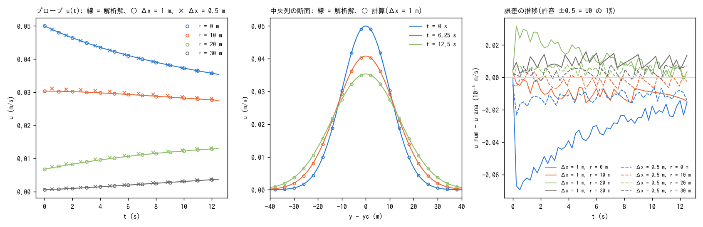

# test/diffusion — 運動方程式の拡散項のガウス形ジェット・ベンチマーク(解析解)

浅水流計算の拡散項(`&list_enc` の `f_diffusion_term`、
[ユーザーガイドの拡散項の解説](../../docs/users_guide/diffusion.md))を、
定数渦動粘性 ν の拡散方程式 ∂u/∂t = ν ∂²u/∂y² の解析解で検定します。
平坦・無摩擦・閉じた水路に、x 方向に一様で y 方向にガウス形の流速分布
(ジェット)を置くと、運動方程式に残るのは拡散項だけになり、ジェットが
y 方向に広がる様子を解析解と比べられます(地形変化の
[test/creep](../creep/) のガウス丘と同じ型の解析解)。reference との比較では
なく解析解との比較で合否を判定する、環境非依存のテストです。

## 構成

| 項目 | 値 |
|---|---|
| 領域・格子 | 200 m × 101 m、200 × 101 セル(Δx = Δy = 1 m)、四周壁、平坦、無摩擦(rn0 = 0) |
| 初期条件 | 静水深 h0 = 1 m。流速 u(y) = U0 exp(−(y − yc)²/2σ²)、v = 0(user_initial `jet_gaussian`)。U0 = 0.05 m/s、σ = 10 m、yc = 50.5 m(水路の中央) |
| 拡散項 | 定数粘性 `f_diffusion_term = 1`、ν = 4 m²/s。陽解法の安定上界 ν_max = Δx²/(2.83 dt) = 7.1 m²/s |
| 時間 | dt = 0.05 s、12.5 s(σ² + 2νt が 2 倍 = 中心の流速が 1/√2 になる時間) |
| 計測 | プローブ 4 点: 中央列 ix = 100 の r = 0, 10, 20, 30 m(iy = 51, 61, 71, 81)。0.25 s 毎に u を記録。流速分布 u は 6.25 s 毎にファイル出力 |
| 適応 RK | `f_adaptive_runge = 0`(下の「既知の問題」) |

解析解(y 方向 1 次元の拡散。r = |y − yc|):

  u(r, t) = U0 σ / √(σ² + 2νt) · exp(−r² / (2(σ² + 2νt)))

流れは x 方向に一様なので、x の壁から出る波(√(gh) ≈ 3.1 m/s、12.5 s で
39 m)が中央列に届く前は、運動方程式の圧力項・移流項は中央列でゼロです。
壁のセルの水深は流入・流出で U0 h t/Δx = 0.63 m 変わりますが乾きません。

| ファイル | 内容 |
|---|---|
| `param.txt` | Δx = 1 m、dt = 0.05 s |
| `param_fine.txt` | Δx = 0.5 m、dt = 0.02 s(格子収束の確認。ν_max = 4.4 m²/s) |
| `Check_analytic.py` | プローブ CSV の u(t) を解析解と比較し、最大絶対誤差 < 5e-4 m/s(U0 の 1%)で PASS |
| `Fig.py` | 下の図 `figs/profile.png` を描く |

U0・σ・ν・yc は `param*.txt`、`src/user_initial.f90` の `jet_gaussian`、
`Check_analytic.py`、`Fig.py` で対になっています。変えるときは同時に
変えてください。

## 実行

```bash
make
./Run.sh          # 2 解像度を実行し、Check_analytic.py で解析解と比較(両方 PASS で PASS)
./Run_MPI.sh 4    # MPI 4 ランク。解析解比較に加え、逐次結果(result_serial)とプローブ CSV のバイト比較
python3 Fig.py    # figs/profile.png
```

## 図



左: プローブの流速 u(t)(○ Δx = 1 m、× Δx = 0.5 m)と解析解(線)。
中: 解析解の断面(t = 0, 6.25, 12.5 s)と計算値(○)。右: 計算 − 解析解の
推移。

## 所見(2026-10-12、gfortran 13.3、-Ofast)

| 格子 | 最大絶対誤差(U0 比) | 発生位置 |
|---|---:|---|
| Δx = 1 m、dt = 0.05 s | 6.9e-5 m/s(0.14%) | ジェット中心、t ≈ 0 |
| Δx = 0.5 m、dt = 0.02 s | 2.3e-5 m/s(0.05%) | 同上 |

- 4 プローブとも解析解の曲線に乗り、誤差は格子を半分にすると約 1/3 に
  減ります。
- 最大誤差は t ≈ 0 のジェット中心に出て、時間とともに減ります。これは
  拡散項の誤差ではなく、ENC がセル流速 u をエッジ流速から再構成するときの
  平滑化(u_c = u + (p_d/4) Δ² u'' + …。p_d = `p_diagratio`)で、
  初期分布の中心では (p_d/4) Δ² U0/σ² = 7.3e-5 m/s(Δx = 1 m)、
  1.8e-5 m/s(0.5 m)と、観測値と一致します。プローブと分布ファイルは
  この再構成した u を書きます。
- 拡散項そのもの(エッジフラックス発散形の 9 点ラプラシアン、
  developer.md §20)の誤差は、流速分布がガウス形で σ/Δx = 10〜20 の
  範囲では上の値より小さく、解析解の減衰率と一致します。
- MPI 2・4 ランクのプローブ CSV は逐次とバイト一致(ULP = 0)。
- 質量 S は 12.5 s を通して 1.0000 のまま(拡散項は運動方程式にしか
  作用しない)。

## 既知の問題: 初期流速が非零の計算での適応 RK の初回ステップ

このケースは `f_adaptive_runge = 0` で定義しています。適応 RK を有効に
すると(既定)、**初回ステップだけ**ジェット中心の流速が dt = 0.05 s で
約 1%、dt = 0.1 s で 3.5% 落ち、以後は解析解と同じ率で減衰します
(落ち込みは dt² に比例。閾値 `p_adprunge_thresh` を 1000 にしても同じ)。

原因は初期化の流儀です。初期流速 u, v からエッジ流速 uv は作られますが、
前ステップの単位幅流量 mn は 0 のまま時間ループに入るため、初回ステップは
「mn(前) = 0 かつ mn(新) ≠ 0 なら再計算」の規則で流速をもつエッジの
ほぼ全部(74%)が RK で再計算されます。RK 段内の仮の水深更新は、自エッジ
だけ段の新しい流量、他のエッジは mn(前) = 0 を使うので、両側のセルに
偽の水位差 ≈ 2 U0 h dt/(a_l Δx) ができ、その圧力勾配が流速を減速します。
2 ステップ目以降は mn(前) が整合するので起きません。

静止状態から始まる計算(wave・dambreak・chichibu など)には無関係です。
初期流速を与える計算(孤立波・undular bore・一様流など)では、初回
ステップに dt² に比例する 1 回限りの減速が入っています。対策の候補は
初期化で mn(前)を uv とエッジ水深から整合させること(mn1 = uv·h_e を
init で作る)ですが、初期流速のある既存ケースの reference が変わるため、
人間の判断で行う作業として docs/handoff.md に残しています。
