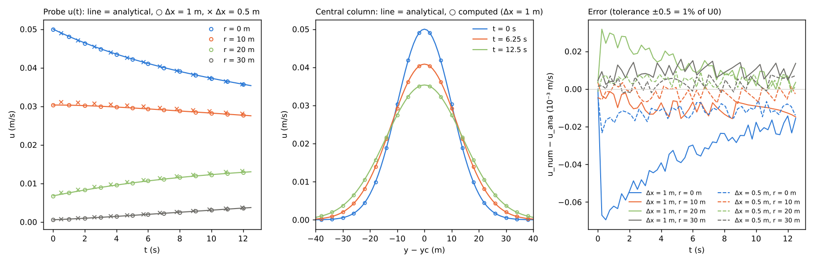

# test/diffusion — Gaussian-jet benchmark of the diffusion term of the momentum equation (analytical solution)

> English mirror of test/diffusion/README.md. The Japanese file is the master copy.

[日本語](../README.md)

The diffusion term of the shallow-water computation (`f_diffusion_term` in
`&list_enc`; [the explanation of the diffusion term in the users' guide](../../../docs/en/users_guide/diffusion.md))
is verified against the analytical solution of the diffusion equation
∂u/∂t = ν ∂²u/∂y² with constant eddy viscosity ν. When a velocity
distribution uniform in x and Gaussian in y (a jet) is placed in a flat,
frictionless, closed channel, only the diffusion term remains in the
momentum equation, and the spreading of the jet in y can be compared with
the analytical solution (the same type of analytical solution as the
Gaussian hill of the terrain change in [test/creep](../../creep/en/README.md)).
This is an environment-independent test in which pass/fail is decided by
comparison with the analytical solution, not with a reference.

## Configuration

| Item | Value |
|---|---|
| Domain and grid | 200 m × 101 m, 200 × 101 cells (Δx = Δy = 1 m), walls on all four sides, flat, frictionless (rn0 = 0) |
| Initial condition | Still-water depth h0 = 1 m. Velocity u(y) = U0 exp(−(y − yc)²/2σ²), v = 0 (user_initial `jet_gaussian`). U0 = 0.05 m/s, σ = 10 m, yc = 50.5 m (centre of the channel) |
| Diffusion term | Constant viscosity `f_diffusion_term = 1`, ν = 4 m²/s. Stability upper bound of the explicit scheme ν_max = Δx²/(2.83 dt) = 7.1 m²/s |
| Time | dt = 0.05 s, 12.5 s (the time at which σ² + 2νt doubles = the centre velocity falls to 1/√2) |
| Measurement | 4 probes: r = 0, 10, 20, 30 m on the centre column ix = 100 (iy = 51, 61, 71, 81). u recorded every 0.25 s. The velocity distribution u is written to file every 6.25 s |
| Adaptive RK | Default (enabled). Also serves as the regression of the consistency of the initial flux mn ("First step" below) |

Analytical solution (one-dimensional diffusion in y; r = |y − yc|):

  u(r, t) = U0 σ / √(σ² + 2νt) · exp(−r² / (2(σ² + 2νt)))

Since the flow is uniform in x, the pressure and advection terms of the
momentum equation are zero on the centre column until the waves emitted from
the x walls (√(gh) ≈ 3.1 m/s, 39 m in 12.5 s) reach it. The depth of the
wall cells changes by U0 h t/Δx = 0.63 m through inflow and outflow, but
they do not dry.

| File | Contents |
|---|---|
| `param.txt` | Δx = 1 m, dt = 0.05 s |
| `param_fine.txt` | Δx = 0.5 m, dt = 0.02 s (grid-convergence check. ν_max = 4.4 m²/s) |
| `Check_analytic.py` | Compares u(t) of the probe CSV with the analytical solution; PASS when the maximum absolute error is < 5e-4 m/s (1% of U0) |
| `Fig.py` | Draws the figure `en/figs/profile.png` below (`python3 Fig.py en`; `figs/profile.png` is the Japanese version) |

U0, σ, ν and yc are paired across `param*.txt`, `jet_gaussian` in
`src/user_initial.f90`, `Check_analytic.py` and `Fig.py`. When changing
them, change them together.

## Running

```bash
make
./Run.sh          # runs the 2 resolutions and compares with the analytical solution by Check_analytic.py (PASS when both PASS)
./Run_MPI.sh 4    # MPI, 4 ranks. In addition to the analytical comparison, byte comparison of the probe CSV with the serial result (result_serial)
python3 Fig.py en # en/figs/profile.png
```

## Figure



Left: probe velocities u(t) (○ Δx = 1 m, × Δx = 0.5 m) and the analytical
solution (lines). Middle: profiles of the analytical solution (t = 0, 6.25,
12.5 s) and the computed values (○). Right: evolution of computed −
analytical.

## Findings (2026-10-12, gfortran 13.3, -Ofast)

| Grid | Maximum absolute error (relative to U0) | Location |
|---|---:|---|
| Δx = 1 m, dt = 0.05 s | 6.9e-5 m/s (0.14%) | Jet centre, t ≈ 0 |
| Δx = 0.5 m, dt = 0.02 s | 2.3e-5 m/s (0.05%) | Same as above |

- All 4 probes lie on the analytical curves, and the error decreases to
  about 1/3 when the grid is halved.
- The maximum error appears at the jet centre at t ≈ 0 and decreases with
  time. This is not an error of the diffusion term but the smoothing when
  ENC reconstructs the cell velocity u from the edge velocities
  (u_c = u + (p_d/4) Δ² u'' + …; p_d = `p_diagratio`): at the centre of the
  initial distribution (p_d/4) Δ² U0/σ² = 7.3e-5 m/s (Δx = 1 m) and
  1.8e-5 m/s (0.5 m), which agree with the observed values. The probes and
  the distribution files write this reconstructed u.
- The error of the diffusion term itself (the nine-point Laplacian in
  edge-flux divergence form, developer.md §20) is smaller than the values
  above for a Gaussian velocity distribution in the range σ/Δx = 10–20, and
  the decay rate agrees with the analytical solution.
- The probe CSVs with MPI 2 and 4 ranks are byte-identical with the serial
  run (ULP = 0).
- The mass S stays at 1.0000 throughout the 12.5 s (the diffusion term acts
  only on the momentum equation).

## First step: consistency of the initial flux mn (a problem found and fixed with this case)

When this case was made (2026-10-12), a phenomenon was found in which, with
the adaptive RK enabled, the velocity at the jet centre drops **in the first
step only** by about 1% at dt = 0.05 s and by 3.5% at dt = 0.1 s
(proportional to dt²; the same even with the threshold `p_adprunge_thresh`
set to 1000). The cause was the initialization convention: the edge velocity
uv is built from the initial velocities u, v, but the time loop was entered
with the unit-width flux mn of the previous step still 0, so in the first
step almost all (74%) of the edges carrying velocity were recomputed by RK
under the rule "recompute if mn(previous) = 0 and mn(new) ≠ 0", and the
provisional depth update within the stage (new flux only on the edge
itself, mn(previous) = 0 on the other edges) created a spurious water-level
difference ≈ 2 U0 h dt/(a_l Δx) between the cells on both sides, which
decelerated the flow.

With the fix (developer.md §7), the initialization now builds
mn1 = uv·h_e at the same place as the edge velocity (the rule for h_e is the
same as in the final stage of the momentum equation); the recomputation rate
of the first step is 0%, and the result is the same with and without the
adaptive RK (the values in the findings above are with the default RK
enabled). Computations starting from rest are unaffected, and the
first-step deceleration in computations given an initial velocity (solitary
waves, undular bores, uniform flow) has disappeared.
