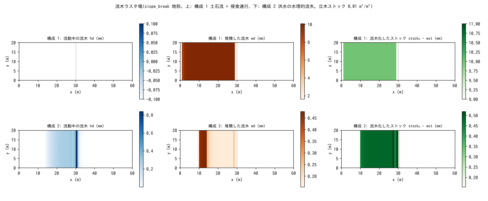

# test/driftwood — 流木ラスタ場(fn_driftwood)の疎通・保存則・リスタート

[English](en/README.md)

流木を「立木ストック wst → 流動中 hd → 堆積 wd」の 3 つのラスタ場で表す
流木モジュール(`fn_driftwood`、[ユーザーガイドの流木の章](../../docs/users_guide/driftwood.md)、
developer.md §50)の検定です。発生の 2 経路(土石流の侵食連行、洪水の
水理的流失)をそれぞれ 1 構成で走らせ、材積保存・活性・遷緩点下への
到達を `Check_driftwood.py` で検定します。あわせてリスタートの分割継続と
既定値の同値検定を行います。構造物での捕捉と集積(`fn_dwtrap`。集積流木 wj と、
集積の抵抗。developer.md §50.7)は、直線水路の構成 5 を `Check_woodjam.py` で検定します。
カルバートの流入口の集積と流量則の損失(`culv_jam`。developer.md §50.8)は、排水試験の
構成 6 を同じスクリプトで検定します。

## 構成

共通: slope_break 地形(tanθ = 0.4 → x = 30 m から平坦)、60 m × 20 m
(Δx = 1 m)、降雨 200 mm/h、四周壁(閉領域 = 材積台帳が閉じる)、
立木ストック 0.01 m³/m²、代表直径 0.02 m、材比重 0.5(喫水 0.01 m)。

| 構成 | ファイル | 発生経路 | 時間 |
|---|---|---|---|
| 1 | `param.txt` | 土石流(`f_debris = 1`)の渓床侵食が根系深 `dw_droot = 2 mm` を超えると流木化(侵食連行)→ 混合体と同速で流下 → 低速凝集域で堆積 | 30 s |
| 2 | `param_flood.txt` | 地形変化なし。斜面シート流の水深・流速が閾値を超えると流失(水理的流失)→ 平坦部の湛水域で減速・堆積 | 60 s |
| 3 | `param_rt1.txt` → `param_rt2.txt` | 構成 1 を 15 s で保存し、復元して 30 s まで継続。通しの `save/` とバイト比較 | 15 + 15 s |
| 4 / 4′ | `param_min.txt` / `param_minx.txt` | `&list_driftwood` を空にした既定値の構成と、既定値を明示した構成のバイト一致(§62) | 60 s |

| ファイル | 内容 |
|---|---|
| `Check_driftwood.py <save> [stock0]` | (1) 材積保存 \|Σhd + Σwd + Σwst − stock₀ nx ny\| < 1e-9、(2) 活性: 流木化 > 1e-3 かつ堆積 > 1e-3 m·cell、(3) 到達: 平坦部(i ≥ 30)の max(hd + wd) > 0 |
| `Fig.py` | 下の図 `figs/driftwood.png` |

### 構成 5: 構造物での捕捉と集積(fn_dwtrap)

乾いた高い地盤に挟まれた幅 4 セル(20 m)の直線水路(長さ 800 m、Δx = 5 m、勾配 0.002、
n = 0.03)。等流水深 2.0 m の流量 94.65 m³/s を西端の区間流入で与え、東辺は自由流出です。
上流の水路(列 21〜30)の立木 20 m³ が水理的流失で流木になり、列 100 の 4 セルの捕捉セル
(橋や透過型堰堤の位置)に届きます。代表直径 0.3 m、材比重 0.5。40 分。入力は
`make_jam.py` が作ります。

| 構成 | ファイル | 捕捉率 E | 流れへの作用 | 確かめること |
|---|---|---|---|---|
| 5 | `param_jam.txt` | 1 | あり(`dw_jamcd`・`dw_jamphi` は既定の 1.0・0.3) | 材積保存、台帳、堰上げの解析解 |
| 5a | `param_jamcap.txt` | 1 | あり(`dw_jamcd = 2.0`、`dw_jamphi = 0.02`) | 充填率の上限 min(w/h, φ) が効く条件の堰上げ |
| 5b → 5c | `param_jamrt1.txt` → `param_jamrt2.txt` | 1 | あり | 構成 5 を 20 分で保存して継続。通しの `save_jam/` とバイト比較 |
| 5d | `param_jamoff.txt` | 0.3 | なし(`f_dwjam = 0`) | 集積した割合が E に一致 |
| 5e | `param_jamnone.txt` | —(流木なし) | — | 5d の流れ(H・V・Log.txt)とバイト一致 |
| 5f | `param_jamgrow.txt` | 0.3(`dw_jamgrow = 0.2`) | なし | 集積が進むほど捕捉率が上がる(飽和しない量)。集積した割合が解に一致 |
| 5g | `param_jamgrow2.txt` | 0.3(`dw_jamgrow = 0.02`) | なし | 同、途中で捕捉率が 1 に達する量 |

| ファイル | 内容 |
|---|---|
| `Check_woodjam.py jam <result> <save> [cd phi]` | (1) 材積保存 \|Σ(wst + hd + wd + wj)·A − 20 m³\| < 1e-9 相対、(2) driftwood.csv の `trap_m3`・`vol_jam_m3` が 20 m³、(3) 定常(30 分と 40 分の水深の差 < 1 mm)、(4) 堰上げ: 集積のセルの 1 つ上流の水深が、下流の一様な区間の水深から漸変流の式を集積の区間(長さ 2Δx)について積分した値に一致(上昇量の比が 1 ± 0.03) |
| `Check_woodjam.py ratio <result> <E>` | 集積した割合 `trap_m3 / rec_hyd_m3` が E に ±3 % で一致し、終了時に流動流木が残っていない |
| `Check_woodjam.py grow <result> <E> <dw_jamgrow>` | 集積した割合が、捕捉率 $`E + (1 - E)\,w_j/w_{\text{full}}`$ の解(下の式)に ±3 % で一致し、終了時に流動流木が残っていない |

(4) の漸変流の式は、集積の抵抗を足した定常の 1 次元の式です。

```math
\frac{dh}{dx} = \frac{S_0 - \dfrac{n^2 q^2}{h^{10/3}} - \kappa_0 \min\!\left(\dfrac{w}{h},\ \varphi\right)\dfrac{q^2}{g\,h^2}}{1 - \dfrac{q^2}{g\,h^3}},
\qquad \kappa_0 = \frac{2\,C_D}{\pi\,d\,(1-\varphi)^3}
```

$`w`$ は辺の両側のセルの集積量の平均で、集積のセルの両側の辺(長さ $`2\Delta x`$)に $`w_j/2`$ ずつ
掛かります。$`d`$ は代表直径、$`\varphi`$ は充填率、$`C_D`$ は抗力係数です
([流木モデルの解説](../../docs/users_guide/driftwood_models.md) §6)。

`dw_jamgrow`($`w_{\text{full}}`$)を与えると、捕捉率はセルの集積量 $`w_j`$ に比例して $`E`$ から 1 へ
上がります。捕捉セルの面積あたりに届いた流木の累積を $`A`$ とすると $`dw_j/dA = E + (1-E)\,w_j/w_{\text{full}}`$
で、集積量は

```math
w_j = \frac{E\,w_{\text{full}}}{1-E}\left[\exp\!\left(\frac{(1-E)\,A}{w_{\text{full}}}\right) - 1\right]
\ (A \le A^*),
\qquad
w_j = w_{\text{full}} + (A - A^*)\ (A > A^*),
\qquad A^* = \frac{w_{\text{full}}}{1-E}\ln\frac{1}{E}
```

です。この構成では 20 m³ が捕捉セル 100 m² に届くので $`A`$ = 0.2 m³/m² で、集積する割合 $`w_j/A`$ は
`dw_jamgrow = 0.2` で 0.4345(飽和に要る量 $`A^*`$ = 0.344 m³/m² に届かない)、0.02 で 0.928
($`A^*`$ = 0.034 m³/m² で飽和し、その後は全量)です。

### 構成 6: カルバートの流入口の集積と流量則の損失(culv_jam)

[test/culvert](../culvert/) と同じ排水試験です。平坦な上流槽 10 × 11 セル(Δx = 10 m)の水深 3 m を、
盛土を横断する 1 m × 1 m のカルバート 1 本だけで、常に乾いた下流の列へ排水します(流入損失
c_e = 0.5、管路長 0)。流入口のセルの立木が最初のステップで流木になり、カルバートが取水して
いるので全量が流入口に集積します。下流が乾いているので流量は上流水深 h₁ だけの関数で、
Log の貯留 S から求めた流量を、集積の損失を入れた流量則と直接比べられます。代表直径 0.3 m、
係数は既定(C_D = 1.0、φ = 0.3 で κ₀ = 6.19 m⁻¹)。入力は `make_jam.py` が作ります。

| 構成 | ファイル | 集積 | 確かめること |
|---|---|---|---|
| 6 | `param_jamculv.txt` | 流入口 1 セルに 0.5 m³(C_A = 6.19)。12 時間 | 流量則(全区間で堰が支配。倍率 0.187) |
| 6a | `param_jamculv3.txt` | 取水セル群 3 セルに 0.02 m³ ずつ = 0.06 m³(C_A = 0.74)。6 時間 | 流量則(満管と堰の両方)。3 セルの実材積の合計(MPI では帯をまたぐ) |
| 6b | `param_jamculvoff.txt` | 6a の配置で `culv_jam = 0` | 流れが 6d とバイト一致(流木は流入口に浮くだけ) |
| 6c | `param_jamculvled.txt` | 6a の配置で `culv_jam = 1`・`f_dwjam = 0` | 流れが 6d とバイト一致、集積 0.06 m³ は台帳に入る |
| 6d | `param_jamculvnone.txt` | —(流木なし) | 6b・6c との比較の基準 |
| 6e | `param_jamculvbad.txt` | 流木モジュールなしで `culv_jam = 1` | 初期化で停止する |
| 6f → 6g | `param_jamculvrt1.txt` → `param_jamculvrt2.txt` | 6a を 3 時間で保存して継続 | 通しの `save_jamculv3/` とバイト比較 |

| ファイル | 内容 |
|---|---|
| `Check_woodjam.py culv <result> <V_j> [both]` | (1) driftwood.csv の `trap_m3`・`vol_jam_m3` が V_j に一致し、流動流木と立木が残っていない、(2) Q = −A_total ΔS/Δt が、損失を入れた流量則(区間のシンプソン平均)に、最初の出力間隔を除く全区間で ±0.5 % で一致、(3) 集積のない流量則に対する比が全区間で 0.95 より小さい。`both` を付けると、満管が支配する区間と堰が支配する区間の両方があること |

流量則は、[test/culvert](../culvert/) の式に損失係数 $`C_A = 2\kappa_0 V_j/(BD)`$ を入れたものです
($`V_j`$ は集積の実材積、$`B`$・$`D`$ は断面の幅と高さ)。

```math
Q_w = 0.35\,B\,h_1\sqrt{2 g h_1}\left(1 + \frac{C_A}{3}\right)^{-3/2},
\qquad
Q_p = BD\sqrt{\frac{2g}{1 + c_e + C_A}}\ \sqrt{h_1 - \frac{d_c + D}{2}},
\quad d_c = \min\!\left(D,\ \left(\frac{Q_w^2}{g B^2}\right)^{1/3}\right)
```

$`Q = Q_w`$($`h_1 < D`$)、$`\min(Q_w, Q_p)`$($`h_1 \ge D`$)です
([流木モデルの解説](../../docs/users_guide/driftwood_models.md) §6)。

## 実行

```bash
make
./Run.sh          # 構成 1 → 2 → リスタート分割 → 既定値の同値 → 構成 5 → 構成 6。すべて通れば PASS(約 80 秒)
./Run_MPI.sh 4    # MPI(構成 1・2・5・6a)。state.dat・driftwood.dat が逐次とバイト一致(-O2 厳密数学ビルドで)
python3 Fig.py    # figs/driftwood.png(引数 en で英語版を en/figs/ に)
```

## 図



上段(構成 1): 土石流の侵食(約 3 mm)が根系深 2 mm を超え、斜面全域の
立木が流木化しています(右)。30 s の時点で流動中の流木はほぼなく(左)、
全量が斜面上と遷緩点直上流に堆積しています(中。混合体の低速凝集域で
接地)。平坦部にはわずか(1.6 mm)が到達しています。
下段(構成 2): 水理的流失。斜面の下 3 分の 2 で立木が流失し(右)、遷緩点
直上の湛水の縁に流動中の流木が集まり(左)、斜面中腹と平坦部の湛水域
で減速して堆積しています(中)。

## 所見

| 構成 | 材積保存 | 流木化 / 堆積 (m·cell) | 平坦部到達 max(hd + wd) | 判定 |
|---|---|---|---|---|
| 1 土石流 + 侵食連行 | 0.0 | 5.60 / 5.60(ほぼ全量堆積) | 1.6 mm | PASS |
| 2 洪水の水理的流失 | 3.2e-13 | 0.200 / 0.102 | 0.84 mm | PASS |
| 3 リスタート分割継続 | driftwood.dat・state.dat が通しとバイト一致 | | | PASS |
| 4 既定値の同値 | save_min と save_minx がバイト一致(stock₀ = 0.001 で (1)〜(3) も PASS) | | | PASS |

| 構成 | 結果 | 判定 |
|---|---|---|
| 5 捕捉率 1 と集積の抵抗 | 材積保存 4.9e-13 m³、集積 20.000000 m³(1 セル 0.200 m³/m²)。下流 1.994 m、上流 3.000 m、解析 2.997 m で、上昇量の比 1.003 | PASS |
| 5a 充填率の上限 | 辺の w/h = 0.040 > φ = 0.02。下流 1.994 m、上流 2.486 m、解析 2.495 m で、上昇量の比 0.982 | PASS |
| 5b → 5c リスタート分割継続 | driftwood.dat(集積流木を含む)・state.dat・swflow_enc.dat が通しとバイト一致 | PASS |
| 5d 捕捉率 0.3 | 集積 6.080 m³ / 発生 20 m³ = 0.304 | PASS |
| 5e 流木なし | 5d と H・V の全出力・Log.txt(14 ファイル)がバイト一致 | PASS |
| 5f dw_jamgrow = 0.2 | 集積した割合 0.4390(解 0.4345。捕捉率が 0.3 のままなら 0.30) | PASS |
| 5g dw_jamgrow = 0.02 | 集積した割合 0.9326(解 0.9280) | PASS |
| 6 カルバートの流入口(大きい集積) | 集積 0.500000 m³。h₁ = 2.88 → 0.77 m の 71 区間で、流量則との差の最大 0.016 %(全区間で堰が支配)。集積のない流量則に対する比 0.19〜0.29 | PASS |
| 6a 小さい集積・取水セル群 3 セル | 集積 0.060000 m³。h₁ = 2.67 → 0.38 m の 35 区間で、差の最大 0.11 %(満管が支配 5 区間、堰が支配 30 区間)。比 0.72〜0.83 | PASS |
| 6b culv_jam = 0、6c f_dwjam = 0 | どちらも 6d(流木なし)と H・V の出力・Log.txt(8 ファイル)がバイト一致。6c は集積 0.06 m³ が台帳に入る | PASS |
| 6e 流木モジュールなしの culv_jam = 1 | 初期化で停止 | PASS |
| 6f → 6g リスタート分割継続 | driftwood.dat・state.dat・swflow_enc.dat が通し(6a)とバイト一致 | PASS |

- 材積(ストック + 流動 + 堆積)は閉領域で機械精度で保存されます。
- 表と図の値は、急勾配の重力補正を既定の 2(斜面に沿う摩擦と流砂のせん断。2026-11-05。
  developer.md §93)にして計算し直したものです。斜面上の摩擦が強まり、1 を明示した値(従来の
  値)と比べて、構成 1 の平坦部到達は 1.9 → 1.6 mm、構成 2 の流木化 / 堆積は 0.186 / 0.101 →
  0.200 / 0.102、平坦部到達は 0.97 → 0.84 mm になりました。
- 喫水は Braudrick & Grant (2000) の円柱浮力平衡の厳密解で求めます
  (sg = 0.5 では線形近似 hf = sg·D と一致するためこのケースの数値は
  不変。§50.4)。
- 流木は水理に片方向(流れ → 流木)で、家屋瓦礫 [test/bldgdebris](../bldgdebris/)
  との同時有効化でも流木台帳は不変です。流れに作用するのは、集積流木だけです(`f_dwjam = 1` の
  とき。`fn_dwtrap` の捕捉セルの抵抗と、`culv_jam = 1` のカルバートの流入口の損失)。
- 構成 5 の堰上げは約 1.0 m(等流水深 2.0 m に対して)で、集積の実材積 20 m³(水路の幅あたり
  1.0 m²)によります。上昇量が解析解と 1〜2 % 違うのは、集積の区間を 2 つの辺で表す離散化に
  よります。捕捉率 0.3 の構成で集積した割合が 0.304 になるのは、捕捉の規則がセルの中だけで
  計算する近似(よく混ざったセルの滞留時間)だからです。
- 構成 6 の流量は、流入口に 0.5 m³(見かけの体積 1.7 m³)の流木が溜まると、集積のないときの
  0.19〜0.29 倍になります。1 m × 1 m の開口は、少ない流木で大きく塞がります。流量則との差
  (0.02〜0.11 %)は、代表セルの水位と槽の平均水位の差と、出力間隔の中の流量の変化によります。
- MPI np = 1, 2, 4 は -O2 厳密数学ビルドで逐次とバイト一致します(構成 5・6a は -Og -fcheck=all の
  ビルドの np = 2・4 で、state.dat・driftwood.dat が逐次とバイト一致)。
  -Ofast では逐次と MPI のビルド間に fast-math の ULP 差が出るため、
  `Run_MPI.sh` の逐次比較は警告扱いです(§50.3)。

## 関連文書

- [docs/users_guide/driftwood.md](../../docs/users_guide/driftwood.md) — 発生 2 経路、停止・再流動、構造物での捕捉と集積、パターン別の推奨値
- developer.md §50(設計・検証記録・文献照合。集積は §50.7、カルバートの流入口の損失は §50.8)、§62(既定値)、docs/woodjam_plan.md(集積の検討の記録)
