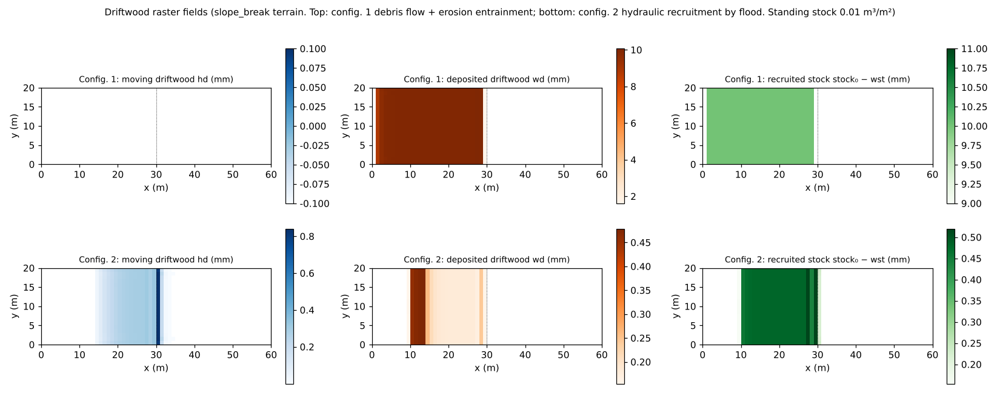

# test/driftwood — driftwood raster fields (fn_driftwood): operation, conservation and restart

> English mirror of test/driftwood/README.md. The Japanese file is the master copy.

[日本語](../README.md)

A check of the driftwood module (`fn_driftwood`,
[the driftwood chapter of the user's guide](../../../docs/en/users_guide/driftwood.md),
developer.md §50), which represents driftwood by three raster fields,
"standing stock wst → moving hd → deposited wd". The two recruitment paths
(erosion entrainment by debris flow, hydraulic recruitment by flood) are each
run in one configuration, and volume conservation, activity and arrival
below the slope break are checked with `Check_driftwood.py`. Split
continuation by restart and the equivalence of the defaults are also checked.
Capture and jamming at structures (`fn_dwtrap`: the jammed wood wj and the drag of
the jam; developer.md §50.7) are checked by configuration 5, a straight channel,
with `Check_woodjam.py`. The jam at a culvert inlet and the loss in the discharge law
(`culv_jam`; developer.md §50.8 and §50.11) are checked by configuration 6, a drainage test
and a culvert that draws part of the main flow, with the same script.

## Configuration

Common: slope_break terrain (tanθ = 0.4 → flat from x = 30 m), 60 m × 20 m
(Δx = 1 m), rainfall 200 mm/h, walls on all four sides (closed domain = the
volume ledger closes), standing stock 0.01 m³/m², representative diameter
0.02 m, wood specific gravity 0.5 (draft 0.01 m).

| Configuration | File | Recruitment path | Time |
|---|---|---|---|
| 1 | `param.txt` | When the channel-bed erosion of the debris flow (`f_debris = 1`) exceeds the rooting depth `dw_droot = 2 mm`, the trees become driftwood (erosion entrainment) → flow down at the same speed as the mixture → deposit in the low-speed consolidation zone | 30 s |
| 2 | `param_flood.txt` | No landform change. When the depth and velocity of the sheet flow on the slope exceed the thresholds, the trees are washed out (hydraulic recruitment) → decelerate and deposit in the ponded zone on the flat part | 60 s |
| 3 | `param_rt1.txt` → `param_rt2.txt` | Configuration 1 saved at 15 s, restored and continued to 30 s. Byte comparison with the continuous `save/` | 15 + 15 s |
| 4 / 4′ | `param_min.txt` / `param_minx.txt` | Byte identity between the default configuration with an empty `&list_driftwood` and the configuration with the defaults given explicitly (§62) | 60 s |

| File | Contents |
|---|---|
| `Check_driftwood.py <save> [stock0]` | (1) volume conservation \|Σhd + Σwd + Σwst − stock₀ nx ny\| < 1e-9, (2) activity: recruitment > 1e-3 and deposition > 1e-3 m·cell, (3) arrival: max(hd + wd) > 0 on the flat part (i ≥ 30) |
| `Fig.py` | The figure `en/figs/driftwood.png` below (`python3 Fig.py en`; `figs/driftwood.png` is the Japanese version) |

### Configuration 5: capture and jamming at structures (fn_dwtrap)

A straight channel 4 cells (20 m) wide between dry high ground (length 800 m, Δx = 5 m,
slope 0.002, n = 0.03). The discharge of the uniform depth of 2.0 m, 94.65 m³/s, is given as a
reach inflow at the west end, and the east edge is a free outflow. 20 m³ of standing trees in
the channel upstream (columns 21–30) become driftwood by hydraulic recruitment and reach the
capture cells, the 4 cells of column 100 (the position of a bridge or an open-type check dam).
Representative diameter 0.3 m, wood specific gravity 0.5; 40 minutes. The inputs are written by
`make_jam.py`.

| Configuration | File | Capture ratio E | Effect on the flow | What is checked |
|---|---|---|---|---|
| 5 | `param_jam.txt` | 1 | yes (`dw_jamcd`, `dw_jamphi` at the defaults 1.0, 0.3) | volume conservation, ledger, analytical backwater |
| 5a | `param_jamcap.txt` | 1 | yes (`dw_jamcd = 2.0`, `dw_jamphi = 0.02`) | backwater where the packing limit min(w/h, φ) is active |
| 5b → 5c | `param_jamrt1.txt` → `param_jamrt2.txt` | 1 | yes | configuration 5 saved at 20 minutes and continued; byte comparison with the continuous `save_jam/` |
| 5d | `param_jamoff.txt` | 0.3 | no (`f_dwjam = 0`) | the jammed share equals E |
| 5e | `param_jamnone.txt` | — (no driftwood) | — | byte identity with the flow of 5d (H, V, Log.txt) |
| 5f | `param_jamgrow.txt` | 0.3 (`dw_jamgrow = 0.2`) | no | the capture ratio rises as the jam grows (an amount that is not reached); the jammed share equals the solution |
| 5g | `param_jamgrow2.txt` | 0.3 (`dw_jamgrow = 0.02`) | no | the same with an amount at which the capture ratio reaches 1 midway |

| File | Contents |
|---|---|
| `Check_woodjam.py jam <result> <save> [cd phi]` | (1) volume conservation \|Σ(wst + hd + wd + wj)·A − 20 m³\| < 1e-9 relative, (2) `trap_m3` and `vol_jam_m3` of driftwood.csv are 20 m³, (3) steady state (depths at 30 and 40 minutes differ by < 1 mm), (4) backwater: the depth one cell upstream of the jam cell equals the value obtained by integrating the gradually-varied-flow equation over the jam section (length 2Δx) from the depth of the uniform reach downstream (ratio of the rises 1 ± 0.03) |
| `Check_woodjam.py ratio <result> <E>` | the jammed share `trap_m3 / rec_hyd_m3` equals E within ±3 %, and no moving driftwood is left at the end |
| `Check_woodjam.py grow <result> <E> <dw_jamgrow>` | the jammed share equals the solution for the capture ratio $`E + (1 - E)\,w_j/w_{\text{full}}`$ (formula below) within ±3 %, and no moving driftwood is left at the end |

The gradually-varied-flow equation of (4) is the steady one-dimensional equation with the
drag of the jam added.

```math
\frac{dh}{dx} = \frac{S_0 - \dfrac{n^2 q^2}{h^{10/3}} - \kappa_0 \min\!\left(\dfrac{w}{h},\ \varphi\right)\dfrac{q^2}{g\,h^2}}{1 - \dfrac{q^2}{g\,h^3}},
\qquad \kappa_0 = \frac{2\,C_D}{\pi\,d\,(1-\varphi)^3}
```

$`w`$ is the mean of the jammed amounts of the two cells of an edge, so $`w_j/2`$ acts on each of
the two edges of the jam cell (length $`2\Delta x`$). $`d`$ is the representative diameter,
$`\varphi`$ the packing ratio and $`C_D`$ the drag coefficient
([driftwood models explained](../../../docs/en/users_guide/driftwood_models.md) §6).

When `dw_jamgrow` ($`w_{\text{full}}`$) is given, the capture ratio rises from $`E`$ to 1 in
proportion to the jammed amount $`w_j`$ of the cell. With $`A`$ the cumulative wood that has arrived per
area of the capture cells, $`dw_j/dA = E + (1-E)\,w_j/w_{\text{full}}`$, and the jammed amount is

```math
w_j = \frac{E\,w_{\text{full}}}{1-E}\left[\exp\!\left(\frac{(1-E)\,A}{w_{\text{full}}}\right) - 1\right]
\ (A \le A^*),
\qquad
w_j = w_{\text{full}} + (A - A^*)\ (A > A^*),
\qquad A^* = \frac{w_{\text{full}}}{1-E}\ln\frac{1}{E}
```

In this configuration 20 m³ arrives on 100 m² of capture cells, so $`A`$ = 0.2 m³/m², and the jammed
share $`w_j/A`$ is 0.4345 for `dw_jamgrow = 0.2` (the amount needed to saturate, $`A^*`$ = 0.344 m³/m²,
is not reached) and 0.928 for 0.02 (saturation at $`A^*`$ = 0.034 m³/m², everything after that).

### Configuration 6: jam at a culvert inlet and the loss in the discharge law (culv_jam)

The same drainage test as [test/culvert](../../culvert/en/README.md). A flat upstream pool of
10 × 11 cells (Δx = 10 m) with a depth of 3 m is drained only through one 1 m × 1 m culvert
crossing an embankment, into a downstream column that always stays dry (entrance loss
c_e = 0.5, conduit length 0). The standing trees in the inlet cells become driftwood in the
first step and jam at the inlet in the same share as the water the culvert draws. All the
water of the upstream pool passes through this culvert, so all of the wood has jammed after
about 30 minutes. The downstream side is dry, so the discharge is a function of the upstream
depth h₁ and the jam V_j(t) at that time alone, and the discharge
obtained from the storage S of the log can be compared directly with the discharge law
including the loss of the jam. Representative diameter 0.3 m; default coefficients
(C_D = 1.0 and φ = 0.3, giving κ₀ = 6.19 m⁻¹). The inputs are written by `make_jam.py`.

Configuration 6h checks the capture rule itself and uses the straight channel of
configuration 5. A culvert 10 m wide and 1 m high, with the 4 channel cells of column 100 as
its intake cells and the 4 cells of column 140, 200 m downstream, as its outlet cells, draws
about 15 % of the main flow and returns it downstream. Of the moving driftwood in the intake
cells, only the same share as the water drawn by the culvert jams at the inlet; the rest
flows on down the main channel and leaves through the east edge.

| Configuration | File | Jam | What is checked |
|---|---|---|---|
| 6 | `param_jamculv.txt` | 0.5 m³ in the single inlet cell (C_A = 6.19); 12 hours | discharge law (the weir governs throughout; multiplier 0.187) |
| 6a | `param_jamculv3.txt` | 0.02 m³ in each of the 3 intake cells = 0.06 m³ (C_A = 0.74); 6 hours | discharge law (both full pipe and weir); the sum of the solid volumes of the 3 cells (across bands with MPI) |
| 6b | `param_jamculvoff.txt` | layout of 6a with `culv_jam = 0` | the flow is byte-identical to 6d (the wood only floats at the inlet) |
| 6c | `param_jamculvled.txt` | layout of 6a with `culv_jam = 1` and `f_dwjam = 0` | the flow is byte-identical to 6d, and the jam of 0.06 m³ enters the ledger |
| 6d | `param_jamculvnone.txt` | — (no driftwood) | reference for the comparison with 6b and 6c |
| 6e | `param_jamculvbad.txt` | `culv_jam = 1` without the driftwood module | stops at initialisation |
| 6f → 6g | `param_jamculvrt1.txt` → `param_jamculvrt2.txt` | 6a saved at 3 hours and continued | byte comparison with the continuous `save_jamculv3/` |
| 6h | `param_jamculvshare.txt` | channel of configuration 5 with a culvert drawing about 15 % of the main flow; `f_dwjam = 0`, the initial velocity is the uniform flow, the wood is released over 2000 s; 1 hour | jammed share = share of the water drawn by the culvert |

| File | Contents |
|---|---|
| `Check_woodjam.py culv <result> <V_j> [both]` | (1) the last `trap_m3` and `vol_jam_m3` of driftwood.csv equal V_j, and no moving driftwood or standing stock is left, (2) Q = −A_total ΔS/Δt agrees within ±0.5 % with the discharge law including the loss of the jam V_j(t) at that time (`vol_jam_m3` of driftwood.csv; Simpson mean over the two ends and the midpoint of the interval) in every interval except the first output interval, (3) the ratio to the discharge law without a jam is below 0.95 in every interval. With `both`, there must be intervals governed by the full pipe and intervals governed by the weir |
| `Check_woodjam.py share <result>` | (1) the jammed share `trap_m3` / `rec_hyd_m3` agrees within ±1 % with the share of the water drawn by the culvert, Q_c/Q_in (Q_in: the transect discharge upstream of the intake cells; Q_c: Q_in minus the transect discharge between the intake and outlet cells; last record). Q_c/Q_in lies in 0.05–0.5 and the transect discharge downstream of the outlet cells returns to Q_in, (2) no moving driftwood is left at the end |

The discharge law is that of [test/culvert](../../culvert/en/README.md) with the loss
coefficient $`C_A = 2\kappa_0 V_j/(BD)`$ ($`V_j`$: solid volume of the jam, $`B`$ and $`D`$:
width and height of the section).

```math
Q_w = 0.35\,B\,h_1\sqrt{2 g h_1}\left(1 + \frac{C_A}{3}\right)^{-3/2},
\qquad
Q_p = BD\sqrt{\frac{2g}{1 + c_e + C_A}}\ \sqrt{h_1 - \frac{d_c + D}{2}},
\quad d_c = \min\!\left(D,\ \left(\frac{Q_w^2}{g B^2}\right)^{1/3}\right)
```

$`Q = Q_w`$ for $`h_1 < D`$ and $`\min(Q_w, Q_p)`$ for $`h_1 \ge D`$
([driftwood models explained](../../../docs/en/users_guide/driftwood_models.md) §6).

The capture at the inlet moves, of the moving driftwood $`h_d`$ of an intake cell, the same
share as the water the culvert draws in one step to the jam. With $`\Delta h`$ the depth drawn
from the cell and $`h`$ the depth after drawing, the amount moved is
$`h_d\,\Delta h/(h + \Delta h)`$. The capture does not change the concentration of wood in the
intake cell (per volume of water), so in a steady flow it equals the concentration arriving
from upstream, and the jammed share is the ratio of the discharges (configuration 6h).

```math
\frac{\text{trap}}{\text{rec}} = \frac{Q_c}{Q_{\text{in}}}
```

$`Q_{\text{in}}`$ is the discharge entering the intake cells from upstream and $`Q_c`$ the
discharge of the culvert. Configurations 6 and 6a, where one culvert drains the upstream
pool, correspond to $`Q_c = Q_{\text{in}}`$, and all of the wood jams.

## Running

```bash
make
./Run.sh          # configuration 1 → 2 → split restart → equivalence of defaults → configuration 5 → configuration 6; PASS if all pass (about 80 seconds)
./Run_MPI.sh 4    # MPI (configurations 1, 2, 5, 6a and 6h); state.dat and driftwood.dat are byte-identical to the serial run (with the -O2 strict-math build)
python3 Fig.py en # en/figs/driftwood.png
```

## Figure



Top row (configuration 1): the erosion by the debris flow (about 3 mm)
exceeds the rooting depth of 2 mm, and the standing trees over the whole
slope become driftwood (right). At 30 s there is almost no moving driftwood (left);
all of it has deposited on the slope and just upstream of the slope break
(center; grounded in the low-speed consolidation zone of the mixture). Only a
little (1.6 mm) reaches the flat part.
Bottom row (configuration 2): hydraulic recruitment. The standing trees on
the lower two thirds of the slope are washed out (right), moving driftwood gathers
at the edge of the ponding just above the slope break (left), and it
decelerates and deposits on the middle of the slope and in the ponded zone
of the flat part (center).

## Findings

| Configuration | Volume conservation | Recruitment / deposition (m·cell) | Arrival on the flat part max(hd + wd) | Result |
|---|---|---|---|---|
| 1 debris flow + erosion entrainment | 0.0 | 5.60 / 5.60 (almost all deposited) | 1.6 mm | PASS |
| 2 hydraulic recruitment by flood | 3.2e-13 | 0.200 / 0.102 | 0.84 mm | PASS |
| 3 split continuation by restart | driftwood.dat and state.dat byte-identical to the continuous run | | | PASS |
| 4 equivalence of defaults | save_min and save_minx byte-identical ((1)–(3) also PASS with stock₀ = 0.001) | | | PASS |

| Configuration | Result | Verdict |
|---|---|---|
| 5 capture ratio 1 and the drag of the jam | volume conservation 4.9e-13 m³, jam 20.000000 m³ (0.200 m³/m² per cell). Downstream 1.994 m, upstream 3.000 m, analytical 2.997 m; ratio of the rises 1.003 | PASS |
| 5a packing limit | w/h of the edges = 0.040 > φ = 0.02. Downstream 1.994 m, upstream 2.486 m, analytical 2.495 m; ratio of the rises 0.982 | PASS |
| 5b → 5c split continuation by restart | driftwood.dat (including the jammed wood), state.dat and swflow_enc.dat byte-identical to the continuous run | PASS |
| 5d capture ratio 0.3 | jam 6.080 m³ / recruited 20 m³ = 0.304 | PASS |
| 5e no driftwood | all outputs of H and V and Log.txt (14 files) byte-identical to 5d | PASS |
| 5f dw_jamgrow = 0.2 | jammed share 0.4390 (solution 0.4345; 0.30 if the capture ratio stayed 0.3) | PASS |
| 5g dw_jamgrow = 0.02 | jammed share 0.9326 (solution 0.9280) | PASS |
| 6 culvert inlet (large jam) | the jam is 97.8 % complete after 10 minutes and 99.9 % after 20 minutes, and ends at 0.500000 m³. Over the 71 intervals of h₁ = 2.86 → 0.77 m the largest difference from the discharge law is 0.038 % (the weir governs throughout). Ratio to the discharge law without a jam 0.19–0.29 | PASS |
| 6a small jam, 3 intake cells | the jam is 94.9 % complete after 10 minutes and 99.7 % after 20 minutes, and ends at 0.060000 m³. Over the 35 intervals of h₁ = 2.66 → 0.38 m the largest difference is 0.11 % (full pipe governs 5 intervals, weir 30). Ratio 0.72–0.83 | PASS |
| 6b culv_jam = 0, 6c f_dwjam = 0 | in both, the outputs of H and V and Log.txt (8 files) are byte-identical to 6d (no driftwood). In 6c the jam of 0.06 m³ enters the ledger | PASS |
| 6e culv_jam = 1 without the driftwood module | stops at initialisation | PASS |
| 6f → 6g split continuation by restart | driftwood.dat, state.dat and swflow_enc.dat byte-identical to the continuous run (6a) | PASS |
| 6h culvert drawing part of the main flow | Q_in = 94.65 and Q_c = 14.24 m³/s, so the share of the water drawn is 0.1505. Jam 3.006 m³ / recruited 20 m³ = 0.1503 (ratio 0.999) | PASS |

- The wood volume (stock + moving + deposited) is conserved to machine
  precision in the closed domain.
- The values of the table and the figures were recomputed with the
  steep-slope gravity correction at the default 2 (friction and sediment
  shear along the slope; 2026-11-05; developer.md §93, in Japanese). The
  friction on the slope is stronger; compared with the values with 1 written
  explicitly (the former values), the arrival on the flat part in
  configuration 1 went from 1.9 to 1.6 mm, and in configuration 2 the
  recruitment / deposition went from 0.186 / 0.101 to 0.200 / 0.102 and the
  arrival on the flat part from 0.97 to 0.84 mm.
- The draft is obtained from the exact solution of the cylinder buoyancy
  balance of Braudrick & Grant (2000) (for sg = 0.5 it coincides with the
  linear approximation hf = sg·D, so the numbers of this case are unchanged;
  §50.4).
- Driftwood is one-way with respect to the hydraulics (flow → driftwood),
  and the driftwood ledger is unchanged even when enabled together with
  building debris [test/bldgdebris](../../bldgdebris/en/README.md). Only the jammed wood
  acts on the flow (with `f_dwjam = 1`: the drag in the capture cells of `fn_dwtrap`, and the
  inlet loss of culverts with `culv_jam = 1`).
- The backwater of configuration 5 is about 1.0 m (against the uniform depth of 2.0 m) and comes
  from the 20 m³ of solid wood in the jam (1.0 m² per unit channel width). The 1–2 % difference
  of the rise from the analytical value comes from the discretization that represents the jam
  section by two edges. The jammed share of 0.304 in the configuration with a capture ratio of
  0.3 comes from the capture rule being an approximation computed inside the cell (the
  residence time of a well-mixed cell).
- In configuration 6, 0.5 m³ of wood at the inlet (a bulk volume of 1.7 m³) reduces the
  discharge to 0.19–0.29 of the value without a jam. A 1 m × 1 m opening is heavily blocked by
  little wood. The differences from the discharge law (0.04–0.11 %) come from the difference
  between the water level of the representative cell and the mean level of the pool, and from
  the change of the discharge within an output interval.
- In configuration 6h the jammed share is 0.1 % smaller than the share of the water drawn
  because of the wood that arrived in the first few minutes of the run. From the moment the
  culvert starts working until the flow settles, the share of the water drawn rises from 0.148
  to 0.150. If the wood is released in 200 s, most of it passes the inlet during this time and
  the difference becomes 0.9 %.
- MPI np = 1, 2, 4 are byte-identical to the serial run with the -O2
  strict-math build (for configurations 5, 6a and 6h, state.dat and driftwood.dat of np = 2 and 4 are
  byte-identical to the serial run with the -Og -fcheck=all build). With -Ofast, fast-math ULP differences appear between
  the serial and MPI builds, so the serial comparison in `Run_MPI.sh` is
  treated as a warning (§50.3).

## Related documents

- [docs/users_guide/driftwood.md](../../../docs/en/users_guide/driftwood.md) — the two recruitment paths, stopping and refloating, capture and jamming at structures, recommended values by pattern
- developer.md §50 (design, verification records, comparison with the literature; jamming in §50.7, the loss at a culvert inlet in §50.8), §62 (defaults), docs/woodjam_plan.md (record of the study of jamming; in Japanese)
