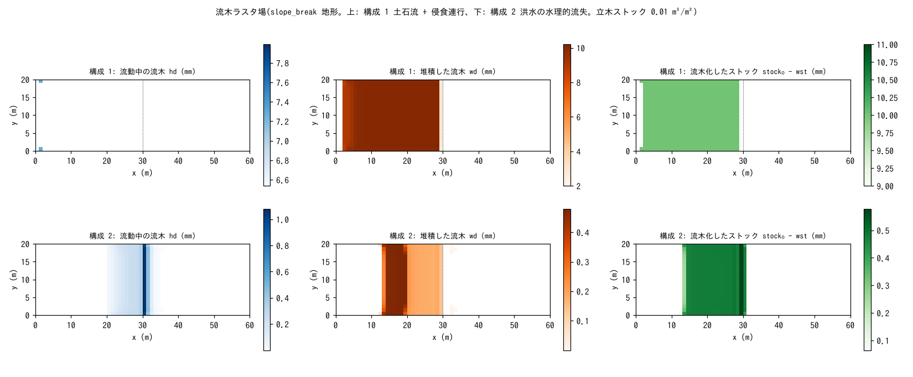

# test/driftwood — driftwood raster fields (fn_driftwood): operation, conservation and restart

> English mirror of test/driftwood/README.md. The Japanese file is the master copy.

[日本語](../README.md)

A check of the driftwood module (`fn_driftwood`,
[the driftwood chapter of the user's guide](../../../docs/en/users_guide/driftwood.md),
developer.md §50), which represents driftwood by three raster fields,
"standing stock wst → moving hd → deposited wd". The two recruitment paths
(erosion entrainment by debris flow, hydraulic recruitment by flood) are each
run in one configuration, and volume conservation, activity and arrival
below the slope break are checked with `Check_driftwood.py`. Split
continuation by restart and the equivalence of the defaults are also checked.

## Configuration

Common: slope_break terrain (tanθ = 0.4 → flat from x = 30 m), 60 m × 20 m
(Δx = 1 m), rainfall 200 mm/h, walls on all four sides (closed domain = the
volume ledger closes), standing stock 0.01 m³/m², representative diameter
0.02 m, wood specific gravity 0.5 (draft 0.01 m).

| Configuration | File | Recruitment path | Time |
|---|---|---|---|
| 1 | `param.txt` | When the channel-bed erosion of the debris flow (`f_debris = 1`) exceeds the rooting depth `dw_droot = 2 mm`, the trees become driftwood (erosion entrainment) → flow down at the same speed as the mixture → deposit in the low-speed consolidation zone | 30 s |
| 2 | `param_flood.txt` | No landform change. When the depth and velocity of the sheet flow on the slope exceed the thresholds, the trees are washed out (hydraulic recruitment) → decelerate and deposit in the ponded zone on the flat part | 60 s |
| 3 | `param_rt1.txt` → `param_rt2.txt` | Configuration 1 saved at 15 s, restored and continued to 30 s. Byte comparison with the continuous `save/` | 15 + 15 s |
| 4 / 4′ | `param_min.txt` / `param_minx.txt` | Byte identity between the default configuration with an empty `&list_driftwood` and the configuration with the defaults given explicitly (§62) | 60 s |

| File | Contents |
|---|---|
| `Check_driftwood.py <save> [stock0]` | (1) volume conservation |Σhd + Σwd + Σwst − stock₀ nx ny| < 1e-9, (2) activity: recruitment > 1e-3 and deposition > 1e-3 m·cell, (3) arrival: max(hd + wd) > 0 on the flat part (i ≥ 30) |
| `Fig.py` | The figure `figs/driftwood.png` below |

## Running

```bash
make
./Run.sh          # configuration 1 → 2 → split restart → equivalence of defaults; PASS if all pass (a few seconds)
./Run_MPI.sh 4    # MPI; state.dat and driftwood.dat are byte-identical to the serial run (with the -O2 strict-math build)
python3 Fig.py    # figs/driftwood.png
```

## Figure



Top row (configuration 1): the erosion by the debris flow (about 3 mm)
exceeds the rooting depth of 2 mm, and the standing trees over the whole
slope become driftwood (right). At 30 s there is no moving driftwood (left);
all of it has deposited on the slope and just upstream of the slope break
(center; grounded in the low-speed consolidation zone of the mixture). Only a
little (1.9 mm) reaches the flat part.
Bottom row (configuration 2): hydraulic recruitment. The standing trees on
the lower half of the slope are washed out (right), moving driftwood gathers
at the edge of the ponding just above the slope break (left), and it
decelerates and deposits on the middle of the slope and in the ponded zone
of the flat part (center).

## Findings

| Configuration | Volume conservation | Recruitment / deposition (m·cell) | Arrival on the flat part max(hd + wd) | Result |
|---|---|---|---|---|
| 1 debris flow + erosion entrainment | 0.0 | 5.60 / 5.60 (all deposited) | 1.9 mm | PASS |
| 2 hydraulic recruitment by flood | 3.0e-13 | 0.188 / 0.101 | 0.88 mm | PASS |
| 3 split continuation by restart | driftwood.dat and state.dat byte-identical to the continuous run | | | PASS |
| 4 equivalence of defaults | save_min and save_minx byte-identical ((1)–(3) also PASS with stock₀ = 0.001) | | | PASS |

- The wood volume (stock + moving + deposited) is conserved to machine
  precision in the closed domain.
- The draft is obtained from the exact solution of the cylinder buoyancy
  balance of Braudrick & Grant (2000) (for sg = 0.5 it coincides with the
  linear approximation hf = sg·D, so the numbers of this case are unchanged;
  §50.4).
- Driftwood is one-way with respect to the hydraulics (flow → driftwood),
  and the driftwood ledger is unchanged even when enabled together with
  building debris [test/bldgdebris](../../bldgdebris/en/README.md).
- MPI np = 1, 2, 4 are byte-identical to the serial run with the -O2
  strict-math build. With -Ofast, fast-math ULP differences appear between
  the serial and MPI builds, so the serial comparison in `Run_MPI.sh` is
  treated as a warning (§50.3).

## Related documents

- [docs/users_guide/driftwood.md](../../../docs/en/users_guide/driftwood.md) — the two recruitment paths, stopping and refloating, recommended values by pattern
- developer.md §50 (design, verification records, comparison with the literature), §62 (defaults)
