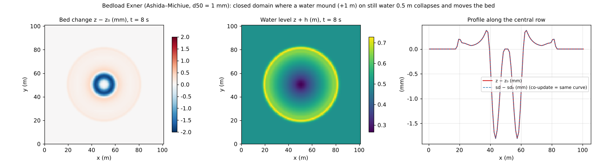

# test/fluvial — bedload Exner (f_fluvial): operation and conservation

> English mirror of test/fluvial/README.md. The Japanese file is the master copy.

[日本語](../README.md)

An operation and conservation check of the basic module of bed change,
bedload transport + the Exner equation (`f_fluvial = 1` in `&list_geomorph`;
the transport formula is Ashida–Michiue) (developer.md §19, §20). A water
mound (wave_hump, +1 m) is placed on still water in a closed domain and
collapses, and `Check_fluvial.py` confirms that the bed moves under the ring
wave, the conservation of sediment volume and the co-update identity. A
quantitative benchmark (analytical solution of uniform flow × sediment-feed
equilibrium) is recorded as remaining work (§19).

## Configuration

| Item | Value |
|---|---|
| Domain and grid | 101 m × 101 m, 101 × 101 cells (Δx = 1 m), flat z₀ = 0, walls on all four sides |
| Initial condition | Still water h₀ = 0.5 m + a central cosine mound (+1 m, radius 15 m; `wave_hump`) |
| Soil layer | Thickness sd₀ = 10 m (thick enough that the floor clip does not fire), porosity 0.4 |
| Bedload | Ashida–Michiue formula, d50 = 1 mm, critical dimensionless shear stress 0.05, submerged specific gravity 1.65, cap on the change per edge and update 0.05 m |
| Time | dt = 0.1 s, 8 s (updated every step). `save/state.dat` at the end |

| File | Contents |
|---|---|
| `Check_fluvial.py <save>` | (1) sediment volume conservation \|Σ(z − z₀)\| < 1e-9 (a consequence of the antisymmetric fluxes), (2) co-update max\|(sd − sd₀) − (z − z₀)\| < 1e-10, (3) activity max\|z − z₀\| > 1e-4 m |
| `Fig.py` | The figure `en/figs/fluvial.png` below (`python3 Fig.py en`; `figs/fluvial.png` is the Japanese version) |

## Running

```bash
make
./Run.sh          # run → Check (1 s)
./Run_MPI.sh 4    # MPI; the discipline is that state.dat is byte-identical to the serial run
python3 Fig.py en # en/figs/fluvial.png
```

## Figure



Left: bed change after 8 s. Scour of up to 1.9 mm occurs in the ring of
radius 5–10 m where the velocity is highest as the mound collapses, with
thin deposition inside it (the center) and outside (radius 15–35 m). The
pattern is circularly symmetric (isotropy of the eight-direction
distribution of the ENC grid). Center: water level at the same time. The
ring wave has spread to radius 30 m. Right: profile along the central row.
That z − z₀ and sd − sd₀ coincide exactly is the co-update identity (the
soil depth changes by exactly the amount the bed moves).

## Findings

| Check | Computed | Result |
|---|---|---|
| (1) Σ(z − z₀) | 4.2e-17 m·cell | PASS (machine precision) |
| (2) max\|(sd − sd₀) − (z − z₀)\| | 1.3e-14 m | PASS |
| (3) max\|z − z₀\| | 1.86 mm | PASS (> 0.1 mm) |

- Because the Exner update sums the antisymmetric fluxes edge by edge, the
  sediment volume is conserved to machine precision.
- The cap on the change per edge and update `fluv_dzmax` and the floor clip
  of the soil layer are safety devices and do not fire in this case
  (sd₀ = 10 m).
- The state.dat of MPI np = 1, 2, 4 is byte-identical to the serial run,
  and a restart round trip (save → restore → save in a state where sd has
  evolved) is also byte-identical (§19).
- For the handling of the conveying cross-section with a channel mask (rw),
  see the subgrid channel of
  [tutorials/chichibu](../../../tutorials/chichibu/en/README.md); for
  suspended sediment and wash load see [test/suspend](../../suspend/en/README.md)
  and [test/wash](../../wash/en/README.md).

## Related documents

- [docs/users_guide/geomorph.md](../../../docs/en/users_guide/geomorph.md) — `f_fluvial`, transport formula, grain size and porosity, cap on the change
- developer.md §19 (implementation and verification records of the landform-change modules), §20 (design of bed change)
