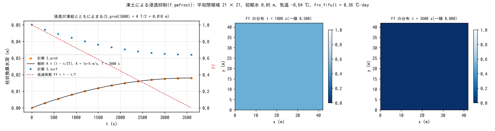

# test/frost — analytical verification of infiltration suppression by frozen ground (f_gwfrost)

> English mirror of test/frost/README.md. The Japanese file is the master copy.

[日本語](../README.md)

A check of the air-temperature-driven infiltration-capacity reduction module
(`f_gwfrost = 1` in `&list_gwflow`, developer.md §16.4) for snowmelt-season
runoff (meltwater flowing over frozen ground). A degree-day freezing index
FI (℃·day) is accumulated, and the reduction factor
Ff = max(fro_fmin, 1 − FI/fro_fifull) multiplies the infiltration capacity.
With a constant air temperature designed so that FI grows linearly, the time
evolution of the subsurface storage is determined analytically, and agreement
to all digits is confirmed by comparison with the reference.

## Configuration

| Item | Value |
|---|---|
| Domain and grid | 42 m × 42 m, 21 × 21 cells (Δx = 2 m), flat, walls on all four sides |
| Water | Initial h₀ = 0.05 m uniform. Green-Ampt infiltration `gw_ksv_mmh = 36` (K = 1e-5 m/s; constant infiltration capacity with psif = 0), no lateral flow. Soil layer 1 m |
| Meteorology | Constant air temperature −8.64 ℃ → ΔFI = 8.64 × dt/86400 = 5e-5 ℃·day/step |
| Frozen ground | `fro_fifull = 0.36` ℃·day (fully frozen at t = 3600 s), `fro_fmin = 0` (fully frozen = impermeable) |
| Time | dt = 0.5 s, 3600 s. Reduction factor Ff output every 1800 s |

Since Ff(t) = 1 − t/T (T = 3600 s), the subsurface storage is
S_grnd(t) = K t (1 − t/2T); in discrete form
S_grnd(3600) = K·dt·(7200 − 7201/2) = 0.0179975 m.

| File | Contents |
|---|---|
| `Run.sh` / `Run_MPI.sh N` | Compare Log.txt with the reference (ULP = 0) |
| `Fig.py` | The figure `figs/frost.png` below |

## Running

```bash
make
./Run.sh
./Run_MPI.sh 4
python3 Fig.py    # figs/frost.png
```

## Figures



Left: the subsurface storage S_grnd (●) lies on the analytical solution
K t (1 − t/2T) (black), and infiltration stops as the reduction factor Ff
(red dashed) falls from 1 to 0. The surface water S_surf decreases by the
same amount. Center and right: the distribution of Ff. It is uniformly 0.5 at
t = 1800 s and uniformly 0 (fully frozen) at t = 3600 s.

## Findings

| Quantity | Computed | Analytical |
|---|---|---|
| S_grnd(3600 s) | 0.01799750000000 m | 0.0179975 m (all 14 digits agree) |
| Ff(1800 s) / Ff(3600 s) | 0.5000 / 0.0000 | 0.5 / 0 |

- All intermediate times also agree exactly (reference PASS).
- The verification record in §16.4 also shows that thawing (fi0 = 0.36,
  Ta = +8.64, ct = 0.5) gives Ff(1800) = 0.25 and Ff(3600) = 0.5 exactly, that
  snow insulation (swe = 0.1 m) gives Ff(3600) = 1 − e⁻¹ = 0.6321 exactly, and
  that a restart round trip (gwflow_frost.dat carries FI) is bit-identical in
  the Log to the straight-through run.
- The default `fro_fifull` of 20 ℃·day is a practical value corresponding to
  a frost depth of 0.25 m by the Stefan equation; the 0.36 of this test is an
  artificial value for analytical verification (§64).

## Related documents

- [docs/users_guide/gwflow.md](../../../docs/en/users_guide/gwflow.md) — `f_gwfrost`, `fro_*`
- developer.md §16.4 (model, state and verification record), §64 (defaults)
