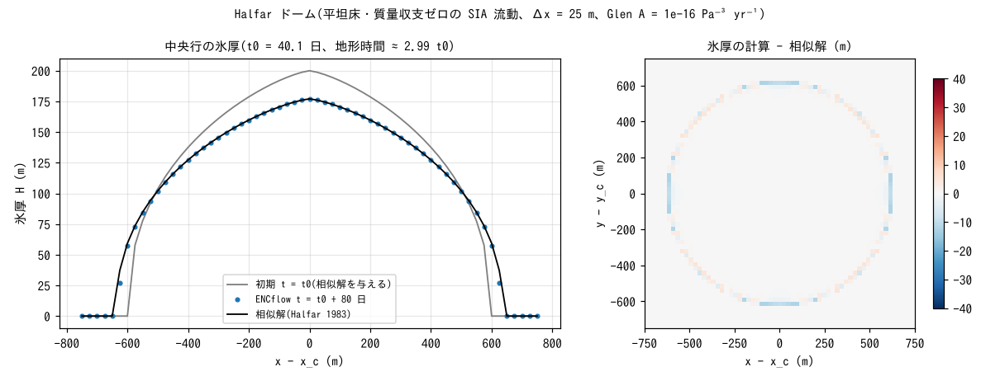
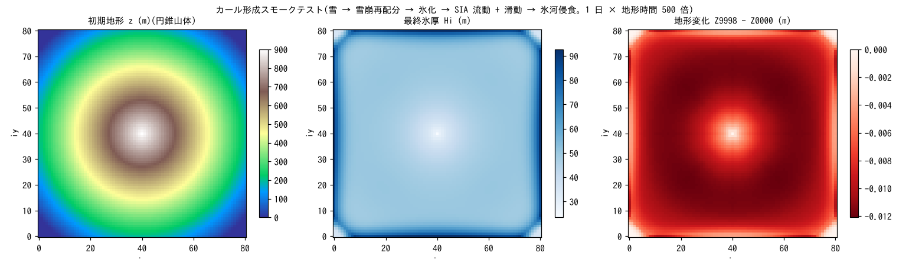
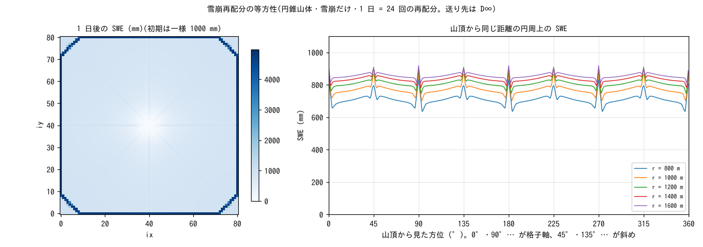
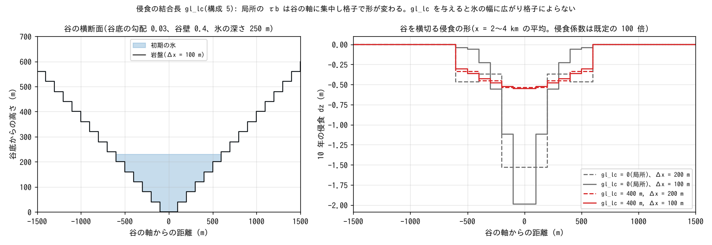

# test/glacier — 氷河モジュール: Halfar ドームの相似解、カール形成スモークテスト、雪崩再配分の等方性、侵食の結合長、谷の氷の流れ(8 近傍)

[English](en/README.md)

氷河モジュール(`fn_glacier`、[ユーザーガイドの氷河の章](../../docs/users_guide/glacier.md))
の検証ケースです。7 つの構成からなります(docs/glacier_plan.md §7、
developer.md §45・§96)。

1. **Halfar ドーム**(`param.txt`): 平坦床・質量収支ゼロの氷帽が浅氷近似
   (SIA)の流動で広がる問題。Halfar (1983) の相似解と比べる定量ベンチマーク。
2. **カール形成スモークテスト**(`param_cirque.txt`): 円錐山体に気温減率・
   標高依存の降水を与え、雪 → 雪崩再配分 → 氷化 → SIA 流動 + Weertman
   滑動 → 氷河侵食の全プロセスを有効化して、「氷河が形成され、その下で
   侵食が起きる」ことと保存量の健全性を確かめる。侵食は局所の τb(gl_lc = 0 を
   明示)で、格子の向きの歪みが侵食に出ないかの検出器を兼ねる(既定の侵食の結合長
   500 m は歪みを隠すので使わない。developer.md §45.4)。
3. **既定値の同値検定**(`param_min.txt` / `param_minx.txt`): 4 つの物性値と侵食の
   結合長 gl_lc を省略した構成と明示した構成の save と Log がバイト一致する(§65・
   §45.4。gl_lc の既定は 500 m なので、侵食は構成 2 と違う)。
4. **雪崩再配分の等方性**(`param_ava.txt`): 構成 2 と同じ円錐山体の全面に一様な雪
   (SWE 1000 mm)を置き、雪崩再配分だけを 1 日(1 時間ごとに 24 回)動かす。山頂から
   同じ距離の円周上で、雪の量が方向によらないこと(格子の向きによる偏りがないこと)と、
   水当量の保存を確かめる(developer.md §45.2)。
5. **侵食の結合長**(`param_lc.txt` / `param_lc2.txt` / `param_lc0.txt` /
   `param_lc02.txt`): 一様に傾いた V 字谷を深さ 250 m まで満たした氷を、流動・
   滑動させながら 10 年(地形時間)削る。侵食に使う駆動応力を長さ gl_lc で
   ならすと(developer.md §45.3)、谷を横切る侵食の形が格子間隔(200 m と 100 m)に
   よらず氷の幅に広がること、ならさない場合(gl_lc = 0 = 局所の τb を明示)は谷の
   軸に集中して形が格子で変わることを確かめる。
6. **Halfar ドームの 8 近傍の 9 点**(`param_d8.txt`): 構成 1 と同じ入力を、SIA 流動の
   8 近傍の 9 点(`gl_diagratio = 1/3`。塞がれた斜めの配分の動的な振り替えつき。developer.md §96)で
   計算し、構成 1 と同じ判定(Check_halfar.py)に合うこと。
7. **谷の氷の流れの向きによる差**(`param_ch0w1.txt`・`param_ch45w1.txt`・`param_ch0w3.txt`・
   `param_ch45w3.txt`・`param_ch45w3q.txt`。`gl_diagratio = 1/3`): 勾配 0.1 の斜面に 0° と 45° の
   1 セル幅・3 セル幅の谷(両側を 500 m 高くした壁)を作り、谷に置いた cos² の氷の盛り上がり
   (最大 200 m、谷に沿う長さ 1 km)を地形時間 2 年流して、谷に沿う座標の氷の体積の重心の移動を
   比べる。SIA の幅あたりの流量は氷厚と面の勾配だけで決まる(側壁の抵抗なし)ので、向きによらず
   同じ距離を進むのが正しい。4 近傍の対照(`ch45w3q`。`gl_diagratio = 0`)が遅れることも確かめる。

## 構成

| 項目 | Halfar ドーム | カール形成 |
|---|---|---|
| 領域・格子 | 1525 m × 1525 m、61 × 61 セル(Δx = 25 m)、平坦 | 81 × 81 セル、円錐山体(`data/zcone.txt`) |
| 初期氷厚 | t = t₀ の相似解 H(r) = H₀ [1 − (r/R₀)^{4/3}]^{3/7}、H₀ = 200 m、R₀ = 600 m(`data/hi0.txt`) | なし(雪から氷化) |
| 気象 | 気温 −30 ℃ 一定(融解・降水なし。質量収支ゼロ) | 気温減率で山頂側が雪、降水は標高倍率で山頂側ほど多い |
| 流動 | SIA、Glen A = 1e-16 Pa⁻³ yr⁻¹(n = 3) | SIA + Weertman 滑動(gl_as = 1e-13)+ 侵食(gl_kg = 1e-4、局所の τb = gl_lc = 0)。氷化は加速のため時定数を極小に |
| 時間 | dt = 60 s、1 日。地形時間倍率 gl_morfac = 80 → 流動は 80 日 ≈ 2 t₀(t₀ = 40.1 日) | dt = 30 s、1 日 × 500 ≈ 1.4 年 |

構成 5(侵食の結合長)は、6000 m × 4000 m の V 字谷(谷底の勾配 0.03、谷壁の勾配 0.4。
`data/zv200.txt`・`data/zv100.txt`)を、谷の軸で深さ 250 m の氷(氷面は谷を横切る
方向に平ら。`data/hiv200.txt`・`data/hiv100.txt`)で満たし、気温 −30 ℃・降水なし
(質量収支ゼロ)で、SIA 流動 + Weertman 滑動 + 侵食を 1 日 × 3652.5 = 10 年動かします。
侵食係数は形を見やすくするため既定の 100 倍(gl_kg = 1e-2)です。

| 構成 | Δx | gl_lc | 平滑化のパス数 |
|---|---|---|---|
| 5(`param_lc.txt`) | 200 m | 400 m | 16 |
| 5b(`param_lc2.txt`) | 100 m | 400 m | 64 |
| 5c(`param_lc0.txt`) | 200 m | 0(局所の τb) | — |
| 5d(`param_lc02.txt`) | 100 m | 0(局所の τb) | — |

Halfar の相似解: H(r, t) = H₀ (t₀/t)^{1/9} [1 − ((t₀/t)^{1/18} r/R₀)^{4/3}]^{3/7}、
t₀ = (1/(18Γ)) (7/4)³ R₀⁴/H₀⁷、Γ = 2A(ρ_i g)³/(n + 2)。初期(t₀)から
地形時間 80 日だけ進めると t ≈ 3 t₀ で、中心の厚さは 200 → 177 m、半径は
600 → 640 m に広がります。

| ファイル | 内容 |
|---|---|
| `Make_input.py` | `data/hi0.txt`(Halfar 初期氷厚)、`data/zcone.txt`(円錐山体)、`data/zv*.txt`・`data/hiv*.txt`(構成 5 の V 字谷と初期氷厚)、`data/zch*.txt`・`data/hich*.txt`(構成 7 の谷と氷の盛り上がり)の生成 |
| `Check_halfar.py` | 最終氷厚 Hi9998 と相似解の平均・最大・中心誤差、格子軸の方向と斜めの方向の扇形の氷の体積比(等方性)、S_total(氷の水当量)の保存を判定 |
| `Check_cirque.py` | 氷河形成(max Hi > 1 m)、氷河下侵食(dz < −0.01 m)、隆起なし、NaN なしを判定 |
| `Check_ava.py` | 構成 4: 半径 800〜1600 m の円周上の SWE の変動係数 < 0.08、半径 400 m の平均 SWE が初期の 90% 未満(再配分が働いている)、水当量の保存を判定 |
| `Check_chan.py` | 構成 7: 5 計算の S_total の相対差 < 1e-12、谷に沿う重心の移動の比 R = 45°/0° が 1 本で 1 ± 0.03、3 本で 1 ± 0.05、4 近傍の対照の 3 本で R < 0.92(検定が差を検出できること) |
| `Check_lc.py` | 構成 5: 谷を横切る侵食の形(x = 2〜4 km の平均)について、gl_lc = 400 m で Δx = 200 m と 100 m の差が相対 L1 で 5% 未満、gl_lc = 0 より氷の幅に広がる(侵食が最大値の半分を超える幅が 2 倍以上・氷のある範囲の平均/最大が 0.15 以上大きい)、谷の軸から氷の縁へ単調に減る、gl_lc = 0 では同じ比較が 5% を超える(検定が格子依存を検出できること)、侵食は氷のあるセルだけ、隆起なし・NaN なしを判定 |
| `Fig.py` | 下の図 `figs/*.png` を描く |

## 実行

```bash
make
./Run.sh          # 入力生成 → Halfar → カール → 雪崩 → 侵食の結合長 → 8 近傍の Halfar → 谷の氷の流れ → 6 つの Check → 既定値の同値検定。すべて通れば PASS
./Run_MPI.sh 4
python3 Fig.py    # figs/halfar.png, figs/cirque.png, figs/avalanche.png, figs/lc.png(引数 en で英語版を en/figs/ に)
```

## 図



左: 中央行の氷厚。初期(灰)から 80 日流動させた計算(青点)は相似解
(黒)に重なります。右: 氷厚の計算 − 相似解の分布。誤差の大半は氷縁の
1 セル幅に集中しています(相似解は氷縁で勾配が無限大のため、半セルの
位置ずれでも数十 m の厚さ差になる)。氷縁から 2 セルより内側の誤差は
−0.8〜+0.4 m で、格子軸の方向と斜めの方向の差は見えません。2026-11-03 の
修正の前は、拡散係数をエッジの法線方向の勾配だけで評価していたため、内部に
−8.9〜+6.0 m の、格子軸の方向と斜めの方向で符号の違う模様がありました
(developer.md §45.1)。



左: 初期の円錐山体。中: 1 日(地形時間 1.4 年)後の氷厚。山体全面が
氷に覆われます(最大 93 m)。右: 地形変化。全域で負(侵食のみ、隆起なし)。
定量ベンチマークではなく、全経路の疎通と符号の健全性を見るための図です。
円錐なので軸対称に近い形になります(外周の四角い縁は領域の端の影響)。山頂から
800〜1600 m の円周上で、方向による差の変動係数は氷厚 0.001〜0.004、侵食深
0.008〜0.018 です。2026-11-03 の 2 つの修正の前は、格子の向きによる放射状の筋が
出ていました。SIA の拡散係数の歪み(developer.md §45.1)では格子軸の 4 方向の筋
(雪崩なしで、格子軸の方向の氷厚が斜めの方向より 19% 厚く、侵食深は 42% 深い)、
雪崩再配分が雪を 8 近傍のうち最急降下の 1 セルへ送っていたこと(§45.2)では
格子軸と斜めの 8 方向の筋(変動係数は氷厚 0.012〜0.030、侵食深 0.073〜0.088)です。



構成 4。左: 1 日後の SWE。雪は斜面を下へ移り、山頂付近で減って、領域の端(円錐の
裾が領域で切れる所)にたまります。右: 山頂から同じ距離の円周上の SWE。線がほぼ平らで、
方向による差の変動係数は 0.017〜0.042 です。格子軸と斜めの方向(0°・45°・90°…)の
細い山と、格子軸から次の格子軸へ上がっていく傾きが残ります。完全に対称な円錐では、
対称軸の上と山頂のセルで同じ勾配の面が並び、先の面を採る規則が対称性を崩すことが
一因です(developer.md §45.2 の残る限界)。送り先を 8 近傍の最急降下の 1 セルにして
いた修正前は、格子軸と斜めの方向に 1000 mm の雪が残り、その間の向きで 100 mm まで
減っていました(変動係数 0.230〜0.350)。



構成 5。左: 谷の横断面と初期の氷。右: 10 年後の、谷を横切る侵食の形(x = 2〜4 km の
平均)。局所の τb(gl_lc = 0。灰)では侵食が谷の軸に集中し(最大値の半分を超える幅
400 m)、格子を 200 m から 100 m に細かくすると軸の侵食が 1.53 m から 1.99 m に増えて
形が変わります(相対 L1 の差 0.196)。氷の縁のセルが一つ内側より深く削れる段(Δx =
200 m で縁 −0.47 m、内側 −0.37 m)もあります。縁のセルの中央差分の勾配に、氷のない
隣の地盤高(氷の崖)が入るためです。gl_lc = 400 m(赤)では侵食が氷の幅全体に広がり
(同じ幅 1200 m)、2 つの格子の形がほぼ重なります(差 0.003)。侵食は谷の軸から氷の
縁へ単調に減ります(平均する駆動応力の勾配は氷のあるセルだけで取る)。どちらの場合も
最大の侵食は谷の軸で、谷を横切る断面が U 字になるかどうかは、この 10 年の検定では
分かりません(長期の試計算は developer.md §45.3)。

## 所見

| 検定 | 計算値 | 基準 | 判定 |
|---|---|---|---|
| Halfar 平均絶対誤差 | 0.32 m(H₀ の 0.16%) | < 4 m | PASS |
| Halfar 最大絶対誤差 | 12.5 m(氷縁) | < 45 m(縁 1.5 セルずれ相当) | PASS |
| Halfar 中心誤差 | 0.13 m | < 6 m(流れないと 23 m) | PASS |
| Halfar 等方性(斜め/軸の扇形の氷の体積比の、解析解の比との差) | +0.59% | < 2%(修正前のコードで −5.49%) | PASS |
| 氷体積 S_total の相対変化 | 〜1e-15 | 機械精度 | PASS |
| カール: max Hi / min dz / max dz | 92.7 m / −0.012 m / 0 | > 1 m / < −0.01 m / ≤ 0 | PASS |
| 雪崩: 半径 800〜1600 m の円周上の SWE の変動係数 | 0.017〜0.042 | < 0.08(修正前のコードで 0.230〜0.350) | PASS |
| 雪崩: 半径 400 m の平均 SWE | 408 mm | < 900 mm(初期 1000 mm の 90%) | PASS |
| 雪崩: 水当量 S_total の相対変化 | 0(表示全桁で不変) | < 1e-12 | PASS |
| 既定値の同値検定 | save・Log がバイト一致、"(default)" 5 行 | — | PASS |
| 結合長: 谷を横切る侵食の形の Δx = 200 m と 100 m の差(相対 L1) | gl_lc = 400 m で 0.003 | < 0.05 | PASS |
| 結合長: 同じ比較を gl_lc = 0 で(検出器の確認) | 0.196 | > 0.05 | PASS |
| 結合長: 侵食が最大値の半分を超える幅 / 氷のある範囲の平均/最大 | 1200 m / 0.82(gl_lc = 0 で 400 m / 0.52) | 2 倍以上 / 0.15 以上大きい | PASS |
| 結合長: 谷の軸から氷の縁へ侵食が単調に減る | gl_lc = 400 m の両格子で成立(gl_lc = 0 では縁に段) | 成立 | PASS |
| 結合長: 侵食が氷のないセル・隆起・NaN | なし | なし | PASS |
| 8 近傍の Halfar(構成 6): 平均・最大・中心誤差 | 0.34 m / 12.2 m / 0.14 m | < 4 m / < 45 m / < 6 m | PASS |
| 8 近傍の Halfar: 等方性(扇形の体積比の解析解の比との差) | +0.41% | < 2% | PASS |
| 谷の氷の流れ(構成 7): 重心の移動の比 R = 45°/0°、1 本 | 1.001(0° で 142.3 m) | 1 ± 0.03(4 近傍では流れない) | PASS |
| 谷の氷の流れ: 同、3 本 / 4 近傍の対照 | 1.019 / 0.871 | 1 ± 0.05 / < 0.92 | PASS |
| 谷の氷の流れ: 氷体積 S_total の相対変化 | 0(5 計算とも) | < 1e-12 | PASS |

- SIA の流動が相似解に平均 0.16%(H₀ 比)で一致し、反対称フラックスの集計に
  より氷体積が機械精度で保存されます。2026-11-03 の修正(拡散係数をエッジの
  勾配の大きさで評価する。developer.md §45.1)の前は、平均 1.2%・中心誤差
  4.7 m・最大誤差 38.6 m で、斜めの方向の扇形の氷が 5.5% 少なくなっていました。
- カール形成は「氷河が形成され山体上部が侵食される」ことの疎通確認で、
  侵食物は系外へ排出されます(画面の WARNING 行がその量。
  glacier_plan.md §7「既知の妥協」)。
- 侵食の結合長 gl_lc の既定は 500 m(格子間隔の 2 倍がそれより長いときはその値)です
  (2026-11-04 に 0 から変更。developer.md §45.4)。局所の τb(gl_lc = 0)のままの長期の
  侵食実験では、氷が厚い所ほど削れ、削れた所ほど氷が厚くなる正のフィードバックが
  格子間隔の規模に縮み、谷底の溝やセル単位の穴が育って計算が止まることがあります
  (試計算で 1500〜4000 年。developer.md §45.3)。既定の 500 m は谷氷河向けで、カールの
  ような薄い氷河では氷厚の 2 倍程度に下げます(目安は[ユーザーガイドの氷河の章](../../docs/users_guide/glacier.md))。
- 構成 6・7 は SIA 流動の 8 近傍の 9 点(`gl_diagratio`。既定 0 = 4 近傍。溶岩流の `lv_diagratio` と
  共通の部品。developer.md §96)の検定です。4 近傍では斜めの 1 セル幅の谷はセルが角でしかつながらず、
  氷は流れません(試作で確認。検定には入れていない)。3 本の帯は軸のエッジのジグザグだけで流れ、
  0° の 0.87 倍しか進みません(`ch45w3q`)。8 近傍では塞がれた斜めの配分を氷厚に応じて振り替えるので、
  0° の谷の流れは 4 近傍と同じまま、45° の 1 本で 1.00 倍、3 本で 1.02 倍になります。45° の谷は谷に
  沿うセルの間隔が √2 倍なので、崖のある氷の板では谷に沿う分解能の差が出ます(試作で R = 1.10。
  0° の間隔をそろえると ±1%)。構成 7 は滑らかな盛り上がりにしてこの差を小さくしてあります。
  構成 1〜5 の分布出力は、8 近傍の追加(既定 0)の前後でバイト一致です。
- 氷温・多温構造、カービング、氷底水系などは持ちません。10⁴ 年スケール
  の圏谷形成を定量的に確かめる長期ケースは将来拡張の候補です(同 §7)。

## 関連文書

- [docs/users_guide/glacier.md](../../docs/users_guide/glacier.md) — `&list_glacier` のパラメータ、推奨値
- [docs/glacier_plan.md](../../docs/glacier_plan.md) — 設計計画、§7 検証と既知の妥協
- developer.md §45(氷河モジュールの実装)、§65(既定値の整備)
