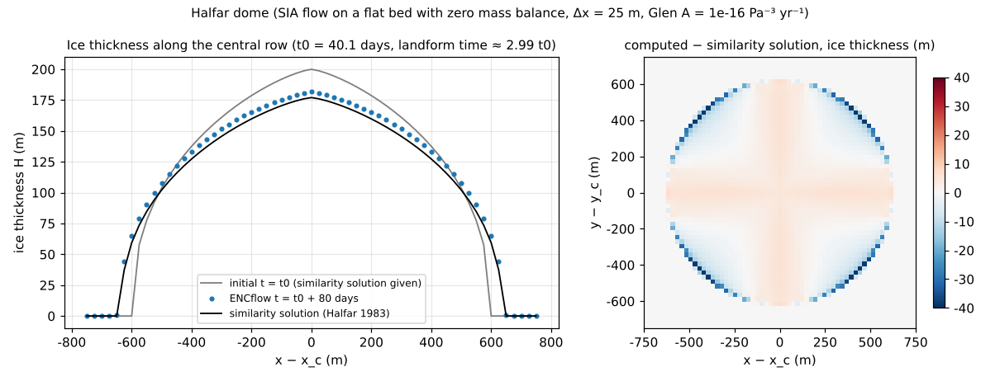
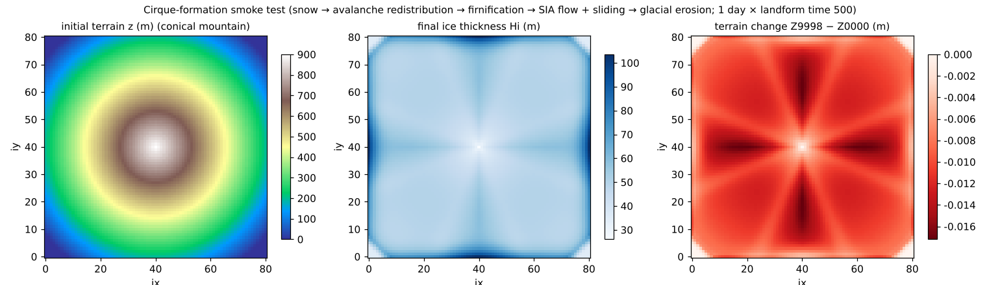

# test/glacier — glacier module: Halfar dome similarity solution and cirque-formation smoke test

> English mirror of test/glacier/README.md. The Japanese file is the master copy.

[日本語](../README.md)

This is the verification case of the glacier module (`fn_glacier`,
[the glacier chapter of the users guide](../../../docs/en/users_guide/glacier.md)).
It consists of three configurations (docs/glacier_plan.md §7, developer.md §45).

1. **Halfar dome** (`param.txt`): an ice cap on a flat bed with zero mass
   balance spreads by shallow-ice-approximation (SIA) flow. A quantitative
   benchmark against the similarity solution of Halfar (1983).
2. **Cirque-formation smoke test** (`param_cirque.txt`): a conical mountain is
   given a temperature lapse rate and elevation-dependent precipitation, and
   the whole chain snow → avalanche redistribution → firnification → SIA flow
   + Weertman sliding → glacial erosion is enabled, to confirm that "a glacier
   forms and erosion occurs beneath it" and that the conserved quantities are
   sound.
3. **Equivalence check of the defaults** (`param_min.txt` / `param_minx.txt`):
   the save and the Log of the configuration that omits four material
   constants and of the configuration that writes them explicitly are
   byte-identical (§65).

## Configuration

| Item | Halfar dome | Cirque formation |
|---|---|---|
| Domain and grid | 1525 m × 1525 m, 61 × 61 cells (Δx = 25 m), flat | 81 × 81 cells, conical mountain (`data/zcone.txt`) |
| Initial ice thickness | Similarity solution at t = t₀, H(r) = H₀ [1 − (r/R₀)^{4/3}]^{3/7}, H₀ = 200 m, R₀ = 600 m (`data/hi0.txt`) | None (formed from snow by firnification) |
| Meteorology | Constant temperature −30 ℃ (no melt or precipitation; zero mass balance) | With the temperature lapse rate the summit side receives snow; precipitation is scaled with elevation, more toward the summit |
| Flow | SIA, Glen A = 1e-16 Pa⁻³ yr⁻¹ (n = 3) | SIA + Weertman sliding (gl_as = 1e-13) + erosion (gl_kg = 1e-4). The firnification time constant is made tiny for acceleration |
| Time | dt = 60 s, 1 day. Landform-time factor gl_morfac = 80 → flow for 80 days ≈ 2 t₀ (t₀ = 40.1 days) | dt = 30 s, 1 day × 500 ≈ 1.4 years |

Halfar similarity solution: H(r, t) = H₀ (t₀/t)^{1/9} [1 − ((t₀/t)^{1/18} r/R₀)^{4/3}]^{3/7},
t₀ = (1/(18Γ)) (7/4)³ R₀⁴/H₀⁷, Γ = 2A(ρ_i g)³/(n + 2). Advancing 80 days of
landform time from the initial state (t₀) gives t ≈ 3 t₀, where the central
thickness goes from 200 to 177 m and the radius spreads from 600 to 640 m.

| File | Contents |
|---|---|
| `Make_input.py` | Generates `data/hi0.txt` (Halfar initial ice thickness) and `data/zcone.txt` (conical mountain) |
| `Check_halfar.py` | Judges the mean, maximum and central errors of the final ice thickness Hi9998 against the similarity solution, and the conservation of S_total (water equivalent of the ice) |
| `Check_cirque.py` | Judges glacier formation (max Hi > 1 m), subglacial erosion (dz < −0.01 m), no uplift, and no NaN |
| `Fig.py` | Draws the figures `en/figs/*.png` below (`python3 Fig.py en`; `figs/*.png` are the Japanese versions) |

## Running

```bash
make
./Run.sh          # generate inputs → Halfar → cirque → the 2 Checks → equivalence check of the defaults. PASS when all pass
./Run_MPI.sh 4
python3 Fig.py en # en/figs/halfar.png, en/figs/cirque.png
```

## Figures



Left: the ice thickness along the central row. The computation after 80 days of
flow (blue dots) from the initial state (grey) lies over the similarity
solution (black). Right: the distribution of the computed ice thickness minus
the similarity solution. Most of the error is concentrated in the one-cell
width at the ice margin (the similarity solution has an infinite gradient at
the margin, so even a half-cell positional offset gives a thickness difference
of tens of metres). The interior is within ±5 m, and a weak pattern with
opposite signs in the axial and diagonal directions (a trace of the
8-direction discretization) is visible.



Left: the initial conical mountain. Centre: the ice thickness after 1 day
(1.4 years of landform time). The whole mountain is covered with ice (maximum
104 m), thicker along the valley lines (the 8 directions of ENC). Right: the
terrain change. Negative everywhere (erosion only, no uplift), with larger
erosion along the 8-direction streaks where the ice is thick and fast. This is
not a quantitative benchmark but a figure for checking the connectivity of the
whole chain and the soundness of the signs.

## Findings

| Check | Computed value | Criterion | Verdict |
|---|---|---|---|
| Halfar mean absolute error | 2.35 m (1.2% of H₀) | < 4 m | PASS |
| Halfar maximum absolute error | 38.6 m (ice margin) | < 45 m (equivalent to a 1.5-cell offset of the margin) | PASS |
| Halfar central error | 4.7 m | < tolerance (23 m without flow) | PASS |
| Relative change of the ice volume S_total | ~1e-15 | Machine precision | PASS |
| Cirque: max Hi / min dz / max dz | 103.6 m / −0.017 m / 0 | > 1 m / < −0.01 m / ≤ 0 | PASS |
| Equivalence check of the defaults | save and Log byte-identical, 4 "(default)" lines | — | PASS |

- The SIA flow agrees with the similarity solution to 1.2% on average, and the
  ice volume is conserved at machine precision owing to the antisymmetric flux
  accounting.
- The cirque formation is a connectivity check that "a glacier forms and the
  upper part of the mountain is eroded"; the eroded material is discharged out
  of the system (the WARNING line on the screen gives its amount;
  glacier_plan.md §7 "known compromises").
- Ice temperature and polythermal structure, calving, subglacial hydrology and
  the like are not included. A long-term case that quantitatively confirms
  cirque formation on the 10⁴-year scale is a candidate for future extension
  (ibid. §7).

## Related documents

- [docs/users_guide/glacier.md](../../../docs/en/users_guide/glacier.md) — parameters of `&list_glacier`, recommended values
- [docs/glacier_plan.md](../../../docs/glacier_plan.md) (in Japanese) — design plan, §7 verification and known compromises
- developer.md §45 (implementation of the glacier module), §65 (preparation of the defaults)
