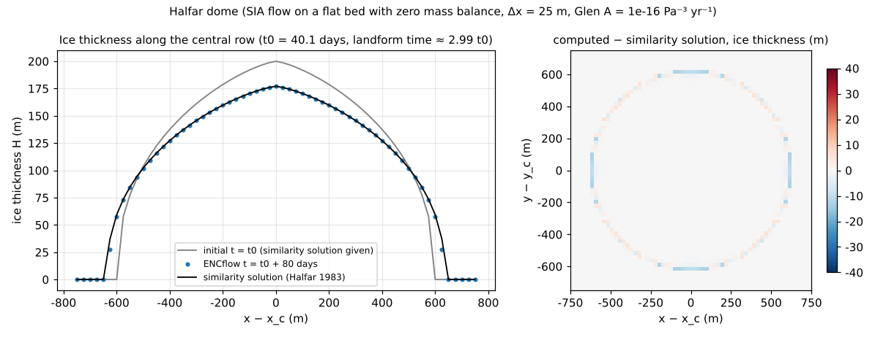
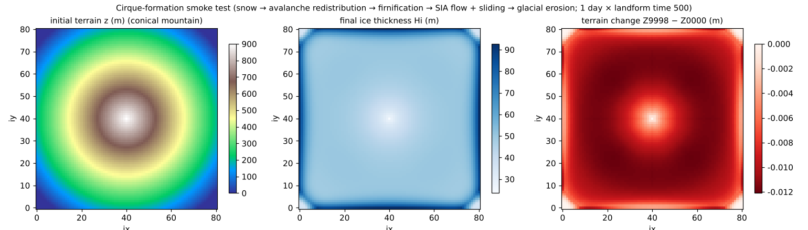
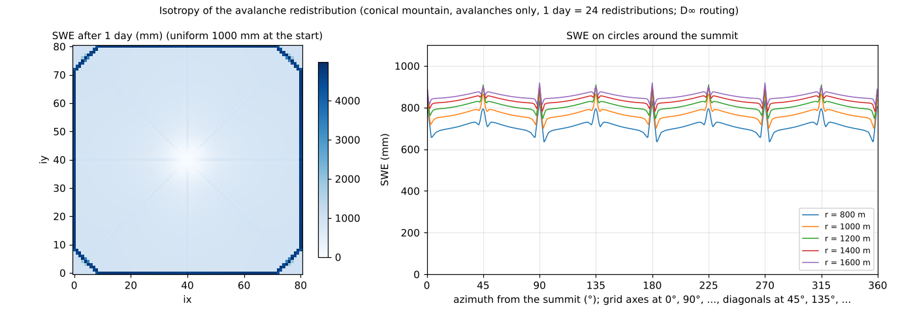
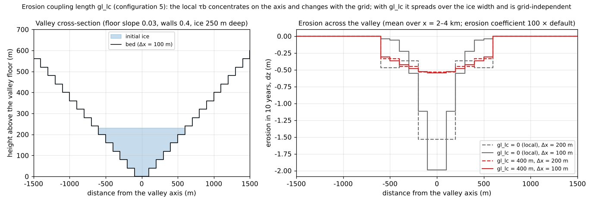

# test/glacier — glacier module: Halfar dome similarity solution, cirque-formation smoke test, isotropy of the avalanche redistribution, and the erosion coupling length

> English mirror of test/glacier/README.md. The Japanese file is the master copy.

[日本語](../README.md)

This is the verification case of the glacier module (`fn_glacier`,
[the glacier chapter of the users guide](../../../docs/en/users_guide/glacier.md)).
It consists of five configurations (docs/glacier_plan.md §7, developer.md §45).

1. **Halfar dome** (`param.txt`): an ice cap on a flat bed with zero mass
   balance spreads by shallow-ice-approximation (SIA) flow. A quantitative
   benchmark against the similarity solution of Halfar (1983).
2. **Cirque-formation smoke test** (`param_cirque.txt`): a conical mountain is
   given a temperature lapse rate and elevation-dependent precipitation, and
   the whole chain snow → avalanche redistribution → firnification → SIA flow
   + Weertman sliding → glacial erosion is enabled, to confirm that "a glacier
   forms and erosion occurs beneath it" and that the conserved quantities are
   sound.
3. **Equivalence check of the defaults** (`param_min.txt` / `param_minx.txt`):
   the save and the Log of the configuration that omits four material
   constants and of the configuration that writes them explicitly are
   byte-identical (§65).
4. **Isotropy of the avalanche redistribution** (`param_ava.txt`): uniform
   snow (SWE 1000 mm) is placed over the whole conical mountain of
   configuration 2 and only the avalanche redistribution runs for one day
   (24 times, once an hour). Confirms that the snow amount on a circle around
   the summit does not depend on the direction (no bias from the grid
   orientation) and that the water equivalent is conserved (developer.md
   §45.2).
5. **Erosion coupling length** (`param_lc.txt` / `param_lc2.txt` /
   `param_lc0.txt` / `param_lc02.txt`): ice filling a uniformly inclined
   V-shaped valley to a depth of 250 m flows, slides and erodes for 10 years of
   landform time. Confirms that when the driving stress used for erosion is
   averaged over the length gl_lc (developer.md §45.3), the erosion across the
   valley spreads over the ice width independently of the grid spacing (200 m
   and 100 m), and that without averaging (gl_lc = 0 = local τb, the default)
   it concentrates on the valley axis and its shape changes with the grid.

## Configuration

| Item | Halfar dome | Cirque formation |
|---|---|---|
| Domain and grid | 1525 m × 1525 m, 61 × 61 cells (Δx = 25 m), flat | 81 × 81 cells, conical mountain (`data/zcone.txt`) |
| Initial ice thickness | Similarity solution at t = t₀, H(r) = H₀ [1 − (r/R₀)^{4/3}]^{3/7}, H₀ = 200 m, R₀ = 600 m (`data/hi0.txt`) | None (formed from snow by firnification) |
| Meteorology | Constant temperature −30 ℃ (no melt or precipitation; zero mass balance) | With the temperature lapse rate the summit side receives snow; precipitation is scaled with elevation, more toward the summit |
| Flow | SIA, Glen A = 1e-16 Pa⁻³ yr⁻¹ (n = 3) | SIA + Weertman sliding (gl_as = 1e-13) + erosion (gl_kg = 1e-4). The firnification time constant is made tiny for acceleration |
| Time | dt = 60 s, 1 day. Landform-time factor gl_morfac = 80 → flow for 80 days ≈ 2 t₀ (t₀ = 40.1 days) | dt = 30 s, 1 day × 500 ≈ 1.4 years |

Configuration 5 (erosion coupling length) fills a 6000 m × 4000 m V-shaped
valley (floor slope 0.03, wall slope 0.4; `data/zv200.txt`, `data/zv100.txt`)
with ice 250 m deep at the valley axis (ice surface flat across the valley;
`data/hiv200.txt`, `data/hiv100.txt`), and runs SIA flow + Weertman sliding +
erosion at −30 ℃ without precipitation (zero mass balance) for 1 day × 3652.5
= 10 years. The erosion coefficient is 100 times the default (gl_kg = 1e-2) to
make the shape easy to see.

| Configuration | Δx | gl_lc | Smoothing passes |
|---|---|---|---|
| 5 (`param_lc.txt`) | 200 m | 400 m | 16 |
| 5b (`param_lc2.txt`) | 100 m | 400 m | 64 |
| 5c (`param_lc0.txt`) | 200 m | 0 (local τb) | — |
| 5d (`param_lc02.txt`) | 100 m | 0 (local τb) | — |

Halfar similarity solution: H(r, t) = H₀ (t₀/t)^{1/9} [1 − ((t₀/t)^{1/18} r/R₀)^{4/3}]^{3/7},
t₀ = (1/(18Γ)) (7/4)³ R₀⁴/H₀⁷, Γ = 2A(ρ_i g)³/(n + 2). Advancing 80 days of
landform time from the initial state (t₀) gives t ≈ 3 t₀, where the central
thickness goes from 200 to 177 m and the radius spreads from 600 to 640 m.

| File | Contents |
|---|---|
| `Make_input.py` | Generates `data/hi0.txt` (Halfar initial ice thickness), `data/zcone.txt` (conical mountain), and `data/zv*.txt` / `data/hiv*.txt` (V-shaped valley and initial ice of configuration 5) |
| `Check_halfar.py` | Judges the mean, maximum and central errors of the final ice thickness Hi9998 against the similarity solution, the ratio of the ice volumes in the sectors along the grid axes and the diagonals (isotropy), and the conservation of S_total (water equivalent of the ice) |
| `Check_cirque.py` | Judges glacier formation (max Hi > 1 m), subglacial erosion (dz < −0.01 m), no uplift, and no NaN |
| `Check_ava.py` | Configuration 4: judges the coefficient of variation of SWE on circles of radius 800–1600 m (< 0.08), the mean SWE on the 400 m circle (below 90% of the initial value, i.e. the redistribution works), and the conservation of the water equivalent |
| `Check_lc.py` | Configuration 5: for the erosion across the valley (mean over x = 2–4 km), judges that with gl_lc = 400 m the difference between Δx = 200 m and 100 m is below 5% in relative L1; that the erosion spreads over the ice width more than with gl_lc = 0 (the width where erosion exceeds half its maximum at least twice as large, and the mean/maximum within the ice at least 0.15 larger); that it decreases monotonically from the valley axis to the ice margin; that with gl_lc = 0 the same comparison exceeds 5% (the check can detect the grid dependence); that erosion occurs only in ice-covered cells; and no uplift and no NaN |
| `Fig.py` | Draws the figures `en/figs/*.png` below (`python3 Fig.py en`; `figs/*.png` are the Japanese versions) |

## Running

```bash
make
./Run.sh          # generate inputs → Halfar → cirque → avalanche → erosion coupling length → the 4 Checks → equivalence check of the defaults. PASS when all pass
./Run_MPI.sh 4
python3 Fig.py en # en/figs/halfar.png, en/figs/cirque.png, en/figs/avalanche.png, en/figs/lc.png
```

## Figures



Left: the ice thickness along the central row. The computation after 80 days of
flow (blue dots) from the initial state (grey) lies over the similarity
solution (black). Right: the distribution of the computed ice thickness minus
the similarity solution. Most of the error is concentrated in the one-cell
width at the ice margin (the similarity solution has an infinite gradient at
the margin, so even a half-cell positional offset gives a thickness difference
of tens of metres). More than two cells inside the margin the error is −0.8 to
+0.4 m, with no difference between the grid axes and the diagonals. Before the
fix of 2026-11-03 the diffusivity was evaluated with the gradient normal to the
edge only, and the interior showed a pattern of −8.9 to +6.0 m with opposite
signs along the grid axes and the diagonals (developer.md §45.1).



Left: the initial conical mountain. Centre: the ice thickness after 1 day
(1.4 years of landform time). The whole mountain is covered with ice (maximum
93 m). Right: the terrain change. Negative everywhere (erosion only, no
uplift). This is not a quantitative benchmark but a figure for checking the
connectivity of the whole chain and the soundness of the signs. The mountain
is a cone, so the result is close to axisymmetric (the square outer rim is the
effect of the domain edges). On circles 800–1600 m from the summit, the
coefficient of variation with direction is 0.001–0.004 for the ice thickness
and 0.008–0.018 for the erosion depth. Before the two fixes of 2026-11-03,
radial streaks from the grid orientation appeared: streaks along the 4 grid
axes from the distortion of the SIA diffusivity (developer.md §45.1; without
avalanches, the ice along the grid axes was 19% thicker than along the
diagonals and the erosion 42% deeper), and streaks along the 8 directions of
the grid axes and diagonals because the avalanche redistribution sent snow to
the single steepest of the 8 neighbours (§45.2; coefficients of variation
0.012–0.030 for the ice thickness and 0.073–0.088 for the erosion depth).



Configuration 4. Left: the SWE after 1 day. The snow moves down the slope,
decreases near the summit, and collects at the domain edges (where the domain
cuts off the foot of the cone). Right: the SWE on circles around the summit.
The lines are nearly flat, with coefficients of variation of 0.017–0.042 with
direction. Narrow peaks along the grid axes and diagonals (0°, 45°, 90°, ...)
remain, as does a slope rising from one grid axis to the next. One reason is
that on a perfectly symmetric cone, facets with the same slope occur on the
symmetry lines and at the summit, and the rule of taking the first of them
breaks the symmetry (remaining limitations of developer.md §45.2). Before the
fix, when the snow went to the single steepest of the 8 neighbours, 1000 mm of
snow remained along the grid axes and diagonals and the amount fell to 100 mm
in the directions in between (coefficients of variation 0.230–0.350).



Configuration 5. Left: the valley cross-section and the initial ice. Right:
the erosion across the valley after 10 years (mean over x = 2–4 km). With the
local τb (gl_lc = 0, grey) the erosion concentrates on the valley axis (the
width where it exceeds half its maximum is 400 m), and refining the grid from
200 m to 100 m increases the erosion at the axis from 1.53 m to 1.99 m and
changes the shape (relative L1 difference 0.196). There is also a step where
the cell at the ice margin is eroded more deeply than the next cell inside
(at Δx = 200 m, −0.47 m at the margin and −0.37 m inside), because the central
difference gradient at the margin cell includes the bed elevation of the
ice-free neighbour (an ice cliff). With gl_lc = 400 m (red) the erosion spreads
over the whole ice width (the same width is 1200 m) and the shapes on the two
grids nearly coincide (difference 0.003). The erosion decreases monotonically
from the valley axis to the ice margin (the gradient for the averaged driving
stress uses ice-covered cells only). In both cases the largest erosion is at
the valley axis; whether the cross-section becomes U-shaped cannot be told from
this 10-year check (for the long-term trial runs see developer.md §45.3).

## Findings

| Check | Computed value | Criterion | Verdict |
|---|---|---|---|
| Halfar mean absolute error | 0.32 m (0.16% of H₀) | < 4 m | PASS |
| Halfar maximum absolute error | 12.5 m (ice margin) | < 45 m (equivalent to a 1.5-cell offset of the margin) | PASS |
| Halfar central error | 0.13 m | < 6 m (23 m without flow) | PASS |
| Halfar isotropy (ratio of the ice volumes in the diagonal and axis sectors, relative to the analytic ratio) | +0.59% | < 2% (−5.49% with the code before the fix) | PASS |
| Relative change of the ice volume S_total | ~1e-15 | Machine precision | PASS |
| Cirque: max Hi / min dz / max dz | 92.7 m / −0.012 m / 0 | > 1 m / < −0.01 m / ≤ 0 | PASS |
| Avalanche: coefficient of variation of SWE on circles of radius 800–1600 m | 0.017–0.042 | < 0.08 (0.230–0.350 with the code before the fix) | PASS |
| Avalanche: mean SWE on the 400 m circle | 408 mm | < 900 mm (90% of the initial 1000 mm) | PASS |
| Avalanche: relative change of the water equivalent S_total | 0 (unchanged in all displayed digits) | < 1e-12 | PASS |
| Equivalence check of the defaults | save and Log byte-identical, 4 "(default)" lines | — | PASS |
| Coupling length: difference of the erosion across the valley between Δx = 200 m and 100 m (relative L1) | 0.003 with gl_lc = 400 m | < 0.05 | PASS |
| Coupling length: the same comparison with gl_lc = 0 (detector check) | 0.196 | > 0.05 | PASS |
| Coupling length: width where erosion exceeds half its maximum / mean/maximum within the ice | 1200 m / 0.82 (400 m / 0.52 with gl_lc = 0) | at least twice / at least 0.15 larger | PASS |
| Coupling length: erosion decreases monotonically from the valley axis to the ice margin | holds on both grids with gl_lc = 400 m (step at the margin with gl_lc = 0) | holds | PASS |
| Coupling length: erosion in ice-free cells, uplift, NaN | none | none | PASS |

- The SIA flow agrees with the similarity solution to 0.16% of H₀ on average,
  and the ice volume is conserved at machine precision owing to the
  antisymmetric flux accounting. Before the fix of 2026-11-03 (the diffusivity
  is evaluated with the magnitude of the gradient at the edge; developer.md
  §45.1), the mean error was 1.2%, the central error 4.7 m and the maximum
  error 38.6 m, and the diagonal sectors held 5.5% less ice.
- The cirque formation is a connectivity check that "a glacier forms and the
  upper part of the mountain is eroded"; the eroded material is discharged out
  of the system (the WARNING line on the screen gives its amount;
  glacier_plan.md §7 "known compromises").
- The erosion coupling length gl_lc defaults to 0 (local τb; bit-identical to
  the code before 2026-11-04). In long-term erosion experiments with the local
  τb, the positive feedback in which thicker ice erodes more and the eroded
  place gets thicker ice shrinks to the scale of the grid spacing, and slots in
  the valley floor or cell-sized pits can grow until the computation stops
  (1500–4000 years in the trial runs; developer.md §45.3). Give gl_lc in
  erosion experiments longer than a millennium (guidelines in
  [the glacier chapter of the users guide](../../../docs/en/users_guide/glacier.md)).
- Ice temperature and polythermal structure, calving, subglacial hydrology and
  the like are not included. A long-term case that quantitatively confirms
  cirque formation on the 10⁴-year scale is a candidate for future extension
  (ibid. §7).

## Related documents

- [docs/users_guide/glacier.md](../../../docs/en/users_guide/glacier.md) — parameters of `&list_glacier`, recommended values
- [docs/glacier_plan.md](../../../docs/glacier_plan.md) (in Japanese) — design plan, §7 verification and known compromises
- developer.md §45 (implementation of the glacier module), §65 (preparation of the defaults)
