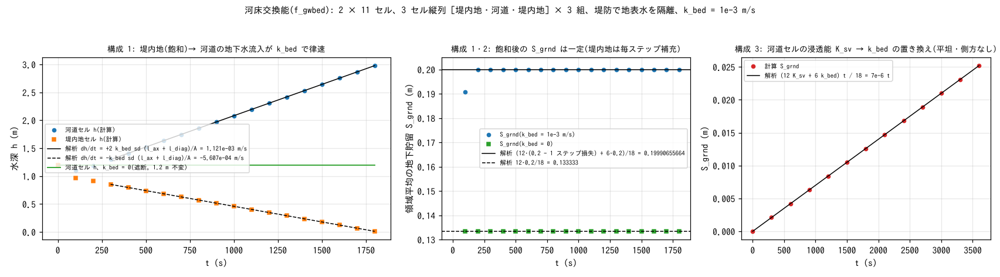

# test/gwbed — 河床交換能(f_gwbed)の解析検証

[English](en/README.md)

河道マスクのセルで地表水と土層地下水の交換に単位面積あたりの上限 k_bed を
与える河床交換能(`&list_gwflow` の `f_gwbed = 1`、
[ユーザーガイドの地下水の章](../../docs/users_guide/gwflow.md#河床交換能f_gwbed1list_gwflow_bed)、
developer.md §16.5)の検定です。作用点は二つ、河道セルの鉛直浸透能の
k_bed による置き換え(失水側)と、側方流動の河道・非河道間エッジ流量の
上限 |q_k| ≤ k_bed·l_k·h_e(得水・失水の両側)で、どちらも解析的に決まる
配置を組んで reference 比較(構成 1)と `Check_gwbed.py` の解析値比較
(3 構成)で確かめます。

## 構成

2 列 × 11 行(Δx = Δy = 2 m)。行は [堤内地, 河道, 堤内地] の 3 セル
縦列を領域外の行で区切って 3 組並べたもの(行 2, 6, 10 が河道 rw = 1、
行 4, 8 が領域外)。3 組は同一で、MPI の帯分割の境界が河道・堤内地の
エッジをまたぐことを兼ねます(np = 4 で 2 行/ランク)。

| 構成 | ファイル | 内容 |
|---|---|---|
| 1 得水 | `param.txt` | 河道 z = −3 m、堤内地 0 m、堤防(bank0 = 2、堤内地基準)で地表水を隔離。初期水深 1.2 m 一様。Green-Ampt K_sv = 1e-2 m/s(psif = 0)+ 側方 K_sh = 0.1 m/s、土層 1 m、sy = 0.2、k_bed = 1e-3 m/s(3600 mm/h)。dt = 0.25 s、1800 s |
| 2 遮断 | `param_lined.txt` | 構成 1 で k_bed = 0 |
| 3 鉛直 | `param_vert.txt` | 平坦・堤防なし・側方なし。初期水深 0.1 m、K_sv = 36 mm/h、k_bed = 3.6 mm/h。dt = 0.5 s、3600 s |

**構成 1 の解析値。** 堤内地は 20 s で飽和し(容量 sd·sy = 0.2 m)、毎
ステップ失った分だけ地表水から補充されて側方計算の時点では常に飽和
(界面飽和帯厚 h_e = sd)。河道セルも約 200 s で飽和し、以後の流入は
そのまま地表へ湧出します。堤内地→河道の水頭差は常に 0.9 m 以上で Darcy
流量が上限を大きく超えるため、エッジ流量は厳密に上限 k_bed·l_k·sd に
等しくなります。各堤内地セルは軸 1 + 対角 1 の 2 エッジで、各河道セルは
4 エッジで河道・堤内地間を結ぶので(l_ax = (1 − r/2)Δy、l_diag = (r/2)√(Δx² + Δy²)、
r = 2/(2 + √2)。l_ax は塞がれた斜めの配分の振り替え(`f_gw_opening = 1`、既定)込みの
軸エッジの通過幅で、各セルの領域外へ向かう斜め 1 本ぶん r/2 が足される。振り替え
なしなら (1 − r)Δy)、t ≥ 300 s で

- 堤内地の地表水深: dh/dt = −k_bed·sd·(l_ax + l_diag)/A = −5.607e-4 m/s
- 河道の地表水深: dh/dt = +2 k_bed·sd·(l_ax + l_diag)/A = +1.121e-3 m/s
- 堤内地の Hg = 0.2 − k_bed·sd·(l_ax + l_diag)·dt/A = 0.2 − 1.40165e-4(一定)、
  河道の Hg = 0.2
- S_grnd = (12 × 0.19985983495706 + 6 × 0.2)/18 = 0.19990655663804(一定)、
  S_total = 1.2 不変

**構成 2。** 河道セルは鉛直浸透も側方交換も持たないので、河道の Hg = 0・
h = 1.2 m が全時間不変、飽和後の S_grnd = 12 × 0.2/18 一定。f_gwbed = 0
なら堤内地の地下水が河道へ流入して湧出するので、この不変性が遮断の
検定になります。

**構成 3。** 表面水が全時間残り容量にも達しないので
S_grnd(t) = (12 K_sv + 6 k_bed) t / 18 = 7e-6 t(S_grnd(3600) = 0.0252 m)。
平坦地で河道セルの浸透が少ないぶん地表水が河道から堤内地側へ流れますが、
浸透量は min(K·dt, h, 容量残)= K·dt のまま変わりません。

| ファイル | 内容 |
|---|---|
| `Run.sh` / `Run_MPI.sh N` | 構成 1 の Log.txt を reference と比較(ULP = 0)→ `Check_gwbed.py gain` → 構成 2・3 を実行して `Check_gwbed.py lined` / `vert`(MPI は構成 1 のみ) |
| `Check_gwbed.py {gain\|lined\|vert} <result>` | Log の S_grnd・S_total(相対 1e-12)、プローブ(5 桁出力。絶対 2e-5)の h の増分と Hg の解析値比較 |
| `Fig.py` | 下の図 `figs/gwbed.png` |

## 実行

```bash
make
./Run.sh
./Run_MPI.sh 4
python3 Fig.py    # figs/gwbed.png(引数 en で英語版を en/figs/ に)
```

## 図



左: 構成 1 のプローブ。河道セルの水深(●)は飽和後に解析勾配 +1.121e-3 m/s
(実線)で増え、堤内地(■)は −5.607e-4 m/s(破線)で減ります。k_bed = 0
(緑)では河道の水深が 1.2 m のまま動きません。中: S_grnd は飽和後に一定で、
構成 1 は 0.19990655664(堤内地 12 セルがそれぞれ 1 ステップ分の損失
1.40165e-4 m だけ欠けた値)、構成 2 は 12 × 0.2/18 に一致します。
右: 構成 3 の S_grnd は 7e-6 t に乗ります。

## 所見

| 検定 | 計算値 | 判定 |
|---|---|---|
| 構成 1 S_grnd(t ≥ 300 s) | 0.19990655663804(解析値に全 14 桁一致) | PASS |
| 構成 1 河道・堤内地の dh/100 s | +0.11213 / −0.05607(解析値 ±2e-5) | PASS |
| 構成 1 Hg(河道 / 堤内地) | 0.20000 / 0.19986 | PASS |
| 構成 2 河道 Hg・h、S_grnd | 0 / 1.2 不変、0.13333333333333 | PASS |
| 構成 3 S_grnd(3600) | 0.0252 = 7e-6 × 3600(全桁一致) | PASS |
| 回帰 | 構成 1 の Log.txt が reference に ULP = 0(逐次、np = 1, 2, 4) | PASS |
