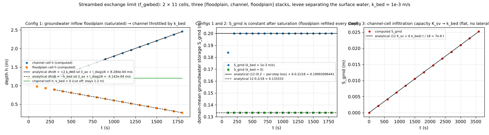

# test/gwbed — analytical verification of the streambed exchange limit (f_gwbed)

> English mirror of test/gwbed/README.md. The Japanese file is the master copy.

[日本語](../README.md)

A check of the streambed exchange limit (`f_gwbed = 1` in `&list_gwflow`,
[the groundwater chapter of the User's Guide](../../../docs/en/users_guide/gwflow.md#streambed-exchange-limit-f_gwbed1-list_gwflow_bed),
developer.md §16.5), which gives the exchange between surface water and
soil-layer groundwater on channel-mask cells a limit per unit area k_bed.
It acts in two places: the vertical infiltration capacity of channel cells
is replaced by k_bed (losing side), and the edge discharge between channel
and non-channel cells in the lateral flow model is capped at
|q_k| ≤ k_bed·l_k·h_e (gaining and losing sides). Both are set up in
configurations whose behaviour is known analytically and are confirmed by
the reference comparison (configuration 1) and by the analytical
comparisons of `Check_gwbed.py` (three configurations).

## Set-up

2 columns × 11 rows (Δx = Δy = 2 m). The rows are three identical
[floodplain, channel, floodplain] three-cell stacks separated by rows
outside the domain (rows 2, 6 and 10 are channel cells rw = 1, rows 4 and 8
are masked out). Three stacks are used so that the MPI band boundaries cross
channel/floodplain edges (2 rows per rank at np = 4).

| Configuration | File | Content |
|---|---|---|
| 1 gaining | `param.txt` | channel z = −3 m, floodplain 0 m, a levee (bank0 = 2, floodplain datum) separates the surface water. Uniform initial depth 1.2 m. Green-Ampt K_sv = 1e-2 m/s (psif = 0) + lateral K_sh = 0.1 m/s, soil 1 m, sy = 0.2, k_bed = 1e-3 m/s (3600 mm/h). dt = 0.25 s, 1800 s |
| 2 cut-off | `param_lined.txt` | configuration 1 with k_bed = 0 |
| 3 vertical | `param_vert.txt` | flat, no levee, no lateral flow. Initial depth 0.1 m, K_sv = 36 mm/h, k_bed = 3.6 mm/h. dt = 0.5 s, 3600 s |

**Analytical values of configuration 1.** The floodplain saturates within
20 s (capacity sd·sy = 0.2 m) and is refilled from its surface water every
step by exactly what it lost, so it is always saturated when the lateral
step runs (interface saturated thickness h_e = sd). The channel cells
saturate within about 200 s, after which every inflow exfiltrates to the
surface. The floodplain-to-channel head difference stays above 0.9 m, so the
Darcy discharge exceeds the cap by far and every edge discharge equals the
cap k_bed·l_k·sd exactly. Each floodplain cell is connected to the channel
by one axial and one diagonal edge and each channel cell by four edges
(l_ax = (1 − r)Δy, l_diag = (r/2)√(Δx² + Δy²), r = 2/(2 + √2)), hence for
t ≥ 300 s

- floodplain surface depth: dh/dt = −k_bed·sd·(l_ax + l_diag)/A = −4.142e-4 m/s
- channel surface depth: dh/dt = +2 k_bed·sd·(l_ax + l_diag)/A = +8.284e-4 m/s
- floodplain Hg = 0.2 − k_bed·sd·(l_ax + l_diag)·dt/A = 0.2 − 1.03553e-4 (constant),
  channel Hg = 0.2
- S_grnd = (12 × 0.19989644660940 + 6 × 0.2)/18 = 0.19993096440627 (constant),
  S_total = 1.2 unchanged

**Configuration 2.** The channel cells neither infiltrate nor exchange
laterally, so the channel Hg = 0 and h = 1.2 m stay unchanged for all time
and S_grnd = 12 × 0.2/18 after saturation. With f_gwbed = 0 the floodplain
groundwater would flow into the channel and exfiltrate, so this invariance
verifies the cut-off.

**Configuration 3.** The surface water remains for the whole run and the
capacity is never reached, so
S_grnd(t) = (12 K_sv + 6 k_bed) t / 18 = 7e-6 t (S_grnd(3600) = 0.0252 m).
On the flat bed the surface water flows from the channel cells (which
infiltrate less) to the floodplain, but the infiltration
min(K·dt, h, remaining capacity) = K·dt is unaffected.

| File | Content |
|---|---|
| `Run.sh` / `Run_MPI.sh N` | compares Log.txt of configuration 1 with the reference (ULP = 0) → `Check_gwbed.py gain` → runs configurations 2 and 3 and `Check_gwbed.py lined` / `vert` (MPI: configuration 1 only) |
| `Check_gwbed.py {gain\|lined\|vert} <result>` | S_grnd and S_total of the Log (relative 1e-12), and the h increments and Hg of the probes (5-digit output; absolute 2e-5) against the analytical values |
| `Fig.py` | the figure below, `figs/gwbed.png` |

## Run

```bash
make
./Run.sh
./Run_MPI.sh 4
python3 Fig.py en   # en/figs/gwbed.png (without the argument: Japanese version in figs/)
```

## Figure



Left: probes of configuration 1. After saturation the channel depth (●)
grows at the analytical rate +8.284e-4 m/s (solid line) and the floodplain
(■) decreases at −4.142e-4 m/s (dashed line). With k_bed = 0 (green) the
channel depth stays at 1.2 m. Middle: S_grnd is constant after saturation,
0.19993096441 in configuration 1 (each of the 12 floodplain cells is short
by one step's loss of 1.03553e-4 m) and 12 × 0.2/18 in configuration 2.
Right: S_grnd of configuration 3 lies on 7e-6 t.

## Findings

| Check | Computed | Result |
|---|---|---|
| Config 1 S_grnd (t ≥ 300 s) | 0.19993096440627 (all 14 digits of the analytical value) | PASS |
| Config 1 channel / floodplain dh per 100 s | +0.08284 / −0.04142 (analytical ±2e-5) | PASS |
| Config 1 Hg (channel / floodplain) | 0.20000 / 0.19990 | PASS |
| Config 2 channel Hg, h and S_grnd | 0 / 1.2 unchanged, 0.13333333333333 | PASS |
| Config 3 S_grnd(3600) | 0.0252 = 7e-6 × 3600 (all digits) | PASS |
| Regression | Log.txt of configuration 1 matches the reference with ULP = 0 (serial, np = 1, 2, 4) | PASS |
