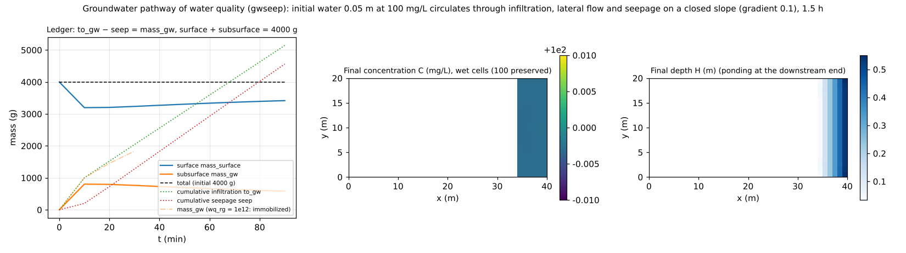

# test/gwseep — ledger closure of the groundwater pathway of water quality (infiltration → lateral flow → seepage)

> English mirror of test/gwseep/README.md. The Japanese file is the master copy.

[日本語](../README.md)

A check of the **groundwater pathway** (developer.md §30.5) of the
water-quality module (`fn_wq`,
[the water-quality chapter of the user's guide](../../../docs/en/users_guide/wq.md)),
in which a dissolved substance infiltrates from the surface water into the
groundwater, is carried by lateral flow, seeps out at the downstream end and
returns to the surface. Initial water 0.05 m deep with concentration
100 mg/L (total mass 4000 g) is placed on a closed sloping domain, and it is
confirmed both by comparison with the reference and by `Check_gwseep.py`
that mass is conserved through 1.5 hours of circulation, that the ledger
(wq.csv) closes as to_gw − seep = mass_gw, and that the concentration stays
at 100 mg/L along the whole pathway. A configuration with the retardation
factor `wq_rg = 1e12` (complete immobilization) is also checked.

## Configuration

| Item | Value |
|---|---|
| Domain and grid | 40 × 20 cells, Δx = 1 m, slope of gradient 0.1 (`z.txt`), walls on all four sides |
| Water | Initial h₀ = 0.05 m, uniform. Green-Ampt infiltration 360 mm/h (psif = 0) + nonlinear Boussinesq lateral flow 36,000 mm/h, soil layer 0.2 m, sy = 0.2 (updated every step) |
| Water quality | Initial concentration 100 mg/L (no decay). Configuration 2 `param_rg.txt`: `wq_rg = 1e12` |
| Time | dt = 0.1 s, 5400 s (1800 s for configuration 2) |

| File | Contents |
|---|---|
| `Run.sh` | Compare Log.txt and wq.csv with the reference (ULP = 0) → `Check_gwseep.py closure` → configuration 2 → `Check_gwseep.py immobile` |
| `Check_gwseep.py closure\|immobile <wq.csv>` | Ledger to_gw − seep = mass_gw and total mass 4000 g (relative 1e-6), activity of the transport / complete immobilization (seep ≈ 0, mass_gw = to_gw) |
| `Fig.py` | The figure `en/figs/gwseep.png` below (`python3 Fig.py en`; `figs/gwseep.png` is the Japanese version) |

## Running

```bash
make
./Run.sh
./Run_MPI.sh 4
python3 Fig.py en # en/figs/gwseep.png
```

## Figure



Left: time series of the ledger. The surface mass decreases to 3197 g by
infiltration in the first 10 minutes, then increases as seepage returns it
to the surface, and the subsurface mass decreases from 803 g. The cumulative
infiltration to_gw and seepage seep both keep increasing beyond the initial
mass (1.3 times the initial mass passes through the ground by circulation),
and their difference, 583.86 g, agrees to all output digits with the
subsurface mass 583.86 g. The total remains 4000.0000 g. With
immobilization (dash-dotted line) the subsurface mass keeps increasing,
equal to to_gw. Center: final concentration. The wet cells at the downstream
end, where seepage and ponding occur, are at 99.9971–99.9974 mg/L; the
concentration is preserved along the whole pathway infiltration → seepage.
Right: final depth (ponding at the downstream end).

## Findings

| Check | Computed | Result |
|---|---|---|
| to_gw − seep = mass_gw | 5144.574 − 4560.714 = 583.860 g (mass_gw 583.860) | PASS |
| Total mass mass_surface + mass_gw | 4000.0000 g | PASS |
| Continuity of concentration | wet cells 99.9971–99.9974 mg/L (initial 100) | — |
| Immobilization (wq_rg = 1e12) | seep ≈ 0, mass_gw = to_gw agree to all digits | PASS |
| Regression | Log.txt and wq.csv at ULP = 0 to the reference | PASS |

- The slight deviation of the concentration (5e-5) is the known
  approximation of the one-step lag on the groundwater side and is
  self-limiting (§30.5).
- A restart round trip (a 3 h run during development split at 1.5 h;
  §30.5) gives a bit-identical final C field, and for MPI np = 1, 2, 4 the
  C / H / Log and the four ledger columns of wq.csv agree with the serial
  run.
- Kd partitioning is in [test/kdpart](../../kdpart/en/README.md), dams and
  retention ponds in [test/damwq](../../damwq/en/README.md), and coupling
  with sewers in [test/sewer_wq](../../sewer_wq/en/README.md).

## Related documents

- [docs/users_guide/wq.md](../../../docs/en/users_guide/wq.md) — pathways and ledger of the water-quality module (the columns of wq.csv)
- developer.md §30.5 (implementation and verification of the groundwater pathway W3)
