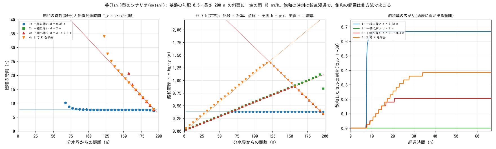

# test/gwtani — 谷(Tani)型のシナリオ: 急勾配・薄い土層の斜面の地下水

[English](en/README.md)

地下水の鉛直浸透(Green-Ampt)と側方流(非線形 Boussinesq、`f_gwlateral = 1`。
[ユーザーガイドの地下水の章](../../docs/users_guide/gwflow.md))を組み合わせると、谷(Tani 1997)が
急勾配・薄い土層の森林斜面の観測から示した機構 — 土層厚 d(x) の分布が各地点の鉛直到達時間
T_v = d·sy/r を決め、土層の薄い箇所が先に飽和して流出のタイミングを支配する — が、専用の
コードなしに現れることを確かめるシナリオ検定です。土層が一様なら飽和する範囲は上流の集水と
側方の通水能の釣り合いで決まり(側方流支配。TOPMODEL 的)、下端へ薄くなる分布なら下端から
鉛直到達時間の順に飽和が広がります(鉛直浸透支配)。あわせて、側方流を有効にしたリスタート
往復を確かめます。reference は持たず、合否は `Check_gwtani.py` の検定で決めます。

## 構成

| 項目 | 値 |
|---|---|
| 斜面 | 1 × 40 セル(Δx = Δy = 5 m、長さ 200 m。北端 = 分水界)。基盤(土層の底)は一様勾配 S_b = 0.5、地表 = 基盤 + 土層厚 d |
| 渓流 | 斜面の下に 1 行(地下水の出口)。地表は基盤面の延長で、土層 2 m を最初のステップで満たす。南辺は地表水の自由流出 |
| 雨・浸透 | 一定の雨 r = 10 mm/h を 66.7 時間。浸透能は十分大きく、土層が満ちる(飽和する)まで雨は全量浸透する |
| 地下水 | 側方の透水係数 K = 3600 mm/h(1e-3 m/s)、sy0 = 0.2、塞がれた斜めの配分の振り替えは既定(1) |
| 時間 | dt = 2 s、分布出力(bil)を 600 s ごと |

| 構成 | 設定ファイル | 土層厚 d | 定常で飽和する範囲(予測) |
|---|---|---|---|
| 1 | `param_uni_thin.txt` | 0.38 m 一様(薄い) | セル 14〜39(下側の 2/3) |
| 2 | `param_uni_thick.txt` | 2.0 m 一様(厚い) | なし |
| 3 | `param_thin_toe.txt` | 分水界の 3.0 m から下端の 0.3 m へ直線的に薄くなる(谷型) | セル 32〜39 |
| 4 | `param_thin_toe_k2.txt` | 構成 3 と同じ、K を半分(1800 mm/h) | セル 25〜39 |
| 5 | `param_l2only.txt` | 構成 2 と同じ(2.0 m 一様)。土層の側方流を切り、層2(底は基盤から 3 m 下、sy2 = 0.2、K2 = 3600 mm/h)の側方流だけを使う | なし(層2も満ちない) |
| R0〜R2 | `param_rt0.txt`・`rt1`・`rt2` | 構成 3 に層2(風化基岩層)の側方流・水質の同伴輸送・更新の間引き(dt_gwflow = 10 s)を重ねる | — |

R0 は 0〜60000 s の通し計算、R1 は 0〜30006 s で保存、R2 はそれを復元して 60000 s まで回します。
分割の時刻は dt_gwflow の周期の途中で、再開後もステップ番号が続くことを確かめます。

| ファイル | 内容 |
|---|---|
| `make_data.py` | 地形と土層厚(data_gwtani/z_*.txt・sd_*.txt)と渓流の初期水深(h_init.txt)を書く。Run.sh・Run_MPI.sh が頭で呼ぶ |
| `Run.sh` | 8 構成を逐次で回して `Check_gwtani.py` で検定 |
| `Run_MPI.sh N` | 同じ検定を N ランクで回し、構成 1〜5・R0 の分布出力と Log.txt(Runge 列を除く)を同じバイナリの np = 1 とバイト比較。41 行なので N ≤ 20 |
| `Check_gwtani.py` | 下の予測との比較(構成ごと)、構成 3 と 4 の比較(`kcompare`)、リスタート往復(`restart`) |
| `Fig.py` | 下の図 `figs/gwtani.png` |

## 予測(運動学的な斜面の地下水流)

基盤の勾配が急で地下水面の勾配が小さいとき、斜面方向の地下水の流量は K·h·S_b
(h = hg/sy は飽和帯厚)で近似できます(運動学的な近似。Beven 1981)。雨 r を受ける斜面で
ここから次が導けます(導出はこの検定のもの)。

- **雨の初期(鉛直浸透支配)**: 地下水の側方の出入りが釣り合うので、分水界から伝わる変化と
  渓流の影響が届かないセルの地下貯留は hg = r·t で一様に上がります(K にも d にもよらない)。
  そのまま飽和するセルは、鉛直到達時間 T_v = d·sy/r に飽和します(浸透能が雨より大きい
  ので雨の強さで決まる。雨が浸透能を超えるときはユーザーガイドの T_v = d·n_e/K_s)。
- **定常(側方流支配)**: 飽和しないセルの流量は、そのセルより上流の雨の総量に等しくなります。
  格子の離散式(界面の飽和帯厚は上流側の値で頭打ちの算術平均)の定常解は h_i = g·i·Δ の
  直線で、g = (S_b − √(S_b² − 4r/K))/2(運動学的な r/(K S_b) に水面勾配の補正 1 % が乗る)。
  集水 r·i·Δ が側方の通水能を超えるセル(g·i·Δ ≥ d)が飽和し、そこに降った雨が地表を流れます。
- **層2だけの側方流(構成 5)**: 土層に入った雨は層2への浸透能(100 mm/h)が雨より大きいので
  毎ステップすべて層2へ移り、層2の地下貯留に同じ予測(雨の初期の一様な上昇、定常の直線
  h2 = g·i·Δ)が成り立ちます。斜面は幅 1 セルで斜めのリンクがすべて塞がれるので、塞がれた
  斜めの配分の振り替え(f_gw_opening の既定 1)が層2に効かなければ軸の通過幅が 0.414 倍になり、
  飽和帯厚は 2.45 倍になります。
- **どちらが効くか**: セルが定常に達する時刻 t_ss = sy·g·i·Δ/r と T_v を比べ、T_v が短い
  (土層が薄い)セルは鉛直浸透で満ち、長いセルは側方流で決まる定常に先に達します。土層が
  一様なら t_ss = T_v となる位置より下流の全セルが同じ時刻 T_v にいっせいに飽和し、下端へ
  薄くなる分布なら下端から T_v(x) の順に飽和が広がります。

## 実行

```bash
make
./Run.sh
./Run_MPI.sh 4
python3 Fig.py    # figs/gwtani.png(引数 en で英語版を en/figs/ に)
```

## 図



左: 各セルの飽和の時刻(記号)と鉛直到達時間 T_v = d·sy/r(線)。一様に薄い土層(構成 1)では
斜面の下側がいっせいに 7.6 時間で飽和し、下端へ薄くなる土層(構成 3・4)では下端から T_v の線に
沿って順に飽和します。K を半分にしても(構成 4)飽和の時刻は変わらず、飽和するセルが上流へ
増えるだけです。中: 66.7 時間後(定常)の飽和帯厚。飽和しないセルは予測 h = g·x の直線に乗り、
直線が土層厚に届いたところから下が飽和します(K を半分にすると直線の傾きが倍)。一様に厚い
土層(構成 2)は飽和せず、雨はすべて地下を流れます。右端のセルは渓流へ抜ける浸出面で水位が
下がります。右: 飽和したセルの割合の時間変化。

## 所見

| 検定 | 計算値 | 判定 |
|---|---|---|
| 雨の初期の一様な上昇(12000 s、セル 25〜34) | hg = r t = 0.03333333 m に 1.7e-9 m 以内(全構成) | PASS |
| 飽和の時刻 = T_v(構成 1: セル 19〜38) | 27360 s に +1.46 % 以内(セル 24〜37 は 0.1 % 以内) | PASS |
| 飽和の時刻 = T_v(構成 3: セル 35〜38、構成 4: セル 29〜38) | 構成 3 は −2.22 %、構成 4 は −1.76 % 以内 | PASS |
| K を半分にしたときの飽和の時刻(構成 3 と 4、セル 35〜38) | 差 0.79 % 以内 | PASS |
| 定常の地下水位(飽和しないセル) | 予測 h = g·i·Δ に 9.9e-4 以内(分水界のセル) | PASS |
| 定常で飽和するセル | 構成 1: 14〜39、2: なし、3: 32〜39、4: 25〜39(予測と一致) | PASS |
| 層2だけの側方流の定常(構成 5、セル 1〜33) | 全幅の予測 h2 = g·i·Δ に 9.9e-4 以内(振り替えが層2に効く。2026-10-30 の変更の前は 2.45 倍で、振り替えなしの予測に 0.04 % で一致) | PASS |
| リスタート往復(R0 と R1 → R2) | 保存状態 5 ファイル・分布出力 66 ファイル・Log 8 行がバイト一致 | PASS |

- 飽和の時刻は、飽和の直前の出力から速度 r で延ばして求めます。分水界から伝わる変化が先に
  届くセル(t_ss < 1.4 T_v)は飽和が遅れるので、時刻の比較から除きます。
- 飽和域の上端のセルは、出ていく量を毎ステップの雨が補って容量のすぐ下で揺れるので、飽和の
  判定は「容量との差が 1 ステップの雨 r·dt 以内」にしています。
- 定常の地下水位のずれ(分水界のセルで 0.1 %、下流へ 1/i で小さくなる)は、降った雨の一部が
  浸透の前に地表流で下流へ運ばれ、地下の流量が一定量だけ減る分です。
- 斜面の下端を領域の縁(側方流の無流束)にすると、下端に水がたまって上流へ戻り、下側の
  セルが T_v より早く飽和します。渓流のセルを置くと地下水は基盤面の高さへ抜けますが、渓流に
  接するセル(セル 40)は浸出面で水位が下がり、その上のセル 39 も界面の飽和帯厚が小さく
  なる影響を受けるため、セル 39・40 は飽和の時刻の比較から、セル 40 は飽和域の比較から除きます。
- MPI は np = 1, 2, 4 とも、同じバイナリの np = 1 と分布出力・Log がバイト一致します。

## 関連文書

- [docs/users_guide/gwflow.md](../../docs/users_guide/gwflow.md) — 地下水の章(側方流の解説は gwflow_models.md §4)
- [test/gwlateral](../gwlateral/) — 側方流と線形化した Boussinesq 方程式の解析解の比較

## 参考文献

- Tani, M. (1997): Runoff generation processes estimated from hydrological observations on a steep
  forested hillslope with a thin soil layer. *J. Hydrol.*, 200, 84–109.
- Beven, K. (1981): Kinematic subsurface stormflow. *Water Resour. Res.*, 17(5), 1419–1424.
  (書誌は検索で確認、本文は未照合)
