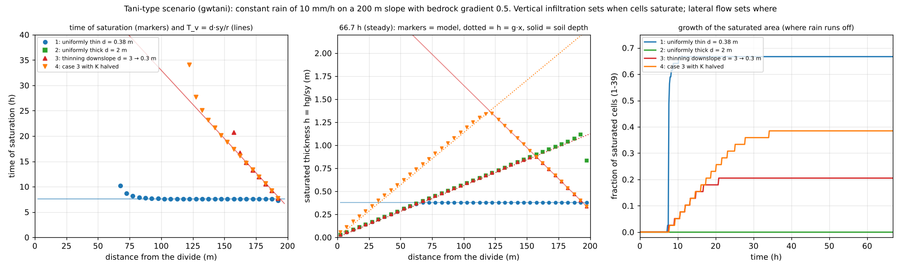

# test/gwtani — Tani-type scenario: groundwater on a steep slope with a thin soil layer

> English mirror of test/gwtani/README.md. The Japanese file is the master copy.

[日本語](../README.md)

A scenario check that combining vertical infiltration (Green-Ampt) with lateral groundwater flow
(nonlinear Boussinesq, `f_gwlateral = 1`;
[groundwater chapter of the users guide](../../../docs/en/users_guide/gwflow.md)) reproduces, without
any dedicated code, the mechanism that Tani (1997) inferred from observations on a steep forested
hillslope with a thin soil layer: the distribution of the soil depth d(x) sets the vertical arrival
time T_v = d·sy/r at each point, and the places with thin soil saturate first and control the timing
of the runoff response. With a uniform soil depth, the extent that saturates is set by the balance
between the upslope contributing recharge and the lateral transmissivity (lateral flow dominates;
TOPMODEL-like); with a soil that thins downslope, saturation spreads up from the toe in the order of
the vertical arrival times (vertical infiltration dominates). A restart round trip with lateral flow
enabled is also checked. There is no reference; `Check_gwtani.py` decides pass or fail.

## Configuration

| Item | Value |
|---|---|
| Slope | 1 × 40 cells (Δx = Δy = 5 m, 200 m long; north edge = divide). The bedrock (bottom of the soil) has a uniform gradient S_b = 0.5; surface = bedrock + soil depth d |
| Stream | One row below the slope (outlet of the groundwater). Its surface lies on the extension of the bedrock plane, and its 2 m soil is filled in the first step. Free surface outflow at the south edge |
| Rain and infiltration | Constant rain r = 10 mm/h for 66.7 hours. The infiltration capacity is large enough that all rain infiltrates until the soil is full (saturated) |
| Groundwater | Lateral conductivity K = 3600 mm/h (1e-3 m/s), sy0 = 0.2, transfer of blocked diagonal shares at its default (1) |
| Time | dt = 2 s, distributions (bil) every 600 s |

| Case | Settings file | Soil depth d | Saturated extent at steady state (prediction) |
|---|---|---|---|
| 1 | `param_uni_thin.txt` | 0.38 m uniform (thin) | cells 14–39 (lower two thirds) |
| 2 | `param_uni_thick.txt` | 2.0 m uniform (thick) | none |
| 3 | `param_thin_toe.txt` | thins linearly from 3.0 m at the divide to 0.3 m at the toe (Tani type) | cells 32–39 |
| 4 | `param_thin_toe_k2.txt` | as case 3, K halved (1800 mm/h) | cells 25–39 |
| R0–R2 | `param_rt0.txt`, `rt1`, `rt2` | case 3 plus lateral flow in layer 2 (weathered bedrock), transport of water quality with the groundwater, and a thinned update interval (dt_gwflow = 10 s) | — |

R0 is a straight run over 0–60000 s, R1 runs 0–30006 s and saves, and R2 restores it and runs to
60000 s. The split falls in the middle of a dt_gwflow cycle, which confirms that the step counter
continues after the restart.

| File | Content |
|---|---|
| `make_data.py` | Writes the terrain and soil depth (data_gwtani/z_*.txt, sd_*.txt) and the initial water depth of the stream (h_init.txt); Run.sh and Run_MPI.sh call it first |
| `Run.sh` | Runs the seven configurations serially and checks them with `Check_gwtani.py` |
| `Run_MPI.sh N` | Runs the same checks on N ranks and compares the distribution outputs and Log.txt (without the Runge column) of cases 1–4 and R0 byte by byte with np = 1 of the same binary. 41 rows, so N ≤ 20 |
| `Check_gwtani.py` | Comparison with the predictions below (per case), comparison of cases 3 and 4 (`kcompare`), restart round trip (`restart`) |
| `Fig.py` | The figure below, `figs/gwtani.png` |

## Predictions (kinematic groundwater flow on a slope)

When the bedrock is steep and the water-table gradient is small, the downslope groundwater discharge
can be approximated by K·h·S_b (h = hg/sy is the saturated thickness; the kinematic approximation,
Beven 1981). For a slope receiving rain r, the following follows from it (the derivation is this
check's own).

- **Early in the rain (vertical infiltration dominates)**: the lateral inflow and outflow of
  groundwater balance, so in cells not yet reached by the change spreading from the divide or by
  the influence of the stream the subsurface storage rises uniformly as hg = r·t (independent of
  both K and d). A cell that keeps rising until it is full saturates at the vertical arrival time
  T_v = d·sy/r (set by the rain intensity, since the infiltration capacity exceeds the rain; when
  the rain exceeds the capacity it is the users guide's T_v = d·n_e/K_s).
- **Steady state (lateral flow dominates)**: the discharge of an unsaturated cell equals the total
  rain falling upslope of it. The steady solution of the discrete equations (interface saturated
  thickness = arithmetic mean capped by the upstream value) is the straight line h_i = g·i·Δ with
  g = (S_b − √(S_b² − 4r/K))/2 (the kinematic r/(K S_b) plus a 1 % correction for the water-table
  gradient). Cells whose contributing recharge r·i·Δ exceeds the lateral transmissivity
  (g·i·Δ ≥ d) saturate, and rain falling on them runs off over the surface.
- **Which one controls**: comparing the time at which a cell reaches its steady state,
  t_ss = sy·g·i·Δ/r, with T_v, cells with short T_v (thin soil) fill by vertical infiltration, and
  cells with long T_v reach the steady state set by lateral flow first. With a uniform soil depth,
  all cells downslope of the point where t_ss = T_v saturate together at the same time T_v; with a
  soil that thins downslope, saturation spreads up from the toe in the order of T_v(x).

## Running

```bash
make
./Run.sh
./Run_MPI.sh 4
python3 Fig.py en # en/figs/gwtani.png (without the argument: Japanese version in figs/)
```

## Figure



Left: time of saturation of each cell (markers) and the vertical arrival time T_v = d·sy/r (lines).
With a uniformly thin soil (case 1) the lower slope saturates all at once at 7.6 hours; with a soil
that thins downslope (cases 3 and 4) cells saturate one after another from the toe along the T_v
line. Halving K (case 4) does not change the time of saturation; it only adds saturated cells
upslope. Middle: saturated thickness after 66.7 hours (steady state). Unsaturated cells lie on the
predicted straight line h = g·x, and cells downslope of where the line reaches the soil depth are
saturated (halving K doubles the slope of the line). The uniformly thick soil (case 2) does not
saturate; all the rain flows through the ground. The rightmost cell is a seepage face draining into
the stream, where the water table drops. Right: fraction of saturated cells over time.

## Findings

| Check | Computed | Result |
|---|---|---|
| Uniform rise early in the rain (12000 s, cells 25–34) | within 1.7e-9 m of hg = r t = 0.03333333 m (all cases) | PASS |
| Time of saturation = T_v (case 1: cells 19–38) | within +1.46 % of 27360 s (cells 24–37 within 0.1 %) | PASS |
| Time of saturation = T_v (case 3: cells 35–38; case 4: cells 29–38) | within −2.22 % (case 3) and −1.76 % (case 4) | PASS |
| Time of saturation with K halved (cases 3 and 4, cells 35–38) | difference within 0.79 % | PASS |
| Steady water table (unsaturated cells) | within 9.9e-4 of the prediction h = g·i·Δ (divide cell) | PASS |
| Cells saturated at steady state | case 1: 14–39, 2: none, 3: 32–39, 4: 25–39 (match the prediction) | PASS |
| Restart round trip (R0 vs R1 → R2) | 5 saved-state files, 66 distribution outputs and 8 Log rows byte-identical | PASS |

- The time of saturation is extrapolated at rate r from the last output before saturation. Cells
  reached first by the change spreading from the divide (t_ss < 1.4 T_v) saturate later and are
  left out of the timing comparison.
- The cell at the upper edge of the saturated zone hovers just below its capacity, its outflow
  being made up by the rain of every step, so a cell counts as saturated when it is within one
  step's rain r·dt of its capacity.
- The small deviation of the steady water table (0.1 % at the divide cell, decreasing as 1/i
  downslope) comes from part of the rain being carried downslope by surface flow before it
  infiltrates, which reduces the groundwater discharge by a constant amount.
- If the toe of the slope is the edge of the domain (no lateral flux), water piles up at the toe
  and backs up, and the lower cells saturate earlier than T_v. With the stream cell the groundwater
  drains to the level of the bedrock plane, but the cell next to the stream (cell 40) is a seepage
  face whose water table drops, and the cell above it (cell 39) is affected by the smaller
  interface saturated thickness, so cells 39 and 40 are left out of the timing comparison and cell
  40 out of the saturated-extent comparison.
- For MPI, np = 1, 2, 4 give distribution outputs and Logs byte-identical to np = 1 of the same
  binary.

## Related documents

- [docs/en/users_guide/gwflow.md](../../../docs/en/users_guide/gwflow.md) — groundwater chapter (lateral flow is explained in gwflow_models.md §4)
- [test/gwlateral](../../gwlateral/en/README.md) — lateral flow against analytical solutions of the linearised Boussinesq equation

## References

- Tani, M. (1997): Runoff generation processes estimated from hydrological observations on a steep
  forested hillslope with a thin soil layer. *J. Hydrol.*, 200, 84–109.
- Beven, K. (1981): Kinematic subsurface stormflow. *Water Resour. Res.*, 17(5), 1419–1424.
  (bibliographic data confirmed by search; the text has not been checked)
