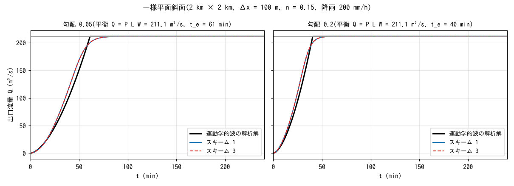
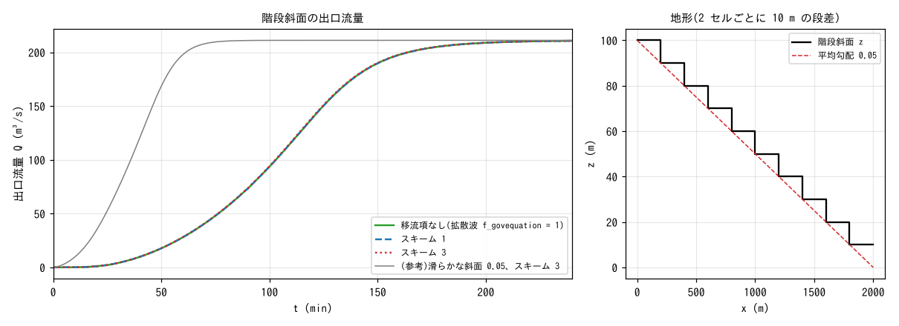
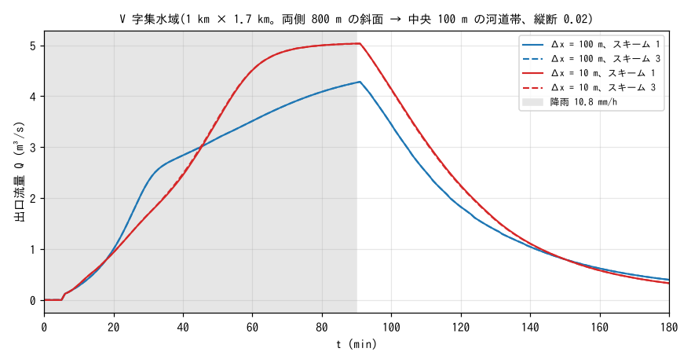

# test/hillslope — comparison of advection schemes for hillslope flow (analytical kinematic-wave solution, stepped slope, grid convergence)

> English mirror of test/hillslope/README.md. The Japanese file is the master copy.

[日本語](../README.md)

This group of cases was made when it was found in chichibu (real terrain)
that the runoff differs greatly between advection schemes 1 and 3, in order
to isolate the possibility that the difference comes from hillslope flow
rather than from the channel (developer.md §68.18, §68.20). On three kinds
of idealized terrain — a smooth slope, a stepped slope and a V-shaped
catchment — scheme 1 (the former default: cell-centre gradient,
non-conservative form), scheme 3 (the default: momentum-conservative form +
MUSCL) and no advection term (diffusive wave `f_govequation = 1`) are
compared. The conclusion is "**no difference appears in hillslope flow**;
the difference in chichibu arises where the deep, fast channel flow drops
over steps", and this case is its basis. No regression comparison with a
reference is made; the analytical solution, grid convergence and the
agreement between schemes are examined.

## Configuration

`Make_hillslope.py` generates the terrain and the parameter files (the
constants are collected in this script). Common to all cases: Manning
roughness n = 0.15 on the slope, free outflow on the east side, and one flux
transect (spanning all rows) just before the outlet records the discharge
every minute.

| Case | Terrain | Rainfall | Grid and dt | What is compared |
|---|---|---|---|---|
| Plane `p05` / `p20` | Uniform plane slope 2 km × 2 km, gradient 0.05 / 0.20 | 200 mm/h for 10 h (computed for 4 h) | Δx = 100 m, dt = 5 s | Schemes 1 and 3 and the analytical kinematic-wave solution |
| Stepped slope `sp05` | A 10 m step every 2 cells (mean gradient 0.05) | Same as above | Same as above | No advection term, schemes 1 and 3 |
| V-shaped catchment `c100` / `f10` | 1 km × 1.7 km. Slopes 800 m long on both sides (gradient 0.05) converge into a central 100 m channel band (longitudinal gradient 0.02, n = 0.15). Slope n = 0.015 | 10.8 mm/h × 90 min | Δx = 100 m (dt 2 s) / 10 m (dt 0.25 s) | Grid convergence and schemes 1 and 3 |

Analytical kinematic-wave solution for the plane slope: unit-width discharge
q = α h^{5/3}, α = √S₀/n. Under uniform rainfall P the rising limb is
q(L, t) = α (P t)^{5/3}, the time to equilibrium is
t_e = (L/(α P^{2/3}))^{3/5}, and the equilibrium discharge is q_e = P L
(L is the slope length to the face of the transect, 1900 m). With the width
W = 2 km, Q_e = P L W = 211.1 m³/s.

| File | Contents |
|---|---|
| `Make_hillslope.py plane` / `stairplane` / `vcat` | Generation of the terrain `z_*.txt`, the roughness `rn_*.txt` and `param_*.txt` (stairplane after plane) |
| `param_*_s1.txt` (in the repository) / `param_*_s3.txt` (generated; .gitignore) | Scheme 1 / 3 |
| `Fig.py` | The figures below, `figs/*.png`, and the tables |

## Running

```bash
make
python3 Make_hillslope.py plane && python3 Make_hillslope.py stairplane && python3 Make_hillslope.py vcat
for p in param_*.txt; do ./encflow $p; done     # 11 cases. The two f10 runs take 1.5–15 min each, the others 1–3 min
python3 Fig.py                                   # figs/plane.png, stair.png, vcat.png and the tables
```

## Figures



Outlet discharge of the uniform plane slope. Scheme 1 (blue) and scheme 3
(red dashed) overlap completely, and the equilibrium discharge agrees with
the analytical P L W = 211.1 m³/s to 4 digits. The rise is gentler than the
kinematic wave (black): 90% is reached at 63 min for gradient 0.05
(analytical 57 min) and at 42 min for 0.20 (38 min). The kinematic wave
neglects the diffusion of the depth and therefore has a sharp front; that
the shallow-water solution is more blunted than it is correct behaviour.



Outlet discharge (left) of the stepped slope with a 10 m step every 2 cells
(right). The three curves — no advection term, scheme 1 and scheme 3 —
overlap (peaks 210.70 / 210.70 / 210.72 m³/s; 50% reached at 105 min,
identical). The kinetic energy lost at a step is the velocity head
u²/2g ≈ 0.01 m (velocity 0.5 m/s), negligible compared with the 10 m step,
so the result does not change even if the dissipation at the steps is
treated differently. The arrival is more than 40 min later than on the
smooth slope drawn for reference (grey) because water pools on the landing
of each step before dropping to the next.



Outlet discharge of the V-shaped catchment. The hydrograph changes between
Δx = 100 m and 10 m (peak 3.83 → 5.02 m³/s), but at each grid schemes 1 and
3 overlap. The difference between grids comes from the resolution of the
slopes and the channel band (at 100 m the channel band is 1 cell wide and
the slopes 8 cells) and from the position of the transect (the catchment
area differs by 5% between the cell faces x = 950 m and 995 m just before
the outlet), not from the schemes.

## Findings

| Case | Scheme 1 | Scheme 3 | Remarks |
|---|---|---|---|
| Plane 0.05 | 211.11 m³/s (equilibrium) | 211.11 | Analytical P L W = 211.1. 90% reached at 63 min (kinematic wave 57 min) |
| Plane 0.20 | 211.11 | 211.11 | 90% reached at 42 min (38 min) |
| Stepped slope 0.05 | 210.70 | 210.72 | No advection term 210.70. All three reach 50% at 105 min |
| V-shaped 100 m | 3.828 @ 91 min | 3.828 | 3 h runoff volume 21,148 m³ |
| V-shaped 10 m | 5.015 @ 91 min | 5.015 | 25,041 m³ (total rainfall 27,540 m³) |

- **On the smooth slope, the stepped slope and the V-shaped catchment alike,
  schemes 1 and 3 agree to 3–4 digits.** The scheme difference seen in
  chichibu (§68.18: 87% of the difference comes from edges that include a
  channel cell) is not due to the discretization of hillslope flow.
- Whether a difference appears is decided not by the geometry but by the
  flow regime (§68.20). In hillslope flow, where the velocity head is much
  smaller than the step (thin, rough, slow), however the advection term
  treats the dissipation at a step, it does not affect the result. Channel
  cells are deep (2–10 m), smooth (n 0.02) and fast (15–25 m/s), and their
  velocity head of 11–30 m exceeds the steps of 2–5 m, so the difference in
  the treatment of the dissipation appears directly in the speed of the
  runoff (see stair3 of test/bendloss and test/dambreak).
- That the equilibrium discharge agrees with the analytical value also
  confirms that the application of rainfall, the free-outflow boundary and
  the discharge integration at the transect are consistent.

## Related documents

- developer.md §68.18 (restriction of the upwind donor to channels, f_advection_donor, and the diagnosis of chichibu), §68.20 (mechanism of the dissipation and momentum exchange at steps; the stepped-slope follow-up)
- [test/dambreak](../../dambreak/en/README.md) (jump condition of the bore), [test/bendloss](../../bendloss/en/README.md) (stepped one-cell channel)
- [docs/users_guide/swflow.md](../../../docs/en/users_guide/swflow.md) — `f_advection_scheme`, `f_govequation`
