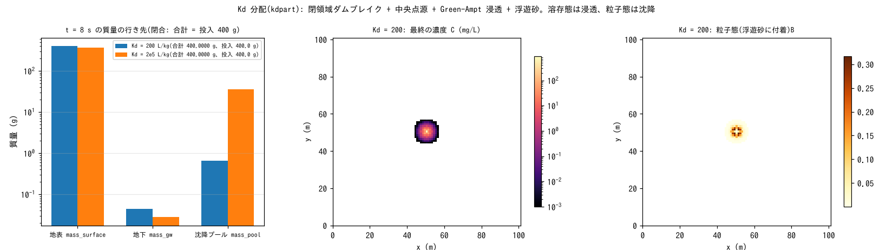

# test/kdpart — ledger closure and monotonicity of equilibrium partitioning (Kd) and particulate settling in water quality

> English mirror of test/kdpart/README.md. The Japanese file is the master copy.

[日本語](../README.md)

A check of **equilibrium partitioning** (`wq_kd`) between the dissolved and
particulate (attached to suspended sediment) phases and of `f_wq_settle = 1`,
which sends the settling particulate phase to the surface buildup pool (K1 of
developer.md §30.6). On the same closed-domain dam break as
[test/suspend](../../suspend/en/README.md), a point source of 50 g/s at the
central cell (400 g in 8 s), Green-Ampt infiltration and suspended sediment
are superposed, and the reference comparison and `Check_kdpart.py` confirm
that the injected mass is distributed among the three destinations (surface,
subsurface and the settling pool) with no excess or deficit (closure), and
that increasing Kd 1000-fold increases settling and decreases infiltration
(monotonicity).

## Configuration

| Item | Value |
|---|---|
| Domain and grid | 101 m × 101 m, Δx = 1 m, flat, walls on all four sides. Still water 0.5 m + water mound (+1 m) |
| Suspended sediment and infiltration | `f_suspend = 1` (sd₀ = 10 m), Green-Ampt 36 mm/h (psif = 0) |
| Water quality | Constant 50 g/s at the point source (51, 51). Configuration 1 `param.txt`: Kd = 200 L/kg (dissolved fraction fd ≈ 0.5 at Css of a few kg/m³). Configuration 2 `param_hi.txt`: Kd = 2e5 L/kg (particulate-dominated) |
| Time | dt = 0.1 s, 8 s |

| File | Contents |
|---|---|
| `Run.sh` | Compares Log.txt and wq.csv with the reference → `Check_kdpart.py closure` (both configurations) → `monotonic` |
| `Check_kdpart.py closure\|monotonic` | in_point = mass_surface + mass_gw + mass_pool (relative 1e-6), activity of settle, to_gw and mass_pool / settle increases and to_gw decreases with larger Kd |
| `Fig.py` | The figure `figs/kdpart.png` below |

## Running

```bash
make
./Run.sh
./Run_MPI.sh 4
python3 Fig.py    # figs/kdpart.png
```

## Figures



Left: the destinations of the injected 400 g after 8 s (logarithmic axis).
At Kd = 200 most of it remains in the surface water; the infiltrated
dissolved phase is 0.044 g and the settled particulate phase 1.47 g. At
Kd = 2e5 the particulate phase dominates: settling increases to 37.5 g and
infiltration decreases to 0.027 g. In both cases the sum of the three equals
400.0000 g. Center: the final concentration at Kd = 200, spreading from the
point source on the ring wave. Right: the particulate phase (the part
attached to suspended sediment).

## Findings

| Quantity | Kd = 200 | Kd = 2e5 | Result |
|---|---|---|---|
| mass_surface / mass_gw / mass_pool (g) | 398.49 / 0.0441 / 1.470 | 362.44 / 0.0275 / 37.53 | — |
| Closure: sum − injected 400 g | 0.000000 | 0.000000 | PASS |
| Monotonicity settle_g | 1.47 → 37.5 (increase) | | PASS |
| Monotonicity to_gw_g | 4.41e-2 → 2.75e-2 (decrease) | | PASS |

- The dissolved fraction is fd = 1/(1 + Kd·Css); only the dissolved phase
  infiltrates and only the particulate phase settles. Cells without suspended
  sediment (hs = 0) have fd = 1, so infiltration does not go to zero even with
  a large Kd (as designed; §30.6).
- Strict coupling with the E-D flux (the metal / sand ratio of the bed
  exchange layer) is deferred until a shortfall is demonstrated by applying
  K1 to a real catchment (wq_metal_plan.md §5).

## Related documents

- [docs/users_guide/wq.md](../../../docs/en/users_guide/wq.md) — `wq_kd`, `f_wq_settle`, the ledger columns
- developer.md §30.6 (implementation and verification of K1), [docs/wq_metal_plan.md](../../../docs/wq_metal_plan.md) (in Japanese)
