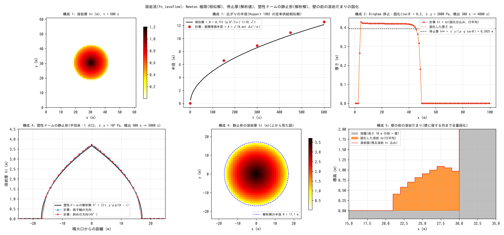

# test/lava — 溶岩流(fn_lavaflow): Huppert 相似解・Bingham 停止厚・塑性ドーム・壁際の固化・土層の埋没・温度(冷却・熱の移流・冷えて止まる流れ・熱の横断の数値拡散)

[English](en/README.md)

溶岩流モジュール(`fn_lavaflow`。Bingham 粘性重力流 + 固化。
[ユーザーガイドの溶岩流の章](../../docs/users_guide/lavaflow.md)、developer.md §51)の
検定です。reference 比較なしの解析解検定で閉じます([test/volcano](../volcano/)
と同じ流儀)。

1. **Huppert**(`param.txt`): 平坦床・中央 1 セルの定率噴出(降伏応力 0 =
   Newton 極限)。Huppert (1982) の定率供給軸対称相似解
   r_N = 0.715 (g Q³/3ν)^{1/8} √t と、面積等価半径・成長則・台帳を比べる。
2. **Bingham**(`param_ty.txt`): 等勾配斜面(tanθ = 0.2)の上流端の列噴火口
   から 300 s 供給して止める。停止厚 h∞ = τ_y/(ρ g tanθ) と固化・台帳を比べる。
3. **既定値の同値**(`param_min.txt` / `param_minx.txt`): 構成 2 と同じ設定で
   `lv_visc`・`lv_vsol` を省略 / 明示し、save と Log がバイト一致(§66)。
4. **等方性**(`param_dome.txt`): 平坦床の中央 1 セルから 900 s 噴出して止まった
   溶岩の静止形を、塑性ドームの解析解 h(r)² = (2τ_y/ρg)(R − r)(Blake 1990)と比べ、
   格子軸の方向と斜めの方向で同じ形になることを検定する(developer.md §51.4)。
5. **壁際の固化**(`param_wall.txt`): 平坦な床の端の高さ 10 m の段(壁)の前に
   溶岩をため、壁に接する列まで全量が固化することを検定する(developer.md §51.5)。
6. **土層の埋没**(`param_bury.txt`): 構成 5 の地形に土層と地下水(Green-Ampt)を
   加え、固化した溶岩の下の土層が埋まり、しみ込んでいた水が地表へ移っても水の
   総量が保たれることを検定する(developer.md §51.6)。
7. **静止した層の冷却**(`param_cool.txt`。温度モード f_lvtemp = 1): 平坦な床に厚さ 1 m の
   一様な溶岩の層(流れない)を置き、放射と対流で冷える温度を、冷却の式の後退 Euler の
   漸化式と厳密解に比べ、固化温度で固まる時刻と熱の台帳を検定する。`param_coolm.txt`
   (構成 7m)は気温を fn_meteo から読む同じ計算で、save がバイト一致すること
   (developer.md §51.7)。
8. **熱の移流**(`param_adv.txt`。温度モード・冷却なし): 噴出温度の違う 2 つの火口から
   噴出させ、熱量の保存と温度の範囲(2 つの噴出温度の間)を検定する。`param_adv0.txt`
   (構成 8')は同じ入力で f_lvtemp = 0 にした等温の計算で、溶岩の堆積がバイト一致すること
   (温度感度 0・冷却なしの温度モードの流れは等温と同じ)。
9. **冷えて止まる流れ**(`param_run.txt`・`param_run4.txt`。温度モード): 一様な斜面に同じ
   体積を噴出率 Q と 4Q で出し、冷えて止まった流れの長さが噴出率とともに増えることを
   検定する(Walker 1973 と同じ向き)。`param_runi.txt`・`param_runi4.txt` は温度を
   計算しない等温の対照で、長さが噴出率によらないこと。構成 9r は構成 9 を途中で保存して
   再開した計算が通しの計算とバイト一致すること(Run.sh が入力を作る)。
10. **熱の横断の数値拡散**(`param_x0.txt`・`param_x0m.txt`・`param_x45.txt`・`param_x45m.txt`。
    温度モード・冷却なし): 一様な斜面を流れるシート流の噴火口の片側から 1150 °C、もう片側から
    1050 °C の溶岩を噴出させ、温度の境目が流れを横切る向きに広がる幅を、流れが格子軸に沿う
    向き(0°)と 45° で、熱の移流の 1 次風上(`f_lvtemp_scheme = 1` を明示)と MUSCL
    (`f_lvtemp_scheme = 3`。既定)で比べる。0° では
    広がらないこと、45° の 1 次風上では修正方程式の横断の拡散係数 (√2/4)·u·Δx に合うこと、
    MUSCL ではその 1/4 未満になることを検定する(developer.md §94)。

## 構成

| 項目 | 構成 1 Huppert | 構成 2 Bingham | 構成 4 等方性 | 構成 5 壁際の固化 | 構成 6 土層の埋没 |
|---|---|---|---|---|---|
| 領域・格子 | 61 m × 61 m、Δx = 1 m、平坦 | 100 m × 8 m、Δx = 1 m、tanθ = 0.2(`zinit.txt`) | 61 m × 61 m、Δx = 1 m、平坦 | 40 m × 8 m、Δx = 1 m、平坦な床と i ≥ 31 の高さ 10 m の段(`zwall.txt`) | 構成 5 と同じ地形に土層 sd0 = 1 m(比湧水量 0.2)、Green-Ampt の地下水(浸透能 360 mm/h)、初期の地表水 5 cm |
| 噴出 | 中央 (31, 31) に 0.5 m³/s 一定 | 上流端 i = 5 の 8 セルに計 0.5 m³/s を 300 s(重複時刻で階段状に停止) | 中央 (31, 31) に 2 m³/s を 900 s(計 1798 m³) | 壁から 3 m の列 i = 28 の 8 セルに計 0.2 m³/s を 300 s | 構成 5 と同じ噴火口に計 0.2 m³/s を 15〜20 分(地表水がしみ込んだ後) |
| 流体 | ρ = 2600、η = 2e4 Pa·s、τ_y = 0、固化なし | ρ = 2600、η = 2e3 Pa·s、τ_y = 2000 Pa、固化レート 0.005 m/s、停止判定 5e-4 m/s | ρ = 2600、η = 1e6 Pa·s、τ_y = 1e4 Pa、固化なし | 構成 2 と同じ | 構成 2 と同じ |
| 時間 | dt = 0.5 s、600 s | dt = 0.5 s、4800 s | dt = 1 s、6000 s | dt = 0.5 s、4800 s | dt = 0.5 s、6000 s |
| 解析値 | r_N(600 s) = 12.13 m | h∞ = 2000/(2600 × 9.8 × 0.2) = 0.3925 m | R = 17.11 m、中心厚 H = √(aR) = 3.665 m(a = 2τ_y/ρg = 0.7849 m) | (保存則と全量固化) | (保存則。水の総量 16 m³) |

温度モード(構成 7〜9。値は検定用で、既定値ではありません):

| 項目 | 構成 7 静止した層の冷却 | 構成 8 熱の移流 | 構成 9 冷えて止まる流れ |
|---|---|---|---|
| 領域・格子 | 4 m × 8 m、Δx = 1 m、平坦 | 41 m × 21 m、Δx = 1 m、平坦 | 320 m × 40 m、Δx = 5 m、tanθ = 0.1(`zrun.txt`) |
| 噴出 | 全 32 セル(`cool_cells.txt`)に最初の更新(t = 10 s)だけ計 3.2 m³/s = 厚さ 1 m の層 | (11, 11) と (31, 11) に 0.5 m³/s ずつ 600 s、噴出温度 1150・1050 °C | 上流端 i = 3 の 8 セルに 1150 °C を計 2 m³/s × 40 分(構成 9)/ 8 m³/s × 10 分(9b)。体積は同じ約 4800 m³ |
| 流体 | 流れない(一様な層) | η = 2e4 Pa·s、τ_y = 0、温度感度 0 | η_r = 1e3 Pa·s、τ_r = 100 Pa(1150 °C)、温度感度 0.04 1/K。等温の対照は η = 1e3、τ_y = 2500 Pa、速度閾値の固化 |
| 冷却 | ε = 0.95、h_c = 70 W/m²/K、c_p = 1150 J/kg/K、気温 20 °C、固化 800 °C | なし(ε = 0、h_c = 0)、固化 700 °C | ε = 0.95、h_c = 70、c_p = 1150、気温 20 °C、固化 1000 °C |
| 時間 | dt = 1 s、更新 10 s、7200 s | dt = 0.5 s、900 s | dt = 1 s、7200 s |
| 比べる値 | 後退 Euler の漸化式・厳密解(RK4)・固化の時刻(4990 s) | Σ V_k T_k(熱量)・温度の範囲・等温の計算 | 流れの長さの比(温度モードと等温の対照) |

構成 10 熱の横断の数値拡散(温度モード・冷却なし。値は検定用):

| 項目 | 0°(`param_x0.txt`・`param_x0m.txt`) | 45°(`param_x45.txt`・`param_x45m.txt`) |
|---|---|---|
| 領域・格子 | 300 m × 100 m(60 × 20)、Δx = 5 m、x 方向に勾配 0.1(`wrk_zx0.txt`) | 300 m × 300 m(60 × 60)、Δx = 5 m、(1,1) 方向に勾配 0.1(`wrk_zx45.txt`) |
| 噴出 | 列 i = 3 の j = 1〜10 から 1150 °C、j = 11〜20 から 1050 °C を 5 m³/s ずつ 3000 s | 反対角線 i + j = 33 の i < j の 14 セルから 1150 °C、i > j の 14 セルから 1050 °C を 9.9 m³/s ずつ 3000 s |
| 流れ | 幅あたり q = 0.1 m²/s の一様なシート流(η = 2e4 Pa·s、τ_y = 0、温度感度 0 で厚さ 1.33 m、速さ 0.075 m/s)。冷却なし | 同じ |
| 熱の移流 | 1 次風上(`x0`)と MUSCL(`x0m`) | 1 次風上(`x45`)と MUSCL(`x45m`) |
| 比べる値 | 境目の両側の温度(噴出温度のまま) | 境目の幅 σ の広がりから求めた横断の拡散係数(修正方程式の 1 次風上で 0.354·u·Δx) |

| ファイル | 内容 |
|---|---|
| `make_init.py` / `make_init.py wall` / `cool` / `run` / `x0`・`x45` / `x0c1`・`x0c2`・`x45c1`・`x45c2` | `zinit.txt`(等勾配斜面)/ `zwall.txt`(平坦な床と高さ 10 m の段)/ `cool_cells.txt`(構成 7 の全セルの噴火口)/ `zrun.txt`(構成 9 の斜面 tanθ = 0.1)/ `wrk_zx0.txt`・`wrk_zx45.txt`(構成 10 の斜面)/ `wrk_x0c*.txt`・`wrk_x45c*.txt`(構成 10 の噴火口。wrk_* は git の対象外で Run.sh・Run_MPI.sh が作る) |
| `Check_lava.py <save> huppert\|bingham\|dome\|wall\|bury\|cool\|adv\|run\|heat\|xdiff` | 構成 1: (1) 台帳 Σhl·A = V_in、(2) 面積等価半径が r_N に 10% 以内、(3) r(tt)/r(tt/2) が √2 に 5% 以内。構成 2: (1) 台帳 Σhl + Σdz = V_in(固化は z への内部移転)、(2) 検定窓(i = 15〜35)の hl + dz が h∞ に 20% 以内・CV < 閾値、(3) 固化率 > 0.7。構成 4: (1) 台帳 Σhl·A = V_in、(2) 格子軸の方向(±22.5°)と斜めの方向(±22.5°)の扇形の面積等価半径の比が 1 に 5% 以内、(3) 中心厚が H に、面積等価半径が R に 5% 以内、r < R の断面の RMS 誤差 < 5% H。構成 5: (1) 台帳 Σhl + Σdz = V_in、(2) 固化率 > 0.999、(3) 壁に接する列(i = 30)の全行で hl = 0 かつ dz が最大厚の半分超。構成 6: (1) 溶岩の台帳、(2) 固化した溶岩のある全セルで sd = 0 かつ hg = 0、ほかのセルの sd = 1 m、(3) Σ(h + hrs + hg) が初期の地表水に相対 1e-9 以内。構成 7(`cool`。第 3 引数は画面出力のログ): (1) 分布出力 Tl が全セル一様で後退 Euler の漸化式に 2e-4 °C 以内、(2) 温度の低下が厳密解に相対 1% 以内、(3) 漸化式で T ≤ 固化温度になる更新より前は溶けたまま・後は全セルが固化、(4) 熱の台帳の残差が相対 1e-12 以内で内訳が漸化式に合う。構成 8(`adv`): (1) 溶岩の台帳、(2) Σhl·Tl·A が Σ V_k T_k に相対 1e-9 以内と画面の残差、(3) 溶岩のある全セルで 1050 ≤ Tl ≤ 1150、混ざった帯がある。構成 9(`run`。4 計算の save を読む): (1) 台帳と全量の固化、(2) 熱の台帳の残差、(3) 温度モードの流れの長さの比 L(4Q)/L(Q) > 1.5、(4) 等温の対照の比が 1 ± 0.1。構成 9r(`heat`): 再開した計算の熱の台帳の残差。構成 10(`xdiff`。4 計算の save を読む): (1) 4 計算の台帳と熱の保存、(2) 0° の列 i = 10・20・30 の全セルが自分の側の噴出温度に 1e-9 °C 以内(1 次風上・MUSCL とも)、(3) 45° の 1 次風上で、反対角線 i + j = 37・43・53・63 の上の温度 θ から求めた境目の幅 σ = √π ∫θ(1 − θ) dn の 2 乗の増え方 D⊥ = u Δσ²/(2Δs) が (√2/4)·u·Δx に相対 15% 以内、(4) 45° の MUSCL の D⊥ が 1 次の 0.25 倍未満、溶岩のある全セルで 1050 ≤ Tl ≤ 1150 |
| `Fig.py` | 下の図 `figs/lava.png` |

## 実行

```bash
make
./Run.sh          # 構成 1 → Check → 構成 2 → Check → 構成 3 の同値検定 → 構成 4〜9・9r・10 → Check(1 スレッドで約 45 秒)
./Run_MPI.sh 4    # MPI。state.dat・lavaflow.dat(・lavaflow_temp.dat)が逐次とバイト一致(-O2 厳密数学)
python3 Fig.py    # figs/lava.png(引数 en で英語版を en/figs/ に)
```

## 図



上段左: 構成 1 の 600 s 後の溶岩厚。中央から軸対称に広がります。上段中: 面積
等価半径の成長。計算(●)は相似解の √t 則に沿い、成長則 r(tt)/r(tt/2) は
√2 に 0.6% で一致します。半径の絶対値は Check_lava の数え方(薄い裾まで
含む)で 13.2 m(+8.5%)、図の 1 cm 以上の面積では 12.5 m(+2.8%)で、差は
前縁の薄い裾の扱いです(エッジ平均厚による前縁の遅れを含む)。
上段右: 構成 2 の最終の厚さ(行平均)。噴火口の下流 x = 6〜40 m で hl + dz が
0.42 m の平坦な台地になり、停止厚の解析値 0.3925 m に 7.1% で一致し、
全量が固化しています(dz = hl + dz)。
下段左: 構成 4 の静止形の断面。格子軸の方向(●)と斜めの方向(■)の断面が重なり、
塑性ドームの解析解(黒)に沿います(中心厚 +1.2%、面積等価半径 −1.5%)。
降伏を法線方向の勾配だけで判定していた修正前の方式では、斜めの方向の前縁が
格子軸の方向の 0.74 倍の距離で止まり、静止形が格子軸の方向に伸びたひし形でした
(developer.md §51.4)。下段中: 同じ静止形を上から見た図。解析解の半径(破線)の
円になります。
下段右: 構成 5 の最終の地形(行平均)。壁の前にたまった溶岩が、壁に接する列まで
固化しています(壁際の dz 0.98 m)。流れ込みのエッジを停止判定に数えていた修正前の
判定では、壁に接する列が溶けたまま(hl 0.98 m、噴出量の 13%)残りました
(developer.md §51.5)。

## 所見

| 検定 | 計算値 | 判定 |
|---|---|---|
| 構成 1 (1) 台帳 Σhl·A − V_in | −5.7e-14 m³(V_in = 300 m³) | PASS |
| 構成 1 (2) 面積等価半径 | 13.17 m(r_N 12.13 m、+8.5%、許容 10%) | PASS |
| 構成 1 (3) 成長則 r(tt)/r(tt/2) | 1.423(√2 に 0.6%) | PASS |
| 構成 2 (1) 台帳 (Σhl + Σdz)·A − V_in | 1.2e-11 m³(V_in = 149.75 m³) | PASS |
| 構成 2 (2) 停止厚 <hl + dz> | 0.4203 m(h∞ 0.3925、+7.1%、許容 20%)、CV 0.001 | PASS |
| 構成 2 (3) 固化率 | 1.000、max dz 0.43 m | PASS |
| 構成 3 既定値の同値 | save・Log がバイト一致、"(default)" 2 行 | PASS |
| 構成 4 (1) 台帳 Σhl·A − V_in | −2.3e-13 m³(V_in = 1798 m³) | PASS |
| 構成 4 (2) 扇形の面積等価半径の比(斜め/格子軸) | 16.96 m / 16.74 m = 1.014(許容 1 ± 0.05) | PASS |
| 構成 4 (3) 塑性ドームの解析解 | 中心厚 3.710 m(H 3.665 m、+1.2%)、面積等価半径 16.86 m(R 17.11 m、−1.5%)、断面 RMS 0.076 m(H の 2.1%) | PASS |
| 構成 5 (1) 台帳 (Σhl + Σdz)·A − V_in | −2.3e-13 m³(V_in = 59.9 m³) | PASS |
| 構成 5 (2) 固化率 | 1.0000(残る溶岩なし) | PASS |
| 構成 5 (3) 壁に接する列 | 全行で hl = 0、min dz 0.978 m(max dz 1.076 m) | PASS |
| 構成 6 (1) 溶岩の台帳 | −1.8e-13 m³(V_in = 60 m³) | PASS |
| 構成 6 (2) 土層の埋没 | 溶岩の下 80 セルで sd = 0・hg = 0、ほかの sd = 1 m(埋めた土層 80 m³、地表へ移した地下水 5.65 m³) | PASS |
| 構成 6 (3) 水の保存 Σ(h + hrs + hg) − 初期 | −5.3e-13 m³(初期 16 m³) | PASS |
| 構成 7 (1) 出力 Tl と後退 Euler の漸化式の差 | 最大 4.2e-5 °C(全セル一様) | PASS |
| 構成 7 (2) 温度の低下の厳密解との差 | 相対 9.4e-4(許容 1%) | PASS |
| 構成 7 (3) 温度による固化 | 499 回目の更新(t = 4990 s、799.60 °C)で全セル固化、dz = 1 m | PASS |
| 構成 7 (4) 熱の台帳の残差 | −2.9e-16(噴出の相対)。噴出 1.0525e11 J = 放射 1.8562e10 + 対流 1.0180e10 + 固化 7.6505e10 J | PASS |
| 構成 7m 気温を fn_meteo から読む | save が構成 7 とバイト一致 | PASS |
| 構成 8 (1) 台帳 Σhl·A − V_in | −1.1e-13 m³(V_in = 599.5 m³) | PASS |
| 構成 8 (2) 熱の保存 | Σhl·Tl·A = Σ V_k T_k に相対 −1.8e-16、画面の残差 1.2e-16 | PASS |
| 構成 8 (3) 温度の範囲 | 1050.000000〜1150.000000 °C、混ざった帯 21 セル | PASS |
| 構成 8' 等温の計算との一致 | lavaflow.dat・state.dat がバイト一致 | PASS |
| 構成 9 (1)(2) 台帳と熱の台帳 | 4 計算とも機械精度・全量固化、熱の台帳の残差 ≤ 9.5e-16 | PASS |
| 構成 9 (3) 温度モードの流れの長さ | 50 m(2 m³/s)→ 145 m(8 m³/s)、比 2.90(許容 > 1.5) | PASS |
| 構成 9 (4) 等温の対照の流れの長さ | 120 m → 120 m、比 1.00(許容 1 ± 0.1) | PASS |
| 構成 9r リスタートの往復 | save 3 ファイルが通しの計算とバイト一致、熱の台帳の残差 8.93e-16 | PASS |
| 構成 10 (1) 台帳と熱の保存 | 4 計算とも Σhl·A − V_in ≤ 5.1e-11 m³(V_in 3.0 万・5.9 万 m³)、熱の相対 ≤ 1.4e-15、画面の残差 ≤ 3.7e-13 | PASS |
| 構成 10 (2) 0° の境目 | 1 次風上・MUSCL とも境目の両側が噴出温度のまま(差 ≤ 4.5e-13 °C)。MUSCL の save は 1 次風上とバイト一致 | PASS |
| 構成 10 (3) 45° の 1 次風上 | σ = 6.85・11.04・15.73・19.37 m(s = 14・35・71・106 m)、D⊥ = 0.357·u·Δx(理論 0.354、+1.0%。許容 15%) | PASS |
| 構成 10 (4) 45° の MUSCL | σ = 3.83・5.02・6.06・6.75 m、D⊥ = 0.034·u·Δx(1 次の 0.09 倍。許容 < 0.25)、Tl = 1050〜1150 °C | PASS |

- 停止厚の +7% は停止判定 `lv_vsol` の打切りによる上振れ
  h∞ + √(v_sol h/(coef (2h + h₀) S)) を含みます(§51.3)。停止の漸近は遅く、
  検定は「検定時間内に排水が h∞ 近傍へ届く粘度」で組んであります
  (η = 1e4 では 900 s で 29% 上振れ = パラメータ選定の目安)。
- 台帳は注入の厳密加算とエッジ反対称の拡散により機械精度で閉じます。
  リスタート往復(300 s save → restore → 600 s)もバイト一致です(構成 4 でも
  3000 s save → restore → 6000 s がバイト一致)。
- 構成 4 は格子の向きによる歪みの検出器です。修正前の方式(降伏と停止を法線方向の
  勾配だけで判定)で回すと、扇形の面積等価半径の比 0.860、中心厚 +9.5%、面積等価
  半径 −5.1%、断面 RMS 12.5% で FAIL します。粘度は静止形に効かないので、検定時間
  内に止まる値(η = 1e6 Pa·s)にしてあります(3000 s と 6000 s の中心厚の差 1.6%)。
- 構成 1・2 は修正(2026-11-03)の前後で save がバイト一致です(構成 1 は τ_y = 0、
  構成 2 は幅方向に一様でエッジに沿う方向の勾配が 0)。
- 構成 5 は停止判定の検出器です。流れ込みのエッジを数えていた修正前の判定で回すと、
  固化率 0.869、壁際の hl 0.978 m で FAIL します。壁際以外の堆積の形は修正の前後で
  同じです。構成 1〜4 の save は停止判定の修正(§51.5)の前後でもバイト一致です。
- 構成 6 は土層の埋没の検出器です。修正前は固化で z だけが上がり、溶岩の下の
  80 セルに sd = 1 m と地下貯留(最大 0.059 m)が残って FAIL します。溶岩の堆積
  (z・hl)は埋める前後でバイト一致です(変わるのは土層と水だけ)。構成 1〜5 は土層を
  使わないので、埋没の修正(§51.6)の前後で save がバイト一致です。図には構成 6 を
  入れていません。
- 構成 7〜9 は温度モード(developer.md §51.7)の検定です。構成 7 の後退 Euler は 1 次精度で、
  10 s の刻み(冷却の時定数は約 80 分)で温度の低下の誤差が 0.09% です。構成 9 は、等温では
  流れの長さが体積と降伏応力で決まり噴出率によらない(停止厚 0.98 m の一様な堆積)のに対し、
  温度モードでは噴出率の低い流れが先端から冷えて早く止まり、その背後に溶岩がたまって厚く
  なる(最大の厚さ 3.5 m)ことを示します。図には構成 7〜9 も入れていません。
- 構成 1〜6 の save・分布出力・Log.txt は、温度モードの追加の前後でバイト一致です
  (等温の計算は温度の配列を確保せず、同じコードを通る)。
- 構成 10 は熱の移流の数値拡散の検出器です(developer.md §94)。4 近傍の 1 次風上は、流れが
  格子軸に沿うと横断に拡散しませんが、45° では x・y の両方のエッジから入る熱が送り手の温度の
  平均になり、修正方程式の D⊥ = (Δx/2)(|u_x| sin²θ + |u_y| cos²θ) = 0.354·u·Δx で広がります。
  MUSCL(`f_lvtemp_scheme = 3`)は主要項を消し、残りは限定器が境目の両端で 1 次に戻る分です。
  0° では温度が流れに沿って一定・横断に階段状なので再構成が働かず、1 次風上とバイト一致します。
  構成 1〜9 の save(save_info.txt の作成時刻の行を除く)・分布出力・Log.txt は、MUSCL の追加
  (当時の既定は 1)の前後でバイト一致でした。既定を 3 にした(2026-11-05)ことで変わるのは、
  温度モードで溶岩が流れる構成 8(温度の分布だけ。冷却がなく温度感度も 0 なので堆積は変わらない)と
  構成 9・9r(堆積の形と流れの長さ。噴出率 Q の流れで 55 → 50 m、比 2.64 → 2.90)です。
  等温の構成 1〜6 と構成 9 の等温の対照、流れない構成 7、1 次風上を明示した構成 10 の x0・x45 は
  変わりません。図には構成 10 を入れていません。
- 流束のステンシルは 4 近傍のままで、8 近傍化は拡散型モジュール共通の候補として
  残ります(developer.md §61.4)。

## 関連文書

- [docs/users_guide/lavaflow.md](../../docs/users_guide/lavaflow.md) — `&list_lavaflow`(粘性・降伏応力・固化・噴火口・温度モード)
- developer.md §51(実装・検証記録)、§66(既定値)
