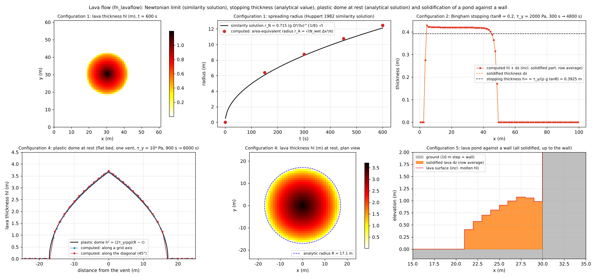

# test/lava — lava flow (fn_lavaflow): Huppert similarity solution, Bingham stopping thickness and plastic dome

> English mirror of test/lava/README.md. The Japanese file is the master copy.

[日本語](../README.md)

Checks of the lava flow module (`fn_lavaflow`; Bingham viscous gravity
current + solidification. [The lava flow chapter of the users
guide](../../../docs/en/users_guide/lavaflow.md), developer.md §51). It is
closed by analytical-solution checks without a reference comparison (the
same practice as [test/volcano](../../volcano/en/README.md)).

1. **Huppert** (`param.txt`): flat bed, constant-rate effusion from the
   single central cell (yield stress 0 = Newtonian limit). The
   area-equivalent radius, the growth law and the ledger are compared with
   the axisymmetric similarity solution of Huppert (1982) for constant
   supply, r_N = 0.715 (g Q³/3ν)^{1/8} √t.
2. **Bingham** (`param_ty.txt`): supply for 300 s from a row of vents at the
   upstream end of a uniform slope (tanθ = 0.2), then stop. The stopping
   thickness h∞ = τ_y/(ρ g tanθ), the solidification and the ledger are
   compared.
3. **Equivalence of the defaults** (`param_min.txt` / `param_minx.txt`): the
   same settings as configuration 2 with `lv_visc` and `lv_vsol` omitted /
   explicit; the save and the Log are byte-identical (§66).
4. **Isotropy** (`param_dome.txt`): the shape at rest of lava erupted for
   900 s from the single central cell of a flat bed is compared with the
   analytic plastic dome h(r)² = (2τ_y/ρg)(R − r) (Blake 1990), checking
   that it is the same along the grid axes and the diagonals
   (developer.md §51.4).

## Configuration

| Item | Configuration 1 Huppert | Configuration 2 Bingham | Configuration 4 isotropy |
|---|---|---|---|
| Domain and grid | 61 m × 61 m, Δx = 1 m, flat | 100 m × 8 m, Δx = 1 m, tanθ = 0.2 (`zinit.txt`) | 61 m × 61 m, Δx = 1 m, flat |
| Effusion | Constant 0.5 m³/s at the center (31, 31) | A total of 0.5 m³/s over the 8 cells at the upstream end i = 5 for 300 s (stepwise stop by a duplicated time) | 2 m³/s at the center (31, 31) for 900 s (1798 m³ in total) |
| Fluid | ρ = 2600, η = 2e4 Pa·s, τ_y = 0, no solidification | ρ = 2600, η = 2e3 Pa·s, τ_y = 2000 Pa, solidification rate 0.005 m/s, stop detection 5e-4 m/s | ρ = 2600, η = 1e6 Pa·s, τ_y = 1e4 Pa, no solidification |
| Time | dt = 0.5 s, 600 s | dt = 0.5 s, 4800 s | dt = 1 s, 6000 s |
| Analytical value | r_N(600 s) = 12.13 m | h∞ = 2000/(2600 × 9.8 × 0.2) = 0.3925 m | R = 17.11 m, center thickness H = √(aR) = 3.665 m (a = 2τ_y/ρg = 0.7849 m) |

| File | Contents |
|---|---|
| `make_init.py` | `zinit.txt` (uniform slope) |
| `Check_lava.py <save> huppert\|bingham\|dome` | Configuration 1: (1) ledger Σhl·A = V_in, (2) area-equivalent radius within 10% of r_N, (3) r(tt)/r(tt/2) within 5% of √2. Configuration 2: (1) ledger Σhl + Σdz = V_in (solidification is an internal transfer to z), (2) hl + dz in the check window (i = 15–35) within 20% of h∞ and CV < threshold, (3) solidified fraction > 0.7. Configuration 4: (1) ledger Σhl·A = V_in, (2) the ratio of the area-equivalent radii of the sectors along the grid axes (±22.5°) and along the diagonals (±22.5°) within 5% of 1, (3) center thickness within 5% of H and area-equivalent radius within 5% of R, RMS error of the profile for r < R < 5% of H |
| `Fig.py` | The figure `en/figs/lava.png` below (`python3 Fig.py en`; `figs/lava.png` is the Japanese version) |

## Running

```bash
make
./Run.sh          # configuration 1 → Check → configuration 2 → Check → equivalence check of configuration 3 → configuration 4 → Check (about 30 seconds)
./Run_MPI.sh 4    # MPI. state.dat and lavaflow.dat are byte-identical to the serial run (-O2 strict math)
python3 Fig.py en # en/figs/lava.png
```

## Figures



Top left: the lava thickness of configuration 1 after 600 s. It spreads
axisymmetrically from the center. Top right: the growth of the area-equivalent
radius. The computation (●) follows the √t law of the similarity solution,
and the growth law r(tt)/r(tt/2) agrees with √2 to 0.6%. The absolute value
of the radius is 13.2 m (+8.5%) by the counting method of Check_lava (which
includes the thin fringe) and 12.5 m (+2.8%) for the area with 1 cm or more
in the figure; the difference is the treatment of the thin fringe at the
front (including the lag of the front due to the edge-averaged thickness).
Bottom left: the final thickness of configuration 2 (row average). Downstream of
the vents at x = 6–40 m, hl + dz forms a flat plateau of 0.42 m, agreeing
with the analytical stopping thickness 0.3925 m to 7.1%, and the whole
amount has solidified (dz = hl + dz).
Bottom right: profiles of the shape at rest of configuration 4. The profiles
along the grid axis (●) and along the diagonal (■) overlap and follow the
analytic plastic dome (black) (center thickness +1.2%, area-equivalent
radius −1.5%). With the scheme before the fix, which judged the yield on the
gradient across the edge only, the front along the diagonal stopped at 0.74
times the distance along the grid axis, and the shape at rest was a diamond
elongated along the grid axes (developer.md §51.4).

## Findings

| Check | Computed | Result |
|---|---|---|
| Configuration 1 (1) ledger Σhl·A − V_in | −5.7e-14 m³ (V_in = 300 m³) | PASS |
| Configuration 1 (2) area-equivalent radius | 13.17 m (r_N 12.13 m, +8.5%, tolerance 10%) | PASS |
| Configuration 1 (3) growth law r(tt)/r(tt/2) | 1.423 (0.6% from √2) | PASS |
| Configuration 2 (1) ledger (Σhl + Σdz)·A − V_in | 1.2e-11 m³ (V_in = 149.75 m³) | PASS |
| Configuration 2 (2) stopping thickness <hl + dz> | 0.4203 m (h∞ 0.3925, +7.1%, tolerance 20%), CV 0.001 | PASS |
| Configuration 2 (3) solidified fraction | 1.000, max dz 0.43 m | PASS |
| Configuration 3 equivalence of the defaults | save and Log byte-identical, 2 "(default)" lines | PASS |
| Configuration 4 (1) ledger Σhl·A − V_in | −2.3e-13 m³ (V_in = 1798 m³) | PASS |
| Configuration 4 (2) ratio of the sector area-equivalent radii (diagonal / grid axis) | 16.96 m / 16.74 m = 1.014 (tolerance 1 ± 0.05) | PASS |
| Configuration 4 (3) analytic plastic dome | center thickness 3.710 m (H 3.665 m, +1.2%), area-equivalent radius 16.86 m (R 17.11 m, −1.5%), profile RMS 0.076 m (2.1% of H) | PASS |

- The +7% of the stopping thickness includes the upward bias
  h∞ + √(v_sol h/(coef (2h + h₀) S)) from the cutoff by the stop detection
  `lv_vsol` (§51.3). The approach to stopping is slow, and the check is
  built with "a viscosity for which the drainage reaches the vicinity of h∞
  within the check time" (with η = 1e4 the bias is 29% at 900 s = a
  guideline for parameter selection).
- The ledger closes to machine precision by the exact addition of the
  injection and the edge-antisymmetric diffusion. The restart round trip
  (300 s save → restore → 600 s) is also byte-identical (and so is
  3000 s save → restore → 6000 s for configuration 4).
- Configuration 4 is a detector of distortion by the grid orientation. Run
  with the scheme before the fix (yield and stopping judged on the gradient
  across the edge only), it FAILs with a sector radius ratio of 0.860, a
  center thickness of +9.5%, an area-equivalent radius of −5.1% and a
  profile RMS of 12.5%. The viscosity does not affect the shape at rest, so
  a value that stops within the check time (η = 1e6 Pa·s) is used (the
  center thickness differs by 1.6% between 3000 s and 6000 s).
- Configurations 1 and 2 have byte-identical saves before and after the fix
  (2026-11-03): configuration 1 has τ_y = 0, and configuration 2 is uniform
  across the width, so the gradient along the edges is 0.
- The flux stencil remains 4-neighbor; the 8-neighbor extension remains a
  candidate common to the diffusion-type modules (developer.md §61.4).

## Related documents

- [docs/users_guide/lavaflow.md](../../../docs/en/users_guide/lavaflow.md) — `&list_lavaflow` (viscosity, yield stress, solidification, vents)
- developer.md §51 (implementation and verification record), §66 (defaults) (in Japanese)
