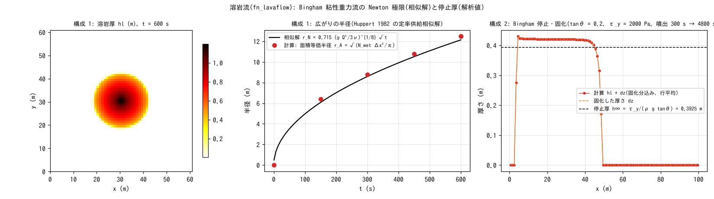

# test/lava — lava flow (fn_lavaflow): Huppert similarity solution and Bingham stopping thickness

> English mirror of test/lava/README.md. The Japanese file is the master copy.

[日本語](../README.md)

Checks of the lava flow module (`fn_lavaflow`; Bingham viscous gravity
current + solidification. [The lava flow chapter of the users
guide](../../../docs/en/users_guide/lavaflow.md), developer.md §51). It is
closed by analytical-solution checks without a reference comparison (the
same practice as [test/volcano](../../volcano/en/README.md)).

1. **Huppert** (`param.txt`): flat bed, constant-rate effusion from the
   single central cell (yield stress 0 = Newtonian limit). The
   area-equivalent radius, the growth law and the ledger are compared with
   the axisymmetric similarity solution of Huppert (1982) for constant
   supply, r_N = 0.715 (g Q³/3ν)^{1/8} √t.
2. **Bingham** (`param_ty.txt`): supply for 300 s from a row of vents at the
   upstream end of a uniform slope (tanθ = 0.2), then stop. The stopping
   thickness h∞ = τ_y/(ρ g tanθ), the solidification and the ledger are
   compared.
3. **Equivalence of the defaults** (`param_min.txt` / `param_minx.txt`): the
   same settings as configuration 2 with `lv_visc` and `lv_vsol` omitted /
   explicit; the save and the Log are byte-identical (§66).

## Configuration

| Item | Configuration 1 Huppert | Configuration 2 Bingham |
|---|---|---|
| Domain and grid | 61 m × 61 m, Δx = 1 m, flat | 100 m × 8 m, Δx = 1 m, tanθ = 0.2 (`zinit.txt`) |
| Effusion | Constant 0.5 m³/s at the center (31, 31) | A total of 0.5 m³/s over the 8 cells at the upstream end i = 5 for 300 s (stepwise stop by a duplicated time) |
| Fluid | ρ = 2600, η = 2e4 Pa·s, τ_y = 0, no solidification | ρ = 2600, η = 2e3 Pa·s, τ_y = 2000 Pa, solidification rate 0.005 m/s, stop detection 5e-4 m/s |
| Time | dt = 0.5 s, 600 s | dt = 0.5 s, 4800 s |
| Analytical value | r_N(600 s) = 12.13 m | h∞ = 2000/(2600 × 9.8 × 0.2) = 0.3925 m |

| File | Contents |
|---|---|
| `make_init.py` | `zinit.txt` (uniform slope) |
| `Check_lava.py <save> huppert\|bingham` | Configuration 1: (1) ledger Σhl·A = V_in, (2) area-equivalent radius within 10% of r_N, (3) r(tt)/r(tt/2) within 5% of √2. Configuration 2: (1) ledger Σhl + Σdz = V_in (solidification is an internal transfer to z), (2) hl + dz in the check window (i = 15–35) within 20% of h∞ and CV < threshold, (3) solidified fraction > 0.7 |
| `Fig.py` | The figure `figs/lava.png` below |

## Running

```bash
make
./Run.sh          # configuration 1 → Check → configuration 2 → Check → equivalence check of configuration 3 (about 30 seconds)
./Run_MPI.sh 4    # MPI. state.dat and lavaflow.dat are byte-identical to the serial run (-O2 strict math)
python3 Fig.py    # figs/lava.png
```

## Figures



Left: the lava thickness of configuration 1 after 600 s. It spreads
axisymmetrically from the center. Center: the growth of the area-equivalent
radius. The computation (●) follows the √t law of the similarity solution,
and the growth law r(tt)/r(tt/2) agrees with √2 to 0.6%. The absolute value
of the radius is 13.2 m (+8.5%) by the counting method of Check_lava (which
includes the thin fringe) and 12.5 m (+2.8%) for the area with 1 cm or more
in the figure; the difference is the treatment of the thin fringe at the
front (including the lag of the front due to the edge-averaged thickness).
Right: the final thickness of configuration 2 (row average). Downstream of
the vents at x = 6–40 m, hl + dz forms a flat plateau of 0.42 m, agreeing
with the analytical stopping thickness 0.3925 m to 7.1%, and the whole
amount has solidified (dz = hl + dz).

## Findings

| Check | Computed | Result |
|---|---|---|
| Configuration 1 (1) ledger Σhl·A − V_in | −5.7e-14 m³ (V_in = 300 m³) | PASS |
| Configuration 1 (2) area-equivalent radius | 13.17 m (r_N 12.13 m, +8.5%, tolerance 10%) | PASS |
| Configuration 1 (3) growth law r(tt)/r(tt/2) | 1.423 (0.6% from √2) | PASS |
| Configuration 2 (1) ledger (Σhl + Σdz)·A − V_in | 1.2e-11 m³ (V_in = 149.75 m³) | PASS |
| Configuration 2 (2) stopping thickness <hl + dz> | 0.4203 m (h∞ 0.3925, +7.1%, tolerance 20%), CV 0.001 | PASS |
| Configuration 2 (3) solidified fraction | 1.000, max dz 0.43 m | PASS |
| Configuration 3 equivalence of the defaults | save and Log byte-identical, 2 "(default)" lines | PASS |

- The +7% of the stopping thickness includes the upward bias
  h∞ + √(v_sol h/(coef (2h + h₀) S)) from the cutoff by the stop detection
  `lv_vsol` (§51.3). The approach to stopping is slow, and the check is
  built with "a viscosity for which the drainage reaches the vicinity of h∞
  within the check time" (with η = 1e4 the bias is 29% at 900 s = a
  guideline for parameter selection).
- The ledger closes to machine precision by the exact addition of the
  injection and the edge-antisymmetric diffusion. The restart round trip
  (300 s save → restore → 600 s) is also byte-identical.
- The lava flow is a candidate for the 8-neighbor extension of the
  diffusion-type modules (developer.md §61.4).

## Related documents

- [docs/users_guide/lavaflow.md](../../../docs/en/users_guide/lavaflow.md) — `&list_lavaflow` (viscosity, yield stress, solidification, vents)
- developer.md §51 (implementation and verification record), §66 (defaults) (in Japanese)
