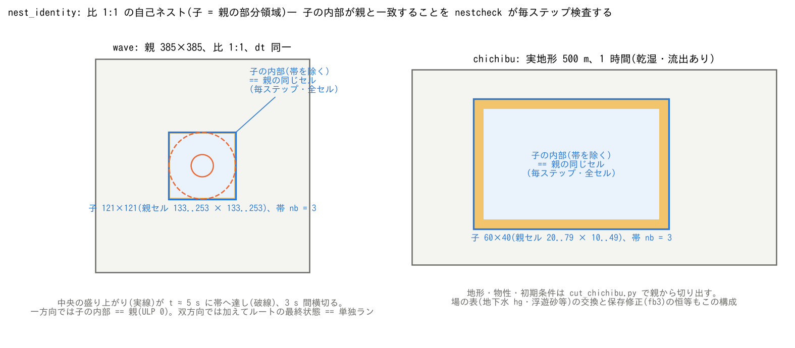

# test/nest_identity — Identity test of 1:1 self-nesting

> English mirror of test/nest_identity/README.md. The Japanese file is the master copy.

[日本語](../README.md)

The core of the verification of nesting (docs/users_guide/nest.md,
docs/nesting_plan.md). When the child uses the same grid as a subregion of
the parent (ratio 1:1, same dt), the interpolation of the band becomes the
identity map (the parent's values are placed as they are), so **the interior
of the child (excluding the band) should be bit-identical to the same cells
of the parent**. `nestcheck` (nestcheck.f90; a verification driver that uses
m_main) checks this at every step and in every cell. With two-way nesting
(nest_fb ≥ 1) the replacement is also the identity, so in addition **the
final state of the root must be byte-identical to a stand-alone run** (cmp of
state.dat / swflow_enc.dat in save). Bugs in grid confusion, row order,
halos, time interpolation and replacement appear here mechanically as
ULP 0 mismatches.



## Running

```
./Run.sh            # serial
./Run_MPI.sh 2      # MPI with 2 ranks (np=1, 2, 4 must all give the same result as the serial run)
```

The main body is Run_nest.sh (builds nestcheck and runs the cases in turn).

Since the comparison is byte identity, nestcheck and the core
(libencflow.a) must be built with the same FFLAGS. If only src is rebuilt
with `make FFLAGS=...` (e.g. -O0 -fcheck=all), nestcheck is still linked
with the -Ofast of make.inc, and the presence or absence of FTZ/DAZ
(flushing denormals to zero) set by `-ffast-math` differs from the core, so
they no longer agree. To verify with a different optimization, change FFLAGS
in make.inc (developer.md §72).

## Cases

| Case | Parent / child | What is checked | Criterion |
|---|---|---|---|
| wave_s1 / wave | wave 385², child 121² (parent cells 133..253). Advection scheme 1 (band 2) / 3 (band 3) | One-way band Dirichlet. The initial depth is cut out of the stand-alone grid (`nestcheck cut`) | Child interior == parent (ULP 0) |
| restart | wave_s1 saved and resumed at t = 4 s (dir_save per grid) | save/restore of a nested system | Identity holds after the resume. The Log lines are lexically identical to the uninterrupted run |
| chichibu | Real terrain 500 m, 112×60, child 60×40 (parent cells 20..79 × 10..49), 1 hour | The band on terrain with wet/dry, runoff and channels | Child interior == parent |
| wave_tw / chichibu_tw | The two configurations above with two-way nesting (nest_fb = 2) | Identity of the replacement | Child interior == parent, and the final state of the root == stand-alone run (cmp) |
| wave_fb3 / chichibu_fb3 | Conservation correction (nest_fb = 3) | At ratio 1 the correction is exactly 0 | As above |
| chichibu_gw | Groundwater bucket enabled in parent and child | Band and replacement of the field table (hg etc.) | As above |
| flather | Parent at rest (385²), child 201² (parent cells 93..293) with its own water mound, radiation on the 4 edges (f_bc_* = 2), one-way | Degeneration of Flather (nest_bc = 3): with a parent at rest, η_e = reference and u_n,e = 0, which coincides with the existing radiation boundary | Child Log == Log of the stand-alone run (radiation boundary only) (cmp) |
| nh | Parent and child both non-hydrostatic (CG, nh_tol = 1e-12, whole-domain solution), one-way | The band cells become known cells of the parent's φ (nest_nh = 1) | Child interior == parent, tolerance 1e-10 (not bit-identical because the CG iteration sequence depends on the domain; measured 2e-13 m) |
| nh0 (control) | As above with nest_nh = 0 (band + margin hydrostatic) | Confirmation that they do not agree (display only) | Measured max|dh| 1.4e-2 m |
| nha (display only) | Active set in the child only (f_nh_adaptive = 1), whole-domain solution in the parent | Truncation error of the active set (cells adjacent to the band join the seeds with the parent's φ) | Measured max|dh| 3.0e-4 m |

- Arguments of nestcheck: `run <root param> <i0> <j0> <nb> [tol]`. `cut <single param> <i0> <j0> <nxc> <nyc> <out>` cuts the child's initial-depth file out of the initial depth of the stand-alone grid. The chichibu terrain files are cut out by cut_chichibu.py (data_chichibu_child/).
- The figure is generated as figs/identity.png by `./Fig.py` (a schematic; no data needed).
- The same identity through BMI (grid distinction, replacement, re-initialize) is test/bmi_nest.
