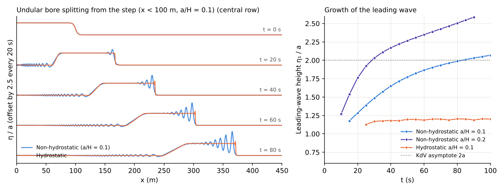

# test/nhbore — Undular bore splitting from a long-wave step (soliton fission by the non-hydrostatic correction)

> English mirror of test/nhbore/README.md. The Japanese file is the master copy.

[日本語](../README.md)

docs/nonhydrostatic_plan.md §11 Phase 5 (in Japanese); the elementary process
of the "soliton fission and undular bores of tsunamis running up rivers" of
its §1. In a flat-bed, frictionless, wall-bounded channel (450 m × 8 m,
Δx = Δy = 0.25 m = H/4, 32 rows), a step with H = 1 m raised by a/H = 0.1 for
x < 100 m (tanh transition 4 m; user routine `wave_bore`) is given the
velocity of a right-going simple wave u = 2(√(g(H+η)) − √(gH)) and
propagated for 100 s. The front steepens nonlinearly and, by dispersion,
splits into a wave train from its head.

- `./Run.sh` / `./Run_MPI.sh N`: regression test of param.txt
  (f_nonhydrostatic=1, CG) (Log.txt; the Runge column excluded).
- After running `./encflow param20.txt` (a/H = 0.2) and
  `./encflow param_h.txt` (hydrostatic), `./Bore.py` tabulates, from the
  water surface along the central row, the position of the front, the
  position and height η₁/a of the leading wave, the number of crests in the
  wave train, and the speed of the leading wave. `./Fig.py en` draws the figure
  to `en/figs/bore.png` (`figs/bore.png` is the Japanese version).

## Figure

## Findings (2026-10-12; the hydrostatic row is the value of 2026-10-24 with f_hcap_upwind = 2)

| Configuration | η₁/a (t = 50 / 90 s) | Number of crests (90 s) | Leading-wave speed / √(gH) (second half) |
|---|---:|---:|---:|
| Non-hydrostatic a/H = 0.1 | 1.77 / 2.03 | 6 | 1.087 |
| Non-hydrostatic a/H = 0.2 | 2.27 / 2.59 | 11 | 1.118 |
| Hydrostatic a/H = 0.1 (f_hcap_upwind = 2) | 1.20 / 1.19 | 1 | 1.091 |

- In the non-hydrostatic run the front of the step splits from its head into
  a wave train (undular bore), and the height of the leading wave approaches
  monotonically the asymptotic value 2a of the KdV undular bore (Gurevich &
  Pitaevskii 1974) (2.03a at 90 s for a/H = 0.1, still growing). The speed of
  the leading wave is −1% relative to √(gH)(1 + a/H) = 1.10 for a solitary
  wave of height 2a (including the +0.1% effect of the channel in which the
  diagonal edges are missing at the walls; test/nhsolitary).
- For a/H = 0.2 the leading wave grows beyond 2a (2.59a at 90 s). Unlike the
  weakly nonlinear KdV, the undular bore of the fully nonlinear one-layer
  model (Serre/Green–Naghdi type) has a leading-wave ratio that exceeds 2 for
  stronger steps (El, Grimshaw & Smyth 2006), and this is consistent with
  that. 100 s is excluded because the front has reached the east wall.
- The hydrostatic run advances as a bore (the head stays at 1.2a; the speed
  is 1.091 √(gH), +1.5% relative to the theoretical bore speed
  √(g h₂(h₁+h₂)/(2h₁)) = 1.075 √(gH), and nearly the same as the NH leading
  wave, 1.087). param_h.txt specifies f_hcap_upwind = 2 (upstream depth;
  §68.7), as nhbreak does (2026-10-24). With the default 0 (two-sided
  average) numerical oscillations (2–3a) arise behind the bore (the same
  origin as the overshoot behind the bore seen for dt ≤ 0.025 in the
  verification against the Stoker solution; §69.6; 3.10a at 90 s, 12 crests,
  speed ratio 1.162, the values of the table up to 2026-10-24). They are
  distinct from the wave train split by dispersion, and the crest spacing
  depends on the grid.
- The growth of the leading wave is slow, t ∝ 1/(dispersion time scale), and
  does not reach the asymptotic value even in the 450 m channel. For a
  quantitative comparison, use the time evolution of the leading-wave height
  itself (figure, right).
- The growth of the oscillation behind the hydrostatic bore with
  f_hcap_upwind = 0 from the record of 10-12 (1.4–1.6a) to 2–3a is due to the
  change of the default on 2026-10-18 (f_opening_dynamic = 2; developer.md
  §68.38). With the former default 1 written explicitly it returns to the
  values of 10-12 (1.57a at 90 s, leading wave speed ratio 1.108) (confirmed
  2026-10-24).
