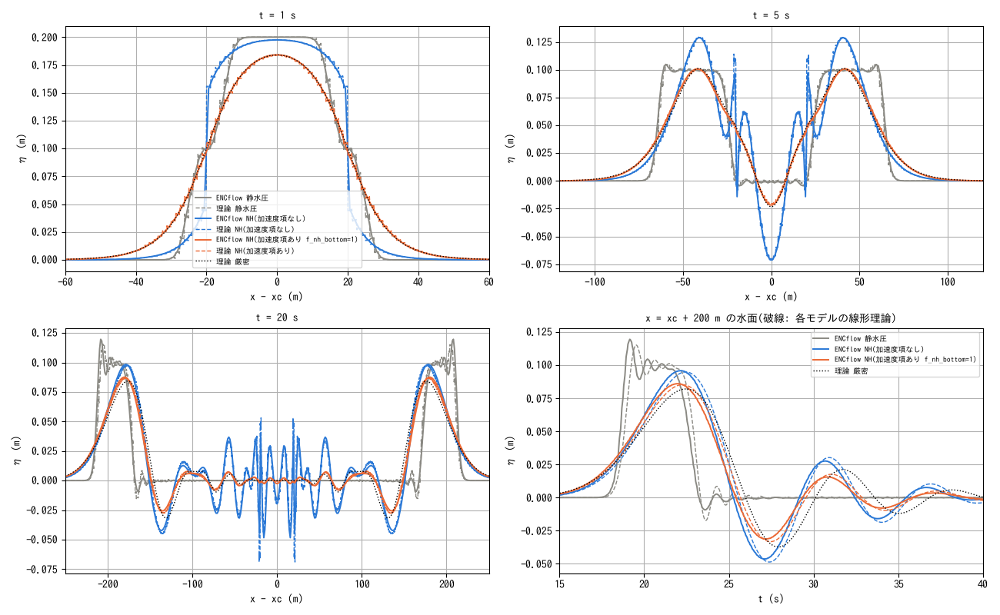
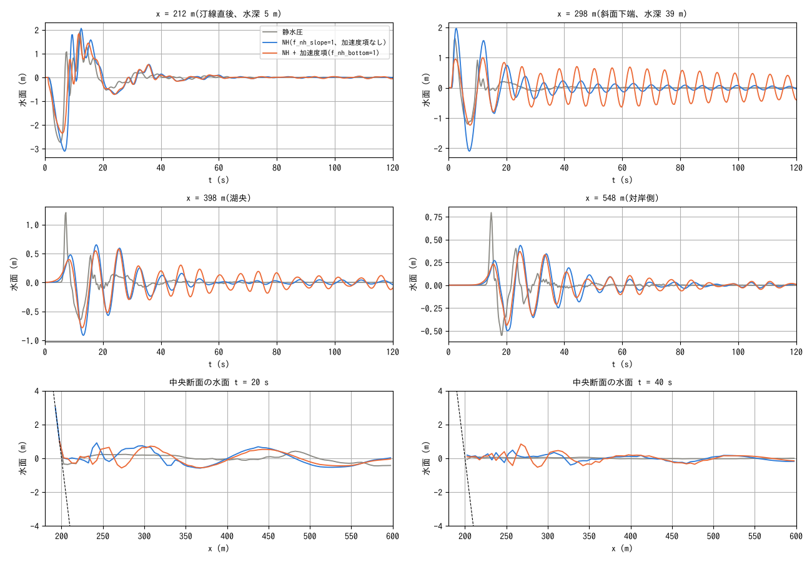

# test/nhbottom — acceleration term of a moving bottom (f_nh_bottom; Phase 8)

> English mirror of test/nhbottom/README.md. The Japanese file is the master copy.

[日本語](../README.md)

Verification of the research option f_nh_bottom, which adds the vertical
acceleration z̈_b of a moving bottom as a source term to the one-layer
non-hydrostatic (NH) correction (docs/nonhydrostatic_plan.md §16,
developer.md §69.10). Putting the kinematic bottom condition
w_b = ∂z_b/∂t + u·∇z_b into the layer-averaged vertical velocity
w̄ = (w_s + w_b)/2 gives φ = (h²/4)∇·a − (h/2)a·∇z_b **− (h/2) z̈_b**, and
the additional term is merely a known source term. ∂z_b/∂t itself is
already handled by the hydrostatic part (the contract of geomorph: move z
without changing h → the surface e = z + h rises with it). What NH adds is
the inertial reaction to accelerating the water column vertically, which
gives the attenuation of short waves (the Kajiura filter) when a bottom
displacement is mapped to the surface.

Linear theory (one-dimensional, flat, β = H²/4; Λ is the one-dimensional
symbol of the ENC):

| Model | Dispersion ω² | Forcing filter F (η̈ + ω²η̂ = F z̈̂) |
|---|---|---|
| Hydrostatic | gHΛ | 1 |
| NH, no acceleration term | gHΛ/(1 + βΛ) | 1 |
| NH, with acceleration term (the naive source term of the derivation; the implementation uses 1/(1 + βΛ)², see below) | gHΛ/(1 + βΛ) | (1 − βΛ)/(1 + βΛ) |
| Exact (potential flow) | gk tanh kH | 1/cosh kH |

The filter of the one-layer NH matches the exact solution up to O(k²H²)
(1 − k²H²/2), is too strong for kH ≳ 1 and changes sign for kH > 2 (the
same as the upper limit of applicability of the one-layer NH).

## Configuration 1: prescribed bottom motion (Hammack-type uplift of a section)

A driver `uplift.f90` (linked with libencflow.a; outside the computational
core) moves the bottom with a time function through the library API
(m_main_set_value('z')). A one-dimensional channel with H = 10 m, flat and
frictionless (1000 m × 40 m, Δx = 1.25 m = H/8, 32 rows; this keeps the
influence of the diagonal edges missing at the walls below 1%). The
section |x − 500| < 20 m (b/H = 2) is raised by 0.2 m (ζ₀/H = 2%) in 1 s
(shorter than b/√(gH) = 2 s = impulsive). The box-shaped spectrum sin(kb)/(kb) has
components up to its first zero kH = 1.57, which falls in the band where
the difference between the one-layer NH filter and Kajiura is visible.

```
make                                  # build uplift (from libencflow.a in src)
./uplift param.txt uplift.txt         # NH + acceleration term (./Run.sh = regression test)
./uplift param_h.txt uplift.txt       # hydrostatic
./uplift param_n.txt uplift.txt       # NH, no acceleration term
python3 Theory.py                     # tables of the linear theory
python3 Fig.py                        # figs/uplift.png and tables
```



Top: profiles at t = 1 s (end of the uplift), 5 s and 20 s. Solid =
ENCflow, dashed = linear theory of each model, dotted = exact solution.
Bottom right: surface time series at x = x_c + 200 m.

| Case | η_max ENCflow (m) | t (s) | η_max theory (m) | t (s) | ENC/theory | theory/exact |
|---|---:|---:|---:|---:|---:|---:|
| Hydrostatic | 0.1124 | 20.92 | 0.1153 | 19.55 | 0.975 | 1.404 |
| NH (no acceleration term) | 0.0955 | 22.36 | 0.0950 | 22.45 | 1.005 | 1.156 |
| NH (with acceleration term, f_nh_bottom=1) | 0.0856 | 22.14 | 0.0853 | 22.25 | 1.004 | 1.039 |
| Exact (linear potential flow) | — | — | 0.0821 | 22.45 | — | 1 |

- ENCflow agrees with its own linear theory for all three models (NH within
  ±0.7%; hydrostatic −2.5% with a lag of 1.4 s because the box-shaped pulse
  suffers numerical dissipation). This confirms that the acceleration term
  is implemented as formulated.
- With the acceleration term the difference of the leading wave height from
  the exact solution shrinks from +16% to +3.9% (hydrostatic +40%). In the
  profile at t = 1 s, the surface directly above the uplift changes from
  box-shaped (hydrostatic) to a rounded form (NH + acceleration term;
  overlapping the exact solution); this is the effect of the filter.
- The short-wave spikes at the edges of the uplifted section (x = ±20 m)
  are a manifestation of the one-layer NH filter becoming negative for
  kH > 2, and the theory (dashed) shows the same (the limitation of plan
  §16.5; the water column h stays positive).

**Difference from the naive source term**: using the −(h/2) z̈ of the
derivation as it is, the filter is (1 − βk²)/(1 + βk²), which changes sign
for kH > 2 (−1 at the grid scale) and produces short-wave spikes at the
edges of the uplifted section. The implementation passes half of the source
through the same Helmholtz operator, −(h/4)(z̈ + (1 + βL)⁻¹z̈), giving
F = 1/(1 + βk²)² (the table above). The surface shape directly above the
uplift (t = 1 s) overlaps the exact solution, and the difference of the
leading wave height from the exact solution is +3.9% (the naive form gives
+3.5%, but diverges when coupled with a submarine landslide; see below).
The iteration count is about doubled only while the bottom moves (average
48 → 57 in this configuration).

## Configuration 2: submarine landslide (coupling with f_bedslide)

The same setting as C of examples/landslide_tsunami (a mass of 19,110 m³ on
an underwater slope of tanθ = 0.4 mobilized at t = 1 s; inertialess
Voellmy bed layer) is compared for hydrostatic / NH (f_nh_slope=1; no
acceleration term) / NH + acceleration term. The inputs come from
`make inputs` (make_init.py of the example).

```
./encflow param_ls_h.txt      # hydrostatic
./encflow param_ls_n.txt      # NH (f_nh_slope=1), no acceleration term
./encflow param_ls_b.txt      # NH + acceleration term
./encflow param_ls_b025.txt   # same, dt = 0.025 s (effect of the one-step lag)
./encflow param_ls_n025.txt   # no acceleration term, dt = 0.025 s (control)
./encflow param_ls_bd.txt     # NH + acceleration term + momentum diffusion ν = 0.3 m²/s
python3 Landslide.py          # figs/landslide.png and tables
```



| Probe | Quantity | Hydrostatic | NH (f_nh_slope=1, no acceleration term) | NH + acceleration term (f_nh_bottom=1) |
|---|---|---:|---:|---:|
| x = 212 m (just off the shoreline, depth 5 m) | Minimum (m) | -2.744 | -3.008 | -2.325 |
| x = 212 m (just off the shoreline, depth 5 m) | Maximum (m) | 1.880 | 2.178 | 1.845 |
| x = 298 m (foot of the slope, depth 39 m) | Minimum (m) | -1.201 | -2.097 | -1.291 |
| x = 298 m (foot of the slope, depth 39 m) | Maximum (m) | 1.644 | 1.975 | 1.045 |
| x = 398 m (lake centre) | Minimum (m) | -0.645 | -0.913 | -0.777 |
| x = 398 m (lake centre) | Maximum (m) | 1.203 | 0.658 | 0.557 |
| x = 548 m (far-shore side) | Minimum (m) | -0.543 | -0.487 | -0.431 |
| x = 548 m (far-shore side) | Maximum (m) | 0.792 | 0.429 | 0.366 |

| Probe | max\|Δη\| with acceleration term, dt 0.05 vs 0.025 (m) | Same, without acceleration term (m) | Effect of the acceleration term max\|η_b − η_n\| (m) |
|---|---:|---:|---:|
| x = 212 m (just off the shoreline, depth 5 m) | 0.1172 | 0.0765 | 1.9515 |
| x = 298 m (foot of the slope, depth 39 m) | 0.2582 | 0.0662 | 1.0287 |
| x = 398 m (lake centre) | 0.0273 | 0.0301 | 0.2033 |
| x = 548 m (far-shore side) | 0.0108 | 0.0096 | 0.1382 |

- **The effect of the acceleration term is large in the near field**: just
  off the shoreline (x = 212) the leading trough goes from −3.0 to −2.3 m,
  and at the foot of the slope (x = 298; directly above the deposition zone
  of the mass) the crest from 2.0 to 1.0 m. The front of the mass is 1–2
  cells (kH ≫ 2), so NH without the acceleration term (and hydrostatic) map
  that bottom displacement to the surface as it is, while the acceleration
  term removes it with the Kajiura filter. From the lake centre outward
  (x ≥ 398) the difference is 0.1–0.2 m (20–30% of the wave height).
- **The effect of the one-step lag Δt**, seen as the difference from
  halving dt, is similar in the far field with and without the acceleration
  term (0.01–0.03 m = the sensitivity to dt itself), and larger with the
  acceleration term in the near field (x = 298) (0.26 m against 0.07 m; 1/4
  of the 1.0 m effect). Most of the near-field difference is the phase
  difference of the trapped mode described below.
- **A mode trapped at the cut-off frequency of the one-layer NH**: at the
  foot of the slope (depth 39 m) an oscillation of period 6 s and amplitude
  ±0.6 m (±0.12 m without the acceleration term; absent in hydrostatic)
  remains without decaying until 120 s. The dispersion relation of the
  one-layer NH, ω² = gHk²/(1 + βk²), saturates for k → ∞ at
  ω → √(4g/H) = 1.0 rad/s (T = 6.3 s), and all short waves have group
  velocity 0 at this frequency = they stay where they were generated. The
  front of the mass (grid scale) excites this; it does not exist in
  hydrostatic (grid-scale waves escape at √(gH)). Because this oscillation
  shakes the driving head Φ = z + r·h of the bed layer, part of the bed
  layer (3,000 m³) cannot stay below bs_vstop for 15 s and is still
  "moving" at 120 s (49 m³ without the acceleration term). The momentum
  diffusion term (param_ls_bd.txt; ν = 0.3 m²/s: e-folding 8 s at the grid
  scale, 13% in 120 s for a 100 m wavelength) does not damp it (±0.67 m) =
  it is not a free grid mode but a self-excited oscillation of the coupling
  with the bed layer. Time relaxation of the bottom velocity (τ = 1 s)
  amplifies the oscillation through the phase lag (±2.7 m), and τ = 2 s
  removes the oscillation but also removes the effect of the acceleration
  term, so it is not adopted (plan §16.6). The proper remedy is a
  multi-layer NH or inertia in the bed layer.
- With the naive source term −(h/2) z̈, this grid-scale coupling became a
  positive feedback and the run diverged from t ≈ 10 s (surface +14 m,
  bed-layer velocity 20 m/s; +8 m even with dt halved). The Helmholtz
  smoothing (F → 0 at the grid scale) made it stable (plan §16.6).

## Regression test

`./Run.sh` / `./Run_MPI.sh N` run param.txt of configuration 1 (NH +
acceleration term) with the uplift driver and compare with
reference/Log.txt (column 4 = Runge is excluded). np = 2, 4 agree with the
serial reference except that the full-precision S column differs in the
last digit on 3 lines (summation order; the same as nhwave_nh).
Configuration 2 is for comparison (no reference; test/bedslide is the check
of bedslide itself).

## Configuration 3: the same uplift given with fn_bedmotion (the built-in prescribed bed motion)

The uplift of configuration 1 is given not by the driver but by the
built-in [fn_bedmotion](../../../docs/en/users_guide/bedmotion.md)
(snapshot table + cumulative displacement rasters). `Bedmotion_inputs.py`
writes snapshots of every step during the uplift (dt = 0.0125 s, 81 files)
to bm/.

```
make inputs_bm                 # python3 Bedmotion_inputs.py (bm/bmlist.txt, bm/disp_*.txt)
./Run_bm.sh                    # ./encflow param_bm.txt → compare with reference/Log.txt (driver)
```

It agrees with the driver's reference except for the last digit of the
full-precision S column on 5 lines (1e-15; the difference between summing
increments and rounding absolute values). A restart (save at 0.5 s →
restore) matches the Log of result_bmh for hydrostatic
(param_bmh_s/r.txt), and for NH + f_nh_bottom (param_bm_s/r.txt) only the
Runge column and the last digit of the S column differ (the z̈ of NH drops
one step; the physical quantities are identical). Coexistence with a
submarine landslide (param_ls_bb.txt = param_ls_b + a prescribed uplift of
0.3 m of the lake bottom) satisfies Σ(z − z0) = Σ d within the output
precision (1e-4 m) (the internal transfer of bedslide sums to 0).
