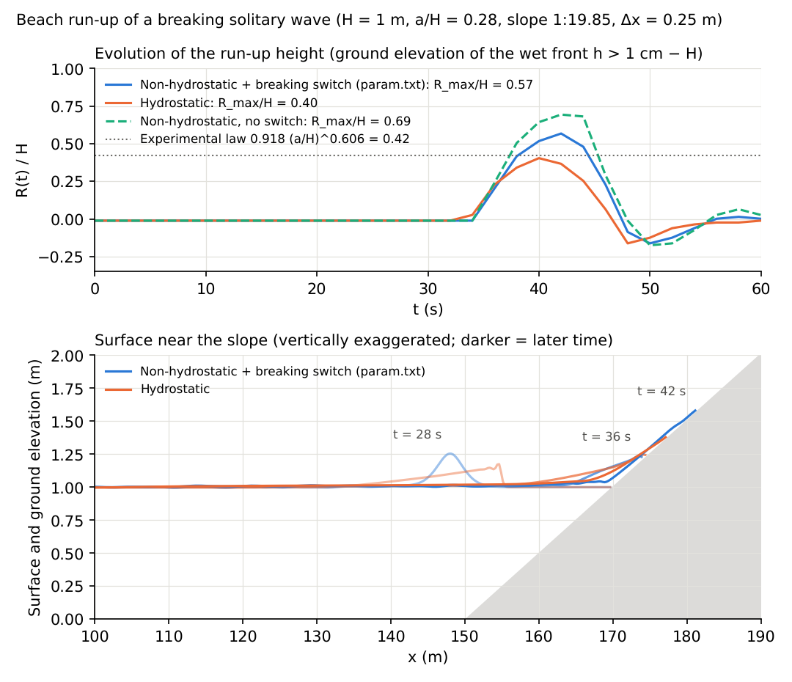
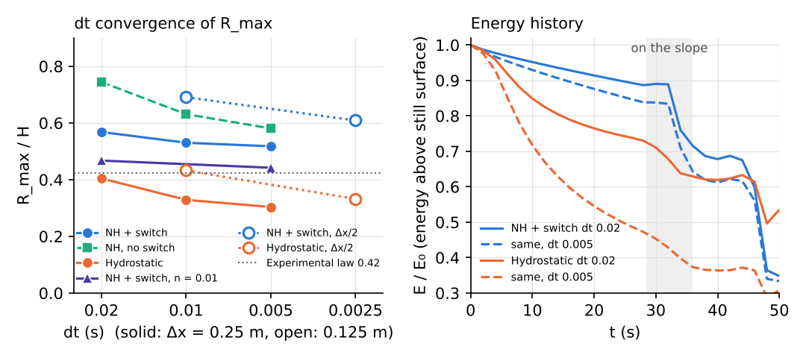
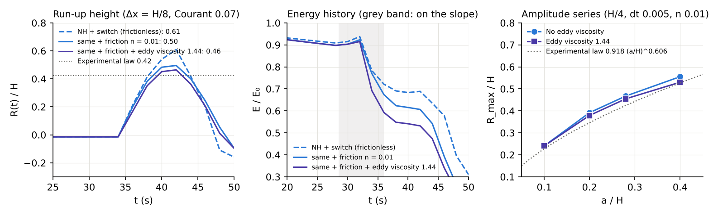

# test/nhbreak — run-up of a breaking solitary wave on a beach (breaking switch and wet/dry degeneration of the non-hydrostatic correction)

> English mirror of test/nhbreak/README.md. The Japanese file is the master copy.

[日本語](../README.md)

docs/nonhydrostatic_plan.md §11 Phase 6, developer.md §69.4. The
configuration of Synolakis (1987): depth H = 1 m, a/H = 0.28, slope 1:19.85
(toe at x = 150 m; user_geoinfo `beach_slope`), solitary wave at x0 = 50 m
(user_initial `wave_solitary28`), Δx = Δy = 0.25 m, 32 rows, 60 s.

- `./Run.sh` / `./Run_MPI.sh N`: regression test of param.txt (NH +
  breaking switch: surface-slope criterion 0.2, margin 8 cells,
  f_hcap_upwind=2, nh_hmin=0.05).
- After running `./encflow param_h.txt` (hydrostatic, the same hcap 2),
  `./Runup.py` tabulates, from the central row of the depth distribution,
  the position of the wet front → run-up height R(t) = z_front − H, the
  maximum run-up height R_max/H and the evolution of the crest height, and
  compares with the experimental breaking run-up law
  R/H = 0.918 (a/H)^0.606 = 0.42.

## Figures

Top: run-up height R(t)/H (ground elevation of the wet front − H).
Hydrostatic 0.40, NH + breaking switch 0.57, NH without switch 0.69
(experimental law 0.42). Bottom: surface and ground near the slope
(t = 28, 36, 42 s). The hydrostatic wave turns into a bore before the
slope, while NH climbs onto the slope without breaking. `./Fig.py en`
generates `en/figs/runup.png` (`figs/runup.png` is the Japanese version;
the curve without the switch is drawn if the
result of param.txt with f_nh_breaking=0, dir_result='result_ns' exists).

## Findings (2026-10-12; the hydrostatic, param.txt and no-switch hcap-2 values and the numbers of the diagnosis and eddy-viscosity sections below were recomputed on 2026-10-24 with the default f_opening_dynamic 2 of that time. Recomputed after the default became 3 on 2026-10-31, hydrostatic 0.40 and param.txt 0.57 are unchanged and the no-switch hcap-2 value goes from 0.74 to 0.69; developer.md §68.41)

| Configuration | R_max/H | Remarks |
|---|---:|---|
| Hydrostatic (hcap 1 / 2) | 0.455 / 0.404 | Early bore formation and dissipation on the flat part. Close to the experimental law 0.42 |
| NH, no switch (hcap 1 / 2) | 1.64 / 0.74 (0.69 with the default 3) | Runs up as a thin tongue without breaking. The 1.64 of hcap 1 is closer to the non-breaking run-up law 2.57 |
| NH + slope criterion 0.2, margin 8 (hcap 2) = param.txt | 0.57 | Insensitive to the settings (slope 0.15 / 0.3, margin 16, Froude 0.5: 0.62 / 0.64 / 0.63 / 0.64) |
| NH + SWASH-type ∂η/∂t criterion (α 0.6 / 0.15 / 0.1, β = α/2, margin 8) | 0.66 / 0.61 / 0.39 | Fires in the current code (breaking cells 52 / 4500 on average). With α 0.1 the whole front becomes hydrostatic and matches hydrostatic. The record of 2026-10-05 (2.2–2.7; α 0.1 diverged) is not reproduced (note below) |
| NH, depth threshold nh_hmin = 0.5 m (hcap 1 / 2) | 0.74 / 0.62 | On 2026-10-05 a spike of h = 1.5 m (two-sided mean edge depth at the bore front; §68.7) rose at the shoreline and the run diverged, but the current code does not diverge (h_max 1.29 m; note below) |

- NH cases with breaking or bores **require f_hcap_upwind = 2**.
- Note (2026-10-12): the table gives the values rerun after the fix of the
  consistency of the initial discharge mn (developer.md §7). The rows for
  the SWASH-type criterion and nh_hmin = 0.5 differ qualitatively from the
  record of 2026-10-05, but the pre-fix code (e6fac14) run with the same
  settings gives 0.64 / 0.73, so the difference comes from code changes
  before that, not from the mn fix (reproduction of the settings of that
  time is unconfirmed).
- NH + switch is 1.5 times the experimental law. The isolation of the cause
  is in the section below (developer.md §69.6).
- np=2 is bit-identical to the serial run in the Log, the probes and the
  depth distribution (-O2 strict build; after fixing the missing fill of
  the interface edge row in init).

## Bottom-slope terms and non-breaking run-up (2026-10-12)

- Even with f_nh_slope=1 (Version 2) the R_max/H with the breaking switch is
  0.62 (−2% from the 0.63 of V1), so the overestimate of the breaking run-up
  is not due to the bottom-slope terms.
- Non-breaking a/H = 0.0185 (`param_nb.txt`, `wave_solitary0185`, 70 s):
  hydrostatic, V1 and V2 all give R_max/H = 0.064 (front at h > 1 mm). This
  is 75% of the non-breaking run-up law 2.831√cotβ (a/H)^{5/4} = 0.086
  (experiment ≈ 0.09). NH contributes nothing; it is a problem of
  representing the wet/dry front (a tongue a few mm thick) at Δx = H/4.

## Isolating the cause of the overestimate (0.57 against 0.42) (2026-10-12; the numbers are recomputed on 2026-10-24 with the default f_opening_dynamic 2 of that time; with the default 3 the 0.568 of param.txt is unchanged and the no-switch value goes from 0.744 to 0.694; developer.md §69.6 keeps the values of 10-12)

`./Diag.py --run` runs derived cases (dt, initial position, extent of NH,
friction, grid) in result_x_*/ (u and v are also output), `./Diag.py`
tabulates the maximum run-up height and the history of the total energy
above the still surface E = Σ[½g((z+h−H)² − max(z−H,0)²) + ½h|u|²]
(E0 = 2.29 J/m, per unit width, ρ = 1), and `./Diag.py --fig en` draws
`en/figs/runup_diag.png` (`figs/runup_diag.png` is the Japanese version). The cases that place the wave 30 m before the toe
use user_initial `wave_solitary28_toe` (x0 = 120 m).

| Configuration | dt 0.02 | dt 0.01 | dt 0.005 | E/E0 at shoreline arrival (dt 0.005) |
|---|---:|---:|---:|---:|
| NH + breaking switch (param.txt) | 0.568 | 0.530 | 0.518 | 0.64 |
| NH, no switch | 0.744 | 0.631 | 0.581 | 0.75 |
| NH on the flat part only (nh_hmin 0.98; the slope is hydrostatic) | 0.555 | 0.518 | — | — |
| Hydrostatic (param_h.txt; wave 100 m before the toe) | 0.404 | 0.329 | 0.304 | 0.37 |
| Hydrostatic, wave placed 30 m before the toe | 0.467 | — | **0.404** | 0.51 |
| NH + switch, Manning n = 0.01 | 0.467 | — | 0.442 | 0.61 |
| NH + switch, n = 0.02 / NH no switch, n = 0.01 | 0.379 / 0.568 | — | — | — |
| Hydrostatic, n = 0.01 / before the toe + n = 0.01 | 0.366 / 0.417 | — | — | — |
| Δx/2: hydrostatic (dt 0.01 / 0.0025) | 0.433 | | **0.332** (dt 0.0025) | 0.37 |
| Δx/2: NH + switch (dt 0.01 / 0.0025) | 0.691 | | **0.609** (dt 0.0025) | 0.72 |
| Δx/2: NH + switch, n = 0.01 (dt 0.01) | 0.514 | | | |
| Hydrostatic, wave placed 5 m before the toe (`wave_solitary28_x145`) | 0.530 | — | 0.492 | 0.65 |
| NH + switch, same | — | — | 0.543 | 0.74 |

- **dt = 0.02 (Courant ≈ 0.28) is not converged**: as dt → 0, NH + switch
  0.57 → 0.52, hydrostatic 0.40 → 0.30. The dt dependence lies in the stage
  of hydrostatic bore formation and the wet/dry front (restricting NH to the
  flat part lowers R by the same amount; the bore jump condition is correct
  independently of dt in the Stoker solution of test/dambreak). Refinement
  at a fixed Courant number raises R instead (an error proportional to Cr).
- **Δx = H/4 is also coarse for NH**: with Δx/2 and Cr 0.07, hydrostatic
  gives 0.33 (within 10% of the coarse-grid converged value 0.30), NH +
  switch 0.61 (coarse grid 0.52). The difference is the numerical
  dissipation of the solitary wave on the flat part (E/E0 at toe arrival
  0.84 → 0.91). On the coarse grid the dt error (+10%) and the numerical
  dissipation (−15%) cancelled to give 0.57 (with the values of 10-12,
  +25% and −20% cancelled to give 0.63 ≈ 0.63).
- **The hydrostatic 0.40 is a coincidence**: it is the result of early bore
  formation over the 100 m of flat part, which loses 30–50% of E (dt 0.02 /
  0.005) before the toe. Placing the wave 30 m before the toe gives 0.404
  (also the result of bore formation over 30 m), and 5 m before the toe (the
  arrangement of Titov & Synolakis 1995; an intact wave reaches the toe)
  gives hydrostatic 0.49 and NH + switch 0.54 (dt 0.005). When an intact wave becomes a hydrostatic bore on
  the slope and runs up, the result is 0.5–0.6, so additional breaking
  dissipation is needed even for hydrostatic.
- **The +45% overestimate of NH + switch at the converged value (0.61) is
  insufficient dissipation of the breaking collapse** (remaining E at
  maximum run-up 0.69 E0 against 0.50 E0 for hydrostatic (before the toe)).
  With friction n = 0.01, NH drops by 15–25% (hydrostatic by 10%), and
  +10–20% remains at the converged value (0.50 with Δx/2 and dt/8).
- **For a quantitative evaluation, confirm convergence at Courant ≲ 0.1 and
  Δx ≲ H/8, and apply friction (n ≈ 0.01).** The remaining overestimate is
  the issue of explicit dissipation in the breaking zone (eddy viscosity,
  roller). The agreement of hydrostatic is a coincidence that depends on
  the length of the flat part. param.txt keeps dt 0.02 and Δx = H/4 for the
  regression test.

## Eddy viscosity in the breaking zone nh_break_visc (2026-10-12; the numbers are recomputed on 2026-10-24; developer.md §69.7, plan §15)

Cells judged as breaking are given ν_b = nh_break_visc·B·h·√(gh)·|∇η| and
dissipate through the diffusion term of the momentum equation (1.44,
corresponding to Kennedy et al. 2000, is used). Run with
`./Diag.py --run visc005_nh viscf005_nh viscfine_nh finef0025_nh amp10_v ...`
and draw `en/figs/runup_visc.png` with `./Diag.py --figvisc en` (`figs/runup_visc.png` is the Japanese version).

| Configuration | R/H | E/E0 at shoreline arrival |
|---|---:|---:|
| NH + switch, Δx = H/4, dt 0.005 | 0.518 | 0.64 |
| Same + eddy viscosity 1.44 | 0.492 | 0.60 |
| Same + friction n = 0.01 | 0.442 | 0.61 |
| Same + friction + eddy viscosity | 0.429 | 0.58 |
| NH + switch, Δx = H/8, Cr 0.07, frictionless | 0.609 | 0.72 |
| Same + friction n = 0.01 | 0.496 | 0.67 |
| Same + friction + eddy viscosity 1.44 | **0.464** | 0.59 |

Amplitude series (Δx = H/4, dt 0.005, n = 0.01, wave at x0 = 120 m;
experimental law R/H = 0.918 (a/H)^0.606):

| a/H | Experimental law | No eddy viscosity | Eddy viscosity 1.44 |
|---:|---:|---:|---:|
| 0.10 | 0.227 | 0.241 (+6%) | 0.241 (+6%) |
| 0.20 | 0.346 | 0.392 (+13%) | 0.379 (+10%) |
| 0.28 | 0.424 | 0.467 (+10%) | 0.455 (+7%) |
| 0.40 | 0.527 | 0.555 (+5%) | 0.530 (+1%) |

- Under the converged conditions (Δx = H/8, Cr 0.07) + friction + eddy
  viscosity the result is +9% above the experimental law (within the target
  ±10%; +5% with the values of 10-12). Breakdown: friction n = 0.01 takes
  0.609 → 0.496 (−19%), the eddy viscosity 0.496 → 0.464 (−6%). The finer
  the grid, the steeper |∇η| at the front, so the dissipation of the eddy
  viscosity is more effective (−3% on the coarse grid).
- The amplitude series is consistent with the exponent of the experimental
  law, and the effect of the eddy viscosity grows with the amplitude (at
  a/H = 0.10 the breaking criterion does not fire and the value is
  unchanged). The coefficient stays at 1.44.
- The clamp at the stability upper bound does not fire. The Logs of
  np=1, 2, 4 agree.
