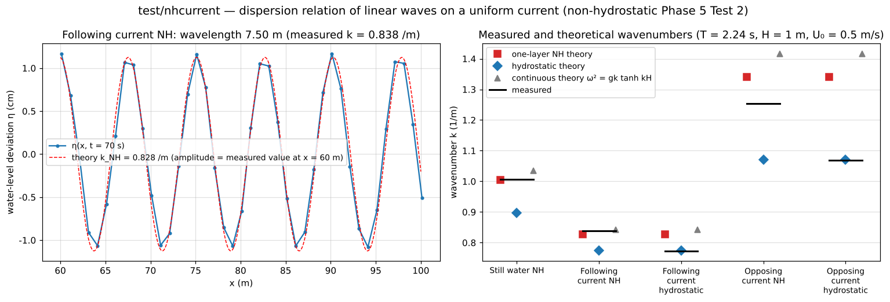

# test/nhcurrent — dispersion relation of linear waves on a uniform current (Phase 5 Test 2 of the non-hydrostatic correction)

> English mirror of test/nhcurrent/README.md. The Japanese file is the master copy.

[日本語](../README.md)

This check confirms that the dispersion relation of small-amplitude waves
travelling on a uniform current U₀ also holds with the one-layer
non-hydrostatic correction (`f_nonhydrostatic = 1`,
docs/nonhydrostatic_plan.md §11 Phase 5 Test 2, developer.md §69.8) in the form

  (ω − U₀k)² = gH Λ(k) / (1 + βΛ(k))  (semi-discrete Λ of ENC, β = H²/4)

under three conditions — following current (waves and current in the same
direction), opposing current and still water — and in a hydrostatic
computation. Uniform flow is maintained by prescribed water levels at both
ends; the prescribed level at one end is oscillated sinusoidally to emit waves,
and the wavenumber k is measured from the x gradient of the phase at 41 probes
at x = 60–100 m (`Current.py`; outside the computation core). The
following-current NH case (`param.txt`) is the regression case that has a
reference.

## Configuration

| Item | Value |
|---|---|
| Channel | 200 m × 8 m, 800 × 32 cells (Δx = 0.25 m = H/4), H = 1 m. Bed slope S = 2.25e-4 (`channel_slope` of `user_geoinfo`; the west is higher), n = 0.03 → uniform flow U₀ = 0.5 m/s (Fr 0.16) |
| Boundaries | One column (32 cells each) at the west and east ends is made a prescribed-water-level cell set and given the uniform-flow water level. On the wave-source side a sinusoidal oscillation a = 1 cm, T = 2.24 s (kH ≈ 1 in still water) is given by `stage_w.txt` / `stage_e.txt` (0.1 s interval, ramped up over the first 2 periods) |
| NH | One-layer correction, CG (`nh_solver = 2`, `nh_tol = 1e-6`). Within nh_bc_margin (2H/Δx) of the prescribed boundaries the computation is hydrostatic (the countermeasure to the real bug of §69.8) |
| Time | dt = 0.02 s, 110 s. 41 probes at x = 60.125–100.125 m (1 m spacing) |

| Configuration | File | U₀ | Wave source | Propagation |
|---|---|---|---|---|
| Following current NH (regression) | `param.txt` | 0.5 | West end | +x |
| Opposing current NH | `param_c.txt` | 0.5 | East end | −x |
| Still water NH | `param_0.txt` | 0 (flat bed) | East end | −x |
| Following current, hydrostatic | `param_h.txt` | 0.5 | West end | +x |
| Opposing current, hydrostatic | `param_hc.txt` | 0.5 | East end | −x |
| Diagnosis of the base flow | `param_osc.txt` (water level prescribed at both ends, no waves), `param_osc_inflow.txt` (section inflow + downstream prescribed water level) | 0.5 | None | For reproducing §69.9 |

| File | Contents |
|---|---|
| `Run.sh` / `Run_MPI.sh N` | Run the following-current NH case and compare Log.txt with the reference (ULP = 1, Runge column excluded) |
| `Current.py [result_dir ...]` | Obtain k and the amplitude decay from the complex amplitude A(x) in the window (following current 45–95 s, opposing current and still water 65–100 s) and list them beside the k of the NH, hydrostatic and continuous theories |
| `Fig.py` | The figure `en/figs/nhcurrent.png` below (`python3 Fig.py en`; `figs/nhcurrent.png` is the Japanese version) |

## Running

```bash
make
./Run.sh                                   # following-current NH (5500 steps, CG 26 iterations on average; a few minutes or more)
for p in param_0 param_c param_h param_hc; do ./encflow $p.txt; done
python3 Current.py                         # table of the 5 cases
python3 Fig.py en                          # en/figs/nhcurrent.png
```

## Figures



Left: the water-level deviation η(x) of the following-current NH case at
t = 70 s (41 probes) and a sine wave of the theoretical wavenumber k_NH drawn
with the measured amplitude. A wave train of wavelength 7.5 m rides on the
current with aligned phases. Right: the measured k (black line) of the 5 cases
and the theoretical values. The still-water and following-current NH
computations lie on the one-layer NH theory (red) and depart from the
hydrostatic theory (blue) by 8–12%. The hydrostatic computations lie
on the hydrostatic theory. In the opposing-current case (kH ≈ 1.3) the waves
travel against the current, and since the group velocity c_g − U₀ is small,
the amplitude decays to 0.02 cm at x = 60 m and the phase accuracy drops.

## Findings

| Case | U₀ | Propagation | k measured | k NH theory | k hydrostatic theory | k/k_NH | k/k_hyd | Amplitude (60 m) |
|---|---:|:-:|---:|---:|---:|---:|---:|---:|
| Still water NH (param_0) | 0 | −x | 1.006 | 1.005 | 0.898 | 1.001 | 1.120 | 1.00 cm |
| Following current NH (param) | 0.5 | +x | 0.838 | 0.828 | 0.774 | 1.012 | 1.083 | 1.13 cm |
| Following current, hydrostatic (param_h) | 0.5 | +x | 0.773 | 0.828 | 0.774 | 0.934 | 0.999 | 0.96 cm |
| Opposing current NH (param_c) | 0.5 | −x | 1.254 | 1.341 | 1.070 | 0.935 | 1.172 | 0.02 cm |
| Opposing current, hydrostatic (param_hc) | 0.5 | −x | 1.068 | 1.341 | 1.070 | 0.796 | 0.998 | 0.18 cm |

(Windows: following current 45–95 s, opposing current and still water
65–100 s. Output of `python3 Current.py`. The reference comparison of the
following-current NH case is PASS.)

- In still water k is +0.1% from the one-layer NH theory, and +1.2% in the
  following current (8–12% away from the hydrostatic theory). The hydrostatic
  computations are −0.1% (following current) and −0.2% (opposing current) from
  the hydrostatic theory. This is a numerical confirmation that the dispersion
  relation holds in the form (ω − U₀k)² on a uniform current as well.
- In the opposing-current NH case (kH ≈ 1.3) the group velocity c_g − U₀ is
  small, the amplitude decays to 0.02 cm at x = 60 m, and the phase
  measurement error is large (−6%). A longer channel or a larger amplitude
  would improve the measurement.
- **History of the base flow** (§69.8–69.9): the phenomenon in which a uniform
  current passing through the prescribed boundaries oscillated with a period
  ≈ 2 s starting from the cell column at the upstream end and diverged was a
  real bug in which the "further upwind" upup of MUSCL (scheme 3) read the 0
  outside the domain and became anti-diffusive. After the fix, the default
  conservative advection keeps the uniform flow steady (h − 1 = 0 at 40 s), and
  the reference of this case was updated after the fix (2026-10-05, visually
  confirmed by a person). The mild oscillation of the corner cell when the
  section of a section inflow ends at a wall corner is a separate, unresolved
  item (`param_osc_inflow.txt`; it does not grow if the section is kept off
  the corner row).

## Related documents

- [test/nhwave](../../nhwave/en/README.md) (dispersion relation of standing waves in a closed basin), [test/nhwave_nh](../../nhwave_nh/en/README.md), [test/nhbore](../../nhbore/en/README.md)
- [docs/nonhydrostatic_plan.md](../../../docs/nonhydrostatic_plan.md) (in Japanese) §11 Phase 5
- developer.md §69.8 (Test 2 and results), §69.9 (cause and fix of the base-flow oscillation)
