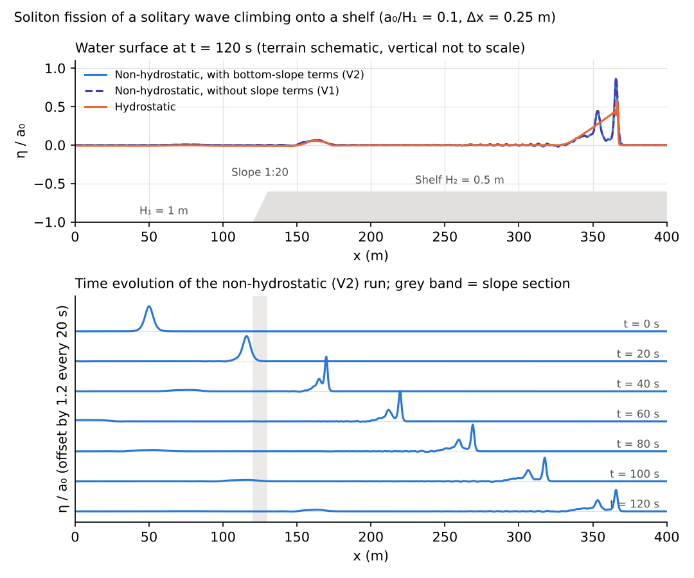

# test/nhshelf — soliton fission of a solitary wave climbing onto a shelf (verification of the bottom-slope terms)

> English mirror of test/nhshelf/README.md. The Japanese file is the master copy.

[日本語](../README.md)

docs/nonhydrostatic_plan.md §11 Phase 5 (soliton fission) and Phase 7
(bottom-slope terms), developer.md §69.5. A solitary wave with a/H = 0.1
(x0 = 50 m, `wave_solitary`) is incident on a flat part of depth 1 m → a
1:20 slope (x 120–130 m) → a shelf of depth 0.5 m (user_geoinfo
`shelf_slope`). Δx = 0.25 m, 32 rows, 120 s.

- `./Run.sh` / `./Run_MPI.sh N`: regression test of param.txt (NH,
  f_nh_slope=1, CG).
- After running `./encflow param_v1.txt` (without the slope terms) and
  `./encflow param_h.txt` (hydrostatic), `./Fission.py` counts the maxima of
  the water surface on the shelf at the final time.

## Figure

Top: water surface η/a0 of the centre row at t = 120 s (NH V2, V1 and
hydrostatic; the terrain is schematic). Bottom: the NH (V2) water surface
every 20 s. After crossing the slope (grey band) it splits into a leading
soliton and a trailing train. Generated in `en/figs/fission.png` by `./Fig.py en` (`figs/fission.png` is the Japanese version, `./Fig.py`).

## Findings (2026-10-12)

| Configuration | Number of crests on the shelf | Leading η/H₂ | Second η/H₂ |
|---|---:|---:|---:|
| NH, with bottom-slope terms (param.txt) | 3 | 0.172 | 0.089 |
| NH, without slope terms (V1) | 3 | 0.176 | 0.089 |
| Hydrostatic | 1 (bore) | 0.114 | — |

NH reproduces the fission into a leading soliton and a trailing train; the
hydrostatic run becomes a bore. The effect of the bottom-slope terms is 2%
at the leading crest. The reflection in front of the shelf is 0.001 m in
both (0.001 m for the hydrostatic run).
