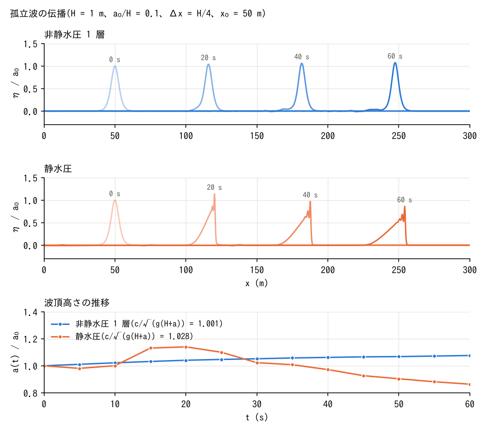

# test/nhsolitary — 孤立波の伝播(非静水圧補正の非線形検証)

[English](en/README.md)

docs/nonhydrostatic_plan.md §11 Phase 5 Test 3。平坦床・無摩擦・壁境界の
水路(300 m × 8 m、Δx = Δy = 0.25 m = H/4、32 行)に、H = 1 m、a/H = 0.1 の
Boussinesq 型孤立波(η = a sech²(k_s(x − x0))、u = cη/(H+η)、
user routine `wave_solitary`)を置き、60 s 伝播させる。

- `./Run.sh` / `./Run_MPI.sh N`: param.txt(f_nonhydrostatic=1、CG)の
  回帰テスト(Log.txt。Runge 列除外)。
- `./encflow param_h.txt`(静水圧)、`./encflow param_a.txt`(活性集合)
  を走らせてから `./Solitary.py` で、水深分布 H00NN.txt の中央行から
  波頂の位置・高さ、伝播速度(線形回帰)、波形の保存(最終波形と初期
  波形を波頂移動量だけずらしたものとの RMS 差 / a)、後続波の振幅を
  表にする。

## 図

中央行の水面 η/a0 を 20 s ごとに重ねたもの(上: 非静水圧、中: 静水圧)と
波頂高さ a(t)/a0(下)。非静水圧では形を保って進み、静水圧では前面が
急峻化して段波になり減衰する。`./Fig.py` で `figs/profiles.png` に生成する(引数 en で英語版を en/figs/ に)。

## 所見(2026-10-12。静水圧は 2026-10-24 の f_hcap_upwind = 2 の値)

| ケース | c_fit (m/s) | c_fit / √(g(H+a)) | a(60 s)/a0 | 波形 RMS/a | 後続波/a |
|---|---:|---:|---:|---:|---:|
| 非静水圧(全域) | 3.288 | 1.001 | 1.076 | 0.033 | 0.036 |
| 非静水圧(活性集合、縁 8) | 3.288 | 1.001 | 1.076 | 0.033 | 0.036 |
| 静水圧(f_hcap_upwind = 2) | 3.375 | 1.028 | 0.864 | 0.32 | 0.23 |

- 1 層 NH では孤立波が形を保って進む(RMS 3.3%)。KdV 型の初期波形は
  1 層モデル(分散係数 1/8。KdV は 1/6)の厳密解ではないため、わずかに
  幅を調整して 3.6% の後続波を残し、振幅は +7.6%。速度は √(g(H+a)) に
  対し +0.1%。
- 静水圧では分散がなく前面が急峻化して段波になり、段波として散逸して
  減衰する(60 s で振幅 0.86、波形 RMS 32%)。param_h.txt は段波先端の
  1 セル幅のスパイク(§68.6・§68.7)を避けるため nhbreak と同じ
  f_hcap_upwind = 2(上流側水深)を指定する(2026-10-24)。既定の 0(両側
  平均)のままでは前面にスパイクが立ち(60 s で振幅 2.60 a0、RMS 0.44、
  後続波 0.57、c_fit 3.541 m/s)、2026-10-24 までの表はこの値だった。NH
  (param.txt)は分散が前面を立てないのでスパイクは出ず、0 のまま。
- dt を半分(0.01 s)、適応 RK なしでも速度は同じ(−0.02%。振幅は +3.1%)。
- **水路幅の影響**: 8 行(幅 2 m)では速度が −3.6%、Δx = H/8 でも −1.7%。
  壁に接するセルで対角エッジが欠ける ENC の性質(定在波試験の
  Λ_wall/Λ_plane と同根)で、壁に接する行の割合に比例する。狭い水路で
  孤立波の速度を論じるときは幅を十分に取る(本ケースは 32 行で 0.1%)。
- 活性集合は全域解とプローブ・波頂位置とも同一(表示桁)。活性セルは
  平均 53%。

- NH の速度の変化(3.256 → 3.288 m/s)と、f_hcap_upwind = 0 の静水圧のスパイクの成長
  (1.48 → 2.60 a0)は 2026-10-18 の既定変更(f_opening_dynamic = 2。developer.md §68.38)
  による。旧既定 1 を明示すると(静水圧は hcap 0 で)NH・静水圧とも 10-12 の表の値
  (3.256 / 0.992 / 1.049 / 0.029 / 0.043、3.334 / 1.015 / 1.48 / 0.30 / 0.29)が再現する
  (2026-10-24 確認)。

## 底面勾配項(f_nh_slope=1、Version 2)の平坦床での効果(2026-10-12)

| ケース | c_fit / √(g(H+a)) | a(60 s)/a0 | 波形 RMS/a |
|---|---:|---:|---:|
| V1(param.txt) | 1.0014 | 1.076 | 0.033 |
| V2、CG + Picard | 0.9920 | 1.045 | 0.028 |
| V2、Jacobi | 0.9920 | 1.045 | 0.028 |

平坦床で残る (φ/h)∇h の非線形項の効果は小さく、CG-Picard と Jacobi は
4 桁一致する。
