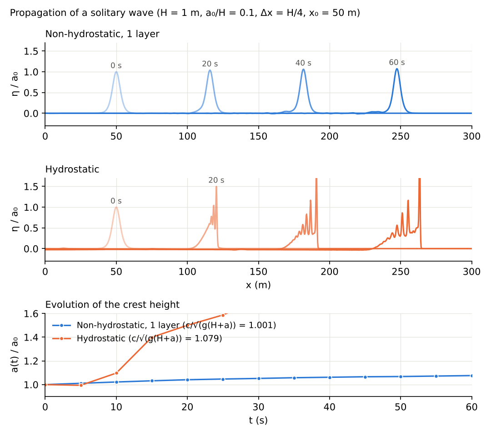

# test/nhsolitary — Propagation of a solitary wave (nonlinear verification of the non-hydrostatic correction)

> English mirror of test/nhsolitary/README.md. The Japanese file is the master copy.

[日本語](../README.md)

docs/nonhydrostatic_plan.md §11 Phase 5 Test 3 (in Japanese). A Boussinesq-type
solitary wave with H = 1 m and a/H = 0.1 (η = a sech²(k_s(x − x0)),
u = cη/(H+η); user routine `wave_solitary`) is placed in a flat-bed,
frictionless, wall-bounded channel (300 m × 8 m, Δx = Δy = 0.25 m = H/4,
32 rows) and propagated for 60 s.

- `./Run.sh` / `./Run_MPI.sh N`: regression test of param.txt
  (f_nonhydrostatic=1, CG) (Log.txt; the Runge column excluded).
- After running `./encflow param_h.txt` (hydrostatic) and
  `./encflow param_a.txt` (active set), `./Solitary.py` tabulates, from the
  central row of the depth distributions H00NN.txt, the crest position and
  height, the propagation speed (linear regression), the preservation of the
  waveform (RMS difference / a between the final waveform and the initial
  waveform shifted by the crest displacement), and the amplitude of the
  trailing waves.

## Figures

The water surface η/a0 along the central row overlaid every 20 s (top:
non-hydrostatic, middle: hydrostatic) and the crest height a(t)/a0 (bottom).
The non-hydrostatic wave keeps its shape as it travels; the hydrostatic one
steepens at its front into a bore. `./Fig.py en` generates `en/figs/profiles.png` (`figs/profiles.png` is the Japanese version).

## Findings (2026-10-12)

| Case | c_fit (m/s) | c_fit / √(g(H+a)) | a(60 s)/a0 | Waveform RMS/a | Trailing wave/a |
|---|---:|---:|---:|---:|---:|
| Non-hydrostatic (whole domain) | 3.288 | 1.001 | 1.076 | 0.033 | 0.036 |
| Non-hydrostatic (active set, margin 8) | 3.288 | 1.001 | 1.076 | 0.033 | 0.036 |
| Hydrostatic | 3.541 | 1.079 | 2.60 | 0.44 | 0.57 |

- In the one-layer NH model the solitary wave propagates keeping its shape
  (RMS 3.3%). The KdV-type initial waveform is not an exact solution of the
  one-layer model (dispersion coefficient 1/8; KdV has 1/6), so the width
  adjusts slightly, leaving 3.6% trailing waves, and the amplitude is +7.6%.
  The speed is +0.1% relative to √(g(H+a)).
- The hydrostatic run has no dispersion, so the front steepens into a bore
  (amplitude 2.6 times, waveform RMS 44%).
- With dt halved (0.01 s) and without adaptive RK the speed is the same
  (−0.02%; the amplitude is +3.1%).
- **Effect of the channel width**: with 8 rows (width 2 m) the speed is
  −3.6%, and still −1.7% at Δx = H/8. This is the ENC property that the
  diagonal edges are missing in cells adjacent to a wall (the same origin as
  Λ_wall/Λ_plane in the standing-wave test), and it is proportional to the
  fraction of rows adjacent to a wall. Take a sufficient width when
  discussing solitary-wave speed in a narrow channel (this case uses 32 rows,
  giving 0.1%).
- The active set is identical to the whole-domain solution in both the
  probes and the crest positions (to the printed digits). Active cells
  average 53%.

- The spike at the hydrostatic bore front (amplitude 2.6 times) and the change
  of the NH speed (3.256 → 3.288 m/s) are due to the change of the default on
  2026-10-18 (f_opening_dynamic = 2; developer.md §68.38). With the former
  default 1 written explicitly, both the NH and the hydrostatic rows of the
  table of 10-12 (3.256 / 0.992 / 1.049 / 0.029 / 0.043 and 3.334 / 1.015 /
  1.48 / 0.30 / 0.29) are reproduced (confirmed 2026-10-24).

## Effect of the bottom-slope terms (f_nh_slope=1, Version 2) on a flat bed (2026-10-12)

| Case | c_fit / √(g(H+a)) | a(60 s)/a0 | Waveform RMS/a |
|---|---:|---:|---:|
| V1 (param.txt) | 1.0014 | 1.076 | 0.033 |
| V2, CG + Picard | 0.9920 | 1.045 | 0.028 |
| V2, Jacobi | 0.9920 | 1.045 | 0.028 |

The effect of the nonlinear term (φ/h)∇h that remains on a flat bed is
small, and CG-Picard and Jacobi agree to 4 digits.
