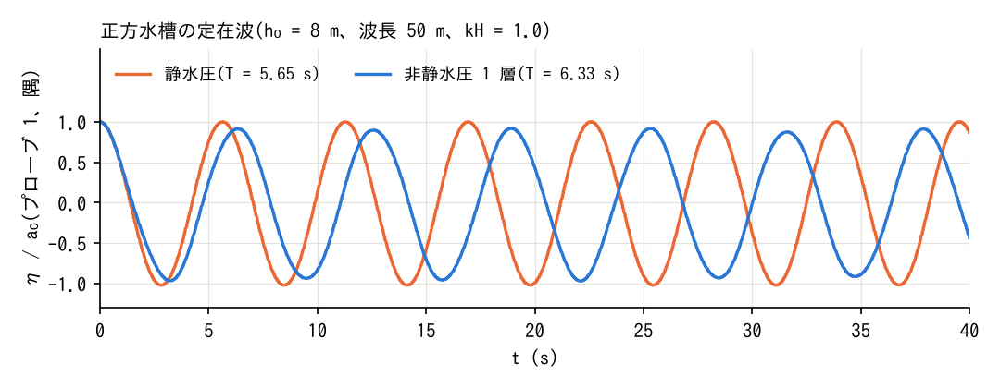
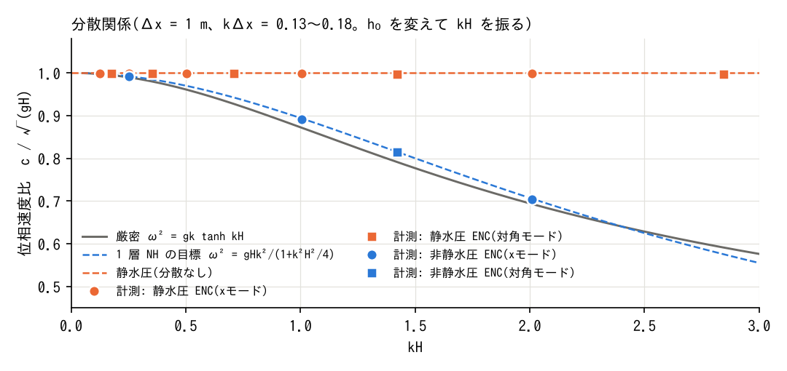

# test/nhwave — standing waves in a closed square tank (measurement of the dispersion relation)

> English mirror of test/nhwave/README.md. The Japanese file is the master copy.

[日本語](../README.md)

A case shared by Phase 1 of docs/nonhydrostatic_plan.md §11 (measurement of
the numerical dispersion of the hydrostatic ENC) and Phase 4 onward
(verification of the dispersion relation of the one-layer NH).

- Flat bed, frictionless, wall boundaries, L = 100 m, nx = ny = 100 (Δx = 1 m).
- The initial water level is the cosine of an eigenmode (amplitude
  1e-3 × depth). `f_user_routine` is `wave_standing_x` (mode (4, 0),
  wavelength 50 m = 50 cells) or `wave_standing_xy` (mode (4, 4), 45°
  direction). Initial velocity 0 → standing wave.
- Changing `h0` changes the depth H and kH while the grid stays the same
  (x mode: kH = 4π h0/100 = 0.126·h0).
- Probe 1 = the south-west corner cell (an antinode of both modes),
  probe 2 = the centre.

## Figures

Water level at probe 1 for h0 = 8 m (kH = 1.0). Compared with the
hydrostatic run (period 5.66 s), the one-layer non-hydrostatic run
(test/nhwave_nh, period 6.33 s) is 12% longer by dispersion.

Phase-speed ratio obtained from the periods measured in the scan
(h0 = 1–16 m, x mode and diagonal mode). The hydrostatic ENC is 1
regardless of kH (numerical dispersion < 1%); the non-hydrostatic ENC lies
on the target curve of the one-layer NH, 1/√(1 + k²H²/4), and is close to
the exact solution √(tanh kH / kH) for kH ≲ 2.

The figures are generated in `figs/` by `./Fig.py` after `./Dispersion.py`
(the scan) and `../nhwave_nh/Run.sh` (matplotlib).

## Regression test

`./Run.sh` / `./Run_MPI.sh N` (param.txt = h0 8 m, x mode, dt 0.02 s,
40 s. Compares Log.txt; the Runge column is excluded).

## Scan of the dispersion relation

`./Dispersion.py` (`--quick` for h0 = 8 only). Runs each case under scan/,
measures the period from the zero crossings of h(t) − H at probe 1 and
writes a table to Dispersion_result.md. The references for comparison are

- T_cont: continuous, hydrostatic √(gH)k
- T_ENC: semi-discrete eigenvalue Λ of the 8-neighbour ENC (Rayleigh
  quotient on the walled grid)
- T_ENC+FB: including the forward-backward Euler time discretization
- T_NH: target of the one-layer NH, ω² = gHΛ/(1 + (H²/4)Λ)
- T_exact: ω² = gk tanh kH

## Findings (2026-10-05; hydrostatic, before the NH implementation)

- The measured periods agree with the semi-discrete ENC prediction T_ENC
  within 0.1% for the x mode and 0.02% for the diagonal mode
  (kΔx = 0.13–0.18). The numerical dispersion (T_ENC − T_cont) is 0.3–0.8%,
  an order of magnitude different from the target of the one-layer NH
  (+12% at kH = 1, +42% at kH = 2), so this case can clearly distinguish
  the presence or absence of NH.
- The difference with and without the adaptive RK (rk1 / rk0) is 0.05% or
  less. At dt = 0.05 (Courant 0.44) the period lengthens by +0.6%, and at
  dt = 0.005 it is within 0.2% of T_ENC.
- f_hcap_upwind = 1 has no effect at small amplitude (the same period as
  rk1 for x_h8).
- Over 8 periods the amplitude changes by +1–2% for the x mode and −5–6% for
  the diagonal mode. This appears to be because the shift of the
  eigenfunction caused by the missing diagonal edges at the walls
  (Λ_wall/Λ_plane = 0.994–0.997) leaks into other modes. The NH
  verification compares under the same conditions.

## Verification of the non-hydrostatic correction (2026-10-05; test/nhwave_nh and the scan)

param.txt of nhwave_nh (the same tank with f_nonhydrostatic=1, CG) is the
regression test. Results of the scan (the periods measured over h0 and the
modes and compared with T_NH = 2π/√(gHΛ/(1+(H²/4)Λ))):

| Case | kH | T_meas | T_NH | Difference | Hydrostatic T | CG iterations/step |
|---|---:|---:|---:|---:|---:|---:|
| x, h0=2 | 0.25 | 11.403 | 11.423 | −0.18% | 11.335 | 12–15 |
| x, h0=8 | 1.01 | 6.332 | 6.338 | −0.10% | 5.667 | 45–52 |
| x, h0=16 | 2.01 | 5.682 | 5.672 | +0.18% | 4.007 | 72–85 |
| xy, h0=8 | 1.42 | 4.924 | 4.924 | −0.01% | 4.024 | 44–52 |

- The period is the same without the adaptive RK (rk0) and at dt = 0.005
  (−0.15 / −0.17%). The change of amplitude (+6.7% over 8 periods, +4.2%
  over 35 periods) is the same as in the long hydrostatic run (+4.2%): a
  transfer between modes caused by the shift of the eigenfunction at the
  walls, not an instability of the time integration.
- Jacobi (nh_solver=1) does not converge even in 500 sweeps for h0=8
  (ε = β·2.83/Δx² ≈ 45) (the period is nevertheless the same). CG was made
  the default.

## Verification of the active set (f_nh_adaptive=1) (2026-10-05)

200 m square (nx = 200), H = 8 m, a hump wave of radius 15 m at the centre
(wave_hump), 8 s. Maximum difference of h at probe 2 (centre) from the
whole-domain solution:

| Margin nh_margin | Active cells (mean) | max\|Δh\| vs whole-domain solution | NH correction (vs hydrostatic) |
|---:|---:|---:|---:|
| 4 | 54% | 9.4e-4 m | 0.47 m |
| 8 | 57% | 4.0e-4 m | same |
| 16 | 64% | 1.0e-4 m | same |
| 8 (nh_arel = 1e-2) | 37% | 1.6e-3 m | same |

For the standing wave (the nhwave_nh configuration) all cells become active
and the result is bit-identical with the whole-domain solution. np=2 is
bit-identical with the serial run. At this size no wall-clock difference
appears.
