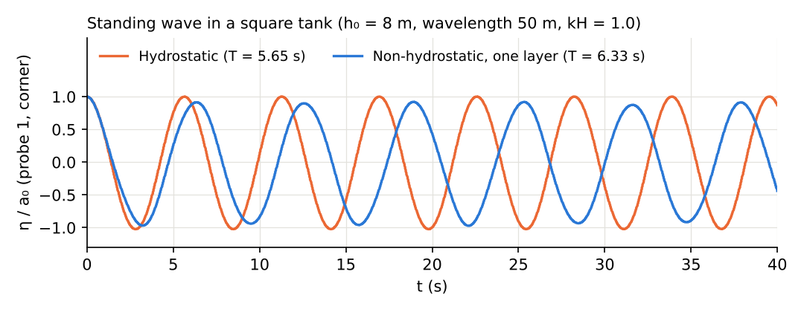
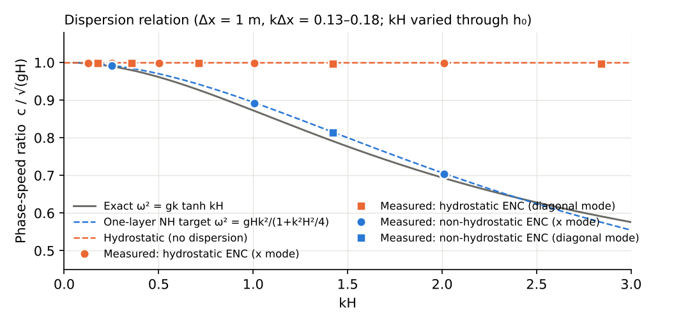

# test/nhwave_nh — standing wave in a closed square tank (regression test of the one-layer non-hydrostatic correction)

> English mirror of test/nhwave_nh/README.md. The Japanese file is the master copy.

[日本語](../README.md)

The same tank as test/nhwave (L = 100 m, Δx = 1 m, h0 = 8 m, x mode (4, 0),
kH = 1.0) with the one-layer non-hydrostatic correction applied
(f_nonhydrostatic=1, CG). docs/nonhydrostatic_plan.md §11 Phase 4. The
target period is ω² = gHΛ/(1 + (H²/4)Λ) → 6.34 s (hydrostatic 5.67 s).

- `./Run.sh` / `./Run_MPI.sh N`: regression test (Log.txt; Runge column
  excluded).
- The scan of the dispersion relation, the findings and the figures are
  collected in the README of test/nhwave and its `Fig.py` (which draws the
  results of this case over the hydrostatic ones).

