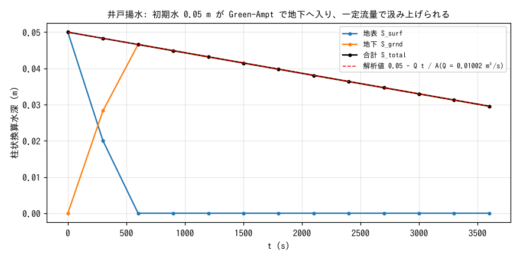
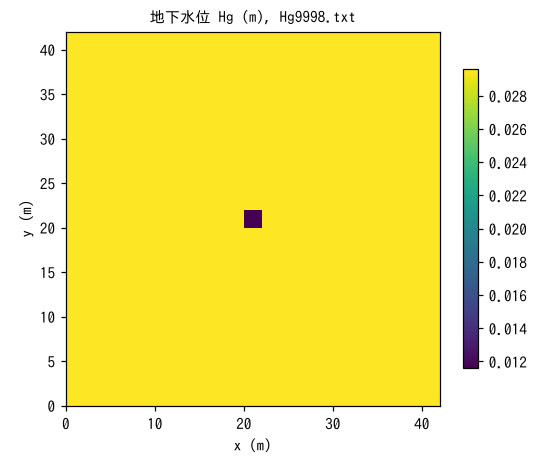

# test/pump — mass budget of the well-pumping sink (f_gwpump)

> English mirror of test/pump/README.md. The Japanese file is the master copy.

[日本語](../README.md)

Verification case for **well pumping** that withdraws a constant discharge
from the groundwater (`f_gwpump = 1` in `&list_gwflow`, `&list_gwflow_pump`;
[the groundwater chapter of the users guide](../../../docs/en/users_guide/gwflow.md)).
A thin initial water layer is placed on a flat closed domain and infiltrated
underground by Green-Ampt infiltration, and then pumped by two wells: one
distributed equally over all cells and one in the single central cell. It
confirms that the demand and the actual withdrawal agree exactly and that
the total storage decreases linearly as the analytical value (verification
record in developer.md §16.3).

## Configuration

| Item | Value |
|---|---|
| Domain and grid | 42 m × 42 m, 21 × 21 cells (Δx = 2 m), flat z = 0, walls on all four sides |
| Soil layer | Thickness sd₀ = 1 m, specific yield sy₀ = 0.2 |
| Infiltration | Green-Ampt (`gw_ksv_mmh = 360` = 1e-4 m/s; `gw_psif = 0` degenerates to a constant infiltration capacity). No lateral flow |
| Initial condition | Surface water h₀ = 0.05 m (no groundwater) |
| Well 1 | Distributed equally over all 441 cells (`data_pump/wells.txt`), constant 0.01 m³/s |
| Well 2 | Central cell (11, 11), constant 2e-5 m³/s given as a time series |
| Time | dt = 0.5 s, 3600 s. Groundwater level Hg output every 1800 s |

Dividing the total pumping rate Q = 0.01002 m³/s by the domain area
A = 1764 m² gives the storage decrease rate Q/A = 5.68e-6 m/s, so
S_total(t) = 0.05 − Q t / A and S_total(3600 s) = 0.029551020408163 m is the
analytical value.

| File | Contents |
|---|---|
| `param.txt` | As above (with a reference) |
| `data_pump/wells.txt` | Cell list of well 1 (all cells) |
| `Fig.py` | Draws the figures `figs/*.png` below |

## Running

```bash
make
./Run.sh          # compare Log.txt with the reference (ULP = 1, excluding the Runge column)
./Run_MPI.sh 4
python3 Fig.py    # figs/storage.png, figs/map.png
```

## Figures



The initial surface water of 0.05 m infiltrates completely underground in
about 500 s (infiltration capacity 1e-4 m/s × 500 s = 0.05 m), and the
subsurface storage S_grnd rises. The total S_total decreases linearly from
the start with the constant slope −Q/A and coincides with the analytical
value (dashed line). The pumping draws from the groundwater from the start
regardless of whether surface water is present.



The subsurface storage Hg (column-equivalent water depth) at the final time
(3600 s). Well 1 is distributed equally over all cells, so the level drops
uniformly, and only the central cell is lower by the additional amount of
well 2 (2e-5 m³/s × 3600 s / 4 m² = 0.018 m) (0.0296 → 0.0116 m). Since
there is no lateral flow, it does not spread to the neighboring cells.

## Findings

| Quantity | Computed | Analytical |
|---|---|---|
| S_total(3600 s) | 0.029551020408150 m | 0.029551020408163 m (relative difference 4.5e-13) |
| Well 1 demand / pumped | 36.000 / 36.000 m³ (100%) | 0.01 × 3600 |
| Well 2 demand / pumped | 0.072 / 0.072 m³ (100%) | 2e-5 × 3600 |
| Additional drawdown of the central cell | 0.0180 m | 0.072 m³ / 4 m² |

- The demand and the actual withdrawal agree exactly (the
  `gwflow_pump: well n: demand / pumped` lines at the end of the screen
  output), and the storage decrease agrees with the analytical value to
  13 digits.
- When the demand exceeds the storage, it is capped at the whole initial
  storage and no negative values appear (§16.3: the whole 88.2 m³ in the
  excessive case with a demand of 1 m³/s). Pumping-induced seawater
  intrusion (a derivative of test/salt) is also recorded in the same
  section.
- Regression discipline: Log.txt must match the reference, and MPI
  np = 1, 2, 4 must be identical.

## Related documents

- [docs/users_guide/gwflow.md](../../../docs/en/users_guide/gwflow.md) — well pumping (`&list_gwflow_pump`: cell list, constant rate, time series), Green-Ampt
- developer.md §16.3 (design and verification record of the well-pumping sink) (in Japanese)
