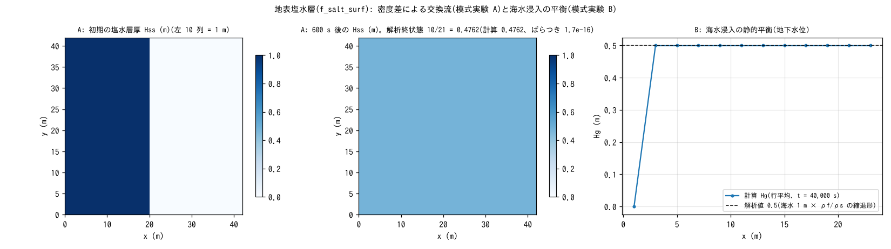

# test/salt — 地表塩水層(f_salt_surf)と海水浸入の平衡

[English](en/README.md)

淡水・塩水を密度の違う 2 つの層として扱う塩水モジュール(`fn_salt`、
[ユーザーガイドの塩水の章](../../docs/users_guide/salt.md)、developer.md §47)の
検定です。9 つの模式実験からなります。

1. **模式実験 A**(`param.txt`、reference あり): 一様水深 1 m の閉じた
   プールの左 10 列を塩水(厚さ 1 m)にして仕切りを外す「ロック交換」。
   密度差による交換流で塩水が底に広がり、終状態の塩水層厚が解析値
   10/21 m(塩水体積 / 全面積)に一様になる。地表水深 H は厳密に不変
   (交換流は層間の入れ替えだけ)。
2. **模式実験 B**(`param_sea.txt`、`Run_sea.sh`): 海(潮位 0 m、海水 1 m)に
   接する乾いた陸の帯水層に海水が浸入し、静的平衡で地下水位が
   Ghyben-Herzberg の縮退形 0.5 m に収束する。
3. **模式実験 C1**(`param_exch_in.txt`、`Run_exch.sh`): 地表—地下の交換の
   淡塩配分(`f_salt_exch`。developer.md §47.5)のうち浸透。水深 1 m のうち
   底層 0.4 m が塩水の閉じた水たまりが、空の帯水層(容量 0.3 m)へ浸透する。
   浸透は河床に接する底層の塩水から先なので、解析終状態は H 0.7・Hss 0.1・
   Hg 0.3・Hgs 0.3(f_salt_exch=0 なら Hss 0.4・Hgs 0 のまま)。
4. **模式実験 C2**(`param_exch_out.txt`、`Run_exch.sh`): 同じく湧出。全層が
   塩水の帯水層(容量の 8 割)が斜面を下り、空の窪地の下で容量を超えて湧き出る。
   湧出は帯水層の上部の淡水から先だが、淡水がないので湧き出るのは塩水
   (f_salt_exch=0 なら窪地の水は Hss = 0 の「淡水」になる)。塩水 zone を
   層1の側方流の直前の状態で評価するので(§47.7)、閉領域の塩水体積は保存する。
5. **模式実験 C3**(`param_exch_dtg.txt`、`Run_exch.sh`): C2 を地下水の更新間隔
   `dt_gwflow = 2 s`(4 ステップに 1 回)で。地下の塩水の処理が側方流と同じ
   ステップ・同じ刻みで同期することの確認(§47.7)。
6. **模式実験 C4a・C4b**(`param_exch_mix1.txt`・`param_exch_mix2.txt`、`Run_exch.sh`):
   C2 と同じ斜面と窪地で、帯水層の下部 4 割だけが塩水(上部は地表の淡水が浸透して
   満たす)。窪地へ湧く水の淡塩配分を f_salt_exch = 1(上部の淡水から先)と 2(湧出前の
   塩水の割合で混合。下限側の感度ケース。§47.9)で比べる。どちらも塩水体積が保存し
   (相対 1e-9)、窪地の水の塩水割合は 2 のほうが大きい。
7. **模式実験 D1・D2**(`param_wall_bank.txt`・`param_wall_sea.txt`、`Run_wall.sh`):
   地表の底層重力流と仮想壁。西の陸(z = 0)の水は全層塩水(界面 +1.2 m)、東の
   河道・海側(z = −3 m)は淡水で、水面は水平(1.2 m)、壁の天端は +2 m(D1 = 堤防
   bank0、D2 = 海岸堤防 seawall0)。塩水を動かしうるのは重力流だけで、界面が天端より
   低いので壁を越えない(§47.8)。解析的な終状態: 陸 Hss = 1.2、河道・海側 Hss = 0、
   H は不変(2026-10-29 以前は重力流が壁を見ず、約 98 % の塩水が壁を越えた)。

## 構成

| 項目 | 模式実験 A | 模式実験 B |
|---|---|---|
| 領域・格子 | 42 m × 42 m、21 × 21 セル(Δx = 2 m)、平坦 z = 0、四周壁 | 24 m × 16 m、12 × 8 セル、陸 z = 1 m、西縁 1 列が海(`sw.txt`) |
| 水 | 一様 h₀ = 1 m、流速 0 | 陸は乾燥(h₀ = 0)。海セルの見かけ水柱厚 1 m、固定潮位 0 m |
| 塩水 | 地表塩水層 `f_salt_surf = 1`、ρf = 1000、ρs = 1025、界面粗度 0.025、初期 `hss0.txt`(左 10 列 = 1 m) | 地下塩水層。帯水層 sd₀ = 3 m(底 −2 m)、sy = 0.2、非線形 Boussinesq 側方流動(毎ステップ) |
| 時間 | dt = 0.1 s、600 s | dt = 0.25 s、40,000 s |

| 項目 | 模式実験 C1 | 模式実験 C2 |
|---|---|---|
| 領域・格子 | 80 m × 80 m、8 × 8 セル、平坦 z = 0、四周壁 | 40 m × 16 m、20 × 8 セル、斜面 z = 1 → 0 m(i = 1〜17)と窪地 z = −0.5 m(i = 18〜20)、四周壁 |
| 水・地下水 | h₀ = 1 m のうち底層 0.4 m が塩水(`salt_hss0`)。帯水層 sd₀ = 1.5 m・sy = 0.2(容量 0.3 m)、初期は空 | 地表は乾燥。帯水層の底 −1 m・sy = 0.2、初期は容量の 8 割まで全層塩水(`fn_salt_hgs0`) |
| 地下水 | Green-Ampt(K_sv = 3600 mm/h、ψ_f = 0)+側方流(一様なので流れない) | Green-Ampt(K_sv = 360 mm/h)+側方流(K_sh = 0.01 m/s) |
| 時間 | dt = 1 s、600 s(300 s で満水) | dt = 0.5 s、7,200 s(C3 は同じ構成で dt_gwflow = 2 s) |

| ファイル | 内容 |
|---|---|
| `Run.sh` / `Run_MPI.sh N` | A の回帰テスト(Log.txt、ULP = 0)。`Run.sh` は続けて `Run_exch.sh`(C1〜C4)と `Run_wall.sh`(D1・D2)も実行する |
| `Run_sea.sh` | B の実行(result_sea/) |
| `Run_wall.sh` / `Check_wall.py` | D1・D2 の実行と検定(倍精度の保存状態 save_wall_*/ を読む) |
| `Run_exch.sh` / `Check_exch.py` | C1〜C4 の実行と検定(倍精度の保存状態 save_exch_*/ を読む) |
| `Fig.py` | 下の図 `figs/salt.png` |

## 実行

```bash
make
./Run.sh          # A: reference と比較(続けて C1〜C4・D1・D2 の検定)
./Run_MPI.sh 4
./Run_sea.sh      # B(数秒)
./Run_exch.sh     # C1〜C4 の実行と Check_exch.py の検定(数秒)
./Run_wall.sh     # D1・D2 の実行と Check_wall.py の検定(数秒)
python3 Fig.py    # figs/salt.png(引数 en で英語版を en/figs/ に)
```

## 図



左・中: 模式実験 A の塩水層厚 Hss。左 10 列に置いた 1 m の塩水が
600 s で全域に一様に広がり、終状態は解析値 10/21 = 0.4762 m に出力精度
(4 桁)で一致し、セル間のばらつきは機械精度(1.7e-16)です。この間、
地表水深 H は 1 セルも変わりません(交換流の設計どおり)。右: 模式実験 B の
地下水位 Hg(行平均、t = 40,000 s)。海に接する列を除いて全セル 0.5000 m
で、解析値 0.5 m(海水 1 m × ρf/ρs の縮退形)に一致します(塩水 Hgs も同値)。

## 所見

| 検定 | 計算値 | 判定 |
|---|---|---|
| A: 終状態の Hss | 0.4762 m 一様(解析 10/21 = 0.47619…)、ばらつき 1.7e-16 | reference PASS |
| A: 地表水深 H | 全時刻・全セルで厳密不変(max\|ΔH\| = 0.0) | — |
| A: 塩水体積 | 相対 2e-5(float32 出力の丸め内) | — |
| B: 地下水位 Hg・塩水 Hgs | Hg = Hgs = 0.5000 m(全陸セル。解析 0.5) | — |
| C1: 終状態 H / Hss / Hg / Hgs | 0.7 / 0.1 / 0.3 / 0.3(倍精度で相対 6e-16 以内。Hgs と Hg はビット一致) | Check_exch PASS |
| C1: 塩水体積 Hss + Hgs | 0.4 を全桁で保存 | Check_exch PASS |
| C2: 窪地の地表水の Hss/H | 0.999(f_salt_exch=0 では 0) | Check_exch PASS(≥ 0.99) |
| C2: 塩水体積 | 2 時間で 0.02 % 減 | Check_exch PASS(\|比 − 1\| < 1e-3) |
| C3: 同上(dt_gwflow = 2 s) | Hss/H 0.998、塩水体積 0.03 % 減 | Check_exch PASS |
| C4a・C4b: 塩水体積、窪地の水の Hss/H | どちらも相対 7e-14 で保存、Hss/H 0.051(淡水から先)< 0.075(混合比) | Check_exch PASS |
| D1・D2: 陸 / 河道・海側の Hss、H | 1.2 / 0 を全桁、H 不変(修正前は陸 0.001〜0.028・河道 1.18) | Check_wall PASS |

- 塩水 zone の乾燥判定・過大流出抑制は側方流動と同じ飽和帯厚単位
  (b = hgs/sy)で書かれています(柱状量単位だと sy 倍保守的になり
  前線で塩水輸送だけが削られる系統誤差になる。実装時に実検出。§47.2)。
- 塩水 zone の水頭は、層1の側方流の直前の hg・h の写しで評価します(§47.7。
  2026-10-29)。それ以前は側方流が動かした後の状態で評価していたため、
  模式実験 B には 1 次の時間分割誤差(K = 0.01 m/s で dt = 0.25 → hgs が 1.5 %
  不足)があり、C2 では湧出面(地表水のある飽和セルと不飽和セルの境。水頭が
  地表水深ぶん切り替わる)で塩水が整合クランプに消えて 2 時間に 16 % 減って
  いました(dt を小さくしてもほとんど減らない)。修正後は B の Hgs が全セルで
  Hg = 0.5000 に一致し、C2 の減少は 0.02 % です。あわせて塩水 zone の界面厚を
  合計の界面飽和帯厚 × 上流側セルの塩水割合にそろえ(合計と同じ向きのとき)、
  全層塩水のセルから淡水が出る食い違いも解消しました(C4a で 9.5 % → 7e-14)。
- MPI np = 1, 2, 4 の Log はバイト一致、リスタート往復(saltwater.dat)も
  一致します(§47.3)。C1〜C4・D1・D2 も np = 1, 2, 4 が逐次と Log.txt・保存状態まで
  バイト一致します(§47.5・§47.7・§47.8)。井戸揚水による海水の誘引は developer.md §16.3 の
  派生実験に記録があります。

## 関連文書

- [docs/users_guide/salt.md](../../docs/users_guide/salt.md) — 地表・地下の塩水層の設定
- developer.md §47(設計・既知の数値特性・検証記録)、[docs/swi_plan.md](../../docs/swi_plan.md)
