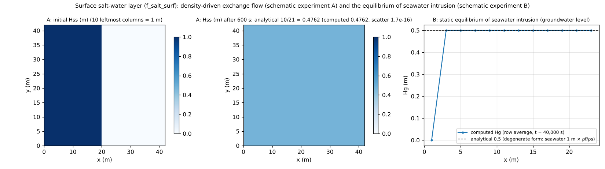

# test/salt — surface salt-water layer (f_salt_surf) and the equilibrium of seawater intrusion

> English mirror of test/salt/README.md. The Japanese file is the master copy.

[日本語](../README.md)

Checks of the salt-water module, which treats fresh water and salt water as
two layers of different density (`fn_salt`; [the salt-water chapter of the
users guide](../../../docs/en/users_guide/salt.md), developer.md §47). It
consists of four schematic experiments.

1. **Schematic experiment A** (`param.txt`, with a reference): a "lock
   exchange" in which the 10 leftmost columns of a closed pool of uniform
   depth 1 m are made salt water (thickness 1 m) and the partition is
   removed. The exchange flow driven by the density difference spreads the
   salt water over the bottom, and the salt-layer thickness in the final
   state becomes uniform at the analytical value 10/21 m (salt-water volume
   / total area). The surface water depth H is exactly unchanged (the
   exchange flow only swaps water between the layers).
2. **Schematic experiment B** (`param_sea.txt`, `Run_sea.sh`): seawater
   intrudes into a dry land aquifer in contact with the sea (tide level
   0 m, seawater 1 m), and in static equilibrium the groundwater level
   converges to 0.5 m, the degenerate form of Ghyben-Herzberg.
3. **Schematic experiment C1** (`param_exch_in.txt`, `Run_exch.sh`): the
   infiltration part of the fresh/salt split of the surface–subsurface
   exchange (`f_salt_exch`; developer.md §47.5). A closed pool 1 m deep,
   whose bottom 0.4 m is salt water, infiltrates into an empty aquifer
   (capacity 0.3 m). Infiltration takes the bottom salt water touching the
   bed first, so the analytical final state is H 0.7, Hss 0.1, Hg 0.3,
   Hgs 0.3 (with f_salt_exch=0, Hss stays 0.4 and Hgs 0).
4. **Schematic experiment C2** (`param_exch_out.txt`, `Run_exch.sh`): the
   seepage part. An aquifer that is entirely salt (80 % of capacity) flows
   down a slope and overflows its capacity beneath an empty hollow. Seepage
   releases the upper fresh water of the aquifer first, but there is no fresh
   water, so what seeps out is salt water (with f_salt_exch=0 the water in the
   hollow becomes "fresh" with Hss = 0).

## Configuration

| Item | Schematic experiment A | Schematic experiment B |
|---|---|---|
| Domain and grid | 42 m × 42 m, 21 × 21 cells (Δx = 2 m), flat z = 0, walls on all four sides | 24 m × 16 m, 12 × 8 cells, land z = 1 m, the 1 western column is sea (`sw.txt`) |
| Water | Uniform h₀ = 1 m, zero velocity | Land is dry (h₀ = 0). Apparent water column of the sea cells 1 m, fixed tide level 0 m |
| Salt water | Surface salt layer `f_salt_surf = 1`, ρf = 1000, ρs = 1025, interface roughness 0.025, initial `hss0.txt` (10 leftmost columns = 1 m) | Subsurface salt layer. Aquifer sd₀ = 3 m (bottom −2 m), sy = 0.2, nonlinear Boussinesq lateral flow (every step) |
| Time | dt = 0.1 s, 600 s | dt = 0.25 s, 40,000 s (a smaller dt to suppress the splitting error) |

| Item | Schematic experiment C1 | Schematic experiment C2 |
|---|---|---|
| Domain and grid | 80 m × 80 m, 8 × 8 cells, flat z = 0, walls on all four sides | 40 m × 16 m, 20 × 8 cells, slope z = 1 → 0 m (i = 1–17) and hollow z = −0.5 m (i = 18–20), walls on all four sides |
| Water and groundwater | h₀ = 1 m with the bottom 0.4 m salt water (`salt_hss0`). Aquifer sd₀ = 1.5 m, sy = 0.2 (capacity 0.3 m), initially empty | Surface dry. Aquifer bottom −1 m, sy = 0.2, initially entirely salt up to 80 % of capacity (`fn_salt_hgs0`) |
| Groundwater models | Green-Ampt (K_sv = 3600 mm/h, ψ_f = 0) + lateral flow (uniform, so no flow) | Green-Ampt (K_sv = 360 mm/h) + lateral flow (K_sh = 0.01 m/s) |
| Time | dt = 1 s, 600 s (full after 300 s) | dt = 0.5 s, 7,200 s |

| File | Contents |
|---|---|
| `Run.sh` / `Run_MPI.sh N` | Regression test of A (Log.txt, ULP = 0). `Run.sh` then also runs `Run_exch.sh` (C1 and C2) |
| `Run_sea.sh` | Run of B (result_sea/) |
| `Run_exch.sh` / `Check_exch.py` | Run and check of C1 and C2 (reads the double-precision saved states save_exch_*/) |
| `Fig.py` | The figure `en/figs/salt.png` below (`python3 Fig.py en`; `figs/salt.png` is the Japanese version) |

## Running

```bash
make
./Run.sh          # A: compare with the reference (then the C1 and C2 checks)
./Run_MPI.sh 4
./Run_sea.sh      # B (a few seconds)
./Run_exch.sh     # C1 and C2 with the Check_exch.py check (a few seconds)
python3 Fig.py en # en/figs/salt.png
```

## Figures



Left and center: the salt-layer thickness Hss of schematic experiment A.
The 1 m of salt water placed in the 10 leftmost columns spreads uniformly
over the whole domain in 600 s; the final state agrees with the analytical
value 10/21 = 0.4762 m to the output precision (4 digits), and the scatter
between cells is at machine precision (1.7e-16). During this time the
surface water depth H does not change in a single cell (as designed for
the exchange flow). Right: the groundwater level Hg of schematic
experiment B (row average, t = 40,000 s). Except for the column in contact
with the sea it is 0.5000–0.5002 m, agreeing with the analytical value
0.5 m (the degenerate form seawater 1 m × ρf/ρs).

## Findings

| Check | Computed | Result |
|---|---|---|
| A: final Hss | 0.4762 m uniform (analytical 10/21 = 0.47619…), scatter 1.7e-16 | reference PASS |
| A: surface water depth H | Exactly unchanged at all times and in all cells (max\|ΔH\| = 0.0) | — |
| A: salt-water volume | Relative 2e-5 (within the rounding of the float32 output) | — |
| B: groundwater level Hg | 0.5000–0.5002 m (analytical 0.5) | — |
| C1: final H / Hss / Hg / Hgs | 0.7 / 0.1 / 0.3 / 0.3 (within relative 6e-16 in double precision; Hgs and Hg bit-identical) | Check_exch PASS |
| C1: salt-water volume Hss + Hgs | 0.4 conserved to all digits | Check_exch PASS |
| C2: Hss/H of the surface water in the hollow | 0.19 (0 with f_salt_exch=0) | Check_exch PASS (≥ 0.1) |
| C2: salt-water volume | 16 % decrease in 2 hours (note below) | displayed only |

- The dry-cell test and the excess-outflow reduction of the salt zone are
  written in the same saturated-thickness unit (b = hgs/sy) as the lateral
  flow (in column-quantity units they would be sy times more conservative,
  a systematic error in which only the salt transport is cut at the front;
  actually detected during implementation. §47.2).
- The salt-layer thickness hgs of schematic experiment B has a first-order
  time-splitting error due to the sequential splitting in which the lateral
  flow moves η first and the salt zone then reads the updated η (in the
  extreme case K = 0.01 m/s, dt = 1.0 → 5%, 0.25 → 1.5%. The equilibrium
  head is correct and the error is local to the front). It is negligible
  for practical K (§47.2).
- The decrease of salt water in C2 arises at the seepage face (the boundary
  between a saturated cell with surface water and an unsaturated cell): the
  head of layer 1 switches by the surface water depth, so in the scheme that
  solves the total and the salt zone in turn there are steps where the
  salt-zone flux is evaluated in the opposite direction and the consistency
  clamp removes salt water (still 13.5 % with dt reduced to 1/8, hardly any
  better; the same mechanism removes 19 % with f_salt_exch=0. Numerical
  property 2 of §47.5; the permanent remedy is in handoff).
- The Logs of MPI np = 1, 2, 4 are byte-identical, and the restart round
  trip (saltwater.dat) also agrees (§47.3). C1 and C2 at np = 1, 2, 4 are
  also byte-identical to the serial run down to Log.txt and the saved states
  (§47.5). Pumping-induced seawater
  intrusion is recorded in the derivative experiment of developer.md §16.3.

## Related documents

- [docs/users_guide/salt.md](../../../docs/en/users_guide/salt.md) — settings of the surface and subsurface salt layers
- developer.md §47 (design, known numerical properties, verification record) (in Japanese), [docs/swi_plan.md](../../../docs/swi_plan.md) (in Japanese)
