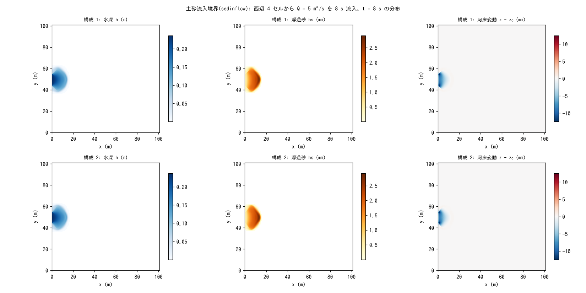

# test/sedinflow — ledger closure of the sediment inflow boundary (inflow_cs / inflow_qs)

> English mirror of test/sedinflow/README.md. The Japanese file is the master copy.

[日本語](../README.md)

A check of the feature that attaches a time series of sediment concentration
`inflow_cs` or sediment discharge `inflow_qs` to an inflow boundary
(`&list_bound_inflow`) and injects sediment together with the water (the
sediment inflow of developer.md §19). A constant inflow Q = 5 m³/s is given
for 8 s at 4 cells on the west side of a dry closed domain, and
`Check_sedinflow.py` checks that the total solid Σhs + (1 − λ)Σ(z − z₀)
agrees to machine precision with the total inflowing sediment C·Q·tt (that
injection by prescribed concentration is exact as "water volume ×
concentration").

## Configuration

| Item | Value |
|---|---|
| Domain and grid | 101 m × 101 m, 101 × 101 cells (Δx = 1 m), flat, dry bed (h₀ = 0), walls on all four sides |
| Inflow | 4 cells (1, 45)–(1, 48) on the west side, constant Q = 5 m³/s |
| Sediment | Configuration 1 `param.txt`: concentration C = 0.001 (volume concentration). Configuration 2 `param_qs.txt`: sediment discharge Qs = 0.005 m³/s (= C·Q; specified exclusively with cs) |
| Transport | Suspended sediment `f_suspend = 1` (advection + E-D), sd₀ = 10 m, λ = 0.4 |
| Time | dt = 0.1 s, 8 s |

| File | Contents |
|---|---|
| `Check_sedinflow.py <save>` | Σhs + (1 − λ)Σ(z − z₀) = C·Q·tt = 0.04 m·cell (machine precision), Σh = Q·tt = 40 m³ |
| `Fig.py` | The figure `figs/sedinflow.png` below (Run.sh leaves configuration 1 in `save_serial/` and configuration 2 in `save/`) |

## Running

```bash
make
./Run.sh          # configuration 1 → Check → configuration 2 → Check
./Run_MPI.sh 4
python3 Fig.py    # figs/sedinflow.png
```

## Figures



Top row: prescribed concentration; bottom row: prescribed sediment discharge.
Left: the depth after 8 s. The water entering from the west side spreads as a
fan. Center: suspended sediment hs. The injected sediment is carried along
with the flow. Right: just in front of the inflow cells the bed is scoured by
14 mm through E-D (the high-velocity part immediately after the inflow).
Qs = 0.005 m³/s is reduced to the equivalent concentration
cs = Qs/Q = 0.001, so the two configurations give the same result.

## Findings

| Configuration | Σh | Total solid | Inflowing sediment C·Q·tt | Result |
|---|---|---|---|---|
| 1 prescribed concentration | 40.000000 m³ | 0.0400000000 m·cell | 0.04 | PASS (closure ~1e-16) |
| 2 prescribed sediment discharge | 40.000000 m³ | 0.0400000000 m·cell | 0.04 | PASS |

- The total injected is the exact sum of Q·C·dt (or Qs·dt), and the
  apportioning follows that of the water. Nothing is injected while Q = 0, and
  Qs/Q ≥ 1 is clipped with a warning (§19).
- There is no new saved state (the time series is input and the injection has
  no history), so save_version is unchanged. The state.dat of MPI np = 1, 2, 4
  is byte-identical to the serial run.

## Related documents

- [docs/users_guide/boundary.md](../../../docs/en/users_guide/boundary.md) — inflow boundaries and `inflow_cs` / `inflow_qs`
- developer.md §19 (implementation of sediment inflow, direct specification of Qs, verification record)
