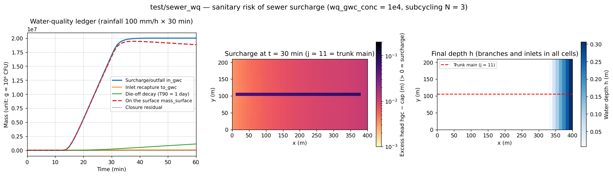

# test/sewer_wq — sanitary risk of sewer surcharge (water quality × conduit continuum layer)

> English mirror of test/sewer_wq/README.md. The Japanese file is the master copy.

[日本語](../README.md)

A regression test that shortens and makes self-contained run D of
[examples/sewer_hybrid](../../../examples/sewer_hybrid/en/README.md) (one
trunk main + a branch network, per-cell sy / slot_sy). A rainfall of
100 mm/h × 30 min (51.7 mm in total) exceeds the in-pipe storage (about
16 mm) and causes surcharge and eruption, and the surcharge and outfall
water is treated as "sewage at 10⁶ CFU/100 mL" (reading of the unit
g = 10⁶ CFU → `wq_gwc_conc = 1e4`) to follow the spreading and die-off of
coliforms (T90 = 1 day, `wq_k20 = 2.303`). It simultaneously checks the
**fixed supply-side concentration approximation** of the water quality
module (developer.md §30) and (4) subcycling of the conduit layer
(dt = 0.1 s → N = 3) and (5) per-cell sy / slot_sy (§46.5). The master
text of the practical procedure is "Sanitary risk of sewer surcharge" in
[users_guide/wq.md](../../../docs/en/users_guide/wq.md).

## Configuration

| Item | Value |
|---|---|
| Domain and grid | 400 m × 210 m, 40 × 21 cells (Δx = 10 m). A uniform slope descending eastward (z 7.975 → 6.025 m), closed boundaries |
| Rainfall | 100 mm/h from 0 to 30 min, then 0 |
| Conduit layer | Branch pipes (D = 0.4 m, buried 2 m) and inlets in all cells, a trunk main (D = 1.0 m, buried 5 m) in row j = 11. Capacity cap, conveyance cnd, invert bot, sy and slot_sy are per-cell maps (`data_sewer/*_T.txt`) |
| Water quality | The surcharge and outfall water from the conduits is a source of concentration 1e4 (`f_wq_gwc_in = 1`), die-off k20 = 2.303 /day |
| Time | dt = 0.1 s, 1 h. The conduit layer is subcycled with N = 3 (dt cap 3.72e-2 s) |

| File | Contents |
|---|---|
| `Run.sh` / `Run_MPI.sh N` | Compare Log.txt (water budget) and wq.csv (mass budget; including the in_gwc_g / to_gwc_g columns of the conduit coupling) with the reference. RTOL = 1e-5 for release builds (see below) |
| `Fig.py` | The figure `en/figs/sewer_wq.png` below (`python3 Fig.py en`; `figs/sewer_wq.png` is the Japanese version) |

## Running

```bash
make
./Run.sh          # 1 h computation (about 10 seconds) + reference comparison
./Run_MPI.sh 2
python3 Fig.py en # en/figs/sewer_wq.png
```

## Figures



Left: the ledger of wq.csv. About 14 minutes after the start of the rainfall the
conduits become full and the surcharge begins (in_gwc); by the end of
the 30-minute rainfall 1.7e7 units (= 1.7e13 CFU), and by about 40 min when
the surcharge subsides 2.0e7 units (= 2e13 CFU), have come out onto the
surface. Recapture by the inlets (to_gwc) is 0.24% of the surcharge, and
die-off is 5.6% in 1 hour; the rest remains on the surface. The closure
residual (dotted line) is zero. Center: the surcharge of the conduits at the
end of the rainfall (in-pipe head hgc − capacity cap). The trunk main holds
about 10 times the excess head of the branch pipes, and in the branch
network the surcharge is larger toward the east (downstream). Right: the
final water depth. The erupted water flows east down the slope and ponds to
0.3 m at the eastern end of the closed boundary.

## Findings

| Quantity | Computed (t = 1 h) |
|---|---|
| Surcharge and outfall in_gwc | 2.0008e7 |
| Recaptured by inlets to_gwc | 4.884e4 |
| Die-off decay | 1.118e6 |
| Remaining on the surface mass_surface | 1.884e7 |
| Closure in − to − decay − surface | +0.64 (relative 3.2e-8 = rounding of the 8 displayed digits) |
| Water budget S_total(1 h) | Cumulative rainfall 51.67 mm (closed boundaries) |
| Regression | Log.txt and wq.csv match the reference | 

- For this case a ULP = 0 comparison does not hold with anything other than
  the identical release binary (-Ofast -march=native -flto) (the threshold
  sensitivity of the Runge substeps amplifies build differences to a
  relative 5e-6. §10). The release regression is judged with
  `RTOL = 1e-5`, and the detection of implementation bugs is carried by the
  serial = np2 bit identity with -Og -fcheck=all (the debug-fcheck layer of
  the nightly, RTOL = 0).
- Fixed supply-side concentration approximation: the concentration of the
  surcharge water does not track the concentration inside the pipes but is
  given by `wq_gwc_conc` (dilution inside the pipes is ignored = on the safe
  side).
- The hydraulics of the conduit layer alone is in
  [test/coastal_drain](../../coastal_drain/en/README.md), and the water
  quality of subsurface pathways in [test/gwseep](../../gwseep/en/README.md).

## Related documents

- [docs/users_guide/wq.md](../../../docs/en/users_guide/wq.md) — "Sanitary risk of sewer surcharge", `wq_gwc_conc`, `f_wq_gwc_in`
- [docs/users_guide/gwflow.md](../../../docs/en/users_guide/gwflow.md) — per-cell maps of the conduit continuum layer
- developer.md §30 (fixed supply-side concentration of water quality), §46.5 (4)(5) (in Japanese)
