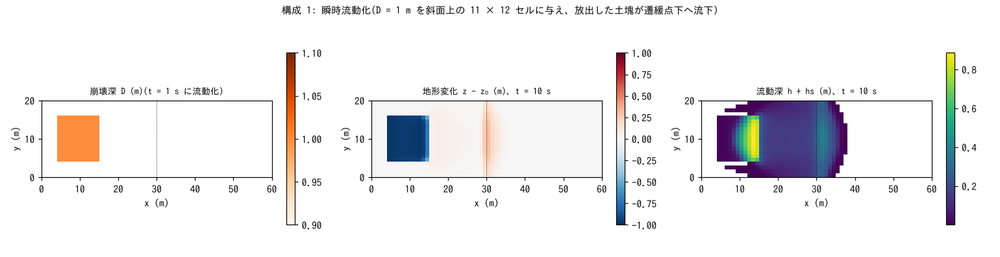
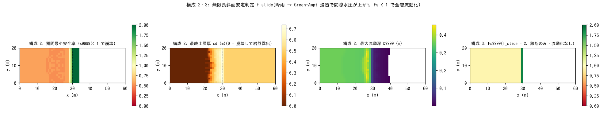

# test/slide — 瞬時流動化(f_release)と斜面安定判定(f_slide)の疎通と保存則

[English](en/README.md)

地滑り型の土砂流動の 2 つの発生機構と、流動化のときの間隙水の扱いの検定です
(developer.md §28.1、§28.9、§28.17、§28.19)。

1. **瞬時流動化 f_release**(`param.txt`): 崩壊深分布 `fn_dbinit` を与え、
   指定時刻 `db_reltime` に一斉に流動化する(地滑り型の初期条件)。
   転換は hs += (1 − λ)D、z −= D、sd −= D で固体台帳が構造的に閉じ、
   間隙水 λ·relsat·D が地表水になる。
2. **斜面安定判定 f_slide**(`param_fs.txt`、`param_fs2.txt`): 無限長斜面の
   安全率 Fs = (c′ + (γt sd − γw hw) cos²θ tanφs)/(γt sd sinθ cosθ) を
   セルごとに評価し、Green-Ampt 浸透で間隙水圧が上がって Fs < 1 に
   なったセルを全層流動化する(sd = 0 = 岩盤露出)。`f_slide = 2` は
   診断のみ(Fs を出力するが流動化しない危険度マップ)。
3. **保持水の授受 f_dbwet = 3 と初期地下水 gw_sat0**(`param_wet.txt`): 地下水計算と併用した
   瞬時流動化で、土と一緒に動く保持水 w_r = λ − sy0 を授受する。飽和した土層(gw_sat0 = 1)が
   流動化すると、保持水 w_r·D と地下貯留から出る sy0·D を合わせた λ·D の水が出て、濃度 C* の
   混合体になる。水の総量は Σh + Σhg + w_r·Σ(z − z0) の形で保存される。
4. **斜面安定判定の選択子**(`make_fs.py` が書く `p_fs_*.txt`): 浸透力を全水頭の勾配で入れる安全率
   `f_slide_seep`、判定・流動化する深さの上限 `slide_dmax`、間隙水圧で起きる崩壊に限る `f_slide_wet`、
   濃い混合体が載るセルを判定しない `f_slide_noflow`(2 は、載っている土砂が薄いセルを判定する)。
   一様な勾配の平面の斜面で、安全率の出力を式の値と比べる。

reference 比較ではなく `Check_slide.py` の自己検定(保存則・水収支・
活性・危険度出力の整合)で合否を決めます。

## 構成

共通: slope_break 地形(tanθ = 0.4 の斜面 → x = 30 m から平坦)、
60 m × 20 m(Δx = 1 m)、クーロン + マニング合成抵抗、低速凝集で停止。

| 構成 | ファイル | 内容 | 時間 |
|---|---|---|---|
| 1 release | `param.txt` | 可動層 5 m。崩壊深 D = 1 m を i ∈ [5, 15], j ∈ [5, 16](`make_dbinit.py`)に与え、t = 1 s に流動化(relsat = 1、φ = 30°) | dt 0.02 s、10 s |
| 2 fslide | `param_fs.txt` | 薄い土層 sd₀ = 0.5 m、sy = 0.3。降雨 → Green-Ampt 浸透 → `f_slide = 1`。危険度出力 Fs9999・D9999・Dt9999・F9999・Hs を有効化 | dt 0.05 s、400 s |
| 3 fsdiag | `param_fs2.txt` | 構成 2 と同じで `f_slide = 2`(診断のみ) | 同上 |
| 4 wet | `param_wet.txt` | 構成 1 + 地下水計算(Green-Ampt。浸透能はほぼ 0)+ `gw_sat0 = 1`(飽和した土層)+ `f_dbwet = 3`(sy0 = 0.2、λ = 0.4、w_r = 0.2)。`Run.sh` は同じ設定の `gw_sat0 = 0`(乾いた土層)も回す(設定 `param_wetdry.txt` を `param_wet.txt` から作る) | dt 0.02 s、10 s |
| 5 seep | `p_fs_u0`・`_u1`、`p_fs_g0`・`_g1`、`p_fs_l0`・`_l1`、`p_fs_lq1`・`_le1`、`p_fs_m1`・`_m0`、`p_fs_gdyn` | `f_slide_seep` の 0 と 1(下記)。判定だけ(`f_slide = 2`)。`p_fs_gdyn` は流動化あり | dt 0.05 s、1 s(gdyn は 5 s) |
| 6 dmax | `p_fs_d2`、`p_fs_d1` | `slide_dmax = 0.5` m。土層厚 2 m、飽和度 0.9。`_d2` は判定だけ、`_d1` は流動化あり | 1 s |
| 7 wet | `p_fs_w1`・`_w0`・`_w2` | `f_slide_wet` の 1 と 0(φs = 20°。乾いていても Fs < 1)、φs = 25° で 1 | 1 s |
| 8 noflow | `p_fs_n1`・`_n0`・`_n2`、`p_fs_f1`・`_f2`・`_f0`、`p_fs_k2`・`_k0` | `f_slide_noflow` の 1・0・2。`_n*` は構成 6 の `_d1` を地形の更新 2 回。`_f*`・`_k*` は薄い膜の下の不安定な層(下記)で、更新 3 回 | 2 s(`_f*`・`_k*` は 3 s) |

構成 5〜8 の地形は、勾配が一様な平面 z = 30 − 0.30 x − 0.25 y(40 m × 30 m、Δx = 1 m)です。最急勾配は
tanθ = 0.3905 で、向きは格子の 8 方向のどれとも合いません。y の向きにも傾くので、MPI の帯の境界を
またいで近傍を読みます。地下水計算は Green-Ampt(浸透能はほぼ 0)で、層1の初期飽和度 `gw_sat0` が
飽和厚 hw = gw_sat0·sd を決めます。地形の更新は 1 秒ごとで、判定だけのケースは 1 回目の更新の安全率
`Fs0001`(bil = 単精度の 2 進)を読みます。平面の地形と平面の土層厚では全水頭 H = (z − sd) + hw も平面
なので、その最急降下勾配 J が解析的に決まり、安全率を式の値と直接比べられます。

- **構成 5**(`f_slide_seep`)。Fs = [c′ + (γt d − γw hw) cos²θ tanφs] / [cos²θ {(γt d − γw hw) tanθ + γw hw J}]。
  - `_u0`・`_u1`: 土層厚が一様(1 m)、飽和度 0.6。J = tanθ なので、0 と 1 が同じ値(従来の式)になる。
  - `_g0`・`_g1`: 土層厚が下流へ厚くなる平面(1 + 0.08 x + 0.06 y m)、飽和度 0.5、c′ = 2 kPa。
    J = 0.4405 > tanθ で、1 は従来の式より 3 % 小さい。
  - `_l0`・`_l1`: 土層厚 1 m・飽和。下流側のおよそ 1/3 を静水の湖(水位 19 m)にする。湖の下は J = 0 で、
    1 は Fs = tanφs/tanθ = 1.194、0 はその (γt − γw)/γt 倍の 0.578(従来の式の過小評価)。陸の側は
    どちらも 0.578。
  - `_lq1`・`_le1`: `_l1` の飽和度を 1 − 2.5×10⁻⁴ と 1 − 10⁻⁶ にする(地下貯留が容量にわずかに届かない)。
    地表水の水頭は、貯留が容量の 99.9 % から 100 % までの間で 0 から 1 へ連続につながる(つながり κ。
    全水頭は H = (z − sd) + hw + κ h)ので、湖の下は J = (1 − κ) tanθ。`_lq1` は κ = 0.75 で Fs = 0.943、
    `_le1` は κ = 0.999 で Fs = 1.193(静水の値より 0.1 % 小さい)。容量に届いたかどうかの 2 値で
    つなぐ実装では、どちらも従来の式の値 0.578 まで下がる。
  - `_m1`・`_m0`: 流動中の土砂が載ったセルの水頭。`_m1` は `_l1` の湖の下の 5 × 6 セルを、深さ 0.5 m だけ
    瞬時に流動化する(`fn_dbinit`、t = 1 s。`f_dbwet = 3` で、崩れた層の水の全部が流れへ出る)。
    流動化したセルは地盤が 0.5 m 下がり、水 0.2 m と土砂 0.3 m が載って、流動面 z + h + hs は湖の水位の
    まま。`_m0` は、同じ形にはじめから掘って清水を張ったケース。全水頭を流動面で読めば
    (H = (z − sd) + hw + κ (h + hs))、どちらも湖の下は J = 0 で、2 つの安全率は同じになる。水深 h だけで
    読む実装では、流動化したセルの水頭が hs = 0.3 m 下がり、その隣の安全率が最大 45 % 違う。
  - `_gdyn`: `_g1` を流動化あり(`f_slide = 1`)で 5 秒。固体と水の保存と、MPI の一致を見る。
- **構成 6**(`slide_dmax`)。上から d = 0.5 m だけを判定する。その中の飽和厚は
  max(0, hw − (sd − d)) = 0.3 m。`_d1` は更新 1 回で、標高がちょうど 0.5 m 下がり、土層が 1.5 m 残り、
  残った土層の容量を超える地下貯留(0.09 m)が地表へ出る。
- **構成 7**(`f_slide_wet`)。φs = 20° では乾いていても Fs = tanφs/tanθ = 0.93 < 1(幾何的な不安定)。
  1 は流動化せず、0 は全層を流動化する。φs = 25°(乾いた Fs = 1.19)で飽和した `_w2` は、間隙水圧で
  Fs = 0.58 になるので 1 でも流動化する。
- **構成 8**(`f_slide_noflow`)。1 回目の更新で 0.5 m が流動化し、濃い混合体(hs = 0.3 m)が載る。
  1 は 2 回目の更新でそのセルを判定しないので土層は 1.5 m のまま、0 はもう 0.5 m 流動化して 1.0 m。
  2 も、自分の流動化した土砂(堆積に直して 0.5 m。判定する厚さと同じ量)が載っている間は判定せず、
  状態が 1 と一致する(`_n2`)。
  - 薄い膜の下の不安定な層(`_f*`・`_k*`。developer.md §28.24)。土層厚 2 m、飽和度 0.8 では、上から
    0.5 m の中の飽和厚が 0.1 m で、はじめは安定(Fs = 1.07)。1 回目の更新の終わりに全面を薄く流動化する
    (`fn_dbinit`)と、地下水面が地表に近づいて不安定になり(深さ 0.1 m で Fs = 0.95、0.3 m で 0.70)、
    流動化した土砂が膜として載る。2 回目の更新で、1 は判定しないので流動化しない(`_f1`。土層 2 m)。
    2 は、膜が判定する厚さの 0.2 倍(`_f2`)なら判定して 0.5 m を流動化し、3 回目は自分の土砂の下なので
    判定しない(1.5 m)。0.6 倍(`_k2`)なら判定しない(2 m)。0 はどちらも 2 回目と 3 回目に流動化する
    (`_f0`・`_k0`。1.0 m)。判定を外す下限の比(本体の定数 0.5)が 0.2 と 0.6 の間にあることを見る。
    膜は水を含まない土砂なので、2 回目の更新の侵食・堆積で斜面に戻る(判定はその前)。

| ファイル | 内容 |
|---|---|
| `Check_slide.py <save> release\|fslide\|fsdiag [result]` | release: (1) 固体総量、(2) 共動更新、(3) 水収支 Σh = λ relsat ΣD、(4) 活性。fslide: (1)(2)、(4) 斜面に sd = 0 のセル、(5) 危険度出力 min Fs9999 < 1・D9999 ≥ H9999。fsdiag: (1) 無流動化(z・sd・hs 不変)、(2) Fs の危険域検出 |
| `Check_slide.py <save> wet <画面出力> <gw_sat0>` | (1) 固体総量、(2) 共動更新、(3) 水台帳 Σh + Σhg + w_r Σ(z − z0) = gw_sat0·sy0·Σsd0 + 保持水の不足(不足は、堆積のとき地表水・地下貯留から取れなかった保持水で、画面出力の終了時の表示 `retained pore water shortfall` から読む)、(4) 活性、(5) 保持水の授受の活性(\|w_r Σ(z − z0)\| > 1e-6。乾いた土層では不足 > 0) |
| `make_fs.py` | 構成 5〜8 の入力 `d_fs/`(地形・土層厚・湖の初期水深)と設定 `p_fs_*.txt` を書く(Run.sh・Run_MPI.sh が呼ぶ。引数 `list` でケース名を出す) |
| `Check_slide_fs.py fs <case>` | 構成 5・6: 内部のセル(縁の 1 列を除く。湖のケースは、自分と 8 近傍がすべて湖か、すべて陸のセル)の安全率が式の値と相対 2e-6 以内(単精度の出力の丸め) |
| `Check_slide_fs.py pair <case1> <case0> same\|differ` | 構成 5: 2 つのケースの安全率が同じ(2e-6 以内)か、2 % 以上違う(検出力) |
| `Check_slide_fs.py dmax1\|wet\|noflow\|film\|ledger …` | 構成 6: 標高の低下・土層厚・hs・hg・h が厳密な値と 1e-12 m 以内、固体と水の台帳。構成 7・8: 上の説明のとおりの土層厚(`film` は薄い膜のケースで、流動化の回数を土層厚の範囲で見る。`_n2` は状態が `_n1` と一致)。`ledger` は構成 5 の `_gdyn` の固体・水の台帳(1e-9)と活性 |
| `Fig.py` | 下の図 `figs/*.png` |

## 実行

```bash
make
./Run.sh          # dbinit 生成 → 8 構成(構成 4 は飽和と乾燥の 2 つ、構成 5〜8 は 18 ケース)を実行し Check。すべて PASS で PASS(10 秒ほど)
./Run_MPI.sh 4    # MPI。state.dat と出力ファイル(Fs9999・Fs0001 等)が逐次とバイト一致
python3 Fig.py    # figs/release.png, figs/fslide.png(引数 en で英語版を en/figs/ に)
```

## 図



構成 1。左: 崩壊深 D = 1 m の崩壊域。中: 10 s 後の地形変化。崩壊域は
約 0.98 m 低下し(放出 1 m のうち一部が直後に再堆積)、遷緩点の下流に
最大 0.31 m の堆積が始まっています。右: 流動深 h + hs。放出された
土塊が崩壊域から遷緩点を越えて平坦部へ扇状に広がっています。



構成 2(左 3 枚)と 3(右)。左: 期間最小安全率 Fs9999。斜面全体で
Fs < 1(最小 0.493)になり、遷緩点付近の緩い部分だけ Fs > 1 です。
中左: 最終土層厚 sd。斜面の多くのセルで sd = 0(崩壊して岩盤が露出。
474 セル)になり、崩壊した土砂が流下して再堆積した縞も見えます。
中右: 最大流動深 D9999(最大 0.43 m)。右: 構成 3 の Fs9999。流動化
しないので Fs の最小は 0.943 にとどまり、危険域(< 1)の検出だけが
行われます(診断モードの危険度マップ)。

## 所見

| 構成 | 固体総量 | 共動更新 | 水収支 / 活性 | 判定 |
|---|---|---|---|---|
| 1 release | 1e-12 程度以下 | 1e-13 程度以下 | Σh = 52.8000(期待 λ relsat ΣD = 52.8000)/ 崩壊域 min dz −0.98 m、域外堆積 +0.31 m | PASS |
| 2 fslide | 1e-11 程度以下(許容 1e-8: 約 2 万セル回の転換の丸め累積) | 1e-13 程度以下 | 斜面 min sd = 0(474 セル崩壊)/ min Fs9999 0.493、D9999 ≥ H9999 | PASS |
| 3 fsdiag | — | — | z・sd・hs 不変、min Fs 0.943 < 1 を検出(600 セル評価) | PASS |
| 4 wet(飽和) | 1e-13 程度以下 | 1e-13 程度以下 | 水台帳の残差 3e-12(初期の地下貯留 1200 m³、保持水の項 17.1 m³、不足 0)/ 崩壊域 min dz −0.97 m、域外堆積 +0.29 m | PASS |
| 4 wet(乾燥) | 1e-12 程度以下 | 1e-13 程度以下 | 水台帳の残差 3e-12(保持水の項 18.3 m³、不足 0.09 m³)/ 崩壊域 min dz −0.83 m、域外堆積 +0.54 m | PASS |

| 構成 5〜8 のケース | 比べる量 | 式の値 | 計算との差 | 判定 |
|---|---|---|---|---|
| 5 `_u0`・`_u1` | 安全率(1064 セル) | 0.8246(従来の式) | 相対 2e-9。0 と 1 は出力が同じ | PASS |
| 5 `_g0` | 同 | 0.940〜1.143(従来の式) | 相対 6e-8 | PASS |
| 5 `_g1` | 同 | 0.910〜1.106(J = 0.4405) | 相対 6e-8。`_g0` より 3.2 % 小さい | PASS |
| 5 `_l0` | 安全率(陸 598・湖 364 セル) | 陸 0.5782、湖 0.5782 | 相対 3e-9 | PASS |
| 5 `_l1` | 同 | 陸 0.5782、湖 1.1941(= tanφs/tanθ) | 相対 5e-9。湖の下は `_l0` の 2.07 倍 | PASS |
| 5 `_lq1` | 同 | 陸 0.5783、湖 0.9431(κ = 0.75、J = 0.25 tanθ) | 相対 3e-8 | PASS |
| 5 `_le1` | 同 | 陸 0.5782、湖 1.1928(κ = 0.999) | 相対 4e-8。湖の下は `_l1` より 0.11 % 小さい | PASS |
| 5 `_m1`・`_m0` | 安全率(1064 セル。うち流動化したセルとその隣が 56) | 2 つのケースが同じ | 出力が一致(相対 0)。流動面は湖の水位から 4e-15 m 以内 | PASS |
| 5 `_gdyn` | 固体・水の台帳 | 0 | 固体 2e-12、水 1e-13(流動化 1167 回) | PASS |
| 6 `_d2` | 安全率 | 0.8246(d = 0.5 m、飽和厚 0.3 m) | 相対 2e-9 | PASS |
| 6 `_d1` | 標高の低下・土層厚・hs・hg・h | 0.5・1.5・0.3・0.45・0.09 m | 4e-15 m 以下。台帳は固体 0、水 7e-13 | PASS |
| 7 `_w1`・`_w0`・`_w2` | 内部の土層厚 | 1(不変)・0・0 m | 厳密に一致 | PASS |
| 8 `_n1`・`_n0` | 縁から 2 列を除く内部の土層厚 | 1.5・1.0 m | 厳密に一致 | PASS |

- 流動化の発火は時刻交差判定で 1 回だけで、リスタート後も再発火しません
  (§28.1)。放出間隙水の水収支が 6 桁で一致します。
- f_slide は gwflow の浸透進行が発生時刻を決めるセル独立の判定
  (側方支持なし = SHALSTAB 系と同水準)で、堆積で sd が再生すれば再判定
  (進行性崩壊)されます。統計出力(Fs9999 等)は save に入らないため、
  ランク数不変の検証は出力ファイルで行います(`Run_MPI.sh` が恒常化)。
- 流体力 F9999 = (h + hs)V² は混合体密度込みで、τ_y ケースで ρm/ρw ≈ 2 倍に
  なることを確認しています(§28.9)。
- 構成 4 の水台帳は、保持水の項 w_r·Σ(z − z0) を入れて初めて閉じます(項の大きさは 17〜18 m³で、
  許容 1e-9 の 10 桁上)。飽和した土層(構成 4 の飽和)は地下貯留から sy0·D、保持水から w_r·D の
  水を出し、地下水計算なしの構成 1(λ·relsat·D)と同じ量の水を持って流れ出すので、崩壊域の低下と
  域外の堆積が構成 1 とほぼ同じになります。乾いた土層(構成 4 の乾燥)は保持水だけを持って
  濃い混合体になり、堆積のときに一部のセルで保持水が足りなくなります。その不足(0.09 m³)を
  台帳に数えると、残差は機械精度に戻ります(§28.17)。
- 構成 5 の湖のケースは、従来の式(斜面に平行な浸透)が静水の下の飽和した斜面の安全率を
  (γt − γw)/γt = 0.48 倍に見積もることを数値で示します。`f_slide_seep = 1` は陸の側(地表水がなく、
  全水頭の勾配が地形の勾配に等しい)では従来の式と同じ値のままです。
- 構成 5 の `_lq1`・`_le1` は、地表水の水頭が飽和帯へ連続につながることを確かめます。側方の地下水流の
  ある計算では、湖の下のセルの地下貯留が 1 ステップごとに容量の 10⁻⁶ ほど欠けます。その大きさの欠けで
  安全率が変わらないこと(`_le1`)が、湛水域のある計算に要ります(developer.md §28.20)。
- 構成 5 の `_m1`・`_m0` は、流動中の土砂が載ったセルの水頭を流動面で読むことを確かめます。水深だけで
  読むと、流動化したセルの水頭が下がって隣のセルの全水頭の勾配が増え、細かい格子では湖の下の飽和した
  斜面で流動化が連鎖します(developer.md §28.21)。
- 構成 7・8 の縁のセルは、最急勾配が内部と違う(領域の外の近傍を除く)ので、内部とは別の判定になります。
  構成 7 の `_w1` でも、乾いた安全率が 1 以上の縁のセル(68 セル)は間隙水圧で流動化します。構成 8 は、
  1 回目に流動化しなかった縁のセルの隣で 2 回目の勾配が変わるので、縁から 2 列を除いて比べます。

- 域外堆積は 2026-10-18〜31 の既定 2 で +0.61 m(2026-10-18 の既定変更 f_opening_dynamic = 2 に
  よる。developer.md §68.38。旧既定 1 を明示すると −0.90 / +0.22 m が再現する。2026-10-24 確認)、
  2026-10-31 からの既定 3 で +0.24 m(2 は急斜面の流れを速くしていた。§68.41)。
- 降伏の静止判定の修正(2026-11-04。developer.md §28.16)で、表と図の値が変わった。修正前の
  コード(同日)では、構成 1 の崩壊域 −0.90 m・域外堆積 +0.24 m、構成 2 の崩壊 240 セル・
  min Fs9999 0.455・最大流動深 0.36 m。修正前は、斜面に斜めのエッジ(8 近傍の斜めのエッジ)が
  降伏で止められて放出土塊が斜面を下りにくく、構成 2 の流れは斜面の上にとどまっていた(最大
  流動深の分布が遷緩点の手前まで)。修正後は遷緩点の下流まで流れ、崩壊したセルも 470 に増えた。
- 急勾配の重力補正の修正(2026-11-04。developer.md §91)と最急勾配の D∞(§92)の後は、構成 1 の
  域外堆積 +0.31 m、構成 2 の崩壊 434 セル・min Fs9999 0.493・最大流動深 0.44 m(§28.16 の修正の
  直後は +0.32 m・470 セル・0.481・0.46 m)。2026-11-05 のセルの流出の合計による抑制とエッジ水深の上流側の
  修正(§94・§95)の後は構成 2 が 426 セル・0.469・0.44 m(構成 1 は +0.31 m のまま)、急勾配の重力補正を既定の 2
  (斜面に沿う摩擦。§93)に揃えた後は構成 1 の域外堆積 +0.28 m、構成 2 の 406 セル・0.492・0.47 m。2026-11-06 に
  2 が混合体流動の抵抗則も斜面に沿って評価する変更(developer.md §101)の後は、構成 2 が 428 セル・0.493・0.45 m
  (構成 1 は +0.28 m のまま)。2026-11-13 にエッジ水深の頭打ちの既定を f_dry_head_cap = 2 に
  した後は、構成 2 が 425 セル・0.493・0.46 m(構成 1 は +0.28 m のまま。developer.md §108)。
  2026-11-16 にエッジ水深の頭打ちの既定を f_dry_head_cap = 3、側方面の移流の既定を f_advection_lateral = 1 に
  した後は、構成 1 の域外堆積が +0.28 → +0.31 m(崩壊域の低下は 0.975 → 0.979 m)、構成 2 は 426 セル・
  0.493・0.46 m(425 → 426 セルは、この切り替えより前の既定の変更の分。developer.md §110.32)。
  2026-11-21 に移流項の 4 つの値(f_advection_donor = 4・f_advection_bend = 2・f_advection_lateral = 2・
  f_dry_head_cap = 4)を既定にした後も、表示の桁では同じ値(構成 1 の域外堆積 +0.31 m、構成 2 は 426 セル・0.493・
  0.46 m。developer.md §114)。2026-11-25 に、塞がれた開口の動的振り替えの塞がり率を流動深 h + hs で測るように
  直した後は、構成 1 は表示の桁で同じ(崩壊域の低下 0.979 → 0.977 m、域外堆積 +0.31 m)、構成 2 は 426 → 474 セル・
  0.493・0.46 → 0.43 m、構成 4 の飽和は域外堆積 +0.30 → +0.29 m・保持水の項 16.8 → 17.1 m³、乾燥は崩壊域の低下
  0.84 → 0.83 m・域外堆積 +0.65 → +0.54 m・保持水の項 17.9 → 18.3 m³・不足 0.18 → 0.09 m³(developer.md §130)。
  表と図はこの値。

## 関連文書

- [docs/users_guide/geomorph.md](../../docs/users_guide/geomorph.md) — `fn_dbinit`・`db_reltime`・`db_relsat`、`f_slide`、危険度出力 `f_out_fs` 等
- developer.md §28.1(f_release / f_slide の構成)、§28.9(危険度出力)、§28.3〜28.5(検証記録と MPI のビット比較の流儀)、§28.19(斜面安定判定の選択子)
