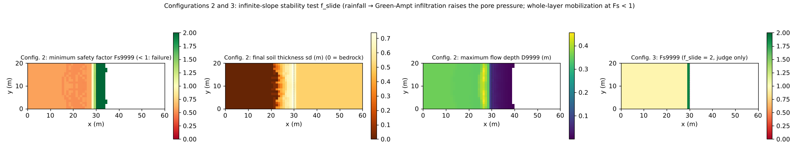

# test/slide — connectivity and conservation of instantaneous mobilization (f_release) and the slope stability test (f_slide)

> English mirror of test/slide/README.md. The Japanese file is the master copy.

[日本語](../README.md)

Checks of the two triggering mechanisms of landslide-type sediment flow and
of the treatment of pore water on mobilization (developer.md §28.1, §28.9,
§28.17, §28.19).

1. **Instantaneous mobilization f_release** (`param.txt`): a collapse-depth
   distribution `fn_dbinit` is given and mobilized all at once at the
   specified time `db_reltime` (a landslide-type initial condition).
   The conversion is hs += (1 − λ)D, z −= D, sd −= D, so the solid ledger
   closes structurally, and the pore water λ·relsat·D becomes surface water.
2. **Slope stability test f_slide** (`param_fs.txt`, `param_fs2.txt`): the
   infinite-slope safety factor
   Fs = (c′ + (γt sd − γw hw) cos²θ tanφs)/(γt sd sinθ cosθ) is evaluated
   cell by cell, and cells whose pore pressure rises through Green-Ampt
   infiltration until Fs < 1 are mobilized over the whole layer
   (sd = 0 = exposed bedrock). `f_slide = 2` is judge-only (a hazard map
   that outputs Fs without mobilizing).
3. **Exchange of retained water f_dbwet = 3 and initial groundwater gw_sat0**
   (`param_wet.txt`): in an instantaneous mobilization combined with the
   groundwater computation, the retained water w_r = λ − sy0 that moves with
   the soil is exchanged. When a saturated soil layer (gw_sat0 = 1) is
   mobilized, the retained water w_r·D and the sy0·D released from the
   subsurface storage come out together as λ·D of water, giving a mixture at
   concentration C*. The total amount of water is conserved in the form
   Σh + Σhg + w_r·Σ(z − z0).
4. **Options of the slope stability test** (`p_fs_*.txt` written by `make_fs.py`): the safety
   factor with the seepage force from the total-head gradient `f_slide_seep`, the upper limit of
   the judged and mobilized depth `slide_dmax`, only failures caused by pore pressure
   `f_slide_wet`, and no test under a dense mixture `f_slide_noflow` (the cells whose mixture is thin
   are still judged; the default is 1 when the stability test is used). On a plane slope of uniform
   gradient, the output of the safety factor is
   compared with the value of the formula.

Pass or fail is decided not by a reference comparison but by the
self-checks of `Check_slide.py` (conservation, water budget, activity and
consistency of the hazard outputs).

## Configuration

Common: slope_break terrain (a slope of tanθ = 0.4 → flat from x = 30 m),
60 m × 20 m (Δx = 1 m), combined Coulomb + Manning resistance, stopping by
low-speed consolidation.

| Configuration | File | Contents | Time |
|---|---|---|---|
| 1 release | `param.txt` | Mobile layer 5 m. Collapse depth D = 1 m is given at i ∈ [5, 15], j ∈ [5, 16] (`make_dbinit.py`) and mobilized at t = 1 s (relsat = 1, φ = 30°) | dt 0.02 s, 10 s |
| 2 fslide | `param_fs.txt` | Thin soil layer sd₀ = 0.5 m, sy = 0.3. Rainfall → Green-Ampt infiltration → `f_slide = 1`. Hazard outputs Fs9999, D9999, Dt9999, F9999 and Hs enabled | dt 0.05 s, 400 s |
| 3 fsdiag | `param_fs2.txt` | Same as configuration 2 with `f_slide = 2` (judge only) | Same as above |
| 4 wet | `param_wet.txt` | Configuration 1 + the groundwater computation (Green-Ampt; infiltration capacity nearly 0) + `gw_sat0 = 1` (saturated soil layer) + `f_dbwet = 3` (sy0 = 0.2, λ = 0.4, w_r = 0.2). `Run.sh` also runs the same settings with `gw_sat0 = 0` (dry soil layer; the settings file `param_wetdry.txt` is made from `param_wet.txt`) | dt 0.02 s, 10 s |
| 5 seep | `p_fs_u0`, `_u1`, `p_fs_g0`, `_g1`, `p_fs_l0`, `_l1`, `p_fs_lq1`, `_le1`, `p_fs_m1`, `_m0`, `p_fs_gdyn` | `f_slide_seep` 0 and 1 (below). Judge only (`f_slide = 2`). `p_fs_gdyn` mobilizes | dt 0.05 s, 1 s (gdyn 5 s) |
| 6 dmax | `p_fs_d2`, `p_fs_d1` | `slide_dmax = 0.5` m. Soil depth 2 m, saturation 0.9. `_d2` is judge only, `_d1` mobilizes | 1 s |
| 7 wet | `p_fs_w1`, `_w0`, `_w2` | `f_slide_wet` 1 and 0 (φs = 20°; Fs < 1 even when dry), and 1 with φs = 25° | 1 s |
| 8 noflow | `p_fs_n1`, `_n0`, `p_fs_f1`, `_f0`, `p_fs_k1`, `_k0` | `f_slide_noflow` 1 and 0. `_n*` are `_d1` of configuration 6 with two bed updates. `_f*` and `_k*` are an unstable layer under a thin film (below), with three updates | 2 s (3 s for `_f*` and `_k*`) |

The terrain of configurations 5 to 8 is a plane of uniform gradient, z = 30 − 0.30 x − 0.25 y
(40 m × 30 m, Δx = 1 m). The steepest slope is tanθ = 0.3905 and its direction matches none of the
eight grid directions. It also slopes in y, so neighbours are read across the band boundaries of
MPI. The groundwater computation is Green-Ampt (infiltration capacity nearly 0), and the initial
saturation of layer 1, `gw_sat0`, sets the saturated thickness hw = gw_sat0·sd. The bed is updated
once per second, and the judge-only cases read the safety factor of the first update, `Fs0001`
(bil = single-precision binary). With a plane terrain and a plane soil depth the total head
H = (z − sd) + hw is also a plane, so its steepest-descent gradient J is known analytically and the
safety factor can be compared directly with the value of the formula.

- **Configuration 5** (`f_slide_seep`). Fs = [c′ + (γt d − γw hw) cos²θ tanφs] / [cos²θ {(γt d − γw hw) tanθ + γw hw J}].
  - `_u0`, `_u1`: uniform soil depth (1 m), saturation 0.6. J = tanθ, so 0 and 1 give the same value
    (the conventional formula).
  - `_g0`, `_g1`: a plane soil depth that thickens downslope (1 + 0.08 x + 0.06 y m), saturation 0.5,
    c′ = 2 kPa. J = 0.4405 > tanθ, and 1 is 3 % smaller than the conventional formula.
  - `_l0`, `_l1`: soil depth 1 m, saturated. About the downstream third is a still lake (water level
    19 m). Under the lake J = 0, so 1 gives Fs = tanφs/tanθ = 1.194 and 0 gives (γt − γw)/γt times
    that, 0.578 (the underestimate of the conventional formula). On land both give 0.578.
  - `_lq1`, `_le1`: `_l1` with the saturation set to 1 − 2.5×10⁻⁴ and 1 − 10⁻⁶ (the subsurface storage
    falls marginally short of its capacity). The head of the surface water is joined continuously,
    from 0 to 1 between 99.9 % and 100 % of the capacity (the connection κ; the total head is
    H = (z − sd) + hw + κ h), so under the lake J = (1 − κ) tanθ. `_lq1` has κ = 0.75 and Fs = 0.943;
    `_le1` has κ = 0.999 and Fs = 1.193 (0.1 % below the value for still water). An implementation
    that joins the surface water only when the capacity is reached (two-valued) drops both to the
    value of the conventional formula, 0.578.
  - `_m1`, `_m0`: the head of cells covered by moving sediment. `_m1` instantly mobilizes 5 × 6 cells
    under the lake of `_l1` to a depth of 0.5 m (`fn_dbinit`, t = 1 s; with `f_dbwet = 3` all the water
    of the failed layer goes into the flow). The mobilized cells are lowered by 0.5 m and carry 0.2 m
    of water and 0.3 m of sediment, so the flow surface z + h + hs stays at the lake level. `_m0` is
    the same shape excavated from the start and filled with clear water. With the total head read at
    the flow surface (H = (z − sd) + hw + κ (h + hs)), J = 0 under the lake in both, and the two
    safety factors are the same. An implementation that reads only the water depth h lowers the head
    of the mobilized cells by hs = 0.3 m, and the safety factor next to them differs by up to 45 %.
  - `_gdyn`: `_g1` with mobilization (`f_slide = 1`) for 5 s. Checks the conservation of solids and
    water, and the agreement under MPI.
- **Configuration 6** (`slide_dmax`). Only the top d = 0.5 m is judged. The saturated thickness within
  it is max(0, hw − (sd − d)) = 0.3 m. With one update, `_d1` lowers the elevation by exactly 0.5 m,
  leaves 1.5 m of soil, and releases to the surface the subsurface storage above the capacity of
  the remaining layer (0.09 m).
- **Configuration 7** (`f_slide_wet`). With φs = 20°, Fs = tanφs/tanθ = 0.93 < 1 even when dry
  (geometric instability). 1 does not mobilize, and 0 mobilizes the whole layer. The saturated
  `_w2` with φs = 25° (dry Fs = 1.19) reaches Fs = 0.58 through pore pressure, so it mobilizes even
  with 1.
- **Configuration 8** (`f_slide_noflow`). The first update mobilizes 0.5 m and leaves a dense
  mixture (hs = 0.3 m) on the cell. With 1 the cell is not judged while its own mobilized mass (0.5 m
  as a deposit, the same amount as the judged depth) lies on it, so the soil depth stays 1.5 m in the
  second update; with 0 another 0.5 m is mobilized, leaving 1.0 m.
  - An unstable layer under a thin film (`_f*`, `_k*`; developer.md §28.24, §135). With a soil depth of
    2 m and a saturation of 0.8, the saturated thickness within the top 0.5 m is 0.1 m and the layer
    is stable at first (Fs = 1.07). Mobilizing a thin layer everywhere at the end of the first update
    (`fn_dbinit`) brings the water table closer to the surface and makes the layer unstable
    (Fs = 0.95 for a depth of 0.1 m, 0.70 for 0.3 m), with the mobilized soil lying on it as a film.
    With 1, a film of 0.2 times the judged depth (`_f1`) is judged in the second update and 0.5 m is
    mobilized, and the third update does not judge the cell under its own mass (1.5 m); a film of
    0.6 times (`_k1`) is not judged (2 m). With 0 both are mobilized in the second and the third update (`_f0`, `_k0`;
    1.0 m). Together they show that the ratio below which the cell is judged (the constant 0.5 in
    the code) lies between 0.2 and 0.6. The film is soil without water, so the erosion and
    deposition step of the second update returns it to the slope (after the judgement).

| File | Contents |
|---|---|
| `Check_slide.py <save> release\|fslide\|fsdiag [result]` | release: (1) total solid, (2) co-moving update, (3) water budget Σh = λ relsat ΣD, (4) activity. fslide: (1)(2), (4) cells with sd = 0 on the slope, (5) hazard outputs min Fs9999 < 1 and D9999 ≥ H9999. fsdiag: (1) no mobilization (z, sd, hs unchanged), (2) detection of the hazardous range of Fs |
| `Check_slide.py <save> wet <screen output> <gw_sat0>` | (1) total solid, (2) co-moving update, (3) water ledger Σh + Σhg + w_r Σ(z − z0) = gw_sat0·sy0·Σsd0 + shortfall of retained water (the shortfall is the retained water that deposition could not take from the surface water or the subsurface storage, read from the line `retained pore water shortfall` printed at the end of the run), (4) activity, (5) activity of the retained-water exchange (\|w_r Σ(z − z0)\| > 1e-6; shortfall > 0 for the dry soil layer) |
| `make_fs.py` | Writes the inputs `d_fs/` (terrain, soil depth, initial depth of the lake) and the settings `p_fs_*.txt` of configurations 5 to 8 (Run.sh and Run_MPI.sh call it; the argument `list` prints the case names) |
| `Check_slide_fs.py fs <case>` | Configurations 5 and 6: the safety factor of the interior cells (excluding one column at the edges; in the lake cases, cells whose 8 neighbours and themselves are all lake or all land) agrees with the formula within a relative 2e-6 (round-off of the single-precision output) |
| `Check_slide_fs.py pair <case1> <case0> same\|differ` | Configuration 5: the safety factors of two cases are the same (within 2e-6) or differ by 2 % or more (detection power) |
| `Check_slide_fs.py dmax1\|wet\|noflow\|film\|ledger …` | Configuration 6: the lowering of the elevation, the soil depth, hs, hg and h agree with the exact values within 1e-12 m, and the ledgers of solids and water. Configurations 7 and 8: the soil depths described above (`film` is for the thin-film cases and reads the number of mobilizations from the range of the soil depth). `ledger` checks the ledgers of solids and water (1e-9) and the activity of `_gdyn` of configuration 5 |
| `Fig.py` | The figures `en/figs/*.png` below (`python3 Fig.py en`; `figs/*.png` are the Japanese versions) |

## Running

```bash
make
./Run.sh          # generate dbinit → run the 8 configurations (configuration 4 is run saturated and dry; configurations 5 to 8 are 18 cases) and Check. PASS when all PASS (about 10 seconds)
./Run_MPI.sh 4    # MPI. state.dat and the output files (Fs9999, Fs0001 etc.) are byte-identical to the serial run
python3 Fig.py en # en/figs/release.png, en/figs/fslide.png
```

## Figures


Configuration 1. Left: the collapse area with collapse depth D = 1 m.
Center: the terrain change after 10 s. The collapse area is lowered by
about 0.98 m (part of the released 1 m is redeposited immediately), and
deposition of up to 0.31 m has begun downstream of the slope break.
Right: the flow depth h + hs. The released mass spreads from the collapse
area over the slope break onto the flat part as a fan.



Configuration 2 (left three panels) and 3 (right). Left: the run minimum
safety factor Fs9999. Fs < 1 over the whole slope (minimum 0.459), and
only the gentle part near the slope break has Fs > 1. Center left: the
final soil thickness sd. The layer fails down to bedrock (sd = 0) in 40
cells, in the bands at x = 2–4 m and 11–15 m. The other cells of the
slope are not judged while the dense mixture flowing down from upslope
lies on them (the default 1 of `f_slide_noflow`), and erosion and
deposition leave 0.15–0.65 m of soil (0.5 m at first). Center right: the
maximum flow depth D9999 (maximum 0.34 m). Right: Fs9999 of configuration 3. Since
nothing is mobilized, the minimum of Fs stays at 0.943, and only the
detection of the hazardous range (< 1) takes place (the hazard map of the
judge-only mode).

## Findings

| Configuration | Total solid | Co-moving update | Water budget / activity | Result |
|---|---|---|---|---|
| 1 release | about 1e-12 or less | about 1e-13 or less | Σh = 52.8000 (expected λ relsat ΣD = 52.8000) / collapse area min dz −0.98 m, deposition outside the area +0.31 m | PASS |
| 2 fslide | about 1e-11 or less (tolerance 1e-8: rounding accumulated over about 20 000 cell conversions) | about 1e-13 or less | slope min sd = 0 (40 cells failed) / min Fs9999 0.459, D9999 ≥ H9999 | PASS |
| 3 fsdiag | — | — | z, sd and hs unchanged; min Fs 0.943 < 1 detected (600 cells evaluated) | PASS |
| 4 wet (saturated) | about 1e-13 or less | about 1e-13 or less | residual of the water ledger 3e-12 (initial subsurface storage 1200 m³, retained-water term 17.1 m³, shortfall 0) / collapse area min dz −0.97 m, deposition outside the area +0.29 m | PASS |
| 4 wet (dry) | about 1e-12 or less | about 1e-13 or less | residual of the water ledger 3e-12 (retained-water term 18.3 m³, shortfall 0.09 m³) / collapse area min dz −0.83 m, deposition outside the area +0.54 m | PASS |

| Case of configurations 5 to 8 | Compared quantity | Value of the formula | Difference from the computation | Verdict |
|---|---|---|---|---|
| 5 `_u0`, `_u1` | safety factor (1064 cells) | 0.8246 (conventional formula) | relative 2e-9. The outputs of 0 and 1 are the same | PASS |
| 5 `_g0` | same | 0.940–1.143 (conventional formula) | relative 6e-8 | PASS |
| 5 `_g1` | same | 0.910–1.106 (J = 0.4405) | relative 6e-8. 3.2 % smaller than `_g0` | PASS |
| 5 `_l0` | safety factor (598 land and 364 lake cells) | land 0.5782, lake 0.5782 | relative 3e-9 | PASS |
| 5 `_l1` | same | land 0.5782, lake 1.1941 (= tanφs/tanθ) | relative 5e-9. Under the lake, 2.07 times `_l0` | PASS |
| 5 `_lq1` | same | land 0.5783, lake 0.9431 (κ = 0.75, J = 0.25 tanθ) | relative 3e-8 | PASS |
| 5 `_le1` | same | land 0.5782, lake 1.1928 (κ = 0.999) | relative 4e-8. Under the lake, 0.11 % below `_l1` | PASS |
| 5 `_m1`, `_m0` | safety factor (1064 cells, 56 of them in or next to the mobilized cells) | the two cases are the same | the outputs are identical (relative 0). The flow surface is within 4e-15 m of the lake level | PASS |
| 5 `_gdyn` | ledgers of solids and water | 0 | solids 2e-12, water 1e-13 (1167 mobilizations) | PASS |
| 6 `_d2` | safety factor | 0.8246 (d = 0.5 m, saturated thickness 0.3 m) | relative 2e-9 | PASS |
| 6 `_d1` | lowering of the elevation, soil depth, hs, hg, h | 0.5, 1.5, 0.3, 0.45, 0.09 m | 4e-15 m or less. Ledgers: solids 0, water 7e-13 | PASS |
| 7 `_w1`, `_w0`, `_w2` | interior soil depth | 1 (unchanged), 0, 0 m | exact | PASS |
| 8 `_n1`, `_n0` | interior soil depth, excluding two columns at the edges | 1.5, 1.0 m | exact | PASS |

- The mobilization fires only once, by a time-crossing test, and does not
  fire again after a restart (§28.1). The water budget of the released
  pore water agrees to 6 digits.
- f_slide is a cell-independent test in which the progress of gwflow
  infiltration decides the time of failure (no lateral support = the same
  level as the SHALSTAB family), and a cell is judged again if deposition
  regenerates sd (progressive failure). Since the statistical outputs
  (Fs9999 etc.) are not included in the save, the check of invariance with
  the number of ranks is done on the output files (`Run_MPI.sh` makes this
  permanent).
- The fluid force F9999 = (h + hs)V² includes the mixture density, and it
  has been confirmed to become ρm/ρw ≈ 2 times larger in the τ_y case
  (§28.9).
- The water ledger of configuration 4 closes only when the retained-water term
  w_r·Σ(z − z0) is included (the term is 17 to 18 m³, ten orders above the
  tolerance 1e-9). The saturated soil layer (configuration 4, saturated)
  releases sy0·D from the subsurface storage and w_r·D from the retained water
  and flows out with the same amount of water as configuration 1 without the
  groundwater computation (λ·relsat·D), so the lowering of the collapse area
  and the deposition outside it are nearly the same as in configuration 1. The
  dry soil layer (configuration 4, dry) carries only the retained water and
  becomes a dense mixture, and on deposition some cells run short of retained
  water. Counting that shortfall (0.09 m³) in the ledger brings the residual
  back to machine precision (§28.17).
- The lake cases of configuration 5 show numerically that the conventional formula (slope-parallel
  seepage) estimates the safety factor of a saturated slope under still water at
  (γt − γw)/γt = 0.48 times its value. On land (no surface water; the gradient of the total head equals
  that of the terrain) `f_slide_seep = 1` keeps the same value as the conventional formula.
- `_lq1` and `_le1` of configuration 5 check that the head of the surface water is joined to the
  saturated zone continuously. In a computation with lateral groundwater flow, the subsurface storage
  of a cell under a lake falls short of its capacity by about 10⁻⁶ of it in every step. A computation
  with a ponded reach needs the safety factor to be unaffected by a deficit of that size (`_le1`)
  (developer.md §28.20).
- `_m1` and `_m0` of configuration 5 check that the head of a cell covered by moving sediment is read
  at the flow surface. If only the water depth is read, the head of a mobilized cell drops, the
  gradient of the total head in the neighbouring cells grows, and on a fine grid mobilization
  propagates as a chain across a saturated slope under a lake (developer.md §28.21).
- The edge cells of configurations 7 and 8 have a steepest slope different from the interior (the
  neighbours outside the domain are excluded), so they are judged differently from the interior. Even
  in `_w1` of configuration 7, the edge cells whose dry safety factor is 1 or more (68 cells) are
  mobilized by pore pressure. In configuration 8 the slope of the second update changes next to the
  edge cells that were not mobilized in the first, so the comparison excludes two columns at the edges.

- The deposition outside the area was +0.61 m with the default 2 of 2026-10-18 to 31
  (the change of the default on 2026-10-18, f_opening_dynamic = 2; developer.md
  §68.38) and is +0.24 m with the default 3 since 2026-10-31 (2 sped up the flow on
  steep slopes; §68.41); with the former default 1 written explicitly, −0.90 / +0.22 m are
  reproduced (confirmed 2026-10-24).
- The fix of the yield rest check (2026-11-04; developer.md §28.16) changed the values in the
  table and figures. The code before the fix (same day) gave −0.90 m in the collapse area and
  +0.24 m of deposition outside it for configuration 1, and 240 failed cells, min Fs9999 0.455
  and a maximum flow depth of 0.36 m for configuration 2. Before the fix, edges oblique to the
  slope (the diagonal edges of the eight neighbours) were held by the yield and the released
  mass hardly went down the slope; the flow of configuration 2 stayed on the slope (the maximum
  flow depth extended only to just above the slope break). After the fix it flows past the slope
  break, and the failed cells increased to 470.
- After the fix of the steep-slope gravity correction (2026-11-04; developer.md §91) and the
  D∞ steepest slope (§92), configuration 1 deposits +0.31 m outside the collapse area, and
  configuration 2 has 434 failed cells, min Fs9999 0.493 and a maximum flow depth of 0.44 m
  (+0.32 m, 470 cells, 0.481 and 0.46 m right after the fix of §28.16). After the suppression of
  excessive outflow by the cell total and the fix of the upwind side of the edge depth of 2026-11-05
  (§94, §95), configuration 2 has 426 cells, 0.469 and 0.44 m (configuration 1 stays at +0.31 m), and
  with the steep-slope gravity correction aligned to the default 2 (friction along the slope; §93),
  configuration 1 deposits +0.28 m outside the collapse area and configuration 2 has 406 cells, 0.492
  and 0.47 m. After the change of 2026-11-06 by which 2 also evaluates the resistance laws of mixture
  flows along the slope (developer.md §101), configuration 2 has 428 cells, 0.493 and 0.45 m
  (configuration 1 stays at +0.28 m). After the default of the edge-depth cap became
  f_dry_head_cap = 2 on 2026-11-13, configuration 2 has 425 cells, 0.493 and 0.46 m (configuration 1
  stays at +0.28 m; developer.md §108). After the default of the edge-depth cap became
  f_dry_head_cap = 3 and the default of the advection on side faces became f_advection_lateral = 1 on
  2026-11-16, the deposit of configuration 1 outside the collapse area goes from +0.28 to +0.31 m (the
  lowering of the collapse area from 0.975 to 0.979 m), and configuration 2 has 426 cells, 0.493 and
  0.46 m (the step from 425 to 426 cells comes from changes of defaults before this switch;
  developer.md §110.32). After the four values of the advection term (f_advection_donor = 4,
  f_advection_bend = 2, f_advection_lateral = 2, f_dry_head_cap = 4) became the default on 2026-11-21, the
  values are the same to the digits shown (the deposit outside of configuration 1 is +0.31 m; configuration 2
  has 426 cells, 0.493 and 0.46 m; developer.md §114). After the blockage ratio of the dynamic reassignment
  of blocked openings was corrected on 2026-11-25 to be measured with the flow depth h + hs, configuration 1
  is the same to the digits shown (lowering of the collapse area from 0.979 to 0.977 m, deposit outside
  +0.31 m), configuration 2 goes from 426 to 474 cells, 0.493, and from 0.46 to 0.43 m, the saturated case of
  configuration 4 has the deposit outside from +0.30 to +0.29 m and the retained-water term from 16.8 to
  17.1 m³, and the dry case has the lowering of the collapse area from 0.84 to 0.83 m, the deposit outside
  from +0.65 to +0.54 m, the retained-water term from 17.9 to 18.3 m³ and the shortfall from 0.18 to 0.09 m³
  (developer.md §130). After `f_slide_noflow = 1`, which does not judge cells under a dense mixture, became
  the default of the stability test on 2026-11-26 (the former test of 2 replaced 1; developer.md §135),
  configuration 2 goes from 474 to 40 cells, from 0.493 to 0.459 and from 0.43 to 0.34 m (the cells under
  the mixture flowing down from upslope are no longer judged; configuration 3 has no flow and does not
  change). In configuration 8 the former cases of 2 take the names of 1 (`_n2`, `_f2`, `_k2` → `_n1`,
  `_f1`, `_k1`; the former cases of 1 are gone). The table and the figures show these values.

## Related documents

- [docs/users_guide/geomorph.md](../../../docs/en/users_guide/geomorph.md) — `fn_dbinit`, `db_reltime`, `db_relsat`, `f_slide`, hazard outputs `f_out_fs` etc.
- developer.md §28.1 (configuration of f_release / f_slide), §28.9 (hazard outputs), §28.3–28.5 (verification records and the practice of bitwise MPI comparison), §28.19 (options of the slope stability test) (in Japanese)
