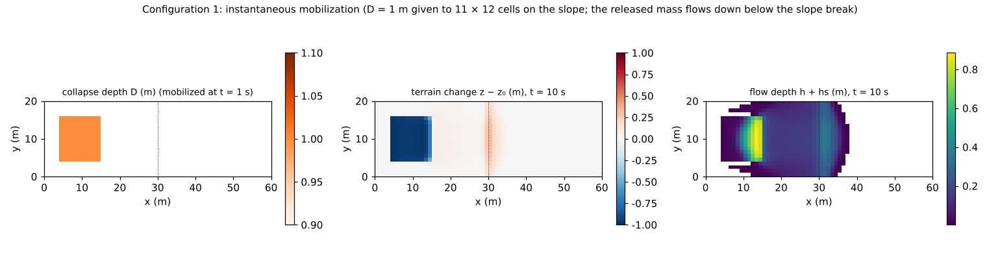

# test/slide — connectivity and conservation of instantaneous mobilization (f_release) and the slope stability test (f_slide)

> English mirror of test/slide/README.md. The Japanese file is the master copy.

[日本語](../README.md)

Checks of the two triggering mechanisms of landslide-type sediment flow and
of the treatment of pore water on mobilization (developer.md §28.1, §28.9,
§28.17).

1. **Instantaneous mobilization f_release** (`param.txt`): a collapse-depth
   distribution `fn_dbinit` is given and mobilized all at once at the
   specified time `db_reltime` (a landslide-type initial condition).
   The conversion is hs += (1 − λ)D, z −= D, sd −= D, so the solid ledger
   closes structurally, and the pore water λ·relsat·D becomes surface water.
2. **Slope stability test f_slide** (`param_fs.txt`, `param_fs2.txt`): the
   infinite-slope safety factor
   Fs = (c′ + (γt sd − γw hw) cos²θ tanφs)/(γt sd sinθ cosθ) is evaluated
   cell by cell, and cells whose pore pressure rises through Green-Ampt
   infiltration until Fs < 1 are mobilized over the whole layer
   (sd = 0 = exposed bedrock). `f_slide = 2` is judge-only (a hazard map
   that outputs Fs without mobilizing).
3. **Exchange of retained water f_dbwet = 3 and initial groundwater gw_sat0**
   (`param_wet.txt`): in an instantaneous mobilization combined with the
   groundwater computation, the retained water w_r = λ − sy0 that moves with
   the soil is exchanged. When a saturated soil layer (gw_sat0 = 1) is
   mobilized, the retained water w_r·D and the sy0·D released from the
   subsurface storage come out together as λ·D of water, giving a mixture at
   concentration C*. The total amount of water is conserved in the form
   Σh + Σhg + w_r·Σ(z − z0).

Pass or fail is decided not by a reference comparison but by the
self-checks of `Check_slide.py` (conservation, water budget, activity and
consistency of the hazard outputs).

## Configuration

Common: slope_break terrain (a slope of tanθ = 0.4 → flat from x = 30 m),
60 m × 20 m (Δx = 1 m), combined Coulomb + Manning resistance, stopping by
low-speed consolidation.

| Configuration | File | Contents | Time |
|---|---|---|---|
| 1 release | `param.txt` | Mobile layer 5 m. Collapse depth D = 1 m is given at i ∈ [5, 15], j ∈ [5, 16] (`make_dbinit.py`) and mobilized at t = 1 s (relsat = 1, φ = 30°) | dt 0.02 s, 10 s |
| 2 fslide | `param_fs.txt` | Thin soil layer sd₀ = 0.5 m, sy = 0.3. Rainfall → Green-Ampt infiltration → `f_slide = 1`. Hazard outputs Fs9999, D9999, Dt9999, F9999 and Hs enabled | dt 0.05 s, 400 s |
| 3 fsdiag | `param_fs2.txt` | Same as configuration 2 with `f_slide = 2` (judge only) | Same as above |
| 4 wet | `param_wet.txt` | Configuration 1 + the groundwater computation (Green-Ampt; infiltration capacity nearly 0) + `gw_sat0 = 1` (saturated soil layer) + `f_dbwet = 3` (sy0 = 0.2, λ = 0.4, w_r = 0.2). `Run.sh` also runs the same settings with `gw_sat0 = 0` (dry soil layer; the settings file `param_wetdry.txt` is made from `param_wet.txt`) | dt 0.02 s, 10 s |

| File | Contents |
|---|---|
| `Check_slide.py <save> release\|fslide\|fsdiag [result]` | release: (1) total solid, (2) co-moving update, (3) water budget Σh = λ relsat ΣD, (4) activity. fslide: (1)(2), (4) cells with sd = 0 on the slope, (5) hazard outputs min Fs9999 < 1 and D9999 ≥ H9999. fsdiag: (1) no mobilization (z, sd, hs unchanged), (2) detection of the hazardous range of Fs |
| `Check_slide.py <save> wet <screen output> <gw_sat0>` | (1) total solid, (2) co-moving update, (3) water ledger Σh + Σhg + w_r Σ(z − z0) = gw_sat0·sy0·Σsd0 + shortfall of retained water (the shortfall is the retained water that deposition could not take from the surface water or the subsurface storage, read from the line `retained pore water shortfall` printed at the end of the run), (4) activity, (5) activity of the retained-water exchange (\|w_r Σ(z − z0)\| > 1e-6; shortfall > 0 for the dry soil layer) |
| `Fig.py` | The figures `en/figs/*.png` below (`python3 Fig.py en`; `figs/*.png` are the Japanese versions) |

## Running

```bash
make
./Run.sh          # generate dbinit → run the 4 configurations (configuration 4 is run saturated and dry) and Check. PASS when all PASS (a few seconds)
./Run_MPI.sh 4    # MPI. state.dat and the output files (Fs9999 etc.) are byte-identical to the serial run
python3 Fig.py en # en/figs/release.png, en/figs/fslide.png
```

## Figures



Configuration 1. Left: the collapse area with collapse depth D = 1 m.
Center: the terrain change after 10 s. The collapse area is lowered by
about 0.98 m (part of the released 1 m is redeposited immediately), and
deposition of up to 0.31 m has begun downstream of the slope break.
Right: the flow depth h + hs. The released mass spreads from the collapse
area over the slope break onto the flat part as a fan.


Configuration 2 (left three panels) and 3 (right). Left: the run minimum
safety factor Fs9999. Fs < 1 over the whole slope (minimum 0.493), and
only the gentle part near the slope break has Fs > 1. Center left: the
final soil thickness sd. Many cells on the slope reach sd = 0 (failed and
bedrock exposed; 426 cells), and stripes of failed sediment that flowed
down and redeposited are also visible. Center right: the maximum flow
depth D9999 (maximum 0.46 m). Right: Fs9999 of configuration 3. Since
nothing is mobilized, the minimum of Fs stays at 0.943, and only the
detection of the hazardous range (< 1) takes place (the hazard map of the
judge-only mode).

## Findings

| Configuration | Total solid | Co-moving update | Water budget / activity | Result |
|---|---|---|---|---|
| 1 release | about 1e-12 or less | about 1e-13 or less | Σh = 52.8000 (expected λ relsat ΣD = 52.8000) / collapse area min dz −0.98 m, deposition outside the area +0.31 m | PASS |
| 2 fslide | about 1e-11 or less (tolerance 1e-8: rounding accumulated over about 20 000 cell conversions) | about 1e-13 or less | slope min sd = 0 (426 cells failed) / min Fs9999 0.493, D9999 ≥ H9999 | PASS |
| 3 fsdiag | — | — | z, sd and hs unchanged; min Fs 0.943 < 1 detected (600 cells evaluated) | PASS |
| 4 wet (saturated) | about 1e-13 or less | about 1e-13 or less | residual of the water ledger 3e-12 (initial subsurface storage 1200 m³, retained-water term 16.8 m³, shortfall 0) / collapse area min dz −0.98 m, deposition outside the area +0.30 m | PASS |
| 4 wet (dry) | about 1e-12 or less | about 1e-13 or less | residual of the water ledger 2e-11 (retained-water term 17.9 m³, shortfall 0.18 m³) / collapse area min dz −0.84 m, deposition outside the area +0.65 m | PASS |

- The mobilization fires only once, by a time-crossing test, and does not
  fire again after a restart (§28.1). The water budget of the released
  pore water agrees to 6 digits.
- f_slide is a cell-independent test in which the progress of gwflow
  infiltration decides the time of failure (no lateral support = the same
  level as the SHALSTAB family), and a cell is judged again if deposition
  regenerates sd (progressive failure). Since the statistical outputs
  (Fs9999 etc.) are not included in the save, the check of invariance with
  the number of ranks is done on the output files (`Run_MPI.sh` makes this
  permanent).
- The fluid force F9999 = (h + hs)V² includes the mixture density, and it
  has been confirmed to become ρm/ρw ≈ 2 times larger in the τ_y case
  (§28.9).
- The water ledger of configuration 4 closes only when the retained-water term
  w_r·Σ(z − z0) is included (the term is 17 to 18 m³, ten orders above the
  tolerance 1e-9). The saturated soil layer (configuration 4, saturated)
  releases sy0·D from the subsurface storage and w_r·D from the retained water
  and flows out with the same amount of water as configuration 1 without the
  groundwater computation (λ·relsat·D), so the lowering of the collapse area
  and the deposition outside it are nearly the same as in configuration 1. The
  dry soil layer (configuration 4, dry) carries only the retained water and
  becomes a dense mixture, and on deposition some cells run short of retained
  water. Counting that shortfall (0.18 m³) in the ledger brings the residual
  back to machine precision (§28.17).

- The deposition outside the area was +0.61 m with the default 2 of 2026-10-18 to 31
  (the change of the default on 2026-10-18, f_opening_dynamic = 2; developer.md
  §68.38) and is +0.24 m with the default 3 since 2026-10-31 (2 sped up the flow on
  steep slopes; §68.41); with the former default 1 written explicitly, −0.90 / +0.22 m are
  reproduced (confirmed 2026-10-24).
- The fix of the yield rest check (2026-11-04; developer.md §28.16) changed the values in the
  table and figures. The code before the fix (same day) gave −0.90 m in the collapse area and
  +0.24 m of deposition outside it for configuration 1, and 240 failed cells, min Fs9999 0.455
  and a maximum flow depth of 0.36 m for configuration 2. Before the fix, edges oblique to the
  slope (the diagonal edges of the eight neighbours) were held by the yield and the released
  mass hardly went down the slope; the flow of configuration 2 stayed on the slope (the maximum
  flow depth extended only to just above the slope break). After the fix it flows past the slope
  break, and the failed cells increased to 470.
- After the fix of the steep-slope gravity correction (2026-11-04; developer.md §91) and the
  D∞ steepest slope (§92), configuration 1 deposits +0.31 m outside the collapse area, and
  configuration 2 has 434 failed cells, min Fs9999 0.493 and a maximum flow depth of 0.44 m
  (+0.32 m, 470 cells, 0.481 and 0.46 m right after the fix of §28.16). After the suppression of
  excessive outflow by the cell total and the fix of the upwind side of the edge depth of 2026-11-05
  (§94, §95), configuration 2 has 426 cells, 0.469 and 0.44 m (configuration 1 stays at +0.31 m), and
  with the steep-slope gravity correction aligned to the default 2 (friction along the slope; §93),
  configuration 1 deposits +0.28 m outside the collapse area and configuration 2 has 406 cells, 0.492
  and 0.47 m. After the change of 2026-11-06 by which 2 also evaluates the resistance laws of mixture
  flows along the slope (developer.md §101), configuration 2 has 428 cells, 0.493 and 0.45 m
  (configuration 1 stays at +0.28 m). After the default of the edge-depth cap became
  f_dry_head_cap = 2 on 2026-11-13, configuration 2 has 425 cells, 0.493 and 0.46 m (configuration 1
  stays at +0.28 m; developer.md §108). After the default of the edge-depth cap became
  f_dry_head_cap = 3 and the default of the advection on side faces became f_advection_lateral = 1 on
  2026-11-16, the deposit of configuration 1 outside the collapse area goes from +0.28 to +0.31 m (the
  lowering of the collapse area from 0.975 to 0.979 m), and configuration 2 has 426 cells, 0.493 and
  0.46 m (the step from 425 to 426 cells comes from changes of defaults before this switch;
  developer.md §110.32). After the four values of the advection term (f_advection_donor = 4,
  f_advection_bend = 2, f_advection_lateral = 2, f_dry_head_cap = 4) became the default on 2026-11-21, the
  values are the same to the digits shown (the deposit outside of configuration 1 is +0.31 m; configuration 2
  has 426 cells, 0.493 and 0.46 m; developer.md §114). The table and the figures show these values.

## Related documents

- [docs/users_guide/geomorph.md](../../../docs/en/users_guide/geomorph.md) — `fn_dbinit`, `db_reltime`, `db_relsat`, `f_slide`, hazard outputs `f_out_fs` etc.
- developer.md §28.1 (configuration of f_release / f_slide), §28.9 (hazard outputs), §28.3–28.5 (verification records and the practice of bitwise MPI comparison) (in Japanese)
