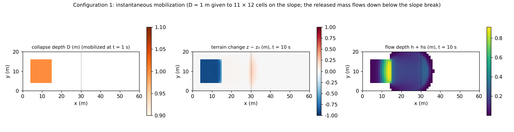
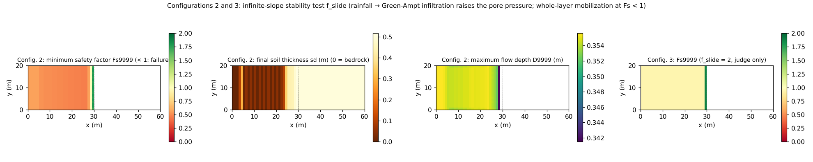

# test/slide — connectivity and conservation of instantaneous mobilization (f_release) and the slope stability test (f_slide)

> English mirror of test/slide/README.md. The Japanese file is the master copy.

[日本語](../README.md)

Checks of the two triggering mechanisms of landslide-type sediment flow
(developer.md §28.1, §28.9).

1. **Instantaneous mobilization f_release** (`param.txt`): a collapse-depth
   distribution `fn_dbinit` is given and mobilized all at once at the
   specified time `db_reltime` (a landslide-type initial condition).
   The conversion is hs += (1 − λ)D, z −= D, sd −= D, so the solid ledger
   closes structurally, and the pore water λ·relsat·D becomes surface water.
2. **Slope stability test f_slide** (`param_fs.txt`, `param_fs2.txt`): the
   infinite-slope safety factor
   Fs = (c′ + (γt sd − γw hw) cos²θ tanφs)/(γt sd sinθ cosθ) is evaluated
   cell by cell, and cells whose pore pressure rises through Green-Ampt
   infiltration until Fs < 1 are mobilized over the whole layer
   (sd = 0 = exposed bedrock). `f_slide = 2` is judge-only (a hazard map
   that outputs Fs without mobilizing).

Pass or fail is decided not by a reference comparison but by the
self-checks of `Check_slide.py` (conservation, water budget, activity and
consistency of the hazard outputs).

## Configuration

Common: slope_break terrain (a slope of tanθ = 0.4 → flat from x = 30 m),
60 m × 20 m (Δx = 1 m), combined Coulomb + Manning resistance, stopping by
low-speed consolidation.

| Configuration | File | Contents | Time |
|---|---|---|---|
| 1 release | `param.txt` | Mobile layer 5 m. Collapse depth D = 1 m is given at i ∈ [5, 15], j ∈ [5, 16] (`make_dbinit.py`) and mobilized at t = 1 s (relsat = 1, φ = 30°) | dt 0.02 s, 10 s |
| 2 fslide | `param_fs.txt` | Thin soil layer sd₀ = 0.5 m, sy = 0.3. Rainfall → Green-Ampt infiltration → `f_slide = 1`. Hazard outputs Fs9999, D9999, Dt9999, F9999 and Hs enabled | dt 0.05 s, 400 s |
| 3 fsdiag | `param_fs2.txt` | Same as configuration 2 with `f_slide = 2` (judge only) | Same as above |

| File | Contents |
|---|---|
| `Check_slide.py <save> release\|fslide\|fsdiag [result]` | release: (1) total solid, (2) co-moving update, (3) water budget Σh = λ relsat ΣD, (4) activity. fslide: (1)(2), (4) cells with sd = 0 on the slope, (5) hazard outputs min Fs9999 < 1 and D9999 ≥ H9999. fsdiag: (1) no mobilization (z, sd, hs unchanged), (2) detection of the hazardous range of Fs |
| `Fig.py` | The figures `en/figs/*.png` below (`python3 Fig.py en`; `figs/*.png` are the Japanese versions) |

## Running

```bash
make
./Run.sh          # generate dbinit → run the 3 configurations and Check. PASS when all PASS (a few seconds)
./Run_MPI.sh 4    # MPI. state.dat and the output files (Fs9999 etc.) are byte-identical to the serial run
python3 Fig.py en # en/figs/release.png, en/figs/fslide.png
```

## Figures



Configuration 1. Left: the collapse area with collapse depth D = 1 m.
Center: the terrain change after 10 s. The collapse area is lowered by
about 0.90 m (part of the released 1 m is redeposited immediately), and
deposition of up to 0.24 m has begun downstream of the slope break.
Right: the flow depth h + hs. The released mass spreads from the collapse
area over the slope break onto the flat part as a fan.



Configuration 2 (left three panels) and 3 (right). Left: the run minimum
safety factor Fs9999. Fs < 1 over the whole slope (minimum 0.455), and
only the gentle part near the slope break has Fs > 1. Center left: the
final soil thickness sd. Many cells on the slope reach sd = 0 (failed and
bedrock exposed; 260 cells), and stripes of failed sediment that flowed
down and redeposited are also visible. Center right: the maximum flow
depth D9999 (maximum 0.37 m). Right: Fs9999 of configuration 3. Since
nothing is mobilized, the minimum of Fs stays at 0.943, and only the
detection of the hazardous range (< 1) takes place (the hazard map of the
judge-only mode).

## Findings

| Configuration | Total solid | Co-moving update | Water budget / activity | Result |
|---|---|---|---|---|
| 1 release | 1e-13 | 3e-14 | Σh = 52.8000 (expected λ relsat ΣD = 52.8000) / collapse area min dz −0.90 m, deposition outside the area +0.24 m | PASS |
| 2 fslide | 8e-12 (tolerance 1e-8: rounding accumulated over about 20 000 cell conversions) | 9e-14 | slope min sd = 0 (260 cells failed) / min Fs9999 0.455, D9999 ≥ H9999 | PASS |
| 3 fsdiag | — | — | z, sd and hs unchanged; min Fs 0.943 < 1 detected (600 cells evaluated) | PASS |

- The mobilization fires only once, by a time-crossing test, and does not
  fire again after a restart (§28.1). The water budget of the released
  pore water agrees to 6 digits.
- f_slide is a cell-independent test in which the progress of gwflow
  infiltration decides the time of failure (no lateral support = the same
  level as the SHALSTAB family), and a cell is judged again if deposition
  regenerates sd (progressive failure). Since the statistical outputs
  (Fs9999 etc.) are not included in the save, the check of invariance with
  the number of ranks is done on the output files (`Run_MPI.sh` makes this
  permanent).
- The fluid force F9999 = (h + hs)V² includes the mixture density, and it
  has been confirmed to become ρm/ρw ≈ 2 times larger in the τ_y case
  (§28.9).

- The deposition outside the area was +0.61 m with the default 2 of 2026-10-18 to 31
  (the change of the default on 2026-10-18, f_opening_dynamic = 2; developer.md
  §68.38) and is +0.24 m with the default 3 since 2026-10-31 (2 sped up the flow on
  steep slopes; §68.41); with the former default 1 written explicitly, −0.90 / +0.22 m are
  reproduced (confirmed 2026-10-24).

## Related documents

- [docs/users_guide/geomorph.md](../../../docs/en/users_guide/geomorph.md) — `fn_dbinit`, `db_reltime`, `db_relsat`, `f_slide`, hazard outputs `f_out_fs` etc.
- developer.md §28.1 (configuration of f_release / f_slide), §28.9 (hazard outputs), §28.3–28.5 (verification records and the practice of bitwise MPI comparison) (in Japanese)
