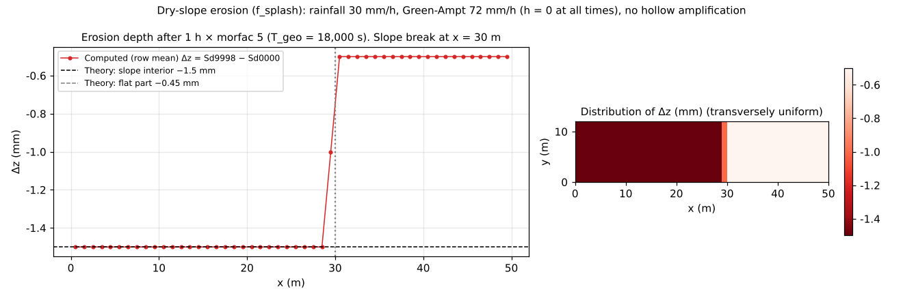

# test/splash — analytical verification of dry-slope erosion (f_splash)

> English mirror of test/splash/README.md. The Japanese file is the master copy.

[日本語](../README.md)

Analytical verification of **dry-slope erosion**, which acts on slopes
without flowing water (`f_splash = 1`: rainsplash erosion + subgrid-rill
erosion, with hollow amplification. developer.md §48, docs/splash_plan.md).
A uniform rainfall of 30 mm/h is applied to a slope with a slope break
(slope_break), the Green-Ampt infiltration capacity 72 mm/h > P keeps
surface flow from forming (h = 0 at all times), and erosion is carried by
f_splash alone. With the hollow amplification switched off
(`spl_ca = spl_cb = 0`), the erosion depth is determined analytically as

  Δz = P (spl_kr + spl_kt S^spl_h) T_geo

and the values on the slope interior and the flat part and the export
ledger are compared. It is a regression test with a reference comparison;
the reference was fixed on the basis of the analytical agreement (§48).

## Configuration

| Item | Value |
|---|---|
| Domain and grid | 50 m × 12 m, 50 × 12 cells (Δx = 1 m). slope_break (tanθ = 0.4 → flat from x = 30 m) |
| Rainfall and infiltration | 30 mm/h uniform, Green-Ampt `gw_ksv_mmh = 72` (psif = 0 → constant infiltration capacity). h = 0 at all times |
| Erosion | `spl_kr = 0.003`, `spl_kt = 0.0175`, `spl_h = 1`, no amplification. Porosity 0 (poroi = 1) |
| Time | dt = 1 s, 1 h. Terrain update every 10 s × morfac 5 → T_geo = 18,000 s |
| Theoretical value | Slope interior Δz = 8.33e-6 × (0.003 + 0.0175 × 0.4) × 18000 = 1.5 mm |

| File | Contents |
|---|---|
| `Run.sh` / `Run_MPI.sh N` | Compare Log.txt with the reference (ULP = 0) |
| `Fig.py` | The figure `en/figs/splash.png` below (`python3 Fig.py en`; `figs/splash.png` is the Japanese version; uses Sd9998 − Sd0000 = Δz) |

## Running

```bash
make
./Run.sh
./Run_MPI.sh 4
python3 Fig.py en # en/figs/splash.png
```

## Figures



Left: the longitudinal profile of the row-averaged erosion depth Δz. The
slope interior agrees with the theoretical value 1.5 mm **to all digits**,
and across the column of the slope break (x = 29.5 m; 0.975 mm with the
face gradient 0.2 on the downhill side) the flat part takes the
rainsplash-only value 0.45 mm (the output is in units of 0.1 mm, so the
figure shows 1.0 / 0.5 mm). The gradient is evaluated as the steepest
descent (the maximum of the downhill gradients to the 8 neighbors;
`spl_sgrad = 1` default), so the column at the top of the slope also keeps
the face gradient 0.4 (before 2026-10-19, with central differences, it was
halved by the mirror boundary and the 2 columns at the slope break were the
average of both sides). Right: the distribution. It is exactly uniform in
the transverse direction (row-to-row deviation 0.0).

## Findings

| Quantity | Value |
|---|---|
| Δz on the slope interior (x < 29 m) | 1.5000 mm (theory 1.5 mm) |
| Column of the slope break (x = 29.5 m, face gradient 0.2) | 0.975 mm (output 1.0 mm) |
| Δz on the flat part | 0.45 mm (rainsplash term only; output 0.5 mm) |
| Export ledger (solid) | 0.64168 m³ (analytical sum by column class 29 × 1.5 + 0.975 + 20 × 0.45 mm × 12 rows = 0.6417 m³) |
| Transverse deviation | 0.0 |
| MPI | np = 1, 2, 4 agree with the serial reference at ULP = 0 (§48) |

- Dry-slope erosion is Phase 1 for reproducing the landform evolution of the
  new-island type with "the foot of the cliff = the sea" (intact plateau,
  marginal valleys), and all the eroded material is exported (capacity-type
  deposition is Phase 3). The schematic experiment and the white-noise
  version are in [examples/badland](../../../examples/badland/en/README.md),
  the consolidated / unconsolidated contrast in
  [test/splashslide](../../splashslide/en/README.md), and the valley
  wavelength selection in [test/splashlc](../../splashlc/en/README.md).
- The reference (Log.txt) contains only the storage ledger, so it is
  unchanged even by the change of the default gradient evaluation (§48.4,
  2026-10-19). The erosion-depth values by column class changed as in the
  table above.
- It does not act in wet cells; erosion of wet slopes is carried by f_wash
  of [test/wash](../../wash/en/README.md).

## Related documents

- [docs/users_guide/geomorph.md](../../../docs/en/users_guide/geomorph.md) — `f_splash`, `spl_*`
- [docs/splash_plan.md](../../../docs/splash_plan.md) (in Japanese) — design and the issues of Phase 2 onward
- developer.md §48 (implementation, verification, Shiromama contrast) (in Japanese)
