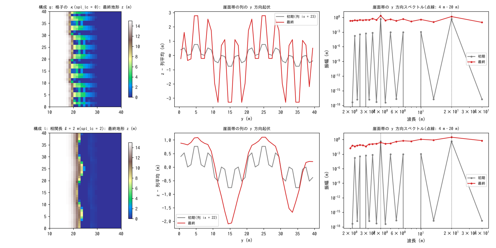

# test/splashlc — 曲率の相関長 spl_lc による谷の波長選択

[English](en/README.md)

乾式斜面侵食 f_splash の凹地形フィードバックは、曲率 κ を格子の 5 点
ラプラシアンで評価すると最短波長(2Δx)が最速で成長し(Smith & Bretherton
の無限波数問題)、谷の間隔が格子幅に張り付きます。`spl_lc` は κ を
相関長 ℓ(サブグリッドリルの集水スケール)で平滑化した z から取る
オプションで、擾乱の成長率

  σ(k) = Dₐ k² exp(−ℓ²k²/2),  Dₐ = P kₜ c_b S^h

が有限の波数(λ* = 2πℓ/√2 ≈ 4.4 ℓ)で極大を持つようになります(developer.md §48.3、
docs/splash_plan.md §6.6)。このテストは崖縁に **2 波長の正弦擾乱**
(λ₁ = 4 m、λ₂ = 20 m、振幅 0.3 m)を与え、崖面帯の y 方向フーリエ振幅の
成長比 A(final)/A(init) を 2 構成で比べる自己検証テストです。

| 構成 | ファイル | 期待 |
|---|---|---|
| g: 格子の κ | `param_g.txt`(spl_lc = 0) | 短波長 λ₁ の成長比 > 長波長 λ₂ の成長比 |
| l: 相関長 ℓ = 2 m | `param_l.txt`(spl_lc = 2) | λ₂ が成長(≥ ×1.5)し、λ₁ はほぼ中立(≤ ×1.5)で、λ₂ の成長比が λ₁ の 3 倍以上 |

ℓ = 2 m のガウス核の伝達関数 exp(−ℓ²k²/2) は λ₁ で 0.007、λ₂ で 0.82 なので、
構成 l では 4 m の擾乱はほぼ中立にとどまり、20 m の擾乱だけが増幅されます
(クリープなどの拡散項は力学的モデルでないため使いません。短波長は
減衰せず、成長しないだけです)。

## 構成

| 項目 | 値 |
|---|---|
| 領域・格子 | 50 m × 40 m、50 × 40 セル(Δx = 1 m)。`make_terrain.py` が台地(z = 15 m)+ 56° の崖 + 海(z ≤ 0 を海域マスク)を生成 |
| 降雨・浸透 | 10 mm/h、Green-Ampt 36 mm/h(全時間 h = 0) |
| 侵食 | `spl_kt = 0.05`、`spl_cb = 32`、`spl_h = 1.5`、`spl_zbase = 0`(海面を侵食基準面に)。拡散項(creep)なし |
| 時間 | dt = 2 s。地形更新 10 s 毎 × morfac 500。構成 l は 1 h(T_geo = 1.8×10⁶ s)、構成 g は 30 min(9×10⁵ s。格子の κ では 2Δx 規模の侵食前線が 1 h で台地に達するため) |

| ファイル | 内容 |
|---|---|
| `Check_select.py` | (1) g: λ₁ の成長比 > λ₂ の成長比、(2) l: λ₂ ≥ ×1.5、λ₁ ≤ ×1.5、λ₂/λ₁ の成長比 ≥ 3、(3) 台地内部(x ≤ 12 m)は無傷、(4) z ≥ spl_zbase |
| `Fig.py` | 下の図 `figs/splashlc.png` |

## 実行

```bash
make
./Run.sh          # 地形生成 → 構成 g → l → Check(数秒)
./Run_MPI.sh 4    # MPI。state.dat が逐次とバイト一致
python3 Fig.py    # figs/splashlc.png(引数 en で英語版を en/figs/ に)
```

## 図



上段が格子の κ、下段が相関長 ℓ = 2 m。左: 最終地形。中: 崖面帯の列の
y 方向起伏(灰: 初期、赤: 最終)。右: 崖面帯の y 方向スペクトル。格子の κ
では 4 m の擾乱が 30 分で ×5.1 に伸び(20 m は ×2.6)、1 セル幅の深い
切れ込みが 4 m 間隔で並びます。ℓ = 2 m では 4 m 成分が ×0.67 と中立〜微減に
とどまり(勾配を最急降下で取るので高いセルだけが削れ、格子規模の凹凸は
わずかに減衰する)、20 m 成分が 1 時間で ×2.6 に成長して、2 本の谷が選ばれます。

## 所見

| 検定 | 構成 g(格子の κ) | 構成 l(ℓ = 2 m) |
|---|---|---|
| λ₁ = 4 m の成長比 | ×5.11(30 min) | ×0.67(≤ 1.5) |
| λ₂ = 20 m の成長比 | ×2.55(30 min) | ×2.57(≥ 1.5、λ₁ の 3.8 倍 ≥ 3) |
| 台地内部 max\|Δz\| | 0.0008 m | 0.0017 m |
| 最低標高 z | 0.000 m | 0.000 m |

- 谷の間隔を物理量(ℓ)で与えるには `spl_lc` が要ります。格子の κ では
  最短波長が最速で成長するため、拡散項を足しても成長の有無(符号)しか
  変わりません(developer.md §48.3)。
- MPI は np = 2, 4 とも state.dat が逐次とバイト一致します(平滑化の各パスで
  ハロを交換する)。

## 関連文書

- [test/splash](../splash/)(解析検証)、[test/splashslide](../splashslide/)(固結度の対照)
- [examples/badland](../../examples/badland/)(白色雑音からの谷の自己形成と間隔の選択則)
- [docs/users_guide/geomorph.md](../../docs/users_guide/geomorph.md) — `spl_lc`、`spl_zbase`
- docs/splash_plan.md §6.6、developer.md §48.3
