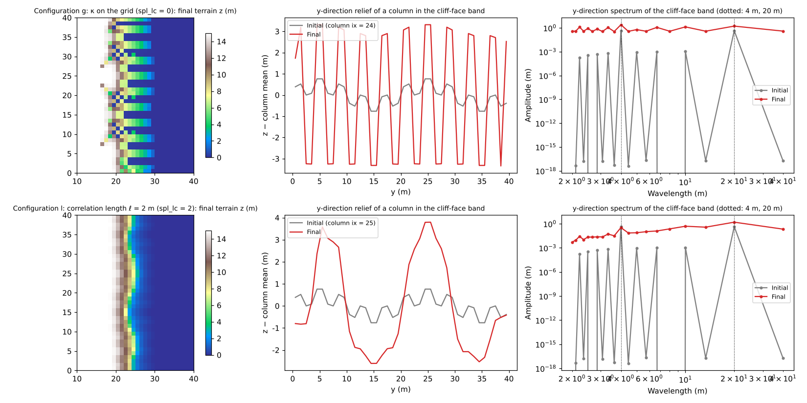

# test/splashlc — valley wavelength selection by the curvature correlation length spl_lc

> English mirror of test/splashlc/README.md. The Japanese file is the master copy.

[日本語](../README.md)

In the hollow-feedback of dry-slope erosion f_splash, when the curvature κ
is evaluated with the 5-point Laplacian of the grid, the shortest
wavelength (2Δx) grows fastest (the infinite-wavenumber problem of Smith &
Bretherton), and the valley spacing sticks to the grid width. `spl_lc` is
an option that takes κ from z smoothed with a correlation length ℓ (the
collection scale of the subgrid rills), so that the growth rate of a
perturbation

  σ(k) = Dₐ k² exp(−ℓ²k²/2),  Dₐ = P kₜ c_b S^h

has a maximum at a finite wavenumber (λ* = 2πℓ/√2 ≈ 4.4 ℓ) (developer.md §48.3,
docs/splash_plan.md §6.6). This test gives the cliff edge a **sinusoidal
perturbation of two wavelengths** (λ₁ = 4 m, λ₂ = 20 m, amplitude 0.3 m)
and is a self-checking test that compares the growth ratio
A(final)/A(init) of the y-direction Fourier amplitudes in the cliff-face
band between two configurations.

| Configuration | File | Expectation |
|---|---|---|
| g: κ on the grid | `param_g.txt` (spl_lc = 0) | Growth ratio of the short wavelength λ₁ > growth ratio of the long wavelength λ₂ |
| l: correlation length ℓ = 2 m | `param_l.txt` (spl_lc = 2) | λ₂ grows (≥ ×1.5), λ₁ is nearly neutral (≤ ×1.5), and the growth ratio of λ₂ is at least 3 times that of λ₁ |

The transfer function exp(−ℓ²k²/2) of the Gaussian kernel with ℓ = 2 m is
0.007 at λ₁ and 0.82 at λ₂, so in configuration l the 4 m perturbation
stays nearly neutral and only the 20 m perturbation is amplified
(diffusion terms such as creep are not used because they are not a
dynamical model; the short wavelength is not damped, it simply does not
grow).

## Configuration

| Item | Value |
|---|---|
| Domain and grid | 50 m × 40 m, 50 × 40 cells (Δx = 1 m). `make_terrain.py` generates a plateau (z = 15 m) + a 56° cliff + sea (z ≤ 0 is the sea mask) |
| Rainfall and infiltration | 10 mm/h, Green-Ampt 36 mm/h (h = 0 at all times) |
| Erosion | `spl_kt = 0.05`, `spl_cb = 32`, `spl_h = 1.5`, `spl_zbase = 0` (sea level as the erosion base level). No diffusion term (creep) |
| Time | dt = 2 s. Terrain update every 10 s × morfac 500. Configuration l runs 1 h (T_geo = 1.8×10⁶ s), configuration g 30 min (9×10⁵ s, because with κ on the grid the 2Δx-scale erosion front reaches the plateau within 1 h) |

| File | Contents |
|---|---|
| `Check_select.py` | (1) g: growth ratio of λ₁ > growth ratio of λ₂, (2) l: λ₂ ≥ ×1.5, λ₁ ≤ ×1.5, growth ratio λ₂/λ₁ ≥ 3, (3) the plateau interior (x ≤ 12 m) is intact, (4) z ≥ spl_zbase |
| `Fig.py` | The figure `en/figs/splashlc.png` below (`python3 Fig.py en`; `figs/splashlc.png` is the Japanese version) |

## Running

```bash
make
./Run.sh          # generate terrain → configuration g → l → Check (a few seconds)
./Run_MPI.sh 4    # MPI. state.dat is byte-identical to the serial run
python3 Fig.py en # en/figs/splashlc.png
```

## Figures



Top row: κ on the grid; bottom row: correlation length ℓ = 2 m. Left: the
final terrain. Center: the y-direction relief of the columns in the
cliff-face band (gray: initial, red: final). Right: the y-direction
spectrum of the cliff-face band. With κ on the grid, the 4 m perturbation
grows ×5.1 in 30 minutes (20 m: ×2.6), and deep one-cell-wide notches line
up at 4 m intervals. With ℓ = 2 m, the 4 m component stays neutral to
slightly decreasing at ×0.67 (since the gradient is taken as the steepest
descent, only the high cells are eroded and grid-scale relief decays
slightly), while the 20 m component grows ×2.6 in 1 hour and two valleys
are selected.

## Findings

| Check | Configuration g (κ on the grid) | Configuration l (ℓ = 2 m) |
|---|---|---|
| Growth ratio of λ₁ = 4 m | ×5.11 (30 min) | ×0.67 (≤ 1.5) |
| Growth ratio of λ₂ = 20 m | ×2.55 (30 min) | ×2.57 (≥ 1.5, 3.8 times λ₁ ≥ 3) |
| Plateau interior max\|Δz\| | 0.0008 m | 0.0017 m |
| Lowest elevation z | 0.000 m | 0.000 m |

- `spl_lc` is needed to give the valley spacing as a physical quantity (ℓ).
  With κ on the grid the shortest wavelength grows fastest, so adding a
  diffusion term changes only whether growth occurs (the sign)
  (developer.md §48.3).
- With MPI, state.dat is byte-identical to the serial run for both np = 2
  and 4 (the halo is exchanged in every pass of the smoothing).

## Related documents

- [test/splash](../../splash/en/README.md) (analytical verification), [test/splashslide](../../splashslide/en/README.md) (contrast of consolidation)
- [examples/badland](../../../examples/badland/en/README.md) (self-formation of valleys from white noise and the selection rule of their spacing)
- [docs/users_guide/geomorph.md](../../../docs/en/users_guide/geomorph.md) — `spl_lc`, `spl_zbase`
- docs/splash_plan.md §6.6, developer.md §48.3 (in Japanese)
