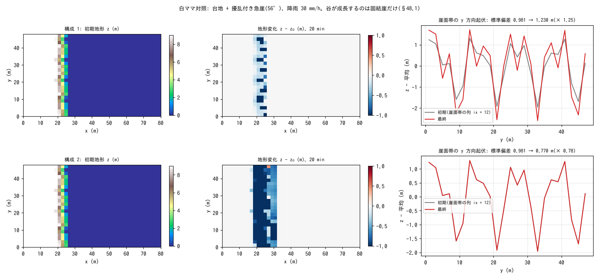

# test/splashslide — contrast between consolidated and unconsolidated cliffs (Shiromama contrast test)

> English mirror of test/splashslide/README.md. The Japanese file is the master copy.

[日本語](../README.md)

A contrast test that numerically reproduces the hypothesis that whether
dry-slope erosion f_splash carves valleys into a cliff is decided by the
degree of consolidation of the cliff (the Shiromama cliffs of Niijima:
valleys are carved into cliffs of consolidated volcanic ash, while
unconsolidated cliffs collapse and become smooth) (developer.md §48.1,
docs/splash_plan.md §6.4). With the same terrain (a plateau + a 56° cliff
with perturbations), the same rainfall and the same splash coefficients, it
runs

1. **Consolidated cliff** (`param_c.txt`): f_splash only. The y-direction
   relief of the cliff edge (the indicator of valleys) grows from the
   initial perturbation.
2. **Unconsolidated cliff** (`param_l.txt`): + f_debris (equivalent fluid)
   + f_slide (c′ = 0, φs = 35°). The hollows fluidize at Fs < 1 and are
   backfilled, resetting the relief.

and checks the growth rate of the relief with `Check_contrast.py`.

## Configuration

| Item | Value |
|---|---|
| Domain and grid | 80 m × 48 m, 40 × 24 cells (Δx = 2 m). `make_terrain.py` generates `z.txt` (plateau z = 9 m → cliff → flat) and adds a ±0.5 m y-direction perturbation to the cliff edge |
| Rainfall and infiltration | 30 mm/h, Green-Ampt (no overland flow) |
| Erosion | `f_splash = 1`, `spl_kr = 0.0005`, with hollow amplification |
| Soil layer | sd₀ = 1.3 m (≤ Δx·tanφs: the condition for a c′ = 0 cascading failure to stop at a one-cell step) |
| Time | dt = 0.05 s, 20 min. Terrain updated every 1 s |

| File | Contents |
|---|---|
| `Check_contrast.py` | (1) consolidated: relief(final)/relief(init) ≥ 1.15, (2) unconsolidated: ≤ 0.9, (3) the plateau interior (x ≤ 6 m) is intact (\|Δz\| < 0.05 m), (4) the lower bound of erosion is bounded (z ≥ −1.5 m) |
| `Fig.py` | The figure `figs/splashslide.png` below |

## Running

```bash
make
./Run.sh          # terrain generation → configuration 1 → 2 → Check (tens of seconds)
./Run_MPI.sh 4    # MPI; state.dat is byte-identical to the serial run
python3 Fig.py    # figs/splashslide.png
```

## Figure



Top row: consolidated cliff; bottom row: unconsolidated cliff. Left: initial
terrain (the perturbation of the cliff edge is the same for both). Center:
terrain change after 20 min. On the consolidated cliff the cliff face is
eroded more deeply in the hollows of the perturbation (deepening of
valleys); on the unconsolidated cliff the whole cliff collapses and deposits
at the foot of the slope (red). Right: y-direction relief of the columns in
the cliff-face band. For the consolidated cliff the amplitude grows × 1.25;
for the unconsolidated cliff it decays × 0.78.

## Findings

| Check | Consolidated cliff | Unconsolidated cliff | Result |
|---|---|---|---|
| Growth rate of the relief | × 1.25 (≥ 1.15) | × 0.78 (≤ 0.9) | PASS |
| Plateau interior \|Δz\| | 0.0 | 0.0 | PASS |
| Minimum elevation z | 0.00 m | −1.30 m (≥ −1.5) | PASS |

- The hypothesis "the critical condition for valley formation is the degree
  of consolidation" is reproduced numerically with two configurations under
  identical conditions.
- Key points of the setup (splash_plan.md §6.4): a c′ = 0 cascading failure
  does not stop as long as the gradient sd/Δx of a one-cell step exceeds
  tanφs, so sd₀ ≤ Δx·tanφs is used. The debris flow is restricted to the
  equivalent-fluid mode `f_dbed = 0` + `f_dbstop = 1` (cutting off the
  self-acceleration of E-D entrainment).
- This case is also the one that actually detected a band-interface bug
  (after splash updated z inside the band, creep / fluvial read the old z of
  the halo rows; a weak creep was used in combination at the time), and
  after the fix np = 1, 2, 4 are byte-identical (§48.1). On 2026-10-19 the
  creep was removed (it has no mechanical basis; §48.3) and the slope
  evaluation was changed to steepest descent (§48.4). The growth rate of the
  consolidated cliff went from × 1.34 to × 1.25.

## Related documents

- [test/splash](../../splash/en/README.md) (analytical verification of dry-slope erosion), [test/slide](../../slide/en/README.md) (f_slide)
- [docs/splash_plan.md](../../../docs/splash_plan.md) (in Japanese) §6.4–6.5, developer.md §48.1
