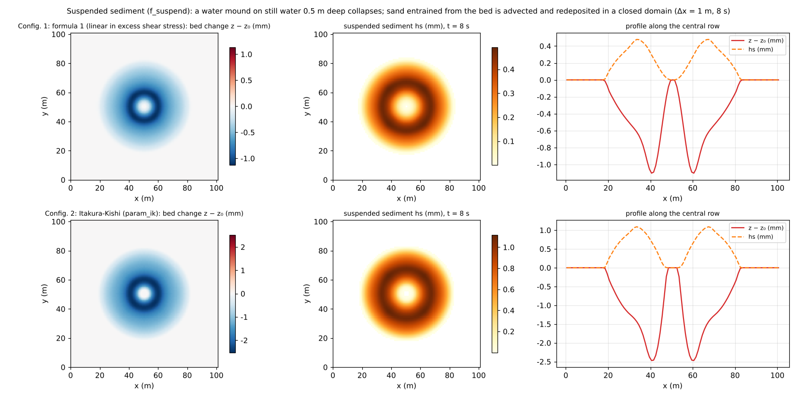

# test/suspend — suspended sediment (f_suspend): operation, conservation and the balance of entrainment and settling

> English mirror of test/suspend/README.md. The Japanese file is the master copy.

[日本語](../README.md)

An operation and conservation check of the suspended-sediment module
(`f_suspend = 1` in `&list_geomorph`; entrainment and settling E-D with the
bed and advection in the water column; developer.md §19). A water mound
(wave_hump, +1 m) is placed on still water in a closed domain and collapses,
and the process in which the sand entrained under the ring wave is carried
and redeposited is run with two equilibrium-concentration formulas.
Conservation of the total solid, the co-update identity and activity are
checked with `Check_suspend.py` (the counterpart of the bedload version in
[test/fluvial](../../fluvial/en/README.md)).

Configurations 3 and 4 are analytical checks of the balance of entrainment
and settling in a channel with uniform flow (developer.md §19.11). In a
channel fed with clear water, the suspended sediment approaches the
equilibrium concentration C_eq/β downstream. The checks confirm that the
concentration in the adapted reach matches the value of the
equilibrium-concentration formula, and that the ratio by which the deficit
from equilibrium decreases downstream matches the discrete prediction.

## Configurations 1 and 2 (bore in a closed domain)

| Item | Value |
|---|---|
| Domain and grid | 101 m × 101 m, 101 × 101 cells (Δx = 1 m), flat, walls on all four sides |
| Initial condition | Still water h₀ = 0.5 m + a cosine mound (+1 m, radius 15 m) |
| Soil layer | sd₀ = 10 m, porosity λ = 0.4 |
| Time | dt = 0.1 s, 8 s (updated every step, morfac = 1) |

| Configuration | File | Equilibrium-concentration formula `f_esform` |
|---|---|---|
| 1 | `param.txt` | 1: linear in the excess shear stress (coefficient `susp_esa = 1e-4`) |
| 2 | `param_ik.txt` | 2: Itakura-Kishi |

## Configurations 3 and 4 (equilibrium and adaptation in a uniform channel)

| Item | Value |
|---|---|
| Channel | A straight channel one cell wide running north-south (length 1000 m, Δy = 1 m, slope 0.002, n = 0.03). Dry ground 2 m higher than the bed on both sides (written by `make_eq.py`) |
| Flow | Section inflow Q = 0.469545 m³/s at the north end (Manning normal depth 0.5 m, velocity 0.939 m/s, τ* = 3.03), free outflow on the south edge. The inflow is clear water |
| Bed | sd₀ = 10 m. morfac = 1e-8 (so that bed changes do not alter the flow; the exchange on the water-column side runs in hydraulic time) |
| Time | dt = 0.2 s, 3600 s |

| Configuration | File | Equilibrium formula, settling velocity, near-bed concentration coefficient |
|---|---|---|
| 3 | `param_eq.txt` | 1: linear (`susp_esa = 1e-4`, τ*c = 0.05), w_f = 0.02 m/s (given directly), β = 1.5 |
| 4 | `param_eq_ik.txt` | 2: Itakura-Kishi, w_f from the Rubey formula (0.02528 m/s), β = 1 |

The suspended sediment exchanges with the bed as E − D = w_f (C_eq − β C)
and approaches C_eq/β downstream. The two checks are:

- **Equilibrium**: over 250–350 m, where adaptation is complete, C = hs/h
  matches C_eq(τ*)/β computed from the local velocity and depth. The check
  script computes C_eq and the Rubey w_f from the formulas of the users guide,
  assembled independently.
- **Adaptation**: the deficit from equilibrium hs_eq − hs decreases downstream
  by a constant ratio ρ. Including the default MUSCL (`f_scalar_scheme = 3`)
  and the time splitting that adds E-D explicitly after advection,
  ρ = (1 − k)/(1 + k), k = b/(2c(1 − b)) (b = w_f β Δt/h,
  c = q Δt/(h Δy)). The decay rate over 10–60 m is compared with this
  prediction. The continuous solution gives exp(−w_f β Δy/q) per cell.

| File | Contents |
|---|---|
| `Check_suspend.py <save>` | Configurations 1 and 2: (1) total solid \|Σhs + (1 − λ)Σ(z − z₀)\| < 1e-9, (2) co-update max\|(sd − sd₀) − (z − z₀)\| < 1e-10, (3) activity max hs > threshold and max\|z − z₀\| > threshold |
| `Check_suspend.py eq` / `eq_ik` | Configurations 3 and 4: (0) uniform flow over 20–350 m (h/h_n and V/V_n within 1 ± 1e-5) and steadiness (hs at 2400 s and 3600 s differ by at most 1e-5 relative), (1) equilibrium (ratio 1 ± 1e-5), (2) ratio of the adaptation decay rate to the discrete prediction 1 ± 1e-3, and a deficit that decreases by a uniform ratio |
| `make_eq.py` | Writes the topography and initial depth of configurations 3 and 4 (zinit_eq.txt, hinit_eq.txt); Run.sh and Run_MPI.sh call it |
| `Fig.py` | The figure `en/figs/suspend.png` below (`python3 Fig.py en`; `figs/suspend.png` is the Japanese version. Run.sh leaves configuration 1 in `save_serial/` and configuration 2 in `save/`) |

## Running

```bash
make
./Run.sh          # configuration 1 → Check → configuration 2 → Check (a few seconds) → configurations 3 and 4 (about 40 s each)
./Run_MPI.sh 4    # MPI; state.dat of configurations 1, 3 and 4 is byte-identical to the serial run
python3 Fig.py en # en/figs/suspend.png
```

## Figure



Top row: configuration 1; bottom row: configuration 2. Left: bed change.
Scour occurs in the ring of radius 5–10 m where the velocity is highest as
the water mound collapses (1.1 mm in configuration 1, 2.5 mm in 2), with
redeposition at the center and outside. Center: suspended sediment hs in
the water column. The sand entrained under the ring wave is carried outward
with the wave. Right: profile along the central row. The Itakura-Kishi
formula gives more than twice the entrainment for the same flow, and the
difference between the formulas appears directly in the amounts (both are
empirical formulas that presuppose calibration).

## Findings

| Configuration | Total solid | Co-update | max hs / max\|dz\| | Result |
|---|---|---|---|---|
| 1 linear formula | 0.0 | 1.3e-14 | 0.49 mm / 1.13 mm | PASS |
| 2 Itakura-Kishi | 0.0 | 1.2e-14 | 1.12 mm / 2.52 mm | PASS |

- At morfac = 1 the E-D exchange is exactly antisymmetric, and the total
  solid is conserved to machine precision (ledger separation of MORFAC: the
  water-column side in hydraulic time, the bed side × morfac; §19).
- In dry cells (h ≤ dd) the suspended part is transferred entirely to the
  bed, leaving no suspended sediment without water.

| Configuration | Equilibrium: difference between C and C_eq/β | Adaptation: decay rate (per cell) | Ratio to the discrete prediction | Ratio to the continuous solution | Result |
|---|---|---|---|---|---|
| 3 linear | 1.4e-6 (C_eq = 5.9606e-3) | 0.0646893 | 0.999986 | 1.0125 | PASS |
| 4 Itakura-Kishi | 1.5e-6 (C_eq = 1.4673e-2) | 0.0544050 | 0.999997 | 1.0105 | PASS |

- The equilibrium concentration matches the value of the formulas assembled
  independently in the check script to six digits (including the Ω of the
  Itakura-Kishi formula and the Rubey settling velocity).
- The adaptation is about 1 % faster than the continuous solution, mainly
  because of the time splitting that adds E-D explicitly (a factor
  1/(1 − b), b = w_f β Δt/h ≈ 0.01). The first few cells after the inflow
  point have a different ratio because the boundary faces are first-order
  upwind, so the measurement starts at 10 m.
- The flow over 20–350 m is within 2.4e-6 of uniform flow. The drawdown from
  the free outflow at the downstream end stays below 400 m.
- Sediment inflow boundaries are in [test/sedinflow](../../sedinflow/en/README.md),
  hillslope erosion (wash load) in [test/wash](../../wash/en/README.md), and
  coupling with Kd partitioning in [test/kdpart](../../kdpart/en/README.md).

## Related documents

- [docs/users_guide/geomorph.md](../../../docs/en/users_guide/geomorph.md) — `f_suspend`, `f_esform`, settling velocity (`susp_wf` / Rubey formula)
- [docs/users_guide/sediment.md](../../../docs/en/users_guide/sediment.md) §4 — the exchange of entrainment and settling, the equilibrium-concentration formulas, the Rubey formula
- developer.md §19 (implementation of suspended sediment, ledger separation of MORFAC, verification records; configurations 3 and 4 in §19.11), §62 (defaults of the coefficients)
