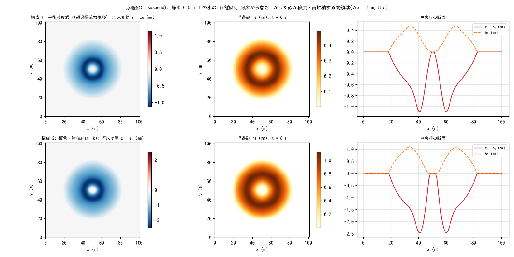

# test/suspend — suspended sediment (f_suspend): operation and conservation with two equilibrium-concentration formulas

> English mirror of test/suspend/README.md. The Japanese file is the master copy.

[日本語](../README.md)

An operation and conservation check of the suspended-sediment module
(`f_suspend = 1` in `&list_geomorph`; entrainment and settling E-D with the
bed and advection in the water column; developer.md §19). A water mound
(wave_hump, +1 m) is placed on still water in a closed domain and collapses,
and the process in which the sand entrained under the ring wave is carried
and redeposited is run with two equilibrium-concentration formulas.
Conservation of the total solid, the co-update identity and activity are
checked with `Check_suspend.py` (the counterpart of the bedload version in
[test/fluvial](../../fluvial/en/README.md)).

## Configuration

| Item | Value |
|---|---|
| Domain and grid | 101 m × 101 m, 101 × 101 cells (Δx = 1 m), flat, walls on all four sides |
| Initial condition | Still water h₀ = 0.5 m + a cosine mound (+1 m, radius 15 m) |
| Soil layer | sd₀ = 10 m, porosity λ = 0.4 |
| Time | dt = 0.1 s, 8 s (updated every step, morfac = 1) |

| Configuration | File | Equilibrium-concentration formula `f_esform` |
|---|---|---|
| 1 | `param.txt` | 1: linear in the excess shear stress (coefficient `susp_esa = 1e-4`) |
| 2 | `param_ik.txt` | 2: Itakura-Kishi |

| File | Contents |
|---|---|
| `Check_suspend.py <save>` | (1) total solid |Σhs + (1 − λ)Σ(z − z₀)| < 1e-9, (2) co-update max|(sd − sd₀) − (z − z₀)| < 1e-10, (3) activity max hs > threshold and max|z − z₀| > threshold |
| `Fig.py` | The figure `figs/suspend.png` below (Run.sh leaves configuration 1 in `save_serial/` and configuration 2 in `save/`) |

## Running

```bash
make
./Run.sh          # configuration 1 → Check → configuration 2 → Check (a few seconds)
./Run_MPI.sh 4    # MPI; state.dat is byte-identical to the serial run
python3 Fig.py    # figs/suspend.png
```

## Figure



Top row: configuration 1; bottom row: configuration 2. Left: bed change.
Scour occurs in the ring of radius 5–10 m where the velocity is highest as
the water mound collapses (1.1 mm in configuration 1, 2.5 mm in 2), with
redeposition at the center and outside. Center: suspended sediment hs in
the water column. The sand entrained under the ring wave is carried outward
with the wave. Right: profile along the central row. The Itakura-Kishi
formula gives more than twice the entrainment for the same flow, and the
difference between the formulas appears directly in the amounts (both are
empirical formulas that presuppose calibration).

## Findings

| Configuration | Total solid | Co-update | max hs / max|dz| | Result |
|---|---|---|---|---|
| 1 linear formula | 0.0 | 1.2e-14 | 0.45 mm / 1.13 mm | PASS |
| 2 Itakura-Kishi | 0.0 | 1.3e-14 | 1.04 mm / 2.53 mm | PASS |

- At morfac = 1 the E-D exchange is exactly antisymmetric, and the total
  solid is conserved to machine precision (ledger separation of MORFAC: the
  water-column side in hydraulic time, the bed side × morfac; §19).
- In dry cells (h ≤ dd) the suspended part is transferred entirely to the
  bed, leaving no suspended sediment without water.
- Sediment inflow boundaries are in [test/sedinflow](../../sedinflow/en/README.md),
  hillslope erosion (wash load) in [test/wash](../../wash/en/README.md), and
  coupling with Kd partitioning in [test/kdpart](../../kdpart/en/README.md).

## Related documents

- [docs/users_guide/geomorph.md](../../../docs/en/users_guide/geomorph.md) — `f_suspend`, `f_esform`, settling velocity (`susp_wf` / Rubey formula)
- developer.md §19 (implementation of suspended sediment, ledger separation of MORFAC, verification records), §62 (defaults of the coefficients)
