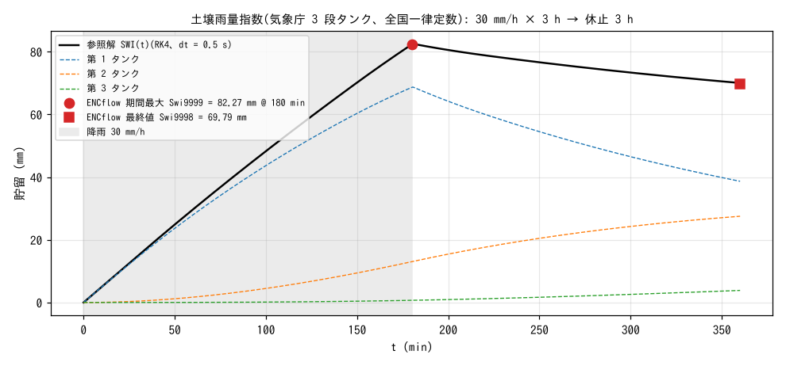

# test/swi — comparison of the Soil Water Index (f_swi) with the three-tank reference solution

> English mirror of test/swi/README.md. The Japanese file is the master copy.

[日本語](../README.md)

A check of the purely diagnostic module (`fn_swi`, developer.md §49) that
computes the "Soil Water Index" (SWI), the operational indicator for
sediment-disaster warning, for each cell. The three serial tanks of the
Japan Meteorological Agency (the nationally uniform constants of Ishihara
and Kobatake 1979) are compared with a reference solution integrated at high
resolution by RK4 (dt = 0.5 s), and the final value, period maximum, time of
occurrence and spatial uniformity are judged by `Check_swi.py` (no
comparison with a stored reference).

## Configuration

| Item | Value |
|---|---|
| Domain and grid | 10 km × 8 km, 10 × 8 cells (2 rows per rank even with np = 4), flat |
| Rainfall | 30 mm/h for 3 h, then a 1-minute linear ramp to 0, then a 3 h pause (6 h in total) |
| SWI | `f_swi = 1`, initial storage 0 (no antecedent rainfall). dt = 60 s (at most the JMA computation interval of 10 min) |
| Tank constants | Outlet heights L1–L4 = 15, 60, 15, 15 mm, outflow coefficients A1–A4 = 0.1, 0.15, 0.05, 0.01 /h, percolation coefficients B1–B3 = 0.12, 0.05, 0.01 /h |
| Output | Current SWI Swi, period maximum Swi9999, time of occurrence Swit9999 (always output when enabled) |

**Note**: the rainfall table (`prtype = 1`) is linearly interpolated. Writing
(0, 30), (180, 0) intending a rectangular pulse gives a gradual decrease over
3 hours. The benchmark doubles the end point to make an explicit short ramp
(§49; actually detected).

| File | Contents |
|---|---|
| `Check_swi.py <result>` | (1) final value Swi9998 within a relative 1% of the reference solution, (2) period maximum Swi9999, (3) time of occurrence Swit9999 within ±2 min, (4) all cells equal |
| `Fig.py` | The figure `figs/swi.png` below (the reference solution is computed as in Check) |

## Running

```bash
make
./Run.sh          # run → Check (1 s)
./Run_MPI.sh 4    # MPI; state.dat, swi.dat and the Swi output are bit-identical to the serial run
python3 Fig.py    # figs/swi.png
```

## Figure



SWI(t) of the reference solution (black) and the storages of the three tanks
(dashed). During the rain the first tank rises across its two outlets (15 mm,
60 mm); just after the rain stops (180.8 min) the SWI reaches its maximum of
82.5 mm; during the pause the whole decreases while water moves from the
first tank to the second and third. The period maximum (●) and final value
(■) of ENCflow lie on the reference solution within 0.3%.

## Findings

| Check | ENCflow | Reference solution | Result |
|---|---|---|---|
| Final value SWI (6 h) | 69.79 mm | 70.02 mm (−0.33%, tolerance 1%) | PASS |
| Period maximum | 82.27 mm | 82.49 mm (−0.28%) | PASS |
| Time of occurrence | 180.0 min | 180.8 min (±2 min) | PASS |
| Spatial uniformity | max − min = 0.0 | — | PASS |

- The 0.3% difference from the reference solution with the explicit scheme
  at dt = 60 s comes from the time discretization in the interval where the
  first tank crosses its outlets, under a condition much finer than the JMA
  interval of 10 minutes.
- The three tank storages are restarted from the module's private
  `swi.dat`, and the maximum statistics are not saved (the convention of
  §7). In a restart round trip split at 3 h, both the SWI and swi.dat are
  bit-identical (§49).

## Related documents

- [docs/users_guide/swi.md](../../../docs/en/users_guide/swi.md) — `&list_swi`, output
- developer.md §49 (implementation, verification, note on the rainfall table)
