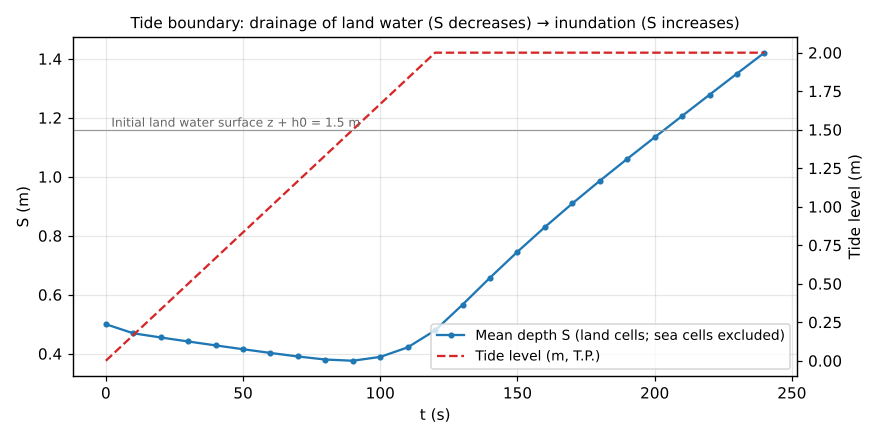
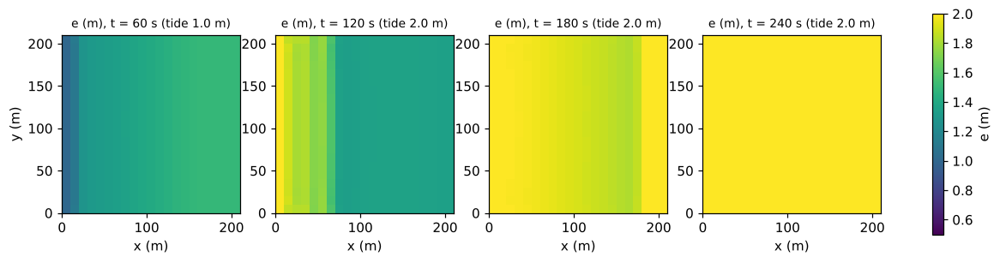

# test/tide — connectivity of the tide boundary (m_tide) and equivalence checks of the defaults and the map list

> English mirror of test/tide/README.md. The Japanese file is the master copy.

[日本語](../README.md)

This is the minimal case of the tide boundary (`fn_tide`,
[the tide chapter of the users guide](../../../docs/en/users_guide/tide.md)),
which gives a tide-level time series to sea cells. On flat land (z = 1 m,
initial depth 0.5 m) the westernmost column is made sea by the sea mask
(`sw.txt`), and the tide level is raised from 0 to 2 m. Water on the land
drains to the sea (S decreases), and once the tide level exceeds the land water
surface at 1.5 m the land is inundated (S increases); the connectivity in both
directions, drainage and inundation, is confirmed within 4 minutes. In
addition, the configuration of defaults with an empty `&list_tide` and the
configuration with the defaults written explicitly are checked to be
bit-identical (developer.md §67). Furthermore, a configuration that gives the
same tide level by a list of distribution files (`titype = 4`) is checked to
agree with configuration 1, and the three configurations that give the interval
of the list as a number in minutes, as a string without a unit (minutes) and as
a string with a unit are checked to be bit-identical (developer.md §88.5).

## Configuration

| Item | Value |
|---|---|
| Domain and grid | 210 m × 210 m, 21 × 21 cells (Δx = 10 m) |
| Terrain and roughness | Land z = 1 m uniform, Manning n = 0.02 |
| Sea area | The westernmost column (x < 10 m) is sea (`sw.txt`). `f_masktype = 2` generates the domain mask automatically from the sea mask |
| Initial condition | Land water depth 0.5 m (water surface 1.5 m T.P.), zero velocity |
| Tide level | Uniform time series with `titype = 2`: 0 m at 0 min, 2 m at 2 min, 2 m thereafter. Update interval 0.1 min. Apparent water column thickness of sea cells `hsea0 = 1 m` |
| Time step | dt = 0.2 s, 240 s. Water level E output every 60 s |

Sea cells are a "boundary that prescribes the water level": `s%z = tide level
− hsea0` and `s%h = hsea0` are forced at every update. The flow of the sea
cells themselves is not solved; drainage and inundation on the land side are
the ordinary shallow-water computation.

| File | Contents |
|---|---|
| `param.txt` | Configuration 1 (above; with a reference) |
| `param_min.txt` | Configuration 2: `&list_tide` left empty (defaults = uniform fixed tide level 0 m, hsea0 = 1 m) |
| `param_minx.txt` | Configuration 2': the defaults written explicitly (`titype = 1`, `ti0 = 0`, `hsea0 = 1`) |
| `param_map.txt` | Configuration 3: the same tide level as configuration 1 given by a list of distribution files (`titype = 4`; uniform distributions of 0, 1 and 2 m at 1-minute intervals). `dt_timaplist = 1` (min) |
| `param_mapc.txt` / `param_maps.txt` | Configurations 3' and 3'': the interval given as a string (`dt_timaplist_c = '1'` = a number without a unit is in minutes, and `'60s'`) |
| `data_map/` | Distributions of configuration 3 (`t0.txt`–`t2.txt`) and the list (`timaplist.txt`; the paths in the list are also relative to dir_data) |
| `sw.txt` | Sea mask (the westernmost column is 1) |
| `Fig.py` | Draws the figures `en/figs/*.png` below (`python3 Fig.py en`; `figs/*.png` are the Japanese versions) |

## Running

```bash
make
./Run.sh          # compare configuration 1 with the reference → run configurations 2 and 2' and check that result_min and result_minx
                  # are byte-identical (diff -r) and that "(default)" is printed → run configurations 3, 3' and 3'' and check that the three
                  # are byte-identical, that the adopted value is printed and that S agrees with configuration 1 (relative 1e-9). PASS when all pass
./Run_MPI.sh 4    # MPI with 4 ranks (configuration 1)
python3 Fig.py en # en/figs/storage.png, en/figs/map.png
```

## Figures



The mean depth S of the screen output (the average over land cells excluding
sea cells; until 2026-10-22 it included the constant water column hsea0 of the
sea cells) and the tide level. While the tide level is below the initial land
water surface of 1.5 m (t < 90 s), land water drains to the sea and S
decreases; at t = 90 s, when the tide level exceeds 1.5 m, S reaches its
minimum (0.376 m) exactly, and thereafter the sea inundates the land and S
keeps increasing.
Even after the tide level levels off at 2 m (t > 120 s), inundation proceeds
at a constant rate until the land water surface catches up with 2 m.



The distribution of the water level e = z + h. At t = 60 s drainage is in
progress and the water surface is lower toward the west edge (sea side); at
t = 120 s the inundation front has advanced about 60 m from the sea; at
t = 180 s the front has reached near the east end; and at t = 240 s the whole
domain is level with the tide level of 2 m.

## Findings

| Quantity | Value |
|---|---|
| S(t = 0) | 0.5000 m (initial depth 0.5 m over the 20 land columns. Sea cells are not included in S) |
| Minimum of S | 0.3762 m (t = 90 s; the time when the tide level = the land water surface 1.5 m) |
| S(t = 240 s) | 1.4209 m (the whole domain approaches the water surface of 2 m) |
| Configurations 2 and 2' | result_min and result_minx byte-identical; `titype = 1 (default)` printed on the screen |
| Configurations 3, 3' and 3'' | result_map, result_mapc and result_maps byte-identical; `tide: dt_timaplist = 1.00000 min` printed on the screen. S differs from configuration 1 by less than a relative 1e-9 (in the environment where this was made, Log.txt is bit-identical) |

- It is confirmed that the switch from drainage to inundation occurs at the
  time dictated by the relation between the tide level and the land water
  surface, and that the inundation front advances uniformly from the sea
  (uniform in the y direction).
- The equivalence check of the defaults guarantees the simplest usage, "just
  writing `&list_tide` gives a sea with a fixed tide level of 0 m" (drainage at
  low tide, the outlet of a catchment to the sea) (§67).
- Configuration 3 also checks the frame times (i−1) × interval of the list of
  distribution files (titype = 4) and the linear interpolation between two
  adjacent frames (added on 2026-10-29; until then no check used titype = 4).
  With the code before the change, `dt_timaplist_c = '1'` was read as 1 second
  and configuration 3' did not agree with configuration 3 (§88.5).
- The verification of a coastal levee (crest height) placed on the tide
  boundary (the land unchanged below the crest, inundation after overtopping,
  flap gates) is in the verification record of developer.md §17.
- Regression discipline: the Log.txt of configuration 1 must match the
  reference (ULP = 1 excluding the Runge column), and MPI np = 1, 2, 4 must be
  identical as well.

## Related documents

- [docs/users_guide/tide.md](../../../docs/en/users_guide/tide.md) — how the tide level is given (titype 1–4), hsea0, update interval
- [docs/users_guide/geoinfo.md](../../../docs/en/users_guide/geoinfo.md) — sea mask `fn_sw`, `f_masktype = 2`
- developer.md §17 (coastal levees and the treatment of sea areas), §67 (minimal input and defaults of the tide)
