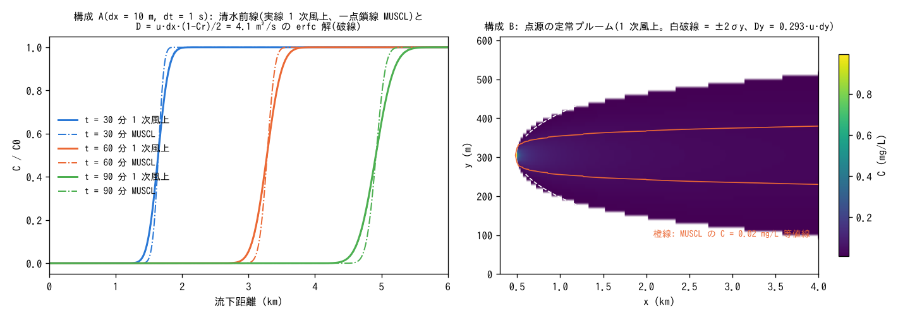

# test/tracer — スカラー輸送(1 次風上)の数値拡散の計測

地表のスカラー(浮遊砂・水質・塩水層・流木・瓦礫)は `advect_scalar`
(developer.md §30・§47)で、水のエッジ流量に**風上セルの濃度**を掛けて
運ぶ 1 次風上・前進オイラーで輸送されます。地下水の同伴輸送も同じ
流儀です。このケースは、その数値拡散を一様流の直線水路で計測し、
修正方程式の理論値と比べます。物理の分散・減衰・沈降はありません
(水質モジュールの既定)。

- **構成 A(縦断)**: 幅 3 セル・南北向きの水路(勾配 9e-4、n = 0.03、
  水深 1 m、u ≈ 0.91 m/s。帯分割で MPI 検証ができる向き)に初期濃度
  100 mg/L の水を満たし、北辺から清水を流入させる。清水の前線(階段)が流下しながらなまる幅 σ(−dC/dx の標準偏差)
  から等価拡散係数 D = σ²/(2t) を求め、
  1 次風上の理論値 D = u·dx·(1 − Cr)/2(Cr = u·dt/dx)と比べる。
  dx = 10 m・dt = 1 s(param.txt。回帰の reference)、dx = 10 m・dt = 2 s
  (param_a10dt2.txt)、dx = 20 m・dt = 2 s(param_a20.txt)。
- **構成 B(横断)**: 幅 61 セルの水路の中央列に一定負荷 10 g/s を投入し、
  定常プルームの横断分散 σy²(x) の勾配から Dy = (dσy²/dx)·u/2 を求める
  (param_b.txt)。無印の param は `f_scalar_scheme = 1`(1 次風上)を明示し、
  各構成に既定の `f_scalar_scheme = 3`(リンクごとの MUSCL)の `*_m.txt` が
  あって 1 次風上との比を検定する。流れは x 方向の一様流で横断流速はゼロなので、Dy は
  ENC の斜めリンクが通過幅シェア p_diag/2 = 0.293 ずつ運ぶことによる
  数値拡散で、理論値は 0.293·u·dy。

流れの移流項はスキーム 1(セル中心勾配)にしています。区間流入 +
運動量保存形移流(スキーム 2・3)が直線水路で自励する流量振動
(docs/handoff.md 00a)を避けて流れを一様に保つためで、スカラーの
スキームとは独立です。

```
make              # リンクと z_*.txt、inflow_b.txt
./Run.sh          # param.txt の回帰(Log.txt + wq.csv)+ 他 3 ケースの実行 + Check_tracer.py
./Run_MPI.sh 4    # MPI 4 ランク(reference と ULP=0)
python3 Fig.py    # figs/tracer.png
```

## 結果(gfortran -Ofast)



| ケース | dx (m) | dt (s) | u (m/s) | Cr | D 実測 (m²/s) | D 理論 u·dx·(1−Cr)/2 | 比 | MUSCL D (m²/s) | MUSCL / 1 次 |
|---|---:|---:|---:|---:|---:|---:|---:|---:|---:|
| param.txt | 10 | 1 | 0.91 | 0.09 | 4.3 | 4.1 | 1.04 | 1.2 | 0.28 |
| param_a10dt2.txt | 10 | 2 | 0.91 | 0.18 | 3.9 | 3.7 | 1.04 | 0.8 | 0.20 |
| param_a20.txt | 20 | 2 | 0.92 | 0.09 | 8.7 | 8.4 | 1.05 | 2.6 | 0.30 |
| param_b.txt(横断) | 10 | 1 | 1.00 | — | 2.7 | 2.9(0.293·u·dy) | 0.94 | 0.19 | 0.07 |

(t = 30〜90 分の値。Check_tracer.py は 1 次風上が各時刻で理論値と相対差
20 % 以内、MUSCL(`*_m.txt`。`f_scalar_scheme = 3`)が 1 次の 0.5 倍以下
(横断は 0.2 倍以下)で、濃度場に負値も初期濃度を超える値もないことを検定)

読み方:

- 縦断の数値拡散は修正方程式どおり **D ≈ u·dx/2**(Cr が小さいので
  (1 − Cr) の補正は 1 〜 2 割)。浅水流の dt は重力波の CFL で決まるため
  スカラーの Cr は常に 0.1〜0.2 程度で、dt を変えても D はほとんど
  変わらず、**格子幅に比例**する(dx 10 m で 4 m²/s、20 m で 9 m²/s)。
  前線の幅(2σ)は 1 時間で 350 m(35 セル)に達する。
- 横断には流れがなくても **Dy ≈ 0.29·u·dy** の数値拡散がある(縦断の
  0.65 倍)。ENC の 8 方向リンクでは x 方向の一様流でも質量流束の
  0.293 ずつが両斜めへ振り分けられるためで、点源のプルームは 3 km 下流で
  σy ≈ 130 m(13 セル)に広がる。
- これらは物理の分散(例: Elder 型の縦断分散 5.9·h·u* ≈ 0.3 m²/s、
  横断 0.15·h·u* ≈ 0.01 m²/s。h = 1 m、u* = 0.05 m/s)を 1〜2 桁上回る。
  総量・堆積分布などの積分量には効かない。
- **リンクごとの MUSCL(`f_scalar_scheme = 3`)** は、各リンクの向きに沿って
  風上・風下・さらに風上の 3 点から van Leer 限定器で面値を再構成する。
  斜めリンクも斜め方向に沿って再構成するので、横断に線形な濃度場では
  両斜めの供給元の平均が中央値に一致し、横断の数値拡散の主要項も消える。
  縦断 D は 1/3〜1/5、横断 Dy は 1/14(σy は 3 km 下流で 129 → 38 m)になり、
  残るのは前線の両端(極値)で限定器が 1 次に退化する分。濃度フロントの
  到達時刻やピーク濃度、密度のピークで決まる荷重を見る用途で使う
  ([移流項の解説](../../docs/users_guide/advection.md) §7、developer.md §78)。
