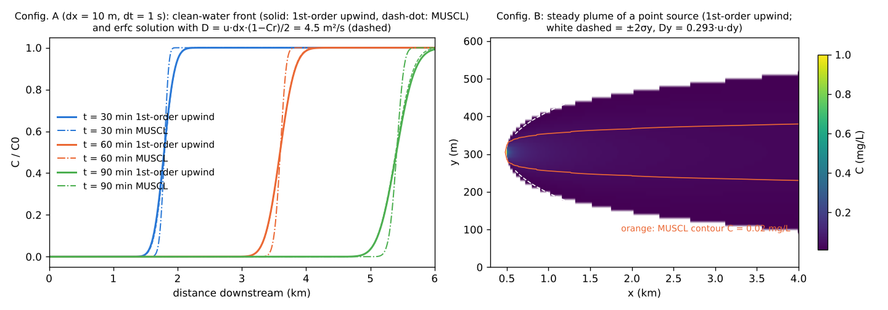

# test/tracer — measuring the numerical diffusion of scalar transport (first-order upwind)

> English mirror of test/tracer/README.md. The Japanese file is the master copy.

[日本語](../README.md)

Surface scalars (suspended sediment, water quality, the salt layer, driftwood
and debris) are transported by `advect_scalar` (developer.md §30, §47) with
first-order upwind, forward Euler: the water flux through each edge is
multiplied by the **concentration of the upwind cell**. Accompanying transport
in groundwater follows the same style. This case measures that numerical
diffusion in a straight channel with uniform flow and compares it with the
theoretical value from the modified equation. There is no physical dispersion,
decay or settling (the defaults of the water-quality module).

- **Configuration A (longitudinal)**: a north–south channel 3 cells wide
  (slope 9e-4, n = 0.03, depth 1 m, u ≈ 1.0 m/s; the orientation in which
  band decomposition allows MPI verification) is filled with water of initial
  concentration 100 mg/L, and clean water flows in from the north side. From
  the width σ (standard deviation of −dC/dx) over which the clean-water front
  (a step) smears as it travels downstream, the equivalent diffusion
  coefficient D = σ²/(2t) is obtained and compared with the first-order
  upwind theory D = u·dx·(1 − Cr)/2 (Cr = u·dt/dx). dx = 10 m, dt = 1 s
  (param.txt; the regression reference), dx = 10 m, dt = 2 s
  (param_a10dt2.txt), and dx = 20 m, dt = 2 s (param_a20.txt).
- **Configuration B (lateral)**: a constant load of 10 g/s is injected into
  the central column of a channel 61 cells wide, and the lateral dispersion
  Dy = (dσy²/dx)·u/2 is obtained from the gradient of the lateral variance
  σy²(x) of the steady plume (param_b.txt). The unsuffixed param files set
  `f_scalar_scheme = 1` (first-order upwind) explicitly, and each
  configuration has a `*_m.txt` with the default `f_scalar_scheme = 3`
  (link-wise MUSCL) whose ratio to first-order upwind is checked. The flow is
  uniform in the x direction with zero lateral velocity, so Dy is the
  numerical diffusion caused by the diagonal links of the ENC grid each
  carrying a passage-width share p_diag/2 = 0.293; the theoretical value is
  0.293·u·dy.

The advection term of the flow uses scheme 1 (cell-centre gradient). This is
to keep the flow uniform by avoiding the self-excited discharge oscillation
that segment inflow + momentum-conservative advection (schemes 2 and 3)
produce in a straight channel (docs/handoff.md 00a), and is independent of
the scalar scheme.

```
make              # links, z_*.txt and inflow_b.txt
./Run.sh          # regression of param.txt (Log.txt + wq.csv) + runs of the other 3 cases + Check_tracer.py
./Run_MPI.sh 4    # MPI with 4 ranks (ULP=0 to the reference)
python3 Fig.py en # en/figs/tracer.png
```

## Results (gfortran -Ofast)



| Case | dx (m) | dt (s) | u (m/s) | Cr | Measured D (m²/s) | Theoretical D u·dx·(1−Cr)/2 | Ratio | MUSCL D (m²/s) | MUSCL / first-order |
|---|---:|---:|---:|---:|---:|---:|---:|---:|---:|
| param.txt | 10 | 1 | 1.00 | 0.10 | 4.7 | 4.5 | 1.04 | 0.8 | 0.16 |
| param_a10dt2.txt | 10 | 2 | 1.00 | 0.20 | 4.2 | 4.0 | 1.05 | 0.3 | 0.07 |
| param_a20.txt | 20 | 2 | 1.00 | 0.10 | 9.4 | 9.0 | 1.05 | 1.7 | 0.18 |
| param_b.txt (lateral) | 10 | 1 | 1.00 | — | 2.7 | 2.9 (0.293·u·dy) | 0.94 | 0.19 | 0.07 |

(Values for t = 30–90 min. Check_tracer.py verifies that first-order upwind
is within a relative difference of 20 % from the theoretical value at each
time, that MUSCL (`*_m.txt`; `f_scalar_scheme = 3`) is at most 0.5 times the
first-order value (at most 0.2 times for the lateral case), and that the
concentration field contains neither negative values nor values exceeding
the initial concentration.)

How to read this:

- The longitudinal numerical diffusion follows the modified equation,
  **D ≈ u·dx/2** (Cr is small, so the (1 − Cr) correction is 10–20 %).
  Because the shallow-water dt is set by the gravity-wave CFL condition, the
  scalar Cr is always around 0.1–0.2; D hardly changes with dt and is
  **proportional to the grid spacing** (5 m²/s at dx 10 m, 9 m²/s at 20 m).
  The width of the front (2σ) reaches 370 m (37 cells) in one hour.
- Laterally there is numerical diffusion **Dy ≈ 0.29·u·dy** even without any
  lateral flow (0.65 times the longitudinal value). In the eight-direction
  links of the ENC grid, even for a uniform flow in the x direction, 0.293 of
  the mass flux is distributed to each diagonal, so the plume of a point
  source spreads to σy ≈ 130 m (13 cells) 3 km downstream.
- These exceed the physical dispersion (e.g. Elder-type longitudinal
  dispersion 5.9·h·u* ≈ 0.3 m²/s, lateral 0.15·h·u* ≈ 0.01 m²/s; h = 1 m,
  u* = 0.05 m/s) by one to two orders of magnitude. They do not affect
  integral quantities such as the total mass or the deposition distribution.
- **Link-wise MUSCL (`f_scalar_scheme = 3`)** reconstructs the face value
  along the direction of each link from three points — upwind, downwind and
  further upwind — with the van Leer limiter. Diagonal links are also
  reconstructed along the diagonal, so for a concentration field that is
  linear in the lateral direction the average of the two diagonal donors
  coincides with the central value and the leading term of the lateral
  numerical diffusion also vanishes. The longitudinal D becomes 1/5–1/14 and
  the lateral Dy 1/14 (σy 3 km downstream: 129 → 38 m); what remains is the
  limiter degrading to first order at the two ends of the front (extrema).
  Use it when looking at the arrival time of a concentration front, peak
  concentrations, or loads determined by density peaks
  ([description of the advection term](../../../docs/en/users_guide/advection.md) §7,
  developer.md §78).
