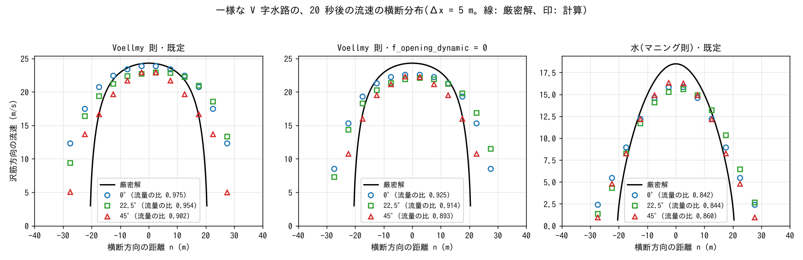

# test/vchannel — 一様な V 字水路の流れの横断分布を、厳密解と比べる(流れの向き 0°・22.5°・45°)

[English](en/README.md)

格子で解像された V 字の谷を流れる流れ(雪崩・土石流・急な渓流)の、**横断方向の流速分布と流量**が、
格子に対する谷の向きによらず正しく出るかを確かめる検定です。一様な勾配の斜面に置いた V 字の水路では、
流れの向きに一様な区間の各列の流速が、自分の流動深だけで決まります。この厳密解と、8 近傍の ENC 格子の計算を、
流れの向きを 0°・22.5°・45° に回して比べます。水(マニング則)と、土砂流動モデルの Voellmy 則
(雪崩の設定の型)の両方を扱います。

塞がれた開口の動的振り替え(`f_opening_dynamic`。[通過幅の調整](../../docs/users_guide/passage_width.md))の
塞がり率が、土砂流動の計算で流動深でなく水深で測られていた不具合(developer.md §130)を見つけた検定で、
その再発を防ぐ役目も持ちます。

## 構成

| 項目 | 値 |
|---|---|
| 地形 | 勾配 S = 0.4 の一様な斜面に、壁の勾配 0.6 の V 字の水路(底は丸める)。基盤の高さ z = 1000 − S s + z_c(n)、z_c(n) = 0.6 (√(n² + 21²) − 21)。s は沢筋に沿う距離、n は横断方向の距離 (m) |
| 流れ | 長さ 600 m の区間に、表面が横断方向に水平になる厚さ max(5 − z_c, 0)(谷底で 4.91 m、幅 40 m)の雪(または水)を置いて、t = 0 に一斉に動かす |
| 格子 | 1400 m × 1400 m、Δx = 5 m(280 × 280)、dt = 0.025 s、20 秒。流れの幅は 8 セル |
| 向き | 沢筋を格子の x 軸に対して 0°・22.5°・45° に回す(`data_r0`・`data_r22p5`・`data_r45`) |
| Voellmy 則 | μ = 0.25、ξ = 1750 m/s²、連行・停止なし、キャリアは雪の厚さの 1 割(`param_voellmy.txt`) |
| 水 | マニングの粗度 n = 0.1(`param_water.txt`) |
| 急勾配の補正 | なし(`f_gravity_correction = 0`。厳密解を水平の流速・鉛直の深さの式で書くため) |

区間の中央(両端からの希薄波が届かない所。20 秒後で s = −150〜100 m)は流れの向きに一様で、流動深 h(n) が
変わらず、横断方向の流れもありません。横断方向の応力を持たない抵抗則では、各列の流速 u(水平)は

```text
Voellmy 則   du/dt = g (S − μ) − g u² / (ξ h)    →  u = u_t tanh(g (S − μ) t / u_t)、 u_t = √(ξ h (S − μ))
マニング則   du/dt = g S − g n² u² / h^(4/3)      →  u = u_n tanh(g S t / u_n)、       u_n = h^(2/3) S^(1/2) / n
```

に従います(独自の整理)。指標は、区間の中央の流量 Q = Σ h u_s Δn(u_s は沢筋方向の流速の成分)の、
厳密解との比です。

| 構成 | 内容 | 向き |
|---|---|---|
| `vo` | Voellmy 則・既定の数値設定 | 0°・22.5°・45° |
| `vo0` | Voellmy 則・`f_opening_dynamic = 0`(V 字の沢の雪崩の例題 snow_avalanche が使う設定) | 0°・22.5°・45° |
| `vo4` | Voellmy 則・4 近傍(`p_diagratio = 0`) | 0° |
| `fr` | 摩擦なし(μ = 1e-4、ξ = 1e9)・1 秒 | 0°・22.5°・45° |
| `w` | 水・既定の数値設定 | 0°・22.5°・45° |
| `w4` | 水・4 近傍 | 0° |

| ファイル | 内容 |
|---|---|
| `make_init.py` | 入力 `data_<向き>/` と、構成ごとの設定 `p_<構成>_<向き>.txt`(2 つのひな形 `param_voellmy.txt`・`param_water.txt` から、向きと上の表の差分だけを差し替える)を書く |
| `Check_vchannel.py` | (1) 摩擦なし: 1 秒後の沢筋方向の流速 ÷ g S t が 0.96〜1.01、(2) 4 近傍・0°: 流量が厳密解の ±2 % 以内、(3) Voellmy 則・既定: 流量の比が 0.86〜1.02 で、向きによる幅(最大 − 最小)/平均が 10 % 以内、(4) Voellmy 則・`f_opening_dynamic = 0`: 0.86〜1.00、幅 5 % 以内、(5) 水・既定: 0.80〜1.00、幅 4 % 以内 |
| `Fig.py` | 下の図 `figs/vchannel.png` |

## 実行

```bash
make
./Run.sh          # 入力の生成 → 実行(14 本)→ Check(4 スレッドで 1 分ほど)
./Run_MPI.sh 4    # MPI。分布出力が逐次とバイト一致
python3 Fig.py    # figs/vchannel.png(引数 en で英語版を en/figs/ に)
```

## 図



20 秒後の、沢筋方向の流速の横断分布(流動深で重み付けた 5 m 幅の平均)。線が厳密解、印が計算(3 つの向き)です。
左: Voellmy 則・既定。中: Voellmy 則・`f_opening_dynamic = 0`。右: 水・既定。厳密解は幅 40 m の中だけに流れが
ありますが、計算では流れが岸へ 1〜2 セル広がり、その分だけ中央の流速が小さく出ます。

## 所見

Δx = 5 m の値です(gfortran 13.3、-Ofast)。

| 指標 | 0° | 22.5° | 45° |
|---|---:|---:|---:|
| (1) 摩擦なし: 流速 ÷ g S t(1 秒後) | 0.995 | 0.994 | 0.990 |
| (3) Voellmy 則・既定: 流量 ÷ 厳密解 | 0.975 | 0.954 | 0.902 |
| (4) Voellmy 則・`f_opening_dynamic = 0`: 流量 ÷ 厳密解 | 0.925 | 0.914 | 0.893 |
| (5) 水・既定: 流量 ÷ 厳密解 | 0.842 | 0.844 | 0.860 |

- **4 近傍・格子に沿う向き**(2)は、Voellmy 則で 0.990、水で 0.995 と、厳密解に合います。直交格子の流束だけの
  計算には横断方向の結合がないので、厳密解と検定の組み方の確認になります。
- **摩擦なしの加速度**(1)は、どの向きでも g S の 1 % 以内です(0.975 が 1 ステップ遅れの分の値)。塞がり率を
  水深で測っていた 2026-11-25 までの計算は、0° で 1.118 になり、重力が与える加速度を 15 % 超えていました。
- **Voellmy 則**の流量は、既定(3)で厳密解の 0.90〜0.98 倍、`f_opening_dynamic = 0`(4)で 0.89〜0.93 倍です。
  向きによる幅は、既定の 8 % に対して、`f_opening_dynamic = 0` では 3 % に収まります。既定の動的振り替えは、
  谷底の列の、軸に沿う向きの通過幅だけを増やすので(谷底の盛り上がりが流動深の 14 %)、0° の流量が
  5 % 大きく出ます。薄い流れほどこの差は大きくなります。
- **水**の流量(5)は厳密解の 0.84〜0.86 倍で、向きによる幅は 2 % です。流量が小さいのは、流れに斜めの辺の
  エッジ水深を上流側の水深で頭打ちする既定(`f_hcap_upwind = 1`)が流れを岸へ広げるためで(流れの幅が
  40 m → 60 m)、格子を細かくすると厳密解に近づきます。

**精度の限界**: 流れの幅が 8 セルのこの水路では、8 近傍の計算の流量は厳密解より 2〜16 % 小さく出ます。誤差は
格子間隔にほぼ比例して縮みます(Δx = 2.5 m で、Voellmy 則・`f_opening_dynamic = 0` が 0.95・0.91(0°・45°)、
水が 0.91・0.93。developer.md §130.2・§130.6)。V 字の沢を進む流れで、谷の向きへの依存を小さくしたいときは、
向きによる幅の小さい `f_opening_dynamic = 0` を使います(例題
[snow_avalanche](../../examples/snow_avalanche/README.md))。平らな谷底と急な谷壁を持つ谷では、0 にすると
谷壁に接する列の通過幅が戻らないので、既定の 3 のままにします([通過幅の調整](../../docs/users_guide/passage_width.md)
§7。例題 debris_fan の土石流での比較は developer.md §130.11)。

## 関連文書

- [通過幅の調整](../../docs/users_guide/passage_width.md)(塞がれた開口の動的振り替えと塞がり率)
- [土石流・斜面崩壊・動く底層の解説](../../docs/users_guide/massflow.md)(Voellmy 則)
- developer.md §130(沢の向きへの依存の原因と、この検定の形)、§68.14・§68.41(動的振り替え)
- [test/vshaped](../vshaped/)(V 字流域の降雨流出を 0° と 45° で理論解と比べる検定)
- [test/volcano](../volcano/)(一様な斜面の Voellmy 則の等流)
